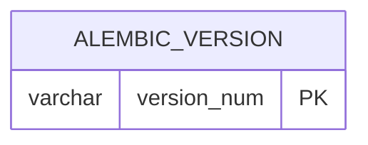

# Database

_Living document – updated whenever a migration is added. Last updated: Phase 0._

**Engine:** PostgreSQL 16 · **Extensions:** `vector` (pgvector) · **Migrations:** Alembic (`backend/alembic/versions/`)

## ER diagram

No application tables yet. Tables are added from Phase 1 onwards.

## Table dictionary

| Table | Column | Type | Constraint | Meaning |
|---|---|---|---|---|
| `alembic_version` | `version_num` | varchar(32) | PK | Id of the latest applied migration (managed by Alembic) |

## Migration history

| Revision | Phase | Description |
|---|---|---|
| `0001` | 0 | Enable the `vector` extension |

## Commands

| Task | Command (run in `backend/`) |
|---|---|
| Apply all migrations | `uv run alembic upgrade head` |
| Undo the last migration | `uv run alembic downgrade -1` |
| Create a migration from model changes | `uv run alembic revision --autogenerate -m "message"` |
| Show current version | `uv run alembic current` |
| Preview SQL without running | `uv run alembic upgrade head --sql` |
