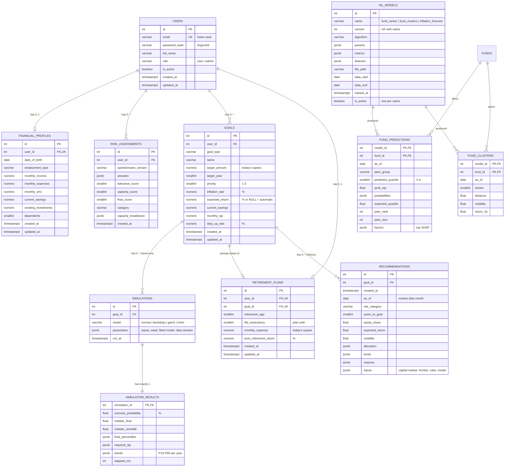
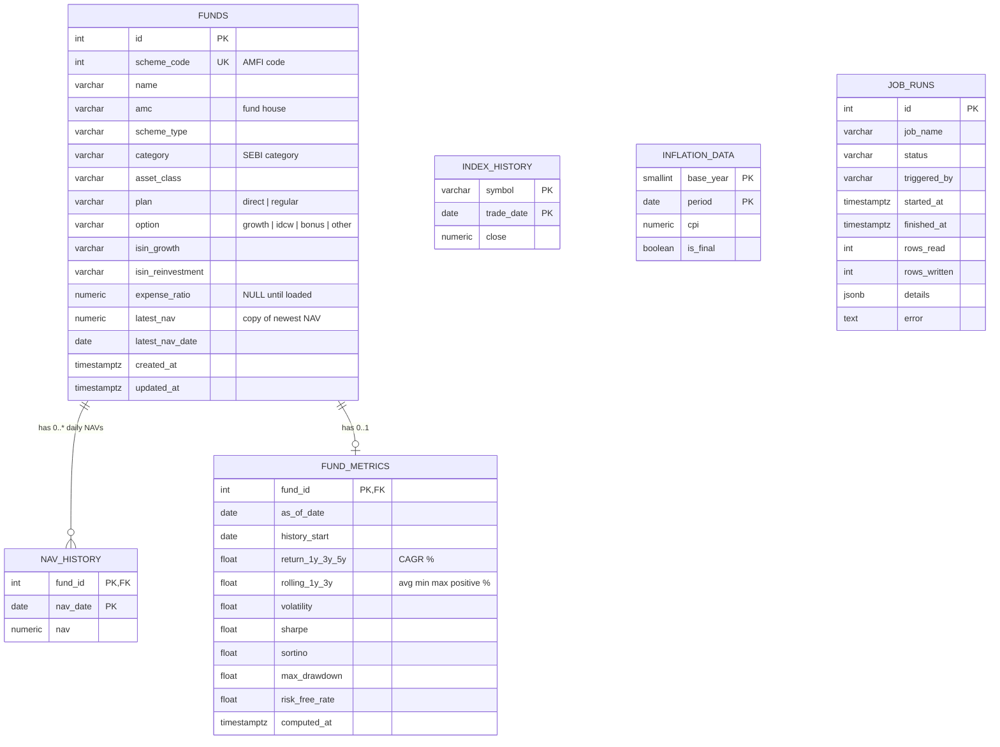

# Database

_Living document – updated whenever a migration is added. Last updated: Phase 8._

**Engine:** PostgreSQL 16 · **Extensions:** `vector` (pgvector) · **Migrations:** Alembic (`backend/alembic/versions/`)

## ER diagram

**Market data (Phase 4)** – not owned by users; filled by the data pipeline.

Conventions: money is `NUMERIC(14,2)`; percentages are `NUMERIC(5,2)` (6.00 = 6%); derived values such as goal projections are computed on read, not stored; timestamps are `timestamptz`; every user-owned table references `users.id` with `ON DELETE CASCADE`; allowed values are enforced with CHECK constraints named `ck_<table>_<rule>`. Market data (Phase 4): time series use a **composite natural primary key** (entity + date) instead of a surrogate id; NAVs are `NUMERIC(18,8)` (AMFI publishes up to 8 decimals); fund metrics are stored as `double precision` because they are derived statistics recomputed nightly (ADR-007). Simulations (Phase 5): a saved run is a **snapshot** (random, depends on market data that changes daily), so its output is stored, unlike goal projections; the question (`simulations`) and the bulky answer (`simulation_results`) are split one-to-one (ADR-008).

## Table dictionary

### `recommendations` (Phase 8) – stored snapshots, many per goal

| Column | Type | Constraint | Meaning |
|---|---|---|---|
| `id` | integer | PK | |
| `goal_id` | integer | FK `goals.id` ON DELETE CASCADE; index `ix_recommendations_goal_created (goal_id, created_at)` | |
| `created_at` | timestamptz | default now() | |
| `as_of` | date | NOT NULL | Last month of market data used |
| `risk_category` | varchar(20) | NULL allowed | Risk profile then (NULL = none, treated as moderate) |
| `years_to_goal` | smallint | NOT NULL | |
| `equity_share`, `expected_return`, `volatility` | double precision | NOT NULL | Fractions |
| `allocation` | jsonb | NOT NULL | Per sleeve: label, weight (%) |
| `funds` | jsonb | NOT NULL | Picks with weight, basis and reason |
| `reasons` | jsonb | NOT NULL | Why this allocation |
| `inputs` | jsonb | NOT NULL | Capital market (assumed returns, measured volatility, correlations), frontier, rules, goal return, fund model version, notes |

### `ml_models` (Phase 7) – model registry, one row per trained version

| Column | Type | Constraint | Meaning |
|---|---|---|---|
| `id` | integer | PK | |
| `name` | varchar(40) | CHECK (fund_ranker, fund_clusters, inflation_forecast); UNIQUE (`name`, `version`) | |
| `version` | integer | NOT NULL | 1, 2, 3 … |
| `algorithm` | varchar(80) | NOT NULL | |
| `params` | jsonb | NOT NULL | Hyper-parameters, or the model itself (cluster scaler and centroids) |
| `metrics` | jsonb | NOT NULL | Validation results, importance, cluster profiles, inflation forecast |
| `features` | jsonb | default `[]` | Input order |
| `file_path` | varchar(255) | NULL allowed | Model file (`backend/data/models/`, not in git) |
| `data_start`, `data_end` | date | NOT NULL | Data window |
| `trained_at` | timestamptz | default now() | |
| `is_active` | boolean | default false; partial unique index `uq_ml_models_one_active` on `name` WHERE `is_active` | One active version per model |

### `fund_predictions` (Phase 7) – the active ranker's view of each fund

| Column | Type | Constraint | Meaning |
|---|---|---|---|
| `model_id`, `fund_id` | integer | PK; FKs ON DELETE CASCADE; index `(model_id, peer_group, expected_quartile)` | |
| `as_of` | date | NOT NULL | Month-end of the features |
| `peer_group` | varchar(30) | NOT NULL | Canonical SEBI category |
| `predicted_quartile` | smallint | CHECK 1–4 | Most likely quartile |
| `prob_top` | double precision | CHECK 0–1 | P(top quartile) |
| `probabilities` | jsonb | NOT NULL | P(Q1) … P(Q4) |
| `expected_quartile` | double precision | NOT NULL | Ranking score (lower = better) |
| `peer_rank`, `peer_size` | integer | NOT NULL | |
| `factors` | jsonb | NOT NULL | Top 5 SHAP factors |

### `fund_clusters` (Phase 7) – behaviour cluster of each fund

| Column | Type | Constraint | Meaning |
|---|---|---|---|
| `model_id`, `fund_id` | integer | PK; FKs ON DELETE CASCADE | |
| `as_of` | date | NOT NULL | |
| `cluster` | smallint | NOT NULL | 0 = least volatile |
| `distance` | double precision | NOT NULL | To the cluster centre (standardised) |
| `volatility`, `return_3y` | double precision | NOT NULL | Scatter coordinates (fractions) |

### `retirement_plans` (Phase 6) – one per user, owning one `retirement` goal

| Column | Type | Constraint | Meaning |
|---|---|---|---|
| `id` | integer | PK | |
| `user_id` | integer | FK `users.id` ON DELETE CASCADE, UNIQUE | One plan per user |
| `goal_id` | integer | FK `goals.id` ON DELETE CASCADE, UNIQUE | The goal holding the savings phase (savings, SIP, step-up, inflation, pre-retirement return); its target (corpus in today's money) and year are written by the planner |
| `retirement_age` | smallint | CHECK 30–80 | |
| `life_expectancy` | smallint | CHECK > retirement_age AND ≤ 105 | Plan until this age |
| `monthly_expense` | numeric(14,2) | CHECK > 0 | Spending in retirement, today's rupees |
| `post_retirement_return` | numeric(5,2) | default 8, CHECK 0–30 | % a year after retiring |
| `created_at`, `updated_at` | timestamptz | default now() | |

### `simulations` (Phase 5) – saved Monte Carlo runs of a goal

| Column | Type | Constraint | Meaning |
|---|---|---|---|
| `id` | integer | PK | |
| `goal_id` | integer | FK `goals.id` ON DELETE CASCADE; index `ix_simulations_goal_id_run_at (goal_id, run_at)` | The goal simulated |
| `model` | varchar(20) | CHECK (normal, bootstrap, garch, hmm) | Return model |
| `parameters` | jsonb | NOT NULL | Resolved inputs after what-if overrides, paths, seed, Phase 3 projection, portfolio volatility, fitted model parameters, market data window |
| `run_at` | timestamptz | default now() | |

### `simulation_results` (Phase 5) – one per simulation (shared primary key)

| Column | Type | Constraint | Meaning |
|---|---|---|---|
| `simulation_id` | integer | PK, FK `simulations.id` ON DELETE CASCADE | One-to-one |
| `success_probability` | double precision | CHECK 0–100 | % of paths that reach the inflated target |
| `median_final` | double precision | NOT NULL | P50 of the value at the goal date (shown in the run list) |
| `median_shortfall` | double precision | NULL allowed | Typical gap of the paths that miss; NULL if none miss |
| `final_percentiles` | jsonb | NOT NULL | P10, P25, P50, P75, P90 and mean at the goal date |
| `required_sip` | jsonb | NOT NULL | Starting SIP for a 50 / 75 / 90% chance |
| `bands` | jsonb | NOT NULL | Per year: P10–P90 and the deterministic projection (the fan chart) |
| `elapsed_ms` | integer | NOT NULL | Fit + simulation time |

### `funds` (Phase 4) – one row per AMFI scheme code

| Column | Type | Constraint | Meaning |
|---|---|---|---|
| `id` | integer | PK | |
| `scheme_code` | integer | UNIQUE | AMFI's code; the natural key every daily file is matched on |
| `name` | varchar(200) | NOT NULL | Scheme name as published |
| `amc` | varchar(120) | index | Fund house (from the AMC line above the rows in NAVAll.txt) |
| `scheme_type` | varchar(30) | | Open Ended / Close Ended / Interval Fund |
| `category` | varchar(120) | index | SEBI category, e.g. "Large Cap Fund" |
| `asset_class` | varchar(20) | CHECK (equity, debt, hybrid, index, etf, fund_of_funds, solution_oriented, other); index | Normalised from AMFI's changing category labels |
| `plan` | varchar(10) | CHECK (direct, regular) | Direct = no distributor commission |
| `option` | varchar(10) | CHECK (growth, idcw, bonus, other) | What happens to gains |
| `isin_growth`, `isin_reinvestment` | varchar(12) | NULL allowed | ISINs ("-" in the file → NULL) |
| `expense_ratio` | numeric(5,2) | NULL allowed | % a year; not loaded yet (AMFI publishes it separately) |
| `latest_nav`, `latest_nav_date` | numeric(18,8), date | CHECK latest_nav > 0 | Copy of the newest NAV (controlled redundancy for the fund list); only ever moves forward in time |
| `created_at`, `updated_at` | timestamptz | default now() | |

### `nav_history` (Phase 4) – one NAV per fund per business day (the largest table)

| Column | Type | Constraint | Meaning |
|---|---|---|---|
| `fund_id` | integer | PK (part 1), FK `funds.id` ON DELETE CASCADE | |
| `nav_date` | date | PK (part 2) | |
| `nav` | numeric(18,8) | CHECK > 0 | Net asset value per unit, ₹ |

The composite primary key prevents duplicate NAVs and its B-tree index (fund_id first) serves the only query on this table: one fund's NAVs between two dates.

### `fund_metrics` (Phase 4) – one row per fund with ≥ 1 year of history

| Column | Type | Meaning |
|---|---|---|
| `fund_id` | integer PK, FK `funds.id` ON DELETE CASCADE | |
| `as_of_date`, `history_start` | date | Latest and first NAV used |
| `return_1y`, `return_3y`, `return_5y` | double, NULL if history too short | Trailing CAGR, % |
| `rolling_1y_avg/min/max/positive`, `rolling_3y_…` | double | Every 1- or 3-year window: average, worst, best, % of windows above 0 |
| `volatility` | double | Annualised std. dev. of the last 36 monthly returns, % |
| `sharpe`, `sortino` | double | Last 3 years, annualised |
| `max_drawdown` | double | Largest peak-to-trough fall in the last 3 years, % (negative) |
| `risk_free_rate` | double NOT NULL | The assumption used for Sharpe/Sortino, % |
| `computed_at` | timestamptz | When a value last changed |

### `index_history` (Phase 4)

| Column | Type | Constraint | Meaning |
|---|---|---|---|
| `symbol` | varchar(30) | PK (part 1) | Yahoo symbol: `^NSEI` Nifty 50, `^CRSLDX` Nifty 500, `NIFTYMIDCAP150.NS` |
| `trade_date` | date | PK (part 2) | |
| `close` | numeric(14,4) | CHECK > 0 | Closing level |

### `inflation_data` (Phase 4)

| Column | Type | Constraint | Meaning |
|---|---|---|---|
| `base_year` | smallint | PK (part 1) | CPI base year (2012 = 100) |
| `period` | date | PK (part 2) | First day of the month |
| `cpi` | numeric(8,2) | CHECK > 0 | All-India Combined General index (MOSPI); inflation is derived on read |
| `is_final` | boolean | default true | False = provisional figure |

### `job_runs` (Phase 4) – the pipeline's log

| Column | Type | Constraint | Meaning |
|---|---|---|---|
| `id` | integer | PK | |
| `job_name` | varchar(40) | index; **partial unique index `uq_job_runs_one_running` on (job_name) WHERE status = 'running'** | daily_nav, backfill_nav, index_history, inflation, fund_metrics |
| `status` | varchar(10) | CHECK (running, success, failed, skipped) | |
| `triggered_by` | varchar(20) | | scheduler / cli / admin |
| `started_at`, `finished_at` | timestamptz | | |
| `rows_read`, `rows_written` | integer | default 0 | Written = inserted or changed (0 on an idempotent re-run) |
| `details` | jsonb | default {} | Data-quality counts (rows skipped and why), latest dates |
| `error` | text | NULL allowed | Exception message of a failed run |

### `goals` (Phase 3) – many per user; inputs only

| Column | Type | Constraint | Meaning |
|---|---|---|---|
| `id` | integer | PK | |
| `user_id` | integer | FK `users.id` ON DELETE CASCADE; index `ix_goals_user_id` | Owner |
| `goal_type` | varchar(20) | CHECK (retirement, education, house, car, marriage, travel, emergency_fund, wealth, other) | Category |
| `name` | varchar(100) | NOT NULL | User's label |
| `target_amount` | numeric(14,2) | CHECK > 0 | Cost in today's rupees |
| `target_year` | smallint | NOT NULL (future year checked by the API) | When the money is needed |
| `priority` | smallint | default 2, CHECK 1–3 | 1 high … 3 low |
| `inflation_rate` | numeric(5,2) | default 6, CHECK 0–20 | % a year |
| `expected_return` | numeric(5,2) | NULL allowed, CHECK 0–30 | % a year; NULL = automatic from the latest risk profile |
| `current_savings` | numeric(14,2) | default 0, ≥ 0 | Already saved for the goal |
| `monthly_sip` | numeric(14,2) | default 0, ≥ 0 | Invested each month now |
| `step_up_rate` | numeric(5,2) | default 0, CHECK 0–50 | Yearly SIP increase, % |
| `created_at`, `updated_at` | timestamptz | default now() | |

### `financial_profiles` (Phase 2) – one per user

| Column | Type | Constraint | Meaning |
|---|---|---|---|
| `id` | integer | PK | |
| `user_id` | integer | FK `users.id` ON DELETE CASCADE, UNIQUE | Owner (one-to-one) |
| `date_of_birth` | date | NOT NULL | Age is computed from it |
| `employment_type` | varchar(20) | CHECK (salaried, self_employed, business_owner, retired, other) | Income stability |
| `monthly_income` | numeric(14,2) | NOT NULL, ≥ 0 | Take-home income |
| `monthly_expenses` | numeric(14,2) | NOT NULL, ≥ 0 | Household spending |
| `monthly_emi` | numeric(14,2) | default 0, ≥ 0 | Loan instalments |
| `current_savings` | numeric(14,2) | default 0, ≥ 0 | Cash and FDs |
| `existing_investments` | numeric(14,2) | default 0, ≥ 0 | Mutual funds, shares, PPF, EPF |
| `dependents` | smallint | default 0, CHECK 0–20 | People relying on the income |
| `created_at`, `updated_at` | timestamptz | default now() | |

### `risk_assessments` (Phase 2) – history, one row per questionnaire

| Column | Type | Constraint | Meaning |
|---|---|---|---|
| `id` | integer | PK | |
| `user_id` | integer | FK `users.id` ON DELETE CASCADE; index `(user_id, created_at)` | Owner |
| `questionnaire_version` | varchar(10) | NOT NULL | e.g. `v1` |
| `answers` | jsonb | NOT NULL | `{question_id: option_id}` |
| `tolerance_score` | smallint | CHECK 0–100 | Willingness |
| `capacity_score` | smallint | CHECK 0–100 | Ability |
| `final_score` | smallint | CHECK 0–100 | min(tolerance, capacity) |
| `category` | varchar(20) | CHECK (conservative, moderate, aggressive) | Result |
| `capacity_breakdown` | jsonb | NOT NULL | Snapshot of each factor's value and points |
| `created_at` | timestamptz | default now() | |

### `users` (Phase 1)

| Column | Type | Constraint | Meaning |
|---|---|---|---|
| `id` | integer | PK | User id; the JWT `sub` claim |
| `email` | varchar(255) | NOT NULL, UNIQUE (`ix_users_email`) | Login name, stored lower-case |
| `password_hash` | varchar(255) | NOT NULL | Argon2id hash with embedded salt |
| `full_name` | varchar(120) | NOT NULL | Display name |
| `role` | varchar(20) | NOT NULL, default `'user'`, CHECK `ck_users_role` | `user` or `admin` |
| `is_active` | boolean | NOT NULL, default `true` | Disabled accounts cannot log in |
| `created_at` | timestamptz | NOT NULL, default `now()` | Creation time |
| `updated_at` | timestamptz | NOT NULL, default `now()` | Last update time |

### `alembic_version` (Phase 0)

| Column | Type | Constraint | Meaning |
|---|---|---|---|
| `version_num` | varchar(32) | PK | Id of the latest applied migration (managed by Alembic) |

## Migration history

| Revision | Phase | Description |
|---|---|---|
| `0001` | 0 | Enable the `vector` extension |
| `0002` | 1 | Create `users` table with unique email index and role check |
| `0003` | 2 | Create `financial_profiles` and `risk_assessments` |
| `0004` | 3 | Create `goals` |
| `0005` | 4 | Create `funds`, `nav_history`, `fund_metrics`, `index_history`, `inflation_data`, `job_runs` |
| `0006` | 5 | Create `simulations` and `simulation_results` |
| `0007` | 6 | Create `retirement_plans` |
| `0008` | 7 | Create `ml_models`, `fund_predictions`, `fund_clusters` |
| `0009` | 8 | Create `recommendations` |

## Databases

| Database | Purpose |
|---|---|
| `goalwise` | Development data |
| `goalwise_test` | Created automatically by the test suite; rebuilt from migrations each run |

## Commands

| Task | Command (run in `backend/`) |
|---|---|
| Apply all migrations | `uv run alembic upgrade head` |
| Undo the last migration | `uv run alembic downgrade -1` |
| Create a migration from model changes | `uv run alembic revision --autogenerate --rev-id NNNN -m "message"` |
| Show current version | `uv run alembic current` |
| Preview SQL without running | `uv run alembic upgrade head --sql` |
| Open a SQL shell | `docker exec -it goalwise-db psql -U goalwise -d goalwise` |
