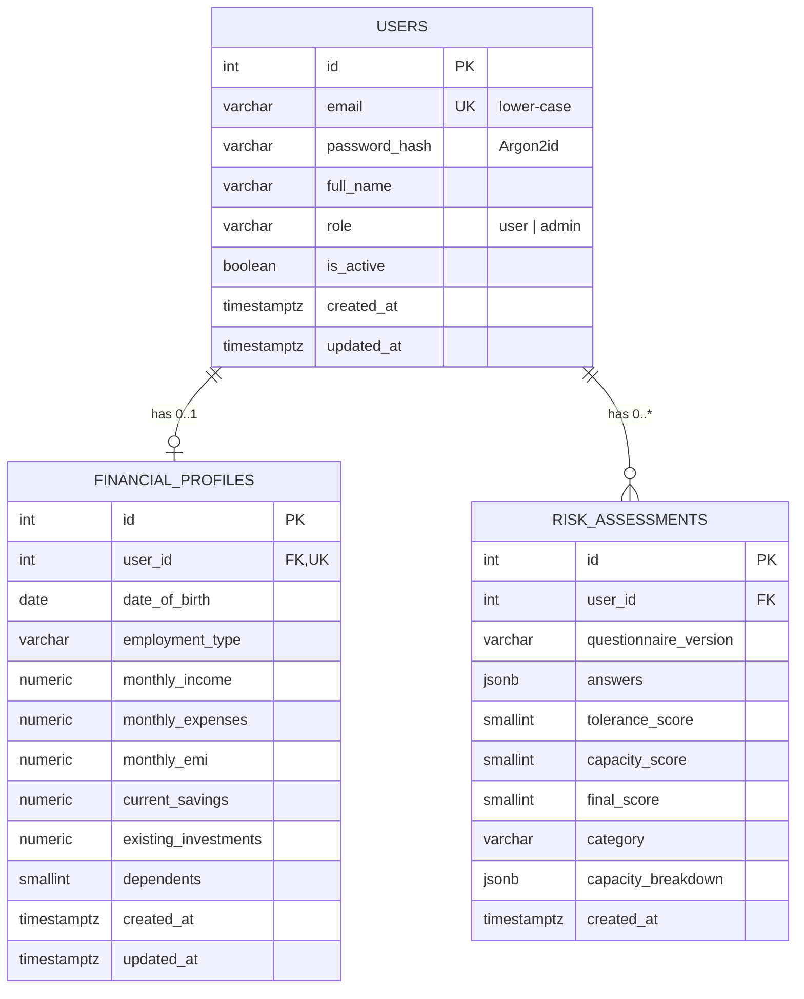

# Database

_Living document – updated whenever a migration is added. Last updated: Phase 2._

**Engine:** PostgreSQL 16 · **Extensions:** `vector` (pgvector) · **Migrations:** Alembic (`backend/alembic/versions/`)

## ER diagram

Conventions: money is `NUMERIC(14,2)`; timestamps are `timestamptz`; every user-owned table references `users.id` with `ON DELETE CASCADE`; allowed values are enforced with CHECK constraints named `ck_<table>_<rule>`.

## Table dictionary

### `financial_profiles` (Phase 2) – one per user

| Column | Type | Constraint | Meaning |
|---|---|---|---|
| `id` | integer | PK | |
| `user_id` | integer | FK `users.id` ON DELETE CASCADE, UNIQUE | Owner (one-to-one) |
| `date_of_birth` | date | NOT NULL | Age is computed from it |
| `employment_type` | varchar(20) | CHECK (salaried, self_employed, business_owner, retired, other) | Income stability |
| `monthly_income` | numeric(14,2) | NOT NULL, ≥ 0 | Take-home income |
| `monthly_expenses` | numeric(14,2) | NOT NULL, ≥ 0 | Household spending |
| `monthly_emi` | numeric(14,2) | default 0, ≥ 0 | Loan instalments |
| `current_savings` | numeric(14,2) | default 0, ≥ 0 | Cash and FDs |
| `existing_investments` | numeric(14,2) | default 0, ≥ 0 | Mutual funds, shares, PPF, EPF |
| `dependents` | smallint | default 0, CHECK 0–20 | People relying on the income |
| `created_at`, `updated_at` | timestamptz | default now() | |

### `risk_assessments` (Phase 2) – history, one row per questionnaire

| Column | Type | Constraint | Meaning |
|---|---|---|---|
| `id` | integer | PK | |
| `user_id` | integer | FK `users.id` ON DELETE CASCADE; index `(user_id, created_at)` | Owner |
| `questionnaire_version` | varchar(10) | NOT NULL | e.g. `v1` |
| `answers` | jsonb | NOT NULL | `{question_id: option_id}` |
| `tolerance_score` | smallint | CHECK 0–100 | Willingness |
| `capacity_score` | smallint | CHECK 0–100 | Ability |
| `final_score` | smallint | CHECK 0–100 | min(tolerance, capacity) |
| `category` | varchar(20) | CHECK (conservative, moderate, aggressive) | Result |
| `capacity_breakdown` | jsonb | NOT NULL | Snapshot of each factor's value and points |
| `created_at` | timestamptz | default now() | |

### `users` (Phase 1)

| Column | Type | Constraint | Meaning |
|---|---|---|---|
| `id` | integer | PK | User id; the JWT `sub` claim |
| `email` | varchar(255) | NOT NULL, UNIQUE (`ix_users_email`) | Login name, stored lower-case |
| `password_hash` | varchar(255) | NOT NULL | Argon2id hash with embedded salt |
| `full_name` | varchar(120) | NOT NULL | Display name |
| `role` | varchar(20) | NOT NULL, default `'user'`, CHECK `ck_users_role` | `user` or `admin` |
| `is_active` | boolean | NOT NULL, default `true` | Disabled accounts cannot log in |
| `created_at` | timestamptz | NOT NULL, default `now()` | Creation time |
| `updated_at` | timestamptz | NOT NULL, default `now()` | Last update time |

### `alembic_version` (Phase 0)

| Column | Type | Constraint | Meaning |
|---|---|---|---|
| `version_num` | varchar(32) | PK | Id of the latest applied migration (managed by Alembic) |

## Migration history

| Revision | Phase | Description |
|---|---|---|
| `0001` | 0 | Enable the `vector` extension |
| `0002` | 1 | Create `users` table with unique email index and role check |
| `0003` | 2 | Create `financial_profiles` and `risk_assessments` |

## Databases

| Database | Purpose |
|---|---|
| `goalwise` | Development data |
| `goalwise_test` | Created automatically by the test suite; rebuilt from migrations each run |

## Commands

| Task | Command (run in `backend/`) |
|---|---|
| Apply all migrations | `uv run alembic upgrade head` |
| Undo the last migration | `uv run alembic downgrade -1` |
| Create a migration from model changes | `uv run alembic revision --autogenerate --rev-id NNNN -m "message"` |
| Show current version | `uv run alembic current` |
| Preview SQL without running | `uv run alembic upgrade head --sql` |
| Open a SQL shell | `docker exec -it goalwise-db psql -U goalwise -d goalwise` |
