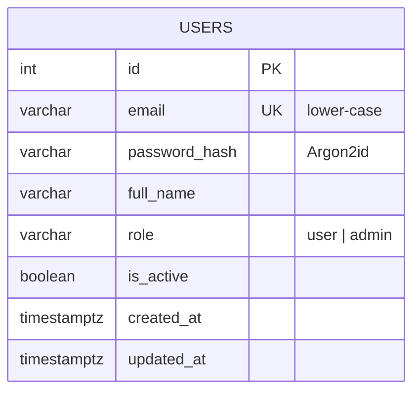

# Database

_Living document – updated whenever a migration is added. Last updated: Phase 1._

**Engine:** PostgreSQL 16 · **Extensions:** `vector` (pgvector) · **Migrations:** Alembic (`backend/alembic/versions/`)

## ER diagram

Relationships are added from Phase 2 onwards (every user-owned table will reference `users.id`).

## Table dictionary

### `users` (Phase 1)

| Column | Type | Constraint | Meaning |
|---|---|---|---|
| `id` | integer | PK | User id; the JWT `sub` claim |
| `email` | varchar(255) | NOT NULL, UNIQUE (`ix_users_email`) | Login name, stored lower-case |
| `password_hash` | varchar(255) | NOT NULL | Argon2id hash with embedded salt |
| `full_name` | varchar(120) | NOT NULL | Display name |
| `role` | varchar(20) | NOT NULL, default `'user'`, CHECK `ck_users_role` | `user` or `admin` |
| `is_active` | boolean | NOT NULL, default `true` | Disabled accounts cannot log in |
| `created_at` | timestamptz | NOT NULL, default `now()` | Creation time |
| `updated_at` | timestamptz | NOT NULL, default `now()` | Last update time |

### `alembic_version` (Phase 0)

| Column | Type | Constraint | Meaning |
|---|---|---|---|
| `version_num` | varchar(32) | PK | Id of the latest applied migration (managed by Alembic) |

## Migration history

| Revision | Phase | Description |
|---|---|---|
| `0001` | 0 | Enable the `vector` extension |
| `0002` | 1 | Create `users` table with unique email index and role check |

## Databases

| Database | Purpose |
|---|---|
| `goalwise` | Development data |
| `goalwise_test` | Created automatically by the test suite; rebuilt from migrations each run |

## Commands

| Task | Command (run in `backend/`) |
|---|---|
| Apply all migrations | `uv run alembic upgrade head` |
| Undo the last migration | `uv run alembic downgrade -1` |
| Create a migration from model changes | `uv run alembic revision --autogenerate --rev-id NNNN -m "message"` |
| Show current version | `uv run alembic current` |
| Preview SQL without running | `uv run alembic upgrade head --sql` |
| Open a SQL shell | `docker exec -it goalwise-db psql -U goalwise -d goalwise` |
