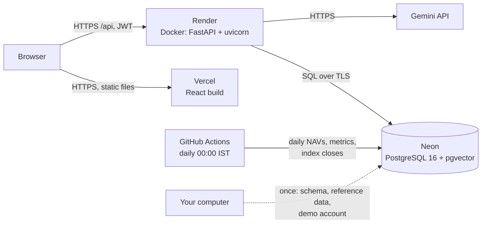

# Deploying GoalWise

GoalWise runs on three free services:

- **Vercel** serves the React app.
- **Render** runs the FastAPI backend in a Docker container.
- **Neon** hosts PostgreSQL with pgvector.

A scheduled GitHub Actions workflow keeps the market data current.

This guide takes about an hour the first time. Most of that is waiting for the data copy and the first builds.



## 1. What the free plans give (checked 18 October 2026)

| Service | Free plan | What it means for GoalWise |
|---|---|---|
| [Render](https://render.com/docs/free) web service | 512 MB memory, 0.1 CPU, 750 hours a month. Sleeps after 15 minutes without traffic and takes about a minute to wake. Files written at run time are lost on restart. No free cron jobs. | The first visit after a break waits for the API. The app shows a "waking up the server" screen (`ServerGate`). One Monte Carlo run at a time (`SIMULATION_CONCURRENCY=1`). The data refresh runs on GitHub instead. |
| Render PostgreSQL | Expires 30 days after creation | **Not used.** The database lives on Neon. |
| [Neon](https://neon.com/pricing) | 1 GB storage per project, 100 compute-hours a month. Sleeps after 5 idle minutes. pgvector included. No time limit. | The reference data takes about 190 MB. `DATABASE_CONNECT_TIMEOUT=15` covers Neon waking up. |
| [Vercel](https://vercel.com/docs/environment-variables) Hobby | Static hosting with a build on every push | Environment variables are read at **build** time. After changing `VITE_API_BASE_URL`, redeploy. |
| Gemini API (Google AI Studio) | About 20 requests a day per model on the free tier (measured in Phase 12) | Render uses the Flash-Lite models, which have their own quota. Without a key, the assistant is switched off and the rest of the app works. |

Free terms change, so check them again before the viva.

## 2. Before you start

- The repository is on GitHub, and `main` passes CI.
- Your local database is running (`docker compose up -d`) and holds the market data (Phase 4) and the ML outputs (Phase 7). The admin page's data-jobs tab shows when each job last ran.
- You can sign in to GitHub. You will create the Neon, Render and Vercel accounts yourself (each offers "Sign in with GitHub"). Secrets are typed only into those dashboards, never into the repository.

Commands below are for **PowerShell** on Windows, run from the `backend` folder. For Git Bash, write `export NAME="value"` instead of `$env:NAME = "value"`.

## 3. Neon: create the database

1. Go to [neon.com](https://neon.com) and click **Sign up**. Create a project named `goalwise`:
   - Postgres version **16**, the same as the local Docker image and CI.
   - Region **AWS Asia Pacific (Singapore)**, the same region as the Render service.
2. On the project dashboard, click **Connect**.
   - Turn **Connection pooling off**, so you get the *direct* connection string. The host name has no `-pooler`. psycopg prepares repeated statements, and a transaction-mode pooler does not support that.
   - Copy the string. It looks like `postgresql://neondb_owner:…@ep-….ap-southeast-1.aws.neon.tech/neondb?sslmode=require`.
   - GoalWise accepts it as it is. `postgres://` and `postgresql://` are turned into SQLAlchemy's `postgresql+psycopg://`.
3. Create the tables. Alembic runs all 12 migrations, including `CREATE EXTENSION vector`:

   ```powershell
   $env:DATABASE_URL = "<Neon connection string>"
   uv run alembic upgrade head
   ```

4. Copy the reference data from your local database:
   - funds, 2.5 million NAVs, metrics, index closes, inflation;
   - ML models, predictions and clusters;
   - the knowledge base with its embeddings.

   User accounts are never copied. Open a **new** terminal, so that `DATABASE_URL` is your local database again:

   ```powershell
   uv run python -m app.deploy copy-data --target "<Neon connection string>"
   ```

   It streams with PostgreSQL's `COPY` and prints each table's row count. Locally this took 90 seconds; over the internet, allow 5–15 minutes. The command refuses to run in two cases:
   - when the two databases are at different migrations;
   - when Neon already holds reference data. To copy again, add `--replace`.

## 4. The demo account

Create the demo account in Neon. Choose the password yourself (at least 8 characters, with a letter and a digit) and keep it with your viva notes:

```powershell
$env:DATABASE_URL = "<Neon connection string>"
$env:DEMO_PASSWORD = "<a password you choose>"
uv run python -m app.deploy demo-user
```

This creates `demo@example.com`, a household with:

- a profile and a moderate risk profile;
- three goals and a retirement plan;
- about three years of SIPs in real funds;
- a recommendation for every goal.

One goal is off track and one has drifted from its recommended mix, so the dashboard has something to explain. Without `DEMO_PASSWORD`, a random password is printed once.

- **The morning of the viva:** run the same command with `--reset`. It deletes the account (and anything visitors changed) and builds it again with dates relative to that day.
- **Administrator:** after the site is live, sign up with your own e-mail, then run `uv run python -m app.admin make-admin <your e-mail>` with `DATABASE_URL` pointing at Neon. Keep the public demo account an ordinary user.

## 5. Render: deploy the API

1. Go to [render.com](https://render.com) and sign up with GitHub. Click **New → Blueprint** and pick the GoalWise repository. Render reads [`render.yaml`](../render.yaml):
   - a free Docker web service `goalwise-api` in Singapore;
   - built from `backend/Dockerfile`, with health checks on `/api/health`;
   - deployed from `main` once GitHub CI has passed (`autoDeployTrigger: checksPass`).
2. Render asks for the values marked `sync: false`:

   | Variable | Value |
   |---|---|
   | `DATABASE_URL` | the Neon connection string |
   | `CORS_ORIGINS` | for now `https://example.com`; the Vercel address goes here in step 7 |
   | `CORS_ORIGIN_REGEX` | leave empty (or see step 7) |
   | `GEMINI_API_KEY` | your Google AI Studio key, or empty to switch the assistant off |

   Render generates `JWT_SECRET_KEY` itself. The other settings come from the blueprint:
   - `ENVIRONMENT=production`, which refuses to start with the development JWT secret;
   - the Flash-Lite models;
   - `SIMULATION_CONCURRENCY=1`;
   - `SCHEDULER_ENABLED=false`.
3. Click **Apply**. The first build takes about 5–10 minutes. Each start runs `alembic upgrade head` (a no-op when the database is up to date) and then one uvicorn worker.
4. Open `https://goalwise-api.onrender.com/api/health` (Render shows the exact address). You should see `"status":"ok"`, `"environment":"production"` and `"pgvector":true`. The interactive API documentation is at `/docs`.

## 6. Vercel: deploy the frontend

1. Go to [vercel.com](https://vercel.com) and sign up with GitHub. Click **Add New → Project** and import the repository.
2. Set **Root Directory** to `frontend`. Vercel detects Vite; [`frontend/vercel.json`](../frontend/vercel.json) sets:
   - the build command and the output folder;
   - the single-page-app rewrite, so `/goals/3/progress` loads on refresh;
   - long caching for hashed assets;
   - security headers.
3. Under **Environment Variables**, add `VITE_API_BASE_URL` with the Render address, for example `https://goalwise-api.onrender.com`. Use no trailing slash and no `/api`.
4. Click **Deploy**. Note the production address, for example `https://goalwise.vercel.app`.

## 7. Connect the two: CORS

Back in Render, open **goalwise-api → Environment**:

- Set `CORS_ORIGINS` to the Vercel production address, for example `https://goalwise.vercel.app`. Use exactly the origin: scheme and host, no path, no trailing slash.
- Optional, for Vercel preview deployments: set `CORS_ORIGIN_REGEX` to `https://goalwise-[a-z0-9-]+\.vercel\.app`, with your project name in place of `goalwise`. The pattern must match the whole origin, so look-alike domains do not pass.

Save. Render redeploys within a minute or two.

## 8. Daily data refresh

Free Render services sleep, so the in-process scheduler would miss its times. [`.github/workflows/data-refresh.yml`](../.github/workflows/data-refresh.yml) runs at 00:00 India time, after AMFI publishes the day's NAVs. It runs:

- `daily_nav`, then `fund_metrics`;
- `index_history`;
- `inflation`, allowed to fail.

It stays off until you switch it on. In GitHub, open **Settings → Secrets and variables → Actions**:

1. **Secrets → New repository secret:** `PRODUCTION_DATABASE_URL` = the Neon connection string.
2. **Variables → New repository variable:** `DATA_REFRESH` = `on`.
3. Under **Actions → Data refresh → Run workflow**, run it once and check that it goes green.

ML scoring is not part of the refresh. The free API has no room for training, and predictions are monthly. To score again, run `uv run python -m app.ml score` locally, then `copy-data --table fund_predictions --table fund_clusters --replace` (models and metrics stay as they are).

## 9. Check the deployment

| Check | Expected |
|---|---|
| Open the Vercel address after 15+ idle minutes | "Waking up the server…", then the login page within about a minute |
| Log in as the demo account | Dashboard: 5 steps done, an off-track and a rebalancing alert |
| Goals → Simulate (each model) | Fan chart. A second click while one runs waits instead of failing. |
| Retirement → Simulate | Lifetime chart |
| Portfolio | Holdings, XIRR, goal cards |
| Download my plan (PDF) | A PDF opens |
| Assistant: "Am I on track for my car?" | Streamed answer with tool chips. If not configured: "assistant switched off". |
| Your own account after `make-admin` | Admin menu: overview, users, audit log, jobs, models |
| Browser developer tools → Console | No CORS errors |

Send Claude the two addresses to have these checked in a browser.

## 10. Troubleshooting

| Symptom | Cause and fix |
|---|---|
| Console: *blocked by CORS policy* | `CORS_ORIGINS` on Render does not match the Vercel origin exactly (https, no trailing slash). Fix it and wait for the redeploy. |
| Render log: `JWT_SECRET_KEY must be set in production` | The blueprint's generated value was removed. Add `JWT_SECRET_KEY` (any long random string) in Render → Environment. |
| Render log: `connection to server … timeout` | Wrong Neon string, the pooled string, or Neon still waking up. Use the direct string; `DATABASE_CONNECT_TIMEOUT` is 15 seconds. |
| `Out of memory (used over 512Mi)` in Render events | Something raised `SIMULATION_CONCURRENCY` above 1. Set it back. |
| The page loads but every request goes to `/api/...` on vercel.app | `VITE_API_BASE_URL` was missing at build time. Add it and **redeploy** in Vercel. |
| Assistant: "rate limit" | The free Gemini quota for the day is used up. It resets daily; for the viva, keep questions few or enable billing. |
| Data refresh job fails | Open the run's log. A source outage (AMFI, NSE, MOSPI) fixes itself the next day; the other jobs still ran. |

## 11. Security notes

- Secrets live only in the Render, Vercel and GitHub dashboards and in your git-ignored `backend/.env`. The repository has none.
  - `render.yaml` marks them `sync: false`.
  - Render generates the JWT secret.
  - Before every commit, check that no `AIzaSy…` key slipped in.
- The API accepts browser calls only from the Vercel origin (and the optional preview pattern).
- The container runs as an unprivileged user.
- Traffic is HTTPS end to end: Vercel and Render terminate TLS, and Neon requires `sslmode=require`.
- The demo account is not an administrator. `--reset` wipes whatever visitors did to it.
