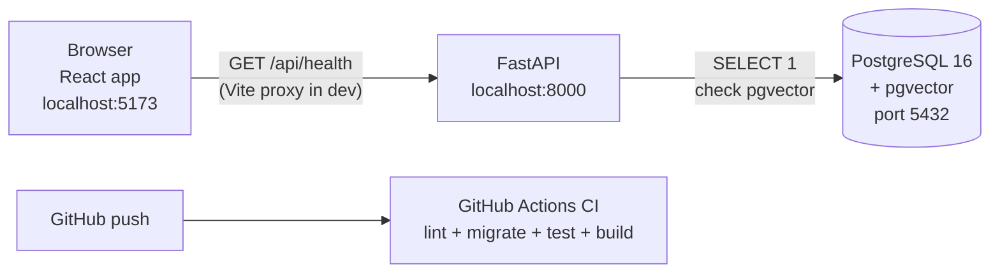

# Phase 0 – Setup and Foundations

| | |
|---|---|
| Branch | `phase-00-setup` |
| Tag | `v0.0.1` |
| Dates | 2026-10-10 |
| Merge | `phase-00-setup` merged into `main` with a merge commit (no PR: GitHub CLI not installed yet) |
| Synopsis objective(s) covered | Foundation for all objectives (no user feature yet) |

## 1. Summary

Phase 0 builds the empty skeleton of GoalWise and proves that its three layers talk to each other:

```
React page (browser)  →  FastAPI backend  →  PostgreSQL database
```

The user cannot plan any goals yet. What exists is a **System status** page that calls the backend; the backend checks the database and reports back. Every later phase adds features on top of this wiring. Every push to GitHub is now automatically tested (Continuous Integration).

## 2. Why this phase

If the layers are wired wrongly, every later feature breaks in confusing ways. Getting configuration, the database connection, migrations, cross-origin rules and CI right *once*, before any business logic, means later phases only add features, not plumbing.

## 3. What was added

### 3.0 Big picture



| Layer | Technology (version installed) | Lives in |
|---|---|---|
| Frontend | React 19.3, TypeScript 6.0, Vite 8.3, Tailwind CSS 4.3, React Router 8.4, TanStack Query 5.104, axios 1.20 | `frontend/` |
| Backend | Python 3.12.15, FastAPI 0.141, Uvicorn 0.53, Pydantic 2.11, pydantic-settings 2.15 | `backend/app/` |
| Database access | SQLAlchemy 2.1 (ORM), psycopg 3.3 (driver), Alembic 1.20 (migrations) | `backend/app/core/`, `backend/alembic/` |
| Database | PostgreSQL 16 + pgvector, run in Docker (`pgvector/pgvector:pg16`) | `docker-compose.yml` |
| Quality | pytest 9.1, ruff 0.17 (Python lint/format), oxlint 1.87 (TS lint), GitHub Actions | `backend/tests/`, `.github/workflows/` |
| Package managers | `uv` (Python), `npm` (JavaScript) | `backend/pyproject.toml` + `uv.lock`, `frontend/package.json` + `package-lock.json` |

### 3.1 Database

No application tables yet. Two things were added:

| Item | What it is | Why |
|---|---|---|
| `docker-compose.yml` | Runs PostgreSQL 16 with the pgvector extension in a Docker container; user/password/db = `goalwise`; data kept in a named volume `pgdata` | One command gives every developer (and CI) the identical database. Installing pgvector natively on Windows is difficult. |
| Migration `0001_enable_pgvector` | `CREATE EXTENSION IF NOT EXISTS vector` | pgvector stores the embeddings the chatbot uses in Phase 10. Enabling it now verifies the database image is correct from day one. |
| Table `alembic_version` | Created automatically by Alembic; holds the id of the latest migration applied (`0001`) | Lets Alembic know which migrations still need to run. |

**What Alembic does:** a migration is a small Python file describing a schema change (`upgrade`) and how to undo it (`downgrade`). `alembic upgrade head` applies every migration not yet applied, in order. The database schema is therefore **version-controlled in Git** like code, and any machine can rebuild it exactly.

SQL generated by `alembic upgrade head --sql`:

```sql
CREATE TABLE alembic_version (version_num VARCHAR(32) NOT NULL, CONSTRAINT alembic_version_pkc PRIMARY KEY (version_num));
CREATE EXTENSION IF NOT EXISTS vector;
INSERT INTO alembic_version (version_num) VALUES ('0001');
```

### 3.2 Backend

| File | Responsibility |
|---|---|
| `backend/pyproject.toml` | Project definition: Python 3.12, dependencies, ruff and pytest settings |
| `backend/uv.lock` | Exact version of every package (direct and indirect), so CI and other machines install the identical set |
| `backend/.env.example` | Names of the environment variables the app reads (copied to `.env`, which is git-ignored) |
| `app/main.py` | Creates the FastAPI app, adds the CORS middleware, registers all routes |
| `app/core/config.py` | `Settings` class: reads `APP_NAME`, `ENVIRONMENT`, `DATABASE_URL`, `CORS_ORIGINS` from env/.env with defaults; `get_settings()` caches one instance |
| `app/core/database.py` | Creates the SQLAlchemy **engine** (connection pool, 3-second connect timeout, `pool_pre_ping` to drop dead connections), the **session factory**, the `Base` class every model will inherit, and `get_db()` (one session per request, always closed) |
| `app/models/__init__.py` | Will import every ORM model so Alembic can see them (empty for now) |
| `app/schemas/health.py` | Pydantic models `DatabaseStatus` and `HealthResponse` – the exact JSON shape the endpoint returns |
| `app/services/health.py` | `check_database()`: runs `SELECT 1`, then checks `pg_extension` for `vector`; returns `connected=False` with the error type instead of crashing |
| `app/api/routes/health.py` | The `GET /api/health` endpoint |
| `app/api/router.py` | Collects all route modules under the `/api` prefix |
| `alembic.ini`, `alembic/env.py` | Alembic configuration; `env.py` takes the database URL from the app's settings (one source of truth) and the table definitions from `Base.metadata` |
| `alembic/versions/0001_enable_pgvector.py` | First migration (above) |
| `tests/test_health.py` | 3 tests: status `ok` when DB is up, `degraded` when down, CORS header present for the frontend origin |
| `tests/test_database.py` | Real-database test: connects and asserts pgvector exists. Skipped automatically if PostgreSQL isn't running; always runs in CI |

**Endpoint added**

| Method | Path | Auth | Request | Response | Purpose |
|---|---|---|---|---|---|
| GET | `/api/health` | None | – | `HealthResponse` (below) | Shows the API is running and whether it can reach the database |

```json
{
  "status": "ok",
  "app": "GoalWise API",
  "version": "0.0.1",
  "environment": "development",
  "database": { "connected": true, "pgvector": true, "error": null }
}
```

FastAPI also generates interactive API documentation automatically at **http://localhost:8000/docs** (Swagger UI) from the Pydantic schemas and type hints.

**Layering introduced** (every later feature follows it):

| Layer | Folder | Rule |
|---|---|---|
| Route | `api/routes/` | HTTP only: receive request, call a service, return a schema |
| Schema | `schemas/` | Pydantic: validates input and shapes output |
| Service | `services/` | Business logic; no HTTP code |
| Model | `models/` | SQLAlchemy classes = database tables |
| Core | `core/` | Settings, database connection, (later) security |

### 3.3 Frontend

| File | Responsibility |
|---|---|
| `package.json`, `package-lock.json` | Dependencies and scripts: `dev`, `build`, `lint`, `preview` |
| `vite.config.ts` | Vite dev server on `127.0.0.1:5173`; React and Tailwind plugins; **proxy** forwarding `/api/*` to `http://127.0.0.1:8000` |
| `index.html` | Single HTML page; React mounts into `<div id="root">` |
| `src/main.tsx` | Entry point: creates the TanStack Query client and renders the router |
| `src/router.tsx` | Route table: `/` → `HomePage`, wrapped in `Layout` |
| `src/index.css` | Imports Tailwind CSS |
| `src/components/Layout.tsx` | Page shell: header with the GoalWise name, `<Outlet/>` where each page renders |
| `src/api/client.ts` | One shared axios instance; base URL from `VITE_API_BASE_URL` (empty in dev because of the proxy) |
| `src/api/health.ts` | `HealthResponse` TypeScript type (mirrors the backend Pydantic schema) and `getHealth()` |
| `src/hooks/useHealth.ts` | TanStack Query hook: fetches health, caches it, refreshes every 15 s |
| `src/pages/HomePage.tsx` | System status card: Frontend / Backend / Database / pgvector, each green or red |
| `src/vite-env.d.ts` | Type declaration for `VITE_API_BASE_URL` |
| `.env.example` | `VITE_API_BASE_URL=` (set to the deployed API URL in production) |

**Folder convention** for later phases: `api/` = functions that call the backend, `hooks/` = TanStack Query hooks wrapping them, `pages/` = one per route, `components/` = reusable pieces, `store/` = auth state (Phase 1).

### 3.4 Integration and orchestration

How one request travels through the system:

```mermaid
sequenceDiagram
    participant P as HomePage (React)
    participant Q as useHealth (TanStack Query)
    participant V as Vite dev proxy :5173
    participant R as FastAPI route /api/health
    participant S as check_database()
    participant DB as PostgreSQL :5432
    P->>Q: render → useHealth()
    Q->>V: axios GET /api/health
    V->>R: forward to 127.0.0.1:8000/api/health
    R->>S: dependency injection (Depends)
    S->>DB: SELECT 1; SELECT EXISTS(... extname='vector')
    DB-->>S: 1, true
    S-->>R: DatabaseStatus(connected, pgvector)
    R-->>V: 200 JSON HealthResponse
    V-->>Q: JSON
    Q-->>P: data → green/red rows
```

Key integration points:

| Concern | How it is handled |
|---|---|
| Frontend → backend in development | Vite **proxy**: the browser only talks to `:5173`, so no cross-origin request happens |
| Frontend → backend in production | Browser calls the API domain directly → backend **CORS** middleware allows only origins listed in `CORS_ORIGINS` |
| Backend → database | `DATABASE_URL` env variable → SQLAlchemy engine (connection pool) → psycopg driver |
| Same data shape on both sides | Pydantic `HealthResponse` (backend) ↔ TypeScript `HealthResponse` (frontend) |
| Database schema changes | Only through Alembic migrations, never by hand |
| Configuration and secrets | `.env` files (git-ignored); `.env.example` documents the names |
| Every push | GitHub Actions: backend job starts a real pgvector database, runs `ruff`, `alembic upgrade head`, `pytest`; frontend job runs `npm ci`, `oxlint`, `tsc` + `vite build` |

### 3.5 Repository and tooling files

| File | Purpose |
|---|---|
| `.github/workflows/ci.yml` | CI pipeline (above) |
| `.gitignore` | Keeps out `.env`, `.venv`, `node_modules`, build output, ML artefacts, the university PDF |
| `.gitattributes` | Stores all text files with LF line endings so Windows and Linux (CI) agree |
| `docs/` | Project plan, this document, architecture, database, API, decision records |

## 4. Key logic explained

**Health check degrading instead of failing.** `check_database()` catches `SQLAlchemyError` and returns `connected=false` with the error class name (e.g. `OperationalError`). The endpoint still returns HTTP 200 with `"status": "degraded"`. This way the frontend can show *which* part is down, instead of just "error".

**Dependency injection.** The endpoint declares `database: DatabaseStatus = Depends(check_database)`. FastAPI calls `check_database()` before the endpoint runs and passes in the result. In tests, `app.dependency_overrides[check_database]` swaps it for a fake – that is how the tests check both the `ok` and `degraded` cases without a database.

**Settings caching.** `get_settings()` is decorated with `@lru_cache`, so `.env` is read once, not on every request.

## 5. Design decisions

Full reasoning is in `docs/decisions/`.

| Decision | Alternatives considered | Why this choice |
|---|---|---|
| FastAPI + React (ADR-001) | Django templates, Flask, Streamlit | Clean split between UI and API; automatic OpenAPI docs; async support; modern interactive UI; the API is reused by the chatbot |
| PostgreSQL + pgvector (ADR-002) | MySQL, SQLite, Oracle XE, separate vector DB | Free; strong SQL and JSON support; pgvector keeps embeddings in the same database |
| SQLAlchemy + Alembic | Raw SQL, SQLModel, Tortoise ORM | Industry standard; migrations versioned in Git |
| uv (ADR-003) | pip + venv, Poetry | Very fast; lockfile for reproducible installs; can install the Python version itself |
| Docker for the database | Native PostgreSQL install, cloud DB | Same image locally and in CI; pgvector pre-installed |
| Vite proxy in development | Enabling CORS for localhost only | Mirrors same-origin behaviour; CORS still configured for production |
| TanStack Query | `useEffect` + `fetch`, Redux | Handles caching, loading/error state and refetching for server data |
| Tailwind CSS | Bootstrap, Material UI | Utility classes, small bundle, full control of the design |

## 6. Testing

| Test | Type | Result (local, 2026-10-10) |
|---|---|---|
| `test_health_ok_when_database_ready` | Unit (DB faked) | Passed |
| `test_health_degraded_when_database_down` | Unit (DB faked) | Passed |
| `test_cors_allows_frontend_origin` | Unit | Passed |
| `test_database_connected_with_pgvector` | Integration (real DB) | Passed locally (Docker) and in CI after `alembic upgrade head` |
| GitHub Actions run #1 | CI (both jobs) | Passed – backend 28 s, frontend 15 s |
| `ruff check` / `ruff format --check` | Lint | Passed |
| `oxlint` | Lint | Passed |
| `tsc -b && vite build` | Type check + build | Passed |
| Manual: browser at `localhost:5173` | End-to-end | All four rows green (frontend, backend, database, pgvector) |

How to run:

```bash
cd backend
uv run pytest -v
```

## 7. How to run / demo this phase

Prerequisites: Python 3.12 via `uv`, Node 20+, Docker Desktop.

```bash
docker compose up -d
```

```bash
cd backend
cp .env.example .env
uv sync
uv run alembic upgrade head
uv run uvicorn app.main:app --reload --reload-dir app --port 8000
```

```bash
cd frontend
npm install
npm run dev
```

Open http://localhost:5173 – all four rows should be green.

All four layers connected:

 Open http://localhost:8000/docs for the API documentation. Stop the database (`docker compose stop`) and the Database row turns red within a few seconds.

## 8. Problems faced and how they were solved

| Problem | Cause | Fix |
|---|---|---|
| `pytest` hung for over 4 minutes | With PostgreSQL not running, the database driver waited on the OS default connection timeout | Added `connect_timeout: 3` to the engine |
| Browser page blank, Vite log `ECONNREFUSED` | Node resolved `localhost` to IPv6 `::1`, but Uvicorn listens on IPv4 `127.0.0.1` | Proxy target and dev server host set to `127.0.0.1`; database URL also uses `127.0.0.1` |
| Uvicorn kept restarting | `--reload` was watching `.venv` (library files) | Added `--reload-dir app` |
| Docker Desktop installs to C:, which had only ~17 GB free | Default install location; images and database data also default to C: | Installed from the command line with custom folders (`--installation-dir`, `--wsl-default-data-root`) under `D:\Softwares\Docker`; C: usage is now ~11 MB, data disk (~2.2 GB) on D: |
| Running `docker compose` inside an unrelated Python `.venv` | Confusion between environments | Docker is independent of Python environments; backend commands always run through `uv run`, which uses `backend/.venv` |
| `uv python install 3.12` printed an error | A shortcut link failed on Windows; the interpreter itself installed fine | Used the exact version `3.12.15` |

## 9. Viva questions and answers

1. **Q: Why did you separate the frontend and the backend?**
   A: Each has one job. The backend exposes a REST API returning JSON; the frontend only renders it. The same API serves the React UI and, later, the chatbot's function calls. They can also be deployed and scaled independently.

2. **Q: What is FastAPI and why choose it?**
   A: A Python web framework built on Starlette (ASGI) and Pydantic. It validates requests from type hints, generates OpenAPI/Swagger documentation automatically, supports async, and is among the fastest Python frameworks. Python is also the language of our ML and simulation code, so everything shares one backend language.

3. **Q: What is ASGI and what is Uvicorn?**
   A: ASGI (Asynchronous Server Gateway Interface) is the standard interface between Python async web apps and servers – the async successor to WSGI. Uvicorn is the ASGI server that receives HTTP requests and passes them to FastAPI.

4. **Q: What is Pydantic used for?**
   A: Defining data shapes with types. Incoming JSON is validated against them (wrong types are rejected with a 422 error) and responses are serialised from them. `pydantic-settings` uses the same idea for environment variables.

5. **Q: What is an ORM and why SQLAlchemy?**
   A: Object-Relational Mapping lets us work with tables as Python classes and rows as objects, instead of writing SQL strings. It prevents SQL injection by parameterising queries and keeps code database-independent. SQLAlchemy is the most widely used Python ORM.

6. **Q: What is a migration and why use Alembic?**
   A: A versioned script that changes the database schema, with an undo step. Alembic applies them in order and records the current version in `alembic_version`. The schema is reproducible on any machine and tracked in Git.

7. **Q: What is CORS?**
   A: Cross-Origin Resource Sharing. Browsers block a page from one origin (e.g. `vercel.app`) reading responses from another (e.g. `onrender.com`) unless the server sends `Access-Control-Allow-Origin` allowing it. Our CORS middleware allows only the configured frontend origins.

8. **Q: Then why do you also have a Vite proxy?**
   A: In development the proxy makes the browser think the API is on the same origin (`:5173`), which mirrors production behaviour behind one domain and avoids CORS issues while developing. In production, CORS handles the cross-origin call.

9. **Q: What is a connection pool and `pool_pre_ping`?**
   A: Opening a database connection is slow, so SQLAlchemy keeps a pool of open connections and reuses them. `pool_pre_ping` tests a connection before using it and replaces it if the database restarted.

10. **Q: What is dependency injection in FastAPI?**
    A: An endpoint declares what it needs with `Depends(...)` (settings, a DB session, the current user). FastAPI provides them per request. It removes repeated code and lets tests replace dependencies with fakes.

11. **Q: Why Docker for PostgreSQL?**
    A: The container image already includes pgvector, behaves identically on every machine, and the CI pipeline uses the same image. No manual installation.

12. **Q: What is pgvector and why enable it now?**
    A: A PostgreSQL extension adding a `vector` column type and similarity search, used to store text embeddings for the chatbot's knowledge base (Phase 10). Enabling it in the first migration confirms the database supports it before we depend on it.

13. **Q: What is CI and what does yours do?**
    A: Continuous Integration automatically builds and tests every push. Our GitHub Actions workflow starts a PostgreSQL+pgvector service, lints the Python code, applies migrations, runs pytest, and lints/type-checks/builds the React app. A broken commit is visible immediately.

14. **Q: What is TanStack Query and why not just `fetch` in `useEffect`?**
    A: A library for server state: it caches responses, tracks loading and error states, deduplicates requests and refetches automatically. Writing that by hand with `useEffect` is error-prone.

15. **Q: Why TypeScript?**
    A: Static types catch mistakes at build time – for example, using a field the API does not return. Our `HealthResponse` type mirrors the backend schema.

16. **Q: How are secrets protected?**
    A: They live in `.env` files that `.gitignore` excludes; only `.env.example` with variable names is committed. In deployment they are set as environment variables on the hosting platform.

17. **Q: What is a lockfile?**
    A: `uv.lock` and `package-lock.json` record the exact version of every package, including indirect ones, so every install is identical. Without them, a new library release could break the build unexpectedly.

## 10. Report mapping

- **Chapter: System Requirements / Tools and Technologies** – section 3.0 table, section 5
- **Chapter: System Design – Architecture** – sections 3.0, 3.4 (flowchart, sequence diagram), layering table
- **Chapter: Implementation – Project Setup** – sections 3.1–3.3
- **Chapter: Testing** – section 6
- **Appendix: Installation Guide** – section 7
