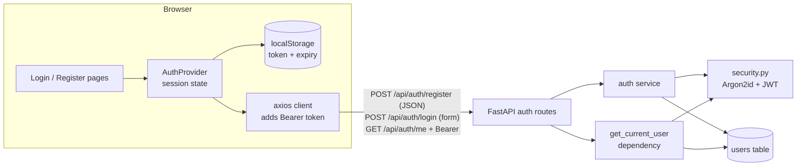
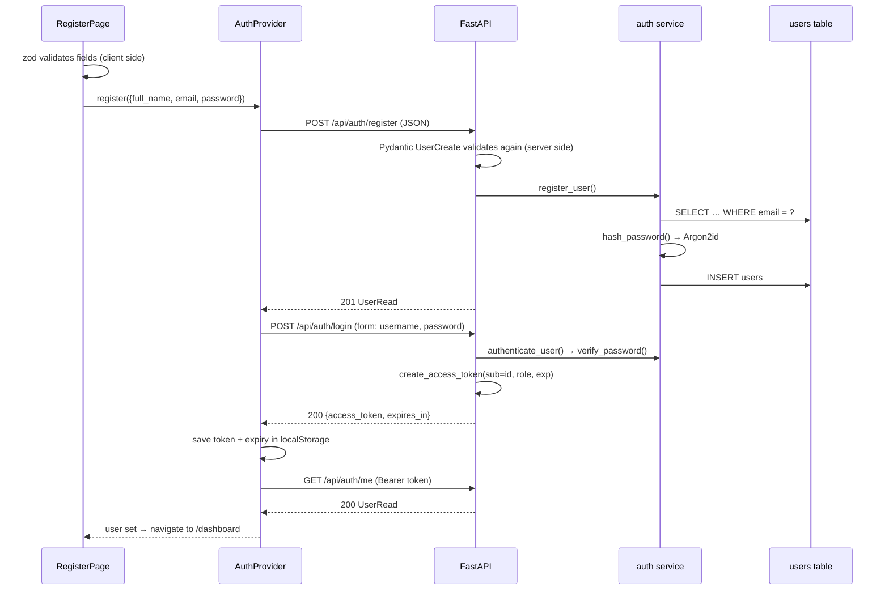
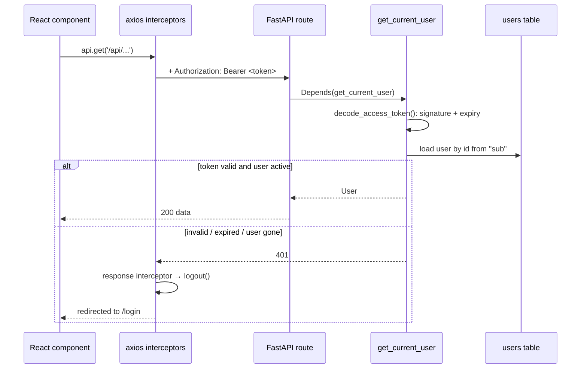
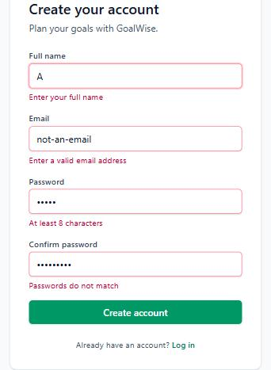
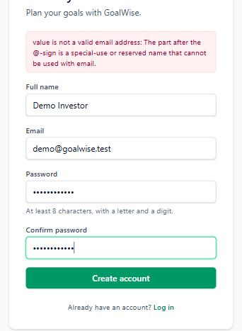
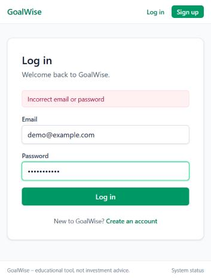
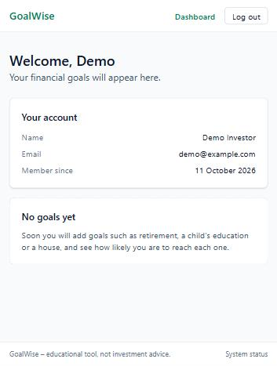

# Phase 1 – Authentication

| | |
|---|---|
| Branch | `phase-01-auth` |
| Tag | `v0.1.0` |
| Dates | 2026-10-11 |
| Synopsis objective(s) covered | Objective 1 (secure web application with user accounts) |

## 1. Summary

Users can now **create an account, log in, stay logged in across page reloads, and log out**. Pages that hold personal data (starting with the dashboard) are only reachable when logged in. Passwords are never stored in readable form: the database keeps only an Argon2id hash. After login, the browser receives a signed **JSON Web Token (JWT)** and sends it with every request; the backend checks the signature and expiry before answering.

| Before Phase 1 | After Phase 1 |
|---|---|
| One public status page | Register, login, logout; protected dashboard; status page moved to `/status` |
| No tables | `users` table (migration `0002`) |
| 1 endpoint | 4 endpoints (`/register`, `/login`, `/me` added) |
| 4 tests | 28 tests, running against a dedicated test database |

## 2. Why this phase

Every later feature – financial profile, goals, portfolio, chat history – belongs to a specific person. Before storing any of that, the system must know reliably *who* is making each request and must keep one user's data away from another. Authentication is that foundation.

## 3. What was added

### 3.0 Big picture



New libraries:

| Side | Library (version) | Used for |
|---|---|---|
| Backend | `pwdlib[argon2]` 0.3.1 (+ `argon2-cffi` 25.1) | Hashing and verifying passwords with Argon2id |
| Backend | `PyJWT` 2.15.1 | Creating and verifying JSON Web Tokens |
| Backend | `email-validator` 2.3.0 | Validating email addresses (powers Pydantic `EmailStr`) |
| Backend | `python-multipart` 0.0.32 | Reading the form-encoded login request |
| Frontend | `react-hook-form` 7.89 | Form state, submission, per-field errors |
| Frontend | `zod` 4.6 + `@hookform/resolvers` 5.9 | Validation rules declared once as a schema |

### 3.1 Database

**Migration `0002_create_users_table`** (generated with `alembic revision --autogenerate`, then reviewed).

| Column | Type | Constraint / default | Meaning |
|---|---|---|---|
| `id` | integer | Primary key, auto-increment | Internal user id; goes into the token as `sub` |
| `email` | varchar(255) | NOT NULL, **unique index** `ix_users_email` | Login name; always stored lower-case |
| `password_hash` | varchar(255) | NOT NULL | Argon2id hash (includes salt and parameters), never the password |
| `full_name` | varchar(120) | NOT NULL | Shown in the UI |
| `role` | varchar(20) | NOT NULL, default `'user'`, **CHECK** `role IN ('user','admin')` | Authorisation level; admin features come in Phase 11 |
| `is_active` | boolean | NOT NULL, default `true` | Lets an account be disabled without deleting its data |
| `created_at` | timestamptz | NOT NULL, default `now()` | When the account was created |
| `updated_at` | timestamptz | NOT NULL, default `now()`, updated on change | Last modification |

Design points:

- **Unique index on email** does two jobs: prevents duplicate accounts at the database level (even if two requests race) and makes the login lookup fast.
- **Emails are normalised to lower case** in the Pydantic schema before they reach the database, so `Asha@Example.com` and `asha@example.com` are the same account.
- **CHECK constraint on role** means an invalid role cannot be written even by a bug in the code.
- **`timestamptz`** (timestamp with time zone) stores an absolute moment, avoiding confusion between IST and UTC.

What a stored row looks like (verified in the development database):

```
 id |      email       |   full_name   | role | is_active |          password_hash
----+------------------+---------------+------+-----------+---------------------------------
  1 | demo@example.com | Demo Investor | user | t         | $argon2id$v=19$m=65536,t=3,p=4…
```

### 3.2 Backend

| File | Responsibility |
|---|---|
| `app/core/config.py` | New settings `JWT_SECRET_KEY`, `JWT_ALGORITHM` (HS256), `ACCESS_TOKEN_EXPIRE_MINUTES` (60). Refuses to start in `production` with the development secret |
| `app/core/security.py` | `hash_password`, `verify_password` (Argon2id via pwdlib); `create_access_token`, `decode_access_token` (PyJWT). Pure functions: no database, no HTTP |
| `app/models/user.py` | `User` ORM model = the `users` table |
| `app/models/__init__.py` | Imports `User` so Alembic autogenerate can see it |
| `app/schemas/auth.py` | `UserCreate` (input rules: valid email, 8–128 char password with a letter and a digit, name 2–120 chars), `UserRead` (output – no password hash), `Token` |
| `app/services/auth.py` | `register_user` (rejects duplicate email), `authenticate_user` (checks email, active flag and password), `get_user_by_email` |
| `app/api/deps.py` | `get_current_user` – reads the Bearer token, verifies it, loads the user; `CurrentUser` type alias; `require_admin` role guard; `DbSession` alias |
| `app/api/routes/auth.py` | The three endpoints below |
| `app/api/router.py` | Registers the auth router |
| `alembic/env.py` | Accepts a database URL passed in by the tests; otherwise uses `DATABASE_URL` |
| `.env.example` | Documents the new JWT variables and how to generate a secret |

**Endpoints added**

| Method | Path | Auth | Request | Response | Errors |
|---|---|---|---|---|---|
| POST | `/api/auth/register` | None | JSON `{email, password, full_name}` | `201` `UserRead` | `409` email already registered · `422` invalid input |
| POST | `/api/auth/login` | None | **Form** `username` (= email), `password` | `200` `{access_token, token_type: "bearer", expires_in: 3600}` | `401` incorrect email or password |
| GET | `/api/auth/me` | Bearer token | – | `200` `UserRead` | `401` missing, invalid or expired token, or user no longer active |

Example `UserRead` response:

```json
{ "id": 1, "email": "demo@example.com", "full_name": "Demo Investor", "role": "user", "created_at": "2026-10-11T08:59:12.410Z" }
```

**How to protect any future endpoint** – add one parameter:

```python
@router.get("/goals")
def list_goals(user: CurrentUser, db: DbSession): ...      # any logged-in user

@router.get("/admin/users", dependencies=[Depends(require_admin)])
def list_users(db: DbSession): ...                          # admins only
```

### 3.3 Frontend

| File | Responsibility |
|---|---|
| `src/api/client.ts` | **Request interceptor** adds `Authorization: Bearer <token>`; **response interceptor** triggers logout on a `401` while logged in |
| `src/api/auth.ts` | `User`, `TokenResponse` types (mirror the backend schemas); `registerUser`, `loginUser` (sends form data), `getMe` |
| `src/lib/tokenStorage.ts` | Saves `{token, expiresAt}` in `localStorage`; returns nothing if expired or unreadable |
| `src/lib/validation.ts` | zod schemas for login and registration – same rules as the backend, plus "passwords match" |
| `src/lib/apiError.ts` | Converts API errors (including FastAPI 422 lists) into one readable sentence |
| `src/store/authContext.ts` | `AuthContext` and the `useAuth()` hook |
| `src/store/AuthProvider.tsx` | The session: restores a saved token on load, fetches `/me`, exposes `login`, `register`, `logout`; auto-logout at expiry; clears all cached data on logout |
| `src/components/RouteGuards.tsx` | `ProtectedRoute` (logged-out → `/login`, remembering the page asked for); `GuestRoute` (logged-in → `/dashboard`) |
| `src/components/form.tsx` | Reusable `TextField` (label, error, hint, accessibility attributes), `FormError`, `SubmitButton`, `AuthCard` |
| `src/pages/LoginPage.tsx` | Login form; returns the user to the page they originally requested |
| `src/pages/RegisterPage.tsx` | Registration form; logs the user in automatically after success |
| `src/pages/DashboardPage.tsx` | First protected page: greeting, account details, empty "no goals yet" state |
| `src/pages/StatusPage.tsx` | The Phase 0 status page, renamed and moved to `/status` |
| `src/components/Layout.tsx` | Header shows Log in / Sign up, or the user's name and Log out; footer with disclaimer and status link |
| `src/router.tsx` | Route table (below) |
| `src/main.tsx` | Wraps the app in `AuthProvider` |

**Routes**

| Path | Who can open it | Page |
|---|---|---|
| `/` | Anyone | Redirects to `/dashboard` (which redirects to `/login` if needed) |
| `/login`, `/register` | Logged-out users (`GuestRoute`) | Login / registration |
| `/dashboard` | Logged-in users (`ProtectedRoute`) | Dashboard |
| `/status` | Anyone | System status |

### 3.4 Integration and orchestration

**Registration and login**



**Any authenticated request (and what happens when the token is no longer valid)**



| Concern | How it is handled |
|---|---|
| Who is calling? | JWT in the `Authorization` header, verified on every request by `get_current_user` |
| Same rules both sides | zod schema (frontend) mirrors Pydantic `UserCreate` (backend). The backend is the authority; the frontend only gives faster feedback |
| Session survives reload | Token + expiry in `localStorage`, restored by `AuthProvider` on start |
| Session ends | Logout button, token expiry timer, or any `401` from the API |
| Data of the previous user | `queryClient.clear()` on logout removes every cached API response |
| Swagger UI | `/docs` has an **Authorize** button (from `OAuth2PasswordBearer`) to test protected endpoints |

## 4. Key logic explained

### 4.1 Password hashing with Argon2id

A **hash** is a one-way function: easy to compute from the password, practically impossible to reverse. At login we hash the typed password again and compare.

- **Salt:** a random value generated for every hash and stored inside it, so two users with the same password get different hashes, and pre-computed "rainbow tables" are useless. (Test: `test_same_password_gives_different_hashes`.)
- **Why Argon2id:** it is deliberately slow and **memory-hard** (`m=65536` = 64 MB per hash, `t=3` iterations, `p=4` lanes), which makes large-scale guessing on GPUs expensive. It won the Password Hashing Competition (2015) and is the current OWASP recommendation.
- The stored string `$argon2id$v=19$m=65536,t=3,p=4$<salt>$<hash>` records the algorithm and parameters, so they can be strengthened later without breaking old hashes.

### 4.2 JSON Web Token

A JWT is three Base64URL-encoded parts joined by dots: `header.payload.signature`.

```json
// header
{ "alg": "HS256", "typ": "JWT" }
// payload (claims)
{ "sub": "1", "role": "user", "iat": 1791707305, "exp": 1791710905 }
```

`signature = HMAC-SHA256(header + "." + payload, JWT_SECRET_KEY)`

- The payload is **readable by anyone** (only encoded, not encrypted), so it holds no secrets – just the user id and role.
- Anyone who changes the payload (e.g. `"role": "admin"`) invalidates the signature, because they don't know the secret key. (Test: `test_tampered_token_is_rejected`.)
- `exp` makes the token useless after 60 minutes. (Tests: `test_expired_token_is_rejected`, `test_me_rejects_expired_token`.)
- The server is **stateless**: it stores no session table; verifying a token needs only the secret key. It still loads the user from the database on each request, so a deleted or deactivated account is rejected immediately. (Test: `test_token_for_deleted_user_is_rejected`.)

### 4.3 OAuth2 password flow

The login endpoint follows the OAuth2 "password" grant: credentials are sent as **form fields** `username` and `password`, and the response is `{access_token, token_type: "bearer"}`. Using the standard lets FastAPI's Swagger UI log in through its **Authorize** button, and any OAuth2-aware client can use the API.

### 4.4 Security measures summary

| Threat | Measure |
|---|---|
| Database leak exposes passwords | Only Argon2id hashes stored |
| Guessing whether an email is registered | Login returns the identical message for unknown email and wrong password |
| Forged or edited token | HMAC signature with a server-side secret |
| Stolen token used forever | 60-minute expiry; client logs out automatically at expiry |
| Disabled or deleted account keeps access | User re-loaded and `is_active` checked on every request |
| Weak production secret | App refuses to start in production with the development secret |
| Invalid data written to the database | Pydantic validation, plus NOT NULL, UNIQUE and CHECK constraints |
| Password hash leaking through the API | `UserRead` schema has no password field; FastAPI filters responses through `response_model` |
| Token read by malicious script (XSS) | React escapes all rendered text; no third-party scripts; short expiry. See trade-off in section 5 |

## 5. Design decisions

| Decision | Alternatives considered | Why this choice |
|---|---|---|
| JWT bearer tokens | Server-side sessions with a cookie | Stateless; standard for REST APIs consumed by an SPA and other clients; works across different domains (Vercel ↔ Render) |
| Argon2id (pwdlib) | bcrypt (passlib) | Memory-hard; current OWASP first choice; passlib is no longer maintained. *The project plan originally said bcrypt – updated.* |
| Token in `localStorage` | Memory only; httpOnly cookie | Memory only logs the user out on every reload. httpOnly cookies protect against XSS but need CSRF protection and same-site cookie setup across two hosting domains. localStorage with a short expiry is a reasonable trade-off for this project; moving to httpOnly cookies + refresh tokens is listed as future work |
| No refresh token yet | Access + refresh token pair | Keeps Phase 1 simple; users log in again after 60 minutes |
| Login as OAuth2 form | JSON body | Standard flow; Swagger "Authorize" works |
| Validation on both sides | Backend only | Backend = security; frontend = instant feedback without a round trip |
| Separate test database, real migrations, rollback per test | SQLite in memory; mocking the database | Tests the real PostgreSQL behaviour (unique index, CHECK constraint) and the migrations themselves |

## 6. Testing

**Test database strategy** (`tests/conftest.py`): a separate database `goalwise_test` is created if missing; migrations are run **down to base and back up to head** at the start (this also proves every migration can be undone); each test runs inside a transaction that is **rolled back** afterwards, so tests never affect each other or the development data.

| Test file | Tests | What is checked |
|---|---|---|
| `test_security.py` | 6 | Hash ≠ password and verifies; different salt each time; token round trip; edited payload rejected; token signed with another key rejected; expired token rejected |
| `test_auth.py` | 18 | Register success and response has no password; hash stored; duplicate email (case-insensitive) → 409; 4 invalid inputs → 422; login returns bearer token; case-insensitive login; same error for wrong password and unknown email; inactive user blocked; `/me` with token; `/me` without token, with garbage token, with expired token, for deleted user → 401; `require_admin` blocks user, allows admin |
| `test_health.py` | 3 | (Phase 0) |
| `test_database.py` | 1 | (Phase 0) |
| **Total** | **28** | **All passed** (local, 4.1 s) |

**Manual end-to-end test in the browser** (2026-10-11):

| Step | Expected | Result |
|---|---|---|
| Open `/dashboard` while logged out | Redirect to `/login` | Pass |
| Submit registration with invalid values | Message under each field, no request sent | Pass |
| Register with a reserved domain (`.test`) | Server-side validation message shown in the form | Pass |
| Register with valid values | Account created, logged in, dashboard shown | Pass |
| Reload the page | Still logged in | Pass |
| Log out | Back to login, header shows Log in / Sign up | Pass |
| Log in with wrong password | "Incorrect email or password" | Pass |
| Log in with correct password | Dashboard | Pass |
| Browser console on a fresh load | No errors | Pass |
| Database row | Lower-case email, `$argon2id$` hash | Pass |

Screenshots: `docs/screenshots/phase-01-*.jpg`

| Client-side validation | Server-side validation | Wrong password | Dashboard |
|---|---|---|---|
|  |  |  |  |

## 7. How to run / demo this phase

```bash
docker compose up -d
```

```bash
cd backend
uv sync
uv run alembic upgrade head
uv run uvicorn app.main:app --reload --reload-dir app --port 8000
```

```bash
cd frontend
npm install
npm run dev
```

1. Open http://localhost:5173 → redirected to the login page.
2. **Sign up**, then explore the dashboard, reload, log out, log in again.
3. API only: open http://localhost:8000/docs → `POST /api/auth/register` → **Authorize** (email + password) → `GET /api/auth/me`.
4. See the stored hash:

   ```bash
   docker exec goalwise-db psql -U goalwise -d goalwise -c "SELECT id, email, left(password_hash, 30) FROM users;"
   ```

## 8. Problems faced and how they were solved

| Problem | Cause | Fix |
|---|---|---|
| Registration with `demo@goalwise.test` rejected | `email-validator` refuses special-use domains such as `.test` | Correct behaviour; used `example.com` for testing |
| PyJWT warning "HMAC key is below 32 bytes" | Development default secret was 25 bytes | Development default lengthened; real secret generated with `secrets.token_urlsafe(48)` in the local `.env` |
| A "tampered token" test could pass by chance | It overwrote the last two characters of the signature with `xx`, which changes nothing if they already were `xx` | Rewritten as a realistic attack: edit the payload's role to `admin`, keep the old signature |
| Console showed `useAuth must be used inside <AuthProvider>` during development | Hot reload applied the new `Layout` before `main.tsx` added the provider | Not a real bug; a fresh load has no console errors |

## 9. Viva questions and answers

1. **Q: What is the difference between authentication and authorisation?**
   A: Authentication proves *who* you are (login, verified token). Authorisation decides *what* you may do (e.g. `require_admin` returns 403 for a normal user). 401 = not authenticated, 403 = authenticated but not allowed.

2. **Q: Why hash passwords instead of encrypting them?**
   A: Encryption is reversible with a key; if the key leaks, every password leaks. A hash cannot be reversed – we only ever need to *compare*, not recover, a password.

3. **Q: What is a salt and where is it stored?**
   A: A random value mixed into each hash so identical passwords give different hashes and pre-computed tables don't work. It is not secret; Argon2 stores it inside the hash string.

4. **Q: Why Argon2id and not SHA-256?**
   A: SHA-256 is designed to be fast, so attackers can try billions per second on GPUs. Argon2id is deliberately slow and uses 64 MB of memory per hash, which makes mass guessing very expensive.

5. **Q: Explain the structure of a JWT.**
   A: `header.payload.signature`, each Base64URL-encoded. Header = algorithm; payload = claims (`sub`, `role`, `iat`, `exp`); signature = HMAC-SHA256 of the first two parts with the server's secret.

6. **Q: Is the JWT payload encrypted? Can the user read it?**
   A: No, it is only encoded; anyone can read it. That's why it contains only the user id and role. The signature ensures it cannot be *changed*.

7. **Q: What happens if a user changes `role` to `admin` in their token?**
   A: The signature no longer matches; `decode_access_token` raises `InvalidSignatureError` and the API returns 401. Tested in `test_tampered_token_is_rejected`.

8. **Q: JWT is stateless – so how do you block a deleted or disabled user?**
   A: `get_current_user` loads the user from the database on every request and checks `is_active`. A deleted or disabled account is rejected immediately even if its token has not expired.

9. **Q: How does logout work with a stateless token?**
   A: The client deletes the token. The server keeps no session, so a copied token stays valid until `exp` (60 minutes). A token blacklist or short-lived access tokens with refresh tokens would close that gap – noted as future work.

10. **Q: Where do you store the token and what are the risks?**
    A: In `localStorage`, so reloads keep the session. Risk: a successful XSS attack could read it. Mitigations: React escapes output, no third-party scripts, 60-minute expiry. The stronger option is an httpOnly cookie, which needs CSRF protection.

11. **Q: Why does login return the same error for a wrong password and an unknown email?**
    A: Different messages would let an attacker discover which emails have accounts (user enumeration).

12. **Q: Why validate on both frontend and backend?**
    A: Frontend validation is for user experience and can be bypassed (e.g. calling the API directly). Backend validation is the security boundary. Both use the same rules.

13. **Q: What does a 422 response mean?**
    A: Unprocessable Entity – the request was well-formed but failed validation (e.g. invalid email). FastAPI returns it automatically from Pydantic errors, listing each failing field.

14. **Q: Why is the login request form-encoded and not JSON?**
    A: It follows the OAuth2 password grant specification. FastAPI's `OAuth2PasswordRequestForm` reads it, and Swagger UI's Authorize button works with it.

15. **Q: How does the frontend attach the token to every request?**
    A: An axios **request interceptor** adds `Authorization: Bearer <token>`. A **response interceptor** watches for 401 and logs the user out.

16. **Q: What is a protected route in React?**
    A: A wrapper component (`ProtectedRoute`) that renders its child pages only if a user is logged in; otherwise it redirects to `/login`, remembering where the user wanted to go.

17. **Q: How do you prevent duplicate accounts if two registration requests arrive at the same moment?**
    A: The service checks first, but the real guarantee is the database's unique index on `email` – the second insert fails.

18. **Q: How are the tests isolated from each other?**
    A: Each test runs inside a database transaction that is rolled back at the end; the app's commits become savepoints inside it. The test database is rebuilt from migrations at the start of each run.

19. **Q: Why store emails in lower case?**
    A: Email addresses are treated case-insensitively in practice. Normalising prevents two accounts like `Asha@` and `asha@`, and makes lookup a simple indexed equality.

20. **Q: What is the role of `is_active` instead of deleting users?**
    A: It disables an account while keeping its goals and history for audit or reactivation – a "soft" disable.

## 10. Report mapping

- **System Design – Database Design**: section 3.1 (table dictionary, constraints)
- **System Design – Security / Authentication**: sections 3.4, 4, 5
- **Implementation – Authentication module**: sections 3.2, 3.3
- **Testing**: section 6 (unit, API, manual test tables, screenshots)
- **Future Enhancements**: refresh tokens, httpOnly cookies, token revocation, password reset by email
