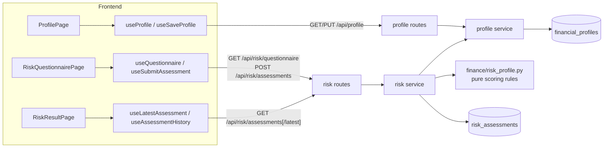
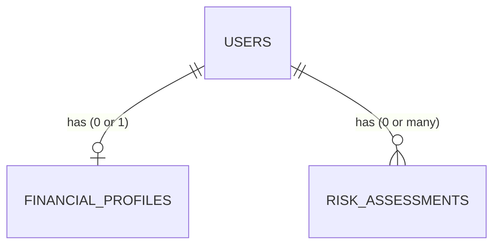
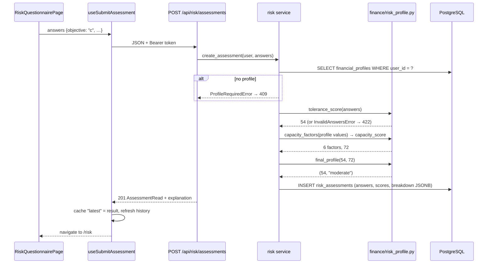
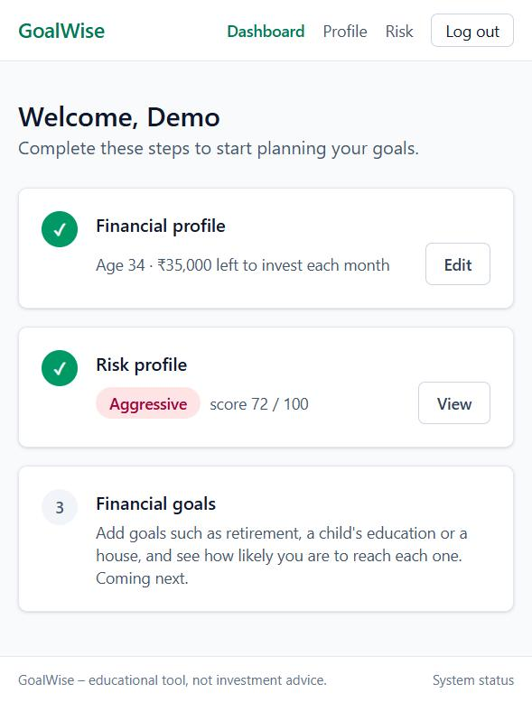
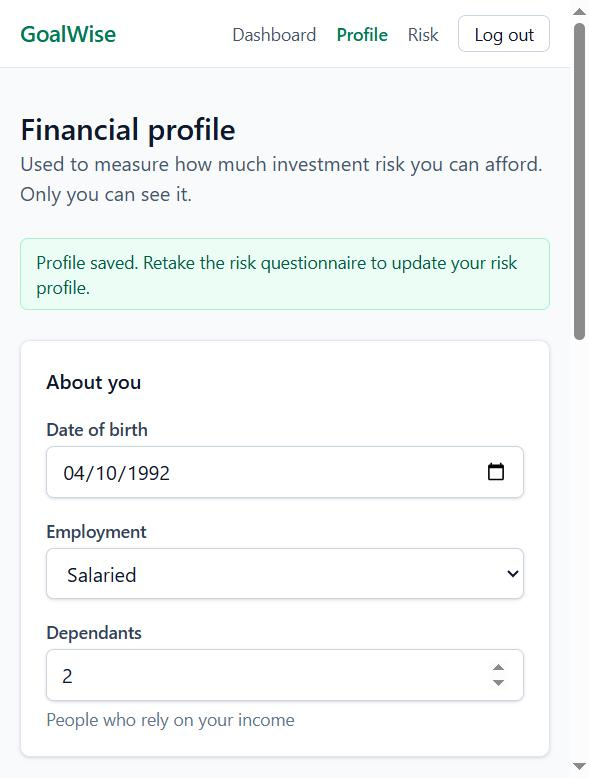
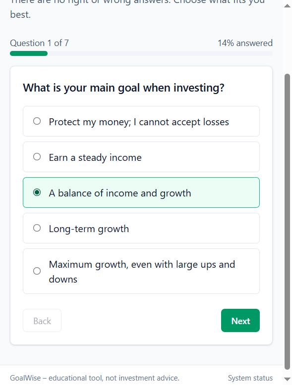
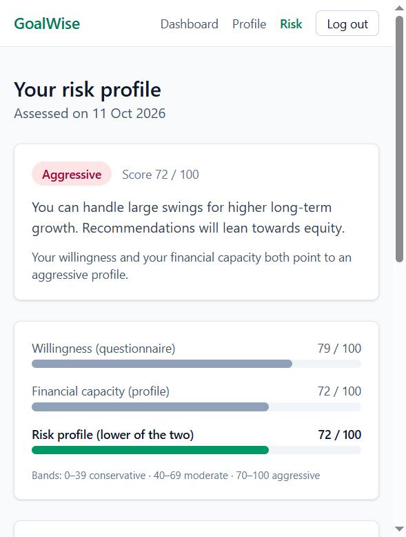
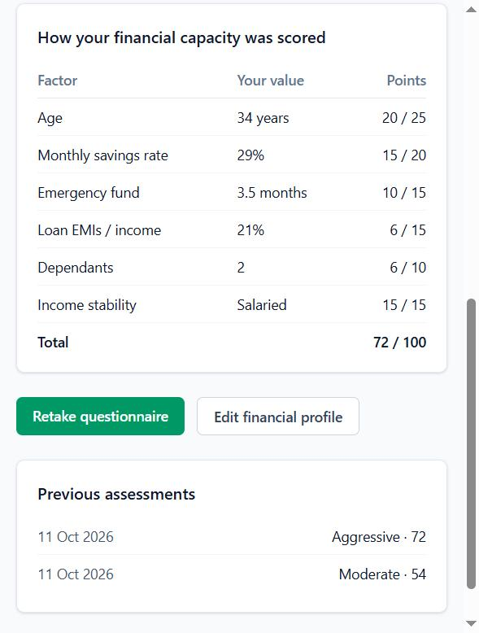

# Phase 2 – Financial Profile and Risk Profiling

| | |
|---|---|
| Branch | `phase-02-risk-profile` |
| Tag | `v0.2.0` |
| Dates | 2026-10-11 |
| Merge | Merged into `main` with a merge commit after CI passed (GitHub CLI not installed, so no PR) |
| Synopsis objective(s) covered | Objective 1 (financial profile), Objective 2 (risk profile from tolerance and capacity) |

## 1. Summary

A logged-in user can now:

1. Save a **financial profile** – date of birth, employment, monthly income, expenses and loan EMIs, cash savings, investments and dependants.
2. Answer a **7-question risk questionnaire**, one question at a time.
3. See their **risk profile** – *conservative*, *moderate* or *aggressive* – with a score out of 100, an explanation, and a factor-by-factor breakdown of how it was calculated.
4. Retake the questionnaire at any time; every attempt is kept as history.

The dashboard became an onboarding checklist: profile → risk profile → goals (next phase).

| Before Phase 2 | After Phase 2 |
|---|---|
| 1 table (`users`) | 3 tables (+ `financial_profiles`, `risk_assessments`) |
| 4 endpoints | 10 endpoints (+ 2 profile, + 4 risk) |
| 28 tests | 95 tests |
| Dashboard placeholder | Profile form, questionnaire, results page, onboarding dashboard |

## 2. Why this phase

Every recommendation the system makes later (asset allocation in Phase 8, fund picks, simulations) must suit the investor. Indian regulation (SEBI's suitability requirements for advisers) and global practice (CFA Institute) both require knowing two things before recommending investments:

- **Risk tolerance** – how much risk the person is *willing* to take (psychology).
- **Risk capacity** – how much risk the person can *afford* to take (finances).

A 25-year-old with no dependants and six months of savings can afford volatility; a 55-year-old with high EMIs cannot, however brave they feel. This phase measures both.

## 3. What was added

### 3.0 Big picture



### 3.1 Database

**Migration `0003_create_profiles_and_risk_assessments`.**



**`financial_profiles`** – one row per user (one-to-one).

| Column | Type | Constraint | Meaning |
|---|---|---|---|
| `id` | integer | PK | |
| `user_id` | integer | FK → `users.id` **ON DELETE CASCADE**, **UNIQUE** | Owner; UNIQUE makes the relationship one-to-one |
| `date_of_birth` | date | NOT NULL | Stored instead of age, which changes every year |
| `employment_type` | varchar(20) | CHECK in (`salaried`, `self_employed`, `business_owner`, `retired`, `other`) | Income stability |
| `monthly_income` | numeric(14,2) | NOT NULL, ≥ 0 | Take-home income |
| `monthly_expenses` | numeric(14,2) | NOT NULL, ≥ 0 | Household spending |
| `monthly_emi` | numeric(14,2) | default 0, ≥ 0 | Loan instalments |
| `current_savings` | numeric(14,2) | default 0, ≥ 0 | Bank balance + FDs (emergency money) |
| `existing_investments` | numeric(14,2) | default 0, ≥ 0 | Mutual funds, shares, PPF, EPF |
| `dependents` | smallint | default 0, CHECK 0–20 | People relying on the income |
| `created_at`, `updated_at` | timestamptz | default `now()` | From the new `TimestampMixin` |

**`risk_assessments`** – one row per completed questionnaire (one-to-many, history).

| Column | Type | Constraint | Meaning |
|---|---|---|---|
| `id` | integer | PK | |
| `user_id` | integer | FK → `users.id` ON DELETE CASCADE | Owner |
| `questionnaire_version` | varchar(10) | NOT NULL | `v1`; lets the questions change later without breaking old results |
| `answers` | **JSONB** | NOT NULL | `{"objective": "c", "experience": "d", …}` |
| `tolerance_score` | smallint | CHECK 0–100 | Willingness score |
| `capacity_score` | smallint | CHECK 0–100 | Ability score |
| `final_score` | smallint | CHECK 0–100 | Lower of the two |
| `category` | varchar(20) | CHECK in (`conservative`, `moderate`, `aggressive`) | Result |
| `capacity_breakdown` | **JSONB** | NOT NULL | Each capacity factor with its value and points, frozen at that moment |
| `created_at` | timestamptz | default `now()` | When it was taken |
| Index | `ix_risk_assessments_user_created (user_id, created_at)` | | Fast "latest assessment" and history queries |

Design points:

- **NUMERIC, not FLOAT, for money.** Binary floating point cannot represent 0.1 exactly (`0.1 + 0.2 = 0.30000000000000004`). `NUMERIC(14,2)` stores exact rupees and paise up to ₹999,999,999,999.99. Python uses `Decimal` end-to-end in the backend.
- **Snapshot, not reference.** An assessment stores its answers *and* the capacity breakdown. If the user later edits their profile, past results still show what they were based on. (Test: `test_assessment_is_a_snapshot`.)
- **JSONB for answers and breakdown.** They are always read and written as a whole, never queried column by column, and the questionnaire may change. JSONB is PostgreSQL's binary JSON type, which can still be indexed if ever needed.
- **ON DELETE CASCADE.** Deleting a user removes their profile and assessments automatically. (Test: `test_deleting_user_deletes_profile_and_assessments`.)
- **TimestampMixin.** `created_at`/`updated_at` are now defined once and reused by `users` and `financial_profiles` (no schema change for `users`).

### 3.2 Backend

| File | Responsibility |
|---|---|
| `app/finance/__init__.py` | New package for **pure financial logic** – no database, no HTTP |
| `app/finance/risk_profile.py` | Questionnaire (questions, options, points), `tolerance_score`, `age_on`, `capacity_factors`, `capacity_score`, `category_for`, `final_profile`, `explanation` |
| `app/models/mixins.py` | `TimestampMixin` |
| `app/models/profile.py` | `FinancialProfile` model |
| `app/models/risk.py` | `RiskAssessment` model |
| `app/models/user.py` | Relationships: `profile` (one-to-one), `risk_assessments` (one-to-many) |
| `app/schemas/profile.py` | `ProfileInput` (validation: amounts ≥ 0 with ≤ 2 decimals, age 18–100, dependants 0–20, employment from fixed list); `ProfileRead` (+ computed `age`, `monthly_surplus`) |
| `app/schemas/risk.py` | Questionnaire output (options **without points**), `AssessmentInput`, `AssessmentRead` (+ computed `explanation`) |
| `app/services/profile.py` | `get_profile`, `upsert_profile` (create or update) |
| `app/services/risk.py` | `create_assessment` (profile → capacity inputs → scores → store), `list_assessments`, `latest_assessment` |
| `app/api/routes/profile.py`, `app/api/routes/risk.py` | Endpoints below |
| `pyproject.toml` | Ruff: generated migrations exempt from line-length rule |

**Endpoints added** (all require login)

| Method | Path | Request | Response | Errors |
|---|---|---|---|---|
| GET | `/api/profile` | – | `200` `ProfileRead` | `404` not created yet |
| PUT | `/api/profile` | `ProfileInput` JSON | `200` `ProfileRead` | `422` invalid |
| GET | `/api/risk/questionnaire` | – | `200` version + questions + options | |
| POST | `/api/risk/assessments` | `{"answers": {question_id: option_id}}` | `201` `AssessmentRead` | `409` no profile yet · `422` missing/unknown/invalid answers |
| GET | `/api/risk/assessments` | – | `200` list, newest first | |
| GET | `/api/risk/assessments/latest` | – | `200` `AssessmentRead` | `404` none yet |

**Why PUT for the profile:** PUT means "store this complete resource at this address". Sending the same profile twice leaves the same result (**idempotent**), and since each user has exactly one profile, there is no need for a separate create (POST) and update. Assessments use **POST** because every submission creates a new history row.

**Data isolation:** no endpoint takes a user id. Every query filters by the user taken from the verified token, so one user can never read another's profile. (Test: `test_users_only_see_their_own_profile`.)

### 3.3 Frontend

| File | Responsibility |
|---|---|
| `src/api/profile.ts`, `src/api/risk.ts` | Types mirroring the backend schemas; API calls. A `404` for "not created yet" is turned into `null` |
| `src/hooks/useProfile.ts`, `src/hooks/useRisk.ts` | TanStack Query hooks; after a save/submit the cache is updated directly so screens refresh instantly |
| `src/lib/profileSchema.ts` | zod rules matching `ProfileInput`; empty required amounts give "Enter an amount" |
| `src/lib/format.ts` | `formatINR` (Indian grouping: ₹1,20,000), dates, labels |
| `src/components/form.tsx` | `TextField` gained a `₹` prefix option; new `SelectField` |
| `src/components/ui.tsx` | `Card`, `PageHeader`, `ButtonLink`, `CategoryBadge`, `ScoreBar` (accessible `meter`), `Spinner` |
| `src/pages/ProfilePage.tsx` | Three-section form; live "left to invest each month" preview; first save continues to the questionnaire, later saves show a confirmation |
| `src/pages/RiskQuestionnairePage.tsx` | One question per screen, progress bar, Back/Next; blocks with a link if no profile exists |
| `src/pages/RiskResultPage.tsx` | Category badge, meaning, explanation, three score bars, capacity breakdown table, history list, retake button |
| `src/pages/DashboardPage.tsx` | Onboarding checklist (profile ✓ → risk ✓ → goals) |
| `src/components/Layout.tsx`, `src/router.tsx` | Navigation links and routes `/profile`, `/risk`, `/risk/questionnaire` |

### 3.4 Integration and orchestration

**Submitting the questionnaire**



| Concern | How it is handled |
|---|---|
| Rules in one place | All scoring lives in `finance/risk_profile.py`; routes and services only move data |
| Points not revealed | The questionnaire endpoint sends option text only, so users answer honestly rather than chasing points |
| Profile before assessment | Backend returns `409`; frontend shows a "fill in your profile first" card |
| Money precision | `Decimal` in Python, `NUMERIC` in PostgreSQL; the frontend rounds to paise before sending |
| Same validation both sides | zod `profileSchema` ↔ Pydantic `ProfileInput` |
| Instant UI updates | Mutations write their result straight into the TanStack Query cache |

## 4. Key logic explained

### 4.1 Risk tolerance (questionnaire)

Seven questions, each option worth 0–4 points (the "risk word" question has four options: 0, 1, 3, 4). Maximum = 28.

```latex
\text{tolerance} = \operatorname{round}\left( \frac{\text{points earned}}{28} \times 100 \right)
```

| # | Question | What it measures |
|---|---|---|
| 1 | Main goal when investing | Objective (preservation → aggressive growth) |
| 2 | Investments held before | Experience |
| 3 | Reaction to a 20% fall in a month | Behaviour under loss – the strongest predictor |
| 4 | Choice of best-year/worst-year portfolio | Trade-off between return and loss |
| 5 | Word associated with "risk" | Attitude (danger … thrill) |
| 6 | Share of savings you'd put in equity | Comfort with volatility |
| 7 | Self-rated knowledge | Understanding |

### 4.2 Risk capacity (financial profile)

Six factors, maximum points add up to 100:

| Factor | Formula | Points |
|---|---|---|
| Age (max 25) | from date of birth | < 30 → 25 · 30–39 → 20 · 40–49 → 15 · 50–59 → 8 · 60+ → 3 |
| Savings rate (max 20) | (income − expenses − EMI) ÷ income | ≥ 40% → 20 · ≥ 25% → 15 · ≥ 10% → 10 · > 0 → 5 · ≤ 0 → 0 |
| Emergency fund (max 15) | cash savings ÷ (expenses + EMI) | ≥ 6 months → 15 · ≥ 3 → 10 · ≥ 1 → 5 · < 1 → 0 |
| Debt burden (max 15) | EMI ÷ income | 0 → 15 · < 20% → 12 · < 40% → 6 · ≥ 40% → 0 |
| Dependants (max 10) | count | 0 → 10 · 1–2 → 6 · 3+ → 2 |
| Income stability (max 15) | employment type | salaried 15 · business owner 10 · self-employed 8 · retired 5 · other 5 |

Rationale: younger investors have more years to recover from losses; a high savings rate and an emergency fund mean the investor won't be forced to sell during a crash; EMIs and dependants are fixed obligations; stable income makes all of this more reliable. The 6-month emergency fund and the 40% EMI-to-income limit are common rules of thumb in Indian personal finance and bank lending.

### 4.3 Combining – the lower score wins

```latex
\text{final score} = \min(\text{tolerance}, \text{capacity})
```

| Final score | Category |
|---|---|
| 0–39 | Conservative |
| 40–69 | Moderate |
| 70–100 | Aggressive |

Why the minimum: if willingness exceeds capacity, recommending risk the person can't afford could force them to sell at a loss when they need money. If capacity exceeds willingness, a portfolio that makes them anxious will likely be abandoned in the first crash. Either way the *lower* level is the suitable one.

### 4.4 Worked example (used in the tests and in the manual test)

Profile: born 10 April 1992 (age 34), salaried, income ₹1,20,000, expenses ₹60,000, EMI ₹25,000, cash savings ₹3,00,000, 2 dependants.

| Factor | Calculation | Value | Points |
|---|---|---|---|
| Age | – | 34 years | 20 / 25 |
| Savings rate | (120000 − 60000 − 25000) ÷ 120000 | 29% | 15 / 20 |
| Emergency fund | 300000 ÷ (60000 + 25000) | 3.5 months | 10 / 15 |
| Debt burden | 25000 ÷ 120000 | 21% | 6 / 15 |
| Dependants | – | 2 | 6 / 10 |
| Income stability | salaried | – | 15 / 15 |
| **Capacity** | | | **72** |

Questionnaire answers all "c": 2 + 2 + 2 + 2 + 3 + 2 + 2 = 15 of 28 → tolerance = **54**.

Final = min(54, 72) = **54 → moderate**. Explanation shown: *"Your finances could support aggressive risk, but you prefer moderate investing, so your preference is respected."*

Retaking with all "d" answers: 3 × 6 + 4 = 22 of 28 → 79; min(79, 72) = 72 → **aggressive**.

## 5. Design decisions

| Decision | Alternatives considered | Why this choice |
|---|---|---|
| Rule-based scoring | Machine-learning classifier | No labelled data exists ("this person's true risk profile is X"). Rules are transparent, explainable to the user and an examiner, and match how regulated advisers work. See ADR-005 |
| Final = minimum of tolerance and capacity | Average; weighted sum | An average lets a very high score hide a very low one. The minimum follows suitability practice |
| Separate tolerance and capacity scores shown | One combined number | The user sees *why* (e.g. "your finances limit you"), which builds trust |
| Pure `finance/` module | Logic inside services | Testable with plain inputs; reused later by recommendations and the chatbot |
| Snapshot breakdown in JSONB | Recalculate from current profile | History must not change when the profile changes |
| Date of birth | Age | Age goes stale; date of birth doesn't |
| `NUMERIC(14,2)` / `Decimal` | `FLOAT` | Exact money arithmetic |
| PUT upsert for profile | POST + PATCH | One profile per user; idempotent |
| 404 for "not created yet" | 200 with `null` | Standard REST meaning; the frontend converts it to `null` |
| Points hidden from the questionnaire API | Send points to the UI | Prevents steering answers |
| `questionnaire_version` column | – | Questions can be revised (v2) while old results stay interpretable |

## 6. Testing

| Test file | Tests | What is checked |
|---|---|---|
| `test_risk_profile.py` | 48 | Questionnaire extremes (0 and 100) and a middle case; max points = 28; missing, unknown and invalid answers rejected; age calculation including birthdays and 29 February; **every boundary** of every capacity factor; zero-income and EMI-without-income edge cases; factor maximums add to 100; best case = 100; the worked example (all six values and points); category thresholds 39/40/69/70; min rule; explanation texts including "an aggressive" |
| `test_profile_api.py` | 19 | Login required; 404 before creation; create and read with computed age and surplus; PUT updates in place (one row); paise kept exactly; 6 invalid inputs → 422; users isolated; questionnaire hides points; assessment requires profile (409); scored and stored (54/72/54 moderate); incomplete answers → 422; history newest first and latest; snapshot unaffected by later profile change; cascade delete |
| Earlier phases | 28 | Auth, security, health, database |
| **Total** | **95** | **All passed** (local, 10.7 s) |

**Manual end-to-end test in the browser** (2026-10-11):

| Step | Expected | Result |
|---|---|---|
| Dashboard with no profile | Step 1 "Start", step 2 waiting | Pass |
| Submit empty profile | Errors under date of birth, employment, income, expenses | Pass |
| Enter worked-example values | Live preview "₹35,000 left to invest" | Pass |
| Save profile (first time) | Moves to questionnaire | Pass |
| Answer all "c" and submit | Moderate, 54 / 72 / 54, breakdown matches table 4.4 | Pass |
| Retake with all "d" | Aggressive, 79 / 72 / 72; history shows both | Pass |
| Edit profile and save again | "Profile saved. Retake the risk questionnaire…" | Pass |
| Dashboard | Both steps ticked; age 34, ₹35,000; Aggressive 72 | Pass |
| Fresh tab console | No errors | Pass |

| Dashboard | Profile | Questionnaire | Result | Breakdown |
|---|---|---|---|---|
|  |  |  |  |  |

## 7. How to run / demo this phase

```bash
cd backend
uv run alembic upgrade head
uv run pytest -v
```

1. Start database, backend and frontend as in Phase 0.
2. Log in → Dashboard → **Start** (profile) → fill in → **Save and continue**.
3. Answer the 7 questions → **See my risk profile**.
4. Try changing the profile (e.g. EMI ₹60,000) and retaking: capacity drops and the explanation changes.
5. Inspect the stored JSON:

   ```bash
   docker exec goalwise-db psql -U goalwise -d goalwise -c "SELECT category, tolerance_score, capacity_score, final_score, answers FROM risk_assessments ORDER BY id DESC LIMIT 2;"
   ```

## 8. Problems faced and how they were solved

| Problem | Cause | Fix |
|---|---|---|
| A test expected tolerance 50 but got 54 | Miscounted: option "c" on the risk-word question is worth 3 points, not 2 | Recomputed by hand (15/28 = 54) and corrected the test; the hand calculation is now documented in 4.4 |
| Explanation said "a aggressive profile" | Article hard-coded as "a" | Helper chooses "a"/"an"; unit test added |
| Breakdown showed "34 Years", "3.5 Months" | A CSS `capitalize` class on the value column | Removed it; only the employment value is capitalised, on the backend |
| Page stuck on "Loading…" after login during development | Uvicorn's auto-reload on Windows waits for open keep-alive connections from the Vite proxy before starting the new process | Not an application bug; restart the backend if it seems stuck after code changes |
| Lint warning about `watch()` | react-hook-form's `watch` cannot be optimised by the React compiler | Replaced with `useWatch` |
| Long SQL strings broke the 100-character lint rule | Generated migration files | Migrations exempted from that one rule in `pyproject.toml` |

## 9. Viva questions and answers

1. **Q: What is the difference between risk tolerance and risk capacity?**
   A: Tolerance is the willingness to take risk (psychological, measured by the questionnaire). Capacity is the financial ability to absorb losses (objective, computed from age, savings, debt, dependants, income stability).

2. **Q: Why take the minimum of the two scores instead of the average?**
   A: An average lets one strong score hide a weak one. Suitability means not exceeding either limit: someone who can't afford losses shouldn't get an aggressive portfolio however keen they are, and someone who is anxious will abandon a risky plan in the first crash.

3. **Q: Why didn't you use machine learning for risk profiling?**
   A: Supervised learning needs labelled examples of each person's true risk profile, which don't exist. A rule-based model is transparent, explainable to the user, auditable, and is how regulated advisers do it. ML is used later where real data exists (fund performance).

4. **Q: How is the tolerance score calculated?**
   A: Sum of points for the chosen options divided by the maximum (28), times 100, rounded.

5. **Q: Explain each capacity factor.**
   A: See table 4.2 – age (time to recover), savings rate (ability to keep investing), emergency fund (not forced to sell), EMI burden and dependants (fixed obligations), employment (income stability).

6. **Q: Walk through the worked example.**
   A: Table 4.4: capacity 72, tolerance 54, final 54 → moderate.

7. **Q: Why store date of birth instead of age?**
   A: Age changes every year; a stored age would silently become wrong. Age is computed when needed (`age_on`), correctly handling birthdays not yet reached this year and 29 February.

8. **Q: Why NUMERIC and not FLOAT for money?**
   A: Floating point is binary and cannot represent most decimal fractions exactly, so rupee amounts would accumulate rounding errors. NUMERIC stores exact decimals.

9. **Q: What is a one-to-one relationship and how did you enforce it?**
   A: Each user has at most one financial profile. Enforced by a UNIQUE constraint on `financial_profiles.user_id` (plus `uselist=False` in SQLAlchemy).

10. **Q: Why is `risk_assessments` one-to-many?**
    A: Each retake is a new row, so users (and the examiner) can see how the profile changed over time.

11. **Q: What does ON DELETE CASCADE do?**
    A: When the parent row (user) is deleted, PostgreSQL automatically deletes child rows (profile, assessments), so no orphan rows remain.

12. **Q: Why JSONB for answers and the breakdown?**
    A: They're always read and written as a whole, their shape depends on the questionnaire version, and JSONB keeps them in one column without extra tables. It is binary JSON, so it can still be queried and indexed if needed.

13. **Q: Why store the breakdown when you could recalculate it?**
    A: The profile may change later. Storing the breakdown makes each assessment an immutable snapshot of what it was based on (audit trail).

14. **Q: What does idempotent mean, and why is PUT idempotent here?**
    A: Repeating the same request leaves the system in the same state. PUT replaces the profile with the sent data, so sending it twice changes nothing more.

15. **Q: How do you stop one user reading another user's profile?**
    A: No endpoint accepts a user id. The user comes from the verified JWT, and every query filters by that user's id.

16. **Q: Why are option points hidden from the frontend?**
    A: If users could see points they might choose answers to reach a desired category instead of answering honestly.

17. **Q: What happens if the questionnaire changes?**
    A: A new version (`v2`) is created; old assessments keep `v1` in `questionnaire_version`, so they remain interpretable.

18. **Q: What is a composite index and why `(user_id, created_at)`?**
    A: An index on two columns. The common query is "this user's assessments ordered by date"; the index serves both the filter and the ordering.

19. **Q: Why is the scoring code in `app/finance/` and not in the service?**
    A: It's pure logic with no database or HTTP, so it can be unit-tested with plain values (48 tests) and reused by later modules such as recommendations and the chatbot.

20. **Q: How does the frontend avoid an extra request after saving?**
    A: The mutation's `onSuccess` writes the response directly into the TanStack Query cache (`setQueryData`), so every component using that data updates immediately.

## 10. Report mapping

- **System Analysis – Requirements**: section 2 (why tolerance and capacity)
- **System Design – Database Design**: section 3.1 (ER, table dictionaries, NUMERIC, JSONB, cascade)
- **Mathematical Techniques**: section 4 (formulas, factor tables, min rule, worked example)
- **Implementation – Risk profiling module**: sections 3.2–3.4
- **Testing**: section 6
- **Limitations**: rule thresholds are expert-chosen, not statistically calibrated; questionnaire not psychometrically validated
- **Future Enhancements**: calibrate thresholds with user data; validated psychometric questionnaire; prompt to retake when the profile changes significantly
