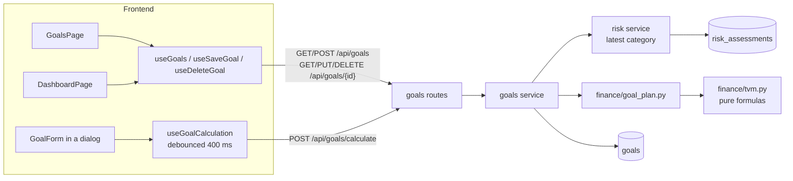
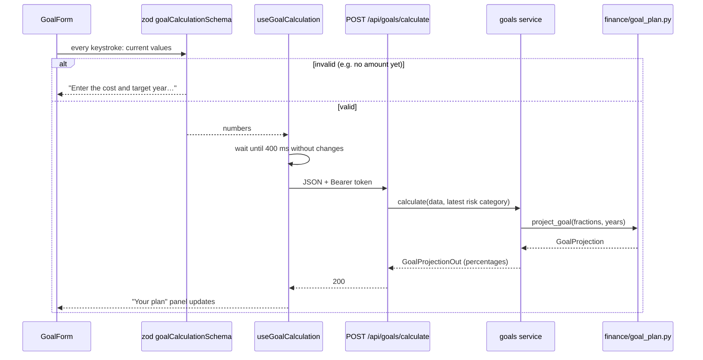
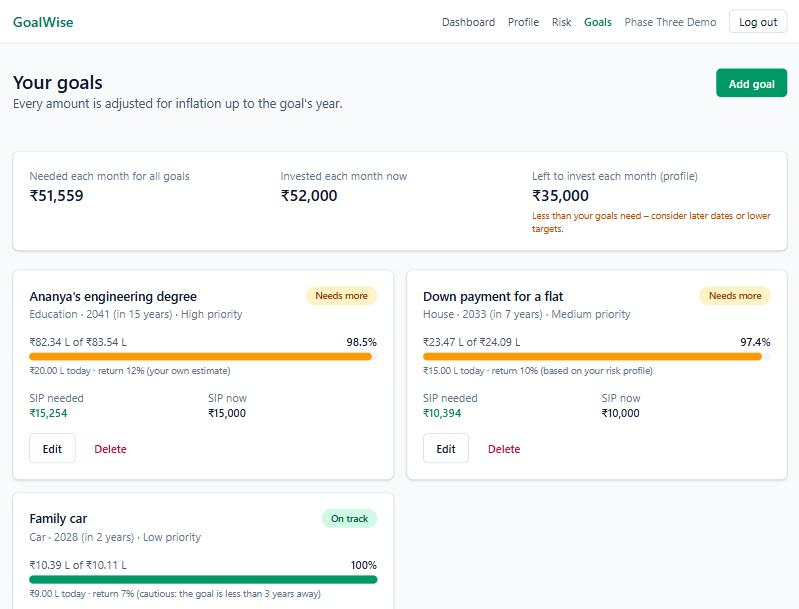
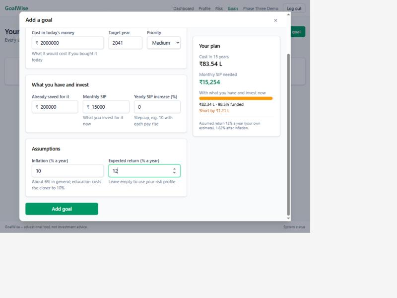
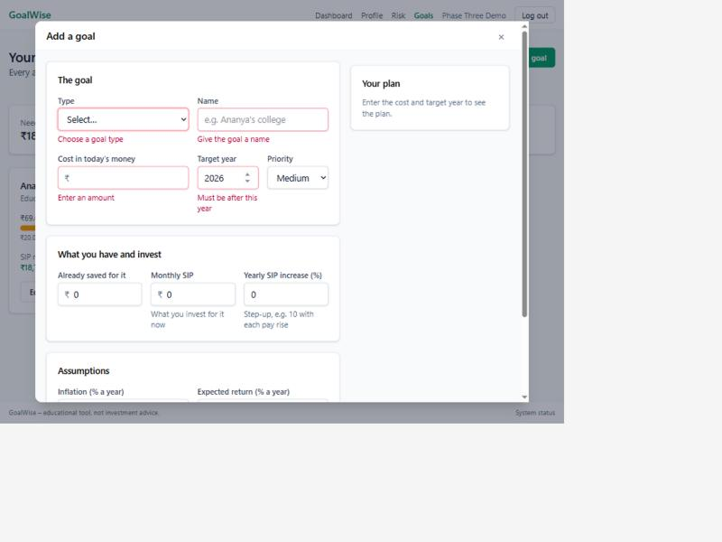
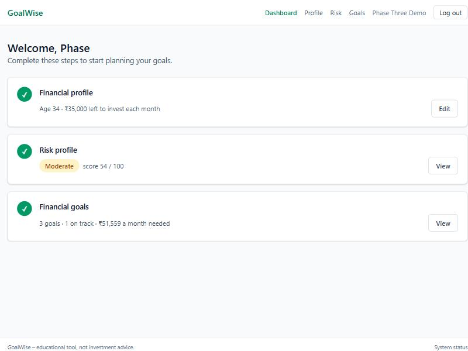

# Phase 3 – Financial Math Library and Goal Manager

| | |
|---|---|
| Branch | `phase-03-goals` |
| Tag | `v0.3.0` |
| Dates | 2026-10-15 |
| Merge | Merged into `main` with a merge commit after CI passed (GitHub CLI not installed, so no PR) |
| Synopsis objective(s) covered | Goal-based planning: inflation-adjusted goal targets and the monthly SIP required for each goal |

## 1. Summary

A logged-in user can now:

1. Add **financial goals** – education, house, car, retirement and others – with a cost in today's money, a target year and a priority.
2. See, **live while typing**, what the goal will cost in its target year after inflation and the **monthly SIP needed** to reach it.
3. Record what is already saved and invested for each goal, including a **yearly SIP step-up**, and see whether the goal is **on track** and by how much it falls short.
4. Leave the expected return empty to have it **follow their risk profile**, or enter their own.
5. Compare the total monthly SIP all goals need with what their profile says is left to invest each month.

The dashboard's third onboarding step is now live.

| Before Phase 3 | After Phase 3 |
|---|---|
| 3 tables | 4 tables (+ `goals`) |
| 10 endpoints | 16 endpoints (+ 6 goals) |
| 95 tests | 165 tests |
| Dashboard step 3 "coming next" | Goals page, goal dialog with live projection, dashboard summary |

## 2. Why this phase

"Invest for the future" is not actionable; "invest ₹15,254 a month for 15 years to pay for Ananya's degree" is. Goal-based planning turns each life goal into a concrete monthly number. That needs three things:

- **Inflation adjustment.** ₹20 lakh of education today costs ₹83.5 lakh in 15 years at 10% education inflation. Planning for ₹20 lakh would leave the family 76% short.
- **Time value of money.** Money invested earlier grows for longer, so the required SIP depends on the return and the horizon.
- **What is already in place.** Existing savings grow too, reducing the SIP needed.

The formulas written in this phase (`app/finance/tvm.py`) are the foundation for the Monte Carlo engine (Phase 5), the retirement planner (Phase 6), recommendations (Phase 8), portfolio tracking (Phase 9) and the chatbot's calculations (Phase 10).

## 3. What was added

### 3.0 Big picture



### 3.1 Database

**Migration `0004_create_goals_table`.**


**`goals`** – one row per goal (one-to-many). Only the user's inputs are stored; projections are recalculated on every read.

| Column | Type | Constraint | Meaning |
|---|---|---|---|
| `id` | integer | PK | |
| `user_id` | integer | FK → `users.id` ON DELETE CASCADE; index `ix_goals_user_id` | Owner |
| `goal_type` | varchar(20) | CHECK in (`retirement`, `education`, `house`, `car`, `marriage`, `travel`, `emergency_fund`, `wealth`, `other`) | Category |
| `name` | varchar(100) | NOT NULL | e.g. "Ananya's engineering degree" |
| `target_amount` | numeric(14,2) | CHECK > 0 | Cost **in today's rupees** |
| `target_year` | smallint | NOT NULL | Year the money is needed |
| `priority` | smallint | default 2, CHECK 1–3 | 1 high, 2 medium, 3 low |
| `inflation_rate` | numeric(5,2) | default 6, CHECK 0–20 | % a year |
| `expected_return` | numeric(5,2) | **NULL allowed**, CHECK 0–30 | % a year; `NULL` = automatic (from risk profile) |
| `current_savings` | numeric(14,2) | default 0, ≥ 0 | Already set aside for this goal |
| `monthly_sip` | numeric(14,2) | default 0, ≥ 0 | Invested each month for it now |
| `step_up_rate` | numeric(5,2) | default 0, CHECK 0–50 | Yearly SIP increase, % |
| `created_at`, `updated_at` | timestamptz | default `now()` | `TimestampMixin` |

Design points:

- **Store inputs, compute outputs.** A projection depends on today's date (years left) and on the latest risk profile (automatic return). Storing it would make it stale. Computing it takes microseconds. (Test: `test_automatic_return_follows_latest_risk_profile`.)
- **Percentages as `NUMERIC(5,2)`.** Exact, like money; 6.00 rather than 0.06 so the database reads the way users think.
- **`NULL` with a meaning.** `expected_return IS NULL` means "decide for me". A separate boolean flag would duplicate information.
- **CHECK constraints for the type list,** consistent with Phase 2. A lookup table pays off when the list must be edited without a migration or carries extra data. A native PostgreSQL `ENUM` is harder to change (values cannot be removed). The goal types are fixed and short.
- **No CHECK on `target_year` being in the future.** "The future" moves; a constraint that is true today would reject existing rows next year. The API validates it on input instead, and a goal whose year has passed is shown as due now.
- **Index on `user_id`.** Every query filters by owner. PostgreSQL does not index foreign keys automatically.

### 3.2 Backend

| File | Responsibility |
|---|---|
| `app/finance/tvm.py` | **Pure formulas**: `monthly_rate`, `real_return`, `cagr`, `future_value`, `present_value`, `inflate`, `sip_future_value`, `step_up_sip_future_value`, `required_sip`, `required_step_up_sip`; `FinanceInputError` for meaningless inputs |
| `app/finance/goal_plan.py` | `suggested_return` (return assumption table), `GoalInputs` → `project_goal` → `GoalProjection` (inflated target, savings and SIP values, shortfall, required SIP, funded %, on-track, real return) |
| `app/models/goal.py` | `Goal` model; `Percent = Numeric(5, 2)` |
| `app/models/user.py` | New `goals` relationship (one-to-many, cascade) |
| `app/schemas/goal.py` | `GoalCalculationInput` (numbers only; target year must be 1–60 years ahead), `GoalInput` (+ type, name, priority), `GoalProjectionOut`, `GoalRead` (inputs + nested `projection`) |
| `app/services/goals.py` | CRUD; `calculate` (percent ↔ fraction conversion, automatic return); `to_read`; `risk_category` |
| `app/api/routes/goals.py` | Endpoints below; `owned_goal` helper returns 404 for missing *or someone else's* goal |
| `alembic/versions/0004_create_goals_table.py` | Migration |

**Endpoints added** (all require login)

| Method | Path | Request | Response | Errors |
|---|---|---|---|---|
| GET | `/api/goals` | – | `200` list of `GoalRead`, by priority then target year | |
| POST | `/api/goals` | `GoalInput` | `201` `GoalRead` | `422` invalid |
| POST | `/api/goals/calculate` | `GoalCalculationInput` | `200` `GoalProjectionOut` – **nothing saved** | `422` invalid |
| GET | `/api/goals/{id}` | – | `200` `GoalRead` | `404` not found / not yours |
| PUT | `/api/goals/{id}` | `GoalInput` | `200` `GoalRead` | `404`, `422` |
| DELETE | `/api/goals/{id}` | – | `204` | `404` |

Example response (worked example, section 4.5):

```json
{
  "id": 1, "goal_type": "education", "name": "Ananya's engineering degree", "priority": 1,
  "target_amount": 2000000.0, "target_year": 2041, "inflation_rate": 10.0, "expected_return": 12.0,
  "current_savings": 200000.0, "monthly_sip": 15000.0, "step_up_rate": 0.0,
  "projection": {
    "years_to_goal": 15, "expected_return_used": 12.0, "expected_return_source": "custom",
    "inflated_target": 8354496.34, "savings_value": 1094713.15, "sip_value": 7138970.99,
    "projected_value": 8233684.14, "shortfall": 120812.2, "required_sip": 15254.0,
    "funded_percent": 98.5, "on_track": false, "real_return": 1.82
  }
}
```

**Why `/calculate` is a POST:** it returns a computed result without changing anything, which sounds like GET, but its input is a structured body of seven fields. GET requests should not carry bodies, and long query strings are awkward. POST to an "action" path is the common pattern for calculations.

**Why 404 and not 403 for another user's goal:** a 403 would confirm that goal id 7 exists. A 404 reveals nothing. (Test: `test_other_users_goals_are_invisible`.)

### 3.3 Frontend

| File | Responsibility |
|---|---|
| `src/api/goals.ts` | Types mirroring the schemas; `getGoals`, `createGoal`, `updateGoal`, `deleteGoal`, `calculateGoal` |
| `src/hooks/useGoals.ts` | `useGoals`, `useSaveGoal` (create or update), `useDeleteGoal` (both refresh the list); `useGoalCalculation` with a 400 ms debounce, `keepPreviousData` and caching by content |
| `src/lib/goalSchema.ts` | zod rules matching `GoalInput`; empty expected return → `null` (automatic); rounding to 2 decimals before sending; form defaults |
| `src/lib/format.ts` | `formatLakhCrore` (₹83.54 L, ₹1.20 Cr), `formatPercent`, goal type / priority / return-source labels |
| `src/components/ui.tsx` | `Modal` on the native `<dialog>` element; `ProgressBar` (accessible `progressbar`) |
| `src/components/GoalForm.tsx` | Three-section form plus a sticky **"Your plan"** panel with the live projection |
| `src/pages/GoalsPage.tsx` | Monthly summary (needed vs invested vs surplus from profile), goal cards with progress, status, required vs current SIP, edit and delete |
| `src/pages/DashboardPage.tsx` | Step 3 shows goals count, how many are on track and the total SIP needed; steps show "Checking…" while loading |
| `src/hooks/useRisk.ts` | After a new assessment, goals are refreshed (automatic returns may change) |
| `src/components/Layout.tsx`, `src/router.tsx` | "Goals" link and `/goals` route; nav wraps on phones |

### 3.4 Integration and orchestration

**Live preview while typing**



| Concern | How it is handled |
|---|---|
| Formulas in one place | Only `app/finance/` calculates. The preview asks the backend instead of copying the math into TypeScript, so the screen and the saved goal can never disagree |
| Not flooding the server | 400 ms debounce, identical inputs served from cache (`staleTime: Infinity`), previous result kept visible while recalculating |
| Automatic return stays current | Stored as `NULL`; resolved on every read; the goals cache is invalidated after a risk retake |
| Same validation both sides | zod `goalSchema` ↔ Pydantic `GoalInput`; the database CHECK constraints are the last line of defence |
| Units | Percentages at the API and database, fractions inside `app/finance/`; converted only in `services/goals.py` |

## 4. Key logic explained

Notation: *r* = annual return, *π* = inflation, *n* = years, *m* = months, *i* = monthly rate, *P* = monthly SIP.

### 4.1 Lump sums and inflation

| Formula | Meaning | Example |
|---|---|---|
| FV = PV × (1 + r)ⁿ | What a lump sum grows to | ₹1,00,000 at 10% for 10 years = **₹2,59,374.25** |
| PV = FV ÷ (1 + r)ⁿ | Today's value of a future amount | ₹10,00,000 in 10 years at 8% = **₹4,63,193.49** |
| Cost in year *n* = cost today × (1 + π)ⁿ | Inflation-adjusted target | ₹20,00,000 at 10% for 15 years = **₹83,54,496.34** |
| Real return = (1 + r) ÷ (1 + π) − 1 | Growth in purchasing power (Fisher) | 12% with 6% inflation = **5.66%** (not 6%) |
| CAGR = (end ÷ start)^(1/n) − 1 | Average yearly growth | ₹1 L → ₹2 L in 6 years = **12.25%** |

### 4.2 Monthly rate: effective, not r / 12

i = (1 + r)^(1/12) − 1. For r = 12%: **i = 0.94888%** a month, which compounds back to exactly 12% a year.

Many online SIP calculators use i = r / 12 = 1% instead. That compounds to 1.01¹² − 1 = **12.68%** a year, so it quietly assumes a higher return:

| ₹10,000 a month for 10 years, "12%" | Result |
|---|---|
| GoalWise (effective rate, annuity due) | **₹22,40,358.90** |
| r / 12 convention | ₹23,23,390.76 (+3.7%) |

### 4.3 SIP: an annuity due

A SIP is invested at the **start** of each month, so every instalment earns one extra month of return compared with an end-of-month (ordinary) annuity:

FV(SIP) = P × [((1 + i)ᵐ − 1) ÷ i] × (1 + i)

**Derivation.** The instalment paid at the start of month 1 grows for *m* months, the next for *m* − 1, … the last for 1 month:

FV = P(1+i)ᵐ + P(1+i)ᵐ⁻¹ + … + P(1+i)¹ = P(1+i) × [1 + (1+i) + … + (1+i)ᵐ⁻¹] = P(1+i) × ((1+i)ᵐ − 1) ÷ i

(the sum of a geometric series). With *i* = 0 it reduces to P × m.

| ₹10,000 a month, 10 years, 12% | Result |
|---|---|
| Annuity due (start of month) – used | **₹22,40,358.90** |
| Ordinary annuity (end of month) | ₹22,19,300.41 |

Each formula is also checked in the tests against a **month-by-month simulation** (add the instalment, then grow one month, 120 times).

### 4.4 Required SIP and step-up SIP

**Required SIP.** Subtract what current savings will grow to, then divide by the future value of ₹1 a month:

P = (target − savings × (1 + r)ⁿ) ÷ [((1 + i)ᵐ − 1) ÷ i × (1 + i)]   (0 if savings already cover the target)

**Step-up SIP** (raised by *s* every year). Year *k*'s twelve instalments of P(1+s)ᵏ form one block worth P(1+s)ᵏ × A₁₂, where A₁₂ is the 12-month annuity factor. That block then grows for the remaining n − 1 − k years:

FV = Σₖ₌₀ⁿ⁻¹ P(1 + s)ᵏ × A₁₂ × (1 + r)ⁿ⁻¹⁻ᵏ

Example: ₹5,000 a month raised 10% a year, 10 years at 12% = **₹16,34,449.24**. The value is proportional to P, so the required starting SIP is (target − FV of savings) ÷ FV(step-up SIP starting at ₹1).

**Rounding towards safety.** The required SIP is rounded **up** to the next rupee and the funded percentage **down** to 0.1%. Rounding the SIP to the nearest paisa (₹15,253.84) left the worked example ₹1.77 short after 15 years, while the progress bar showed 100%. (Tests: `test_investing_the_required_sip_puts_the_goal_on_track`, `test_funded_percent_never_rounds_up_to_100`.)

### 4.5 Worked example (used in the tests, the screenshots and the manual test)

*Ananya's engineering degree* – costs ₹20,00,000 today, needed in 15 years (2041), education inflation 10%, expected return 12%, ₹2,00,000 already saved, ₹15,000 a month invested now.

| Step | Calculation | Result |
|---|---|---|
| 1. Cost in 2041 | 20,00,000 × 1.10¹⁵ = 20,00,000 × 4.177248 | **₹83,54,496.34** |
| 2. Savings in 2041 | 2,00,000 × 1.12¹⁵ = 2,00,000 × 5.473566 | ₹10,94,713.15 |
| 3. Still needed from SIPs | 83,54,496.34 − 10,94,713.15 | ₹72,59,783.19 |
| 4. Monthly rate | 1.12^(1/12) − 1 | 0.0094888 |
| 5. Value of ₹1 a month for 180 months | ((1.0094888)¹⁸⁰ − 1) ÷ 0.0094888 × 1.0094888 | 475.9314 |
| 6. **Required SIP** | 72,59,783.19 ÷ 475.9314 = 15,253.84 → rounded up | **₹15,254 a month** |
| 7. Current plan: SIP value | 15,000 × 475.9314 | ₹71,38,970.99 |
| 8. Current plan: projected | 10,94,713.15 + 71,38,970.99 | ₹82,33,684.14 |
| 9. Shortfall / funded | 83,54,496.34 − 82,33,684.14; 82,33,684.14 ÷ 83,54,496.34 | **₹1,20,812.20 short, 98.5% funded** |
| 10. Real return | 1.12 ÷ 1.10 − 1 | 1.82% a year |

With a 10% yearly step-up, the starting SIP needed falls to **₹8,774**.

### 4.6 Expected return when left empty

| Situation | Assumed return | Source shown to the user |
|---|---|---|
| Goal less than 3 years away | 7% | "cautious: the goal is less than 3 years away" |
| Latest risk profile conservative / moderate / aggressive | 8% / 10% / 12% | "based on your risk profile" |
| No risk profile yet | 10% | "default until you complete the risk profile" |

These are planning assumptions, roughly debt-heavy, balanced and equity-heavy long-term returns in India, and are documented in `goal_plan.py`. Money needed within 3 years should not depend on equity markets, which can fall 30–50% in a year. Phase 8 replaces this table with returns derived from an actual asset allocation; goals left on "automatic" will pick that up without any change.

## 5. Design decisions

| Decision | Alternatives considered | Why this choice |
|---|---|---|
| Effective monthly rate | r / 12 | Consistent meaning of "x% a year" for lump sums and SIPs. See ADR-006 |
| Annuity due | Ordinary annuity | Matches how SIPs are debited |
| Projections computed on read | Stored columns | Depend on today's date and the latest risk profile; would go stale |
| `float` in `app/finance/`, `NUMERIC` in the DB | `Decimal` everywhere | Stored money must be exact; projections are estimates. `Decimal` has no exact fractional powers |
| Required SIP rounded up, funded % rounded down | Round to nearest | Following the advice must reach the goal; never show 100% when short |
| Live preview via `POST /calculate` | Re-implement formulas in TypeScript | One source of truth; the backend tests cover what the user sees |
| 400 ms debounce | Request per keystroke; calculate only on a button | Feels live; about one request per pause instead of per key |
| `NULL` expected return = automatic | Copy a number at creation | Follows the risk profile; Phase 8 can improve it centrally |
| Native `<dialog>` for the form | Custom overlay div; UI library | Focus trapping, Escape and backdrop built in; no new dependency |
| Store target in today's money | Ask for the future amount | People know today's prices; inflation is the system's job |
| Whole years to the goal | Months to a target date | Matches how goals are stated ("in 2041"); keeps the worked example hand-checkable |
| 404 for another user's goal | 403 | Does not reveal that the id exists |

## 6. Testing

| Test file | Tests | What is checked |
|---|---|---|
| `test_finance_tvm.py` | 28 | Monthly rate compounds back to the annual rate; Fisher real return; CAGR and invalid inputs; FV, PV, inflation (worked values to the paisa); PV/FV inverse; zero years; SIP worked example; **SIP formula = month-by-month simulation** for 4 rate/term pairs; 0% return; annuity due after 1 month; step-up worked example and simulation; step-up 0 = flat; required SIP worked example; **required SIP reaches the target exactly**; savings already enough; no time left raises |
| `test_goal_plan.py` | 13 | Full worked example (all 9 outputs); investing the required SIP puts the goal on track; funded % never rounds up to 100; step-up lowers the required SIP; savings already enough; goal due now; past year treated as due; 6 return-assumption cases |
| `test_goals_api.py` | 29 | Login required; create returns projection (worked example); defaults; automatic return without risk profile (10%, default), after a conservative profile (8%), **and changing after a retake**; short horizon (7%); list order; update; delete; other users get 404 on get/put/delete and see an empty list; paise and fractional percentages kept; `/calculate` saves nothing and needs only the numbers; 14 invalid inputs → 422; database CHECK rejects priority 9; cascade delete |
| Earlier phases | 95 | Auth, security, health, database, risk profiling, profile API |
| **Total** | **165** | **All passed** (local, ~20 s; GitHub Actions run #11: passed in 43 s) |

**Manual end-to-end test in the browser** (2026-10-15):

| Step | Expected | Result |
|---|---|---|
| Goals page, no goals | "No goals yet" card | Pass |
| Add goal → submit empty with target year 2026 | Errors under type, name, amount, "Must be after this year" | Pass |
| Enter worked example | Live panel: ₹83.54 L, ₹15,254, 98.5% funded, short by ₹1.21 L, "12% (your own estimate), 1.82% after inflation" – one `/calculate` request for the whole form | Pass |
| Save | Card and summary show the same numbers | Pass |
| Edit: SIP ₹15,254, clear expected return | Switches to 10% "based on your risk profile", ₹18,722 needed, 0% real return | Pass |
| Escape key | Dialog closes | Pass |
| Dashboard | Step 3 ticked: "3 goals · 1 on track · ₹51,559 a month needed" | Pass |
| Phone width (375 px) | No horizontal scrolling; nav wraps | Pass (after fix, see 8) |
| Console | No errors | Pass |

| Goals | Goal dialog with live plan | Validation | Dashboard |
|---|---|---|---|
|  |  |  |  |

## 7. How to run / demo this phase

```bash
cd backend
uv run alembic upgrade head
uv run pytest -v tests/test_finance_tvm.py tests/test_goal_plan.py tests/test_goals_api.py
```

1. Start database, backend and frontend as in Phase 0.
2. Log in → **Goals** → **Add goal** → enter the worked example (section 4.5) and watch "Your plan" update.
3. Save, then **Edit** and clear "Expected return": the source changes to the risk profile.
4. Retake the risk questionnaire with different answers and return to Goals: automatic goals change.
5. Try the calculation directly in Swagger (`/docs` → `POST /api/goals/calculate`).
6. Inspect the stored rows (only inputs are stored):

   ```bash
   docker exec goalwise-db psql -U goalwise -d goalwise -c "SELECT name, target_amount, target_year, inflation_rate, expected_return, monthly_sip FROM goals;"
   ```

## 8. Problems faced and how they were solved

| Problem | Cause | Fix |
|---|---|---|
| A test showed that investing the "required" SIP left the goal ₹1.77 short | Required SIP rounded to the nearest paisa (down), 180 instalments magnified it | Round the required SIP **up** to a whole rupee; funded % rounded down; two tests lock this in |
| The add-goal dialog closed immediately after opening (development only) | React StrictMode runs effects twice; the effect's cleanup called `dialog.close()`, which fires the `close` event → `onClose` | No `close()` in cleanup (unmounting removes the dialog anyway); `showModal()` only if not already open |
| Header links overflowed on a phone after adding "Goals" | Nav was a single non-wrapping row | `flex-wrap` with smaller gaps on small screens |
| Dashboard briefly showed finished steps as "to do"; goals summary said "complete your profile" while loading | `undefined` (loading) and `null` (absent) were treated the same | "Checking…" while loading; the profile message only when the profile is truly absent |
| `uv` not found in a new terminal | `uv` was installed in Python 3.13's user `Scripts` folder, which is not on `PATH` | Run with the full path or add `%APPDATA%\Python\Python313\Scripts` to `PATH` |
| Long CHECK expression in the model | Line-length rule | Split into adjacent string literals |

## 9. Viva questions and answers

1. **Q: Derive the future value of a SIP.**
   A: Instalment *k* (paid at the start of month *k*) grows for m − k + 1 months. Summing P(1+i)ᵐ + … + P(1+i)¹ is a geometric series = P(1+i)((1+i)ᵐ − 1)/i. See 4.3.

2. **Q: What is the difference between an annuity due and an ordinary annuity?**
   A: Payments at the start of each period (due) or at the end (ordinary). An annuity due is worth (1 + i) times more because each payment compounds one extra period. SIPs are annuities due.

3. **Q: Why (1 + r)^(1/12) − 1 and not r / 12?**
   A: So that twelve months of compounding give exactly r. r / 12 compounds to more than r (12% → 12.68%) and overstates SIP results by about 3.7% over 10 years.

4. **Q: How do you calculate the required SIP?**
   A: Grow current savings to the target year, subtract from the inflated target, and divide the remainder by the future value of ₹1 a month (the annuity factor). Walk through table 4.5.

5. **Q: Why is the required SIP rounded up?**
   A: Following the advice must reach the goal. Rounding down by a few paise per month compounds into a shortfall (₹1.77 in the worked example). A test proves the rounded-up SIP is on track.

6. **Q: What is the real return and why not just subtract inflation?**
   A: Growth in purchasing power: (1 + r)/(1 + π) − 1. Subtraction ignores that inflation also erodes the returns themselves; the error grows with higher rates.

7. **Q: How does a step-up SIP work mathematically?**
   A: Treat each year's 12 instalments as a block worth P(1+s)ᵏ × A₁₂, then grow it for the remaining years and sum. Because the result is proportional to P, the required starting SIP is one division.

8. **Q: Why separate pure math (`app/finance`) from services?**
   A: Pure functions have no database or HTTP, so they are tested with plain numbers (41 unit tests run in under a second), are easy to verify by hand, and are reused by later phases and the chatbot.

9. **Q: Why are projections not stored in the database?**
   A: They depend on today's date and the latest risk profile, so stored values would go stale (redundant, derived data). Storing only inputs keeps one source of truth, which is normalisation.

10. **Q: Why float in the formulas when money is NUMERIC?**
    A: Stored amounts are facts and must be exact. Projections are estimates built on an assumed return; float error (10⁻¹²) is negligible compared with that, and exponentiation to fractional powers is not exact in `Decimal` either.

11. **Q: Enum column vs lookup table vs CHECK constraint?**
    A: A lookup table suits values that change without a deployment or carry extra data. A native ENUM is a type that is hard to alter (values cannot be removed). A CHECK on a varchar is simple, portable and easy to change in a migration. Goal types are short and fixed, so CHECK, consistent with earlier tables.

12. **Q: Why no CHECK constraint that the target year is in the future?**
    A: A constraint must hold for all rows forever, but "the future" moves. Next year valid rows would violate it. The API validates on input instead.

13. **Q: Why does `/calculate` use POST?**
    A: It needs a structured body; GET requests should not have bodies. It is safe (saves nothing). The test `test_calculate_does_not_save` checks that.

14. **Q: Why does the frontend call the backend for the live preview instead of calculating locally?**
    A: To keep the formulas in one place. Duplicated math in TypeScript could drift from the backend, and the user would see one number while typing and another after saving.

15. **Q: How do you avoid sending a request on every keystroke?**
    A: A debounce: the request is made only after 400 ms without changes. Identical inputs are cached, and the previous result stays visible while recalculating.

16. **Q: What happens to goals when the user retakes the risk questionnaire?**
    A: Goals with an empty expected return are recalculated with the new category on the next read, and the frontend invalidates the goals cache so the screen updates.

17. **Q: Why 7% for goals less than 3 years away?**
    A: Equity can fall sharply in any single year. Money needed soon should be in debt instruments, so the plan should not assume equity returns.

18. **Q: How do you stop users accessing each other's goals?**
    A: Every query filters by both goal id and the user id from the JWT. A missing or foreign goal gives 404 (not 403), so ids cannot be probed.

19. **Q: Why is there an index on `goals.user_id`?**
    A: Every goals query filters by owner, and PostgreSQL does not create indexes for foreign keys automatically (only for primary keys and unique constraints).

20. **Q: How did you test the formulas are correct?**
    A: Three ways: hand-calculated values (tables 4.1–4.5), comparison with an independent month-by-month simulation, and round trips (PV of FV; investing the required SIP reaches the target).

## 10. Report mapping

- **System Analysis – Requirements**: section 2 (why goal-based planning, inflation)
- **System Design – Database Design**: section 3.1 (goals table, store inputs not outputs, NULL as automatic, CHECK vs ENUM vs lookup)
- **System Design – API Design**: section 3.2 (endpoints, POST for calculations, 404 vs 403)
- **Mathematical Techniques**: section 4 (all formulas, derivation, effective vs nominal rate, annuity due, step-up, worked example)
- **Implementation – Goal planning module**: sections 3.2–3.4
- **Testing**: section 6 (unit, simulation cross-check, API, manual)
- **Limitations**: deterministic projection with a single assumed return (volatility comes in Phase 5); whole years only; return assumptions are fixed planning values until Phase 8; no tax on gains
- **Future Enhancements**: month-level target dates; tax-adjusted returns; goal-specific glide paths (reduce equity as the goal approaches)
