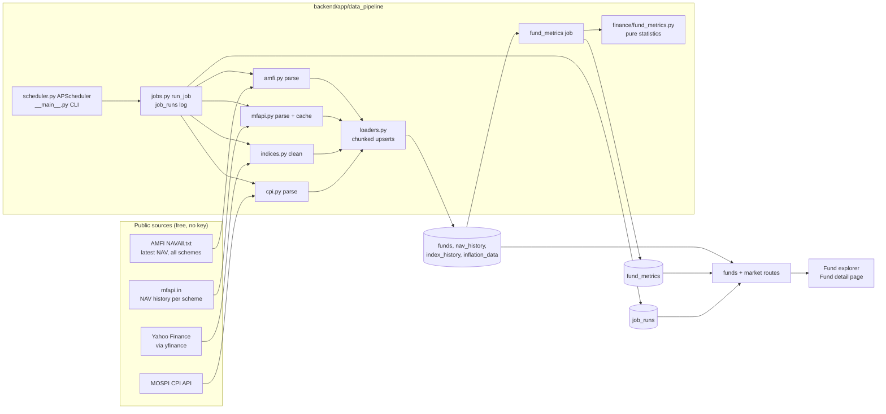
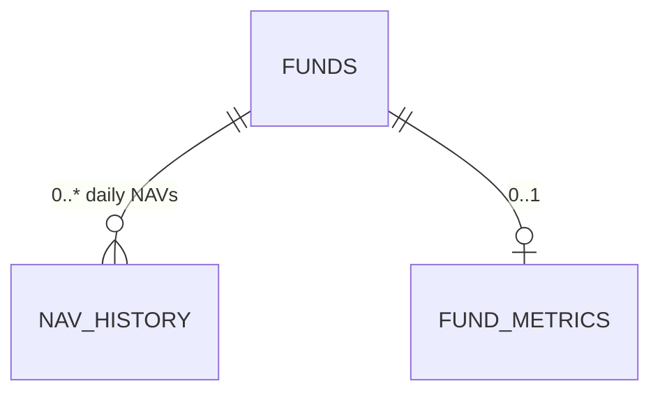
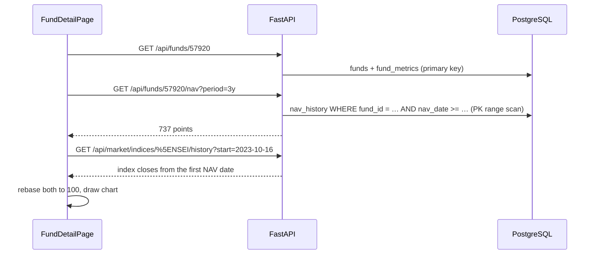
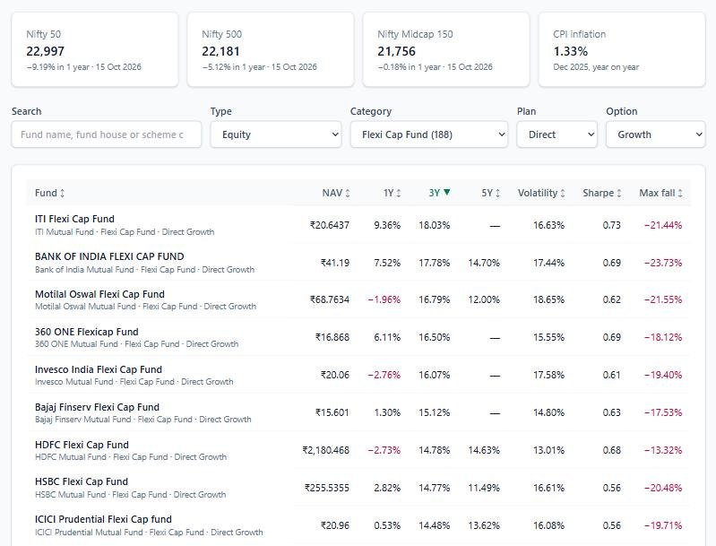
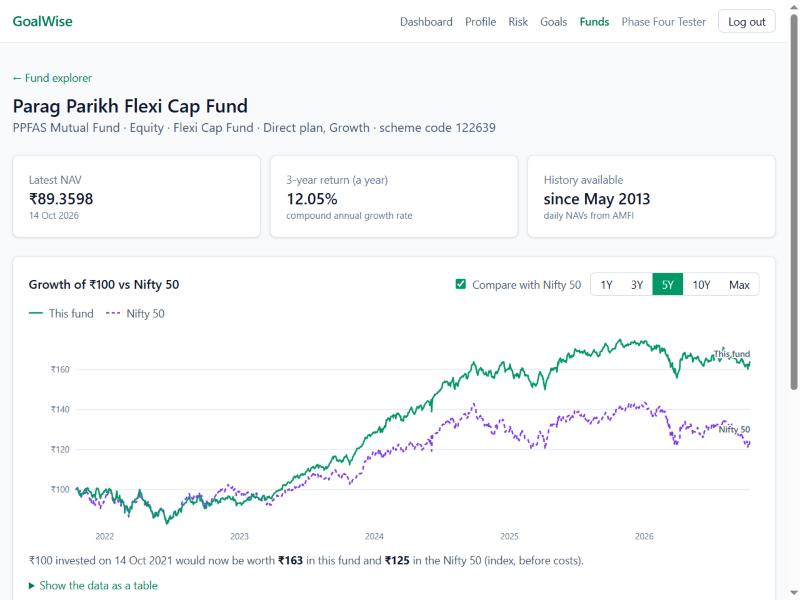
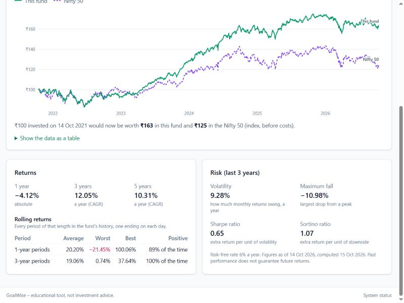
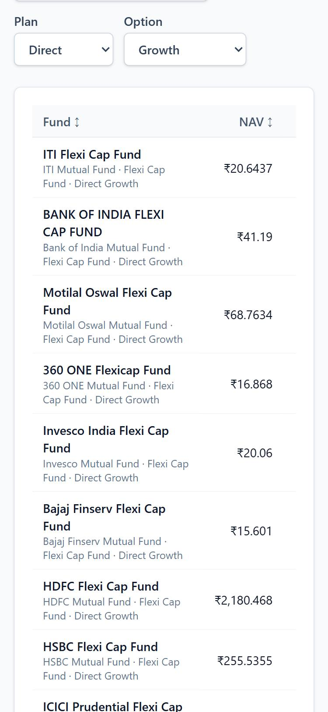

# Phase 4 – Market Data Pipeline

| | |
|---|---|
| Branch | `phase-04-market-data` |
| Tag | `v0.4.0` |
| Dates | 2026-10-15 |
| Merge | Merged into `main` with a merge commit after CI passed (GitHub CLI not installed, so no PR) |
| Synopsis objective(s) covered | Market data foundation: real mutual fund, index and inflation data, and fund return/risk analytics used by later phases (simulation, ML, recommendations) |

## 1. Summary

GoalWise now has real Indian market data, refreshed automatically:

1. The **latest NAV of every mutual fund scheme** in India (≈14,100 schemes) from AMFI, every business evening.
2. The **full NAV history** of 1,482 open-ended, direct-plan, growth-option funds (equity, hybrid, index, debt) – 2,545,178 daily NAVs in total.
3. **Benchmark indices** (Nifty 50, Nifty 500, Nifty Midcap 150) and monthly **CPI inflation**.
4. **Fund metrics** for every fund with at least a year of history: 1/3/5-year returns, rolling returns, volatility, Sharpe, Sortino and maximum drawdown.
5. A **fund explorer** (search, filter, sort, page) and a **fund detail page** with a NAV chart compared with the Nifty 50.
6. A **pipeline log** (`job_runs`) showing every run, how many rows were read and written, and which rows were rejected and why.

| Before Phase 4 | After Phase 4 |
|---|---|
| 4 tables | 10 tables (+ `funds`, `nav_history`, `fund_metrics`, `index_history`, `inflation_data`, `job_runs`) |
| 16 endpoints | 25 endpoints (+ 4 funds, + 5 market data) |
| 165 tests | 255 tests |
| No market data | 2,545,178 NAVs (167 MB with indexes), 3 indices since 2005–2019, CPI since 2011 |

## 2. Why this phase

Every later phase needs market data:

- **Phase 5 (Monte Carlo)** samples returns from real history instead of assuming a fixed 10–12%.
- **Phase 7 (ML)** builds features from NAV history and metrics and needs years of data for walk-forward validation.
- **Phase 8 (recommendations)** picks funds by category and risk-adjusted return.
- **Phase 10 (chatbot)** answers "how has this fund done?" from the same tables.

The data must be **free** (no paid feeds or keys), **fresh** (updated daily), **correct** (bad rows rejected, duplicates impossible) and **repeatable** (re-running a load changes nothing). That makes this phase mostly about data engineering: extract, validate, load idempotently, log.

## 3. What was added

### 3.0 Big picture



### 3.1 Database

**Migration `0005_create_market_data_tables`** (full dictionary in `docs/database.md`).



| Table | Key | Rows (local) | Purpose |
|---|---|---|---|
| `funds` | `id`; `scheme_code` UNIQUE | 14,136 | One row per AMFI scheme code (each plan/option of a scheme has its own code) |
| `nav_history` | **(fund_id, nav_date)** | 2,545,178 | One NAV per fund per business day – the largest table |
| `fund_metrics` | `fund_id` | 1,344 | Statistics per fund, recomputed after each NAV load |
| `index_history` | (symbol, trade_date) | 11,770 | Daily closes of 3 indices |
| `inflation_data` | (base_year, period) | 180 | Monthly CPI, Jan 2011 – Dec 2025 |
| `job_runs` | `id`; partial unique (job_name) WHERE running | – | The pipeline log |

Design points:

- **Composite natural primary keys for time series.** A NAV is identified by *which fund* and *which day*. Making that pair the primary key means a duplicate NAV cannot exist, and the key's B-tree index (fund_id first, then date) is exactly what the only query needs – "NAVs of fund X between two dates". `EXPLAIN ANALYZE` on 2.5 million rows: *Bitmap Index Scan on nav_history_pkey … 737 rows, execution 0.4 ms*. A surrogate `id` would add 4 bytes and a second index to every one of millions of rows for nothing.
- **Column order in the composite index matters.** (fund_id, nav_date) serves "one fund, a date range". (nav_date, fund_id) would serve "all funds on one date" but not our query. The same applies to `index_history` (symbol, trade_date).
- **`NUMERIC(18,8)` for NAVs.** AMFI publishes some NAVs with 8 decimals (e.g. 14.86269632); fewer decimals would silently round stored facts.
- **Controlled redundancy: `funds.latest_nav`.** The fund list shows the latest NAV of thousands of funds. Reading it from `nav_history` would need a "latest row per fund" query over millions of rows; copying it into `funds` during the load is cheap. The upsert only ever moves it *forward* in time, so re-loading an old file cannot make it stale (test `test_an_older_file_never_overwrites_the_latest_nav`).
- **Stored metrics, unlike goal projections.** Phase 3 computes projections on read because they are cheap and depend on today's date. Fund metrics need a fund's whole history and the explorer sorts all funds by them, so they are stored and refreshed when new NAVs arrive. `risk_free_rate` is stored with them, so a Sharpe ratio always records its assumption. They are `double precision`: derived statistics, not money (ADR-007).
- **Only the CPI index is stored;** year-on-year inflation is derived on read (`CPI(month) ÷ CPI(same month last year) − 1`), as in Phase 3.
- **CHECK constraints** reject impossible values even if code is wrong: `nav > 0`, `close > 0`, `cpi > 0`, plan/option/asset class lists, job status list.
- **Partial unique index** `uq_job_runs_one_running ON job_runs (job_name) WHERE status = 'running'`: the database itself guarantees that at most one run of a job is in progress (section 4.3).

### 3.2 Backend

| File | Responsibility |
|---|---|
| `app/data_pipeline/amfi.py` | Download and parse `NAVAll.txt`: state machine over section / fund-house / data lines; columns found by header name; per-line UTF-8 or Windows-1252 decoding; validation with reasons; asset class, plan and option classification; duplicate scheme codes resolved |
| `app/data_pipeline/mfapi.py` | NAV history per scheme from mfapi.in with an on-disk cache; parse, sort, de-duplicate; largest-gap check |
| `app/data_pipeline/indices.py` | Index list (`^NSEI`, `^CRSLDX`, `NIFTYMIDCAP150.NS`); fetch closes with `yfinance`; drop missing (NaN), non-positive and duplicate closes |
| `app/data_pipeline/cpi.py` | MOSPI API (paged, legacy-TLS context), parse, resolve duplicated months |
| `app/data_pipeline/loaders.py` | `bulk_upsert` (chunked multi-row `INSERT … ON CONFLICT DO UPDATE … WHERE IS DISTINCT FROM … RETURNING`), `upsert_funds` (latest NAV only moves forward), NAV / index / CPI / metrics upserts |
| `app/data_pipeline/jobs.py` | Jobs `daily_nav`, `backfill_nav`, `index_history`, `inflation`, `fund_metrics`; `run_job` writes `job_runs` (running → success / failed / skipped), rolls back failed work, frees abandoned runs |
| `app/data_pipeline/scheduler.py` | APScheduler timetable (India time): NAVs 23:30 then metrics; indices Mon–Fri 18:30; CPI on the 13th |
| `app/data_pipeline/__main__.py` | CLI: `python -m app.data_pipeline <job>` or `all` |
| `app/finance/fund_metrics.py` | **Pure statistics**: `shift_months`, `nav_on_or_before`, `trailing_return`, `rolling_returns`, `monthly_returns`, `annualised_volatility`, `sharpe_ratio`, `sortino_ratio`, `max_drawdown`, `fund_statistics`; reuses `tvm.cagr` and `tvm.monthly_rate` |
| `app/models/market.py` | The six ORM models |
| `app/schemas/market.py` | Response models; `FundSort`, `Period` etc. as `Literal` types so FastAPI validates query parameters |
| `app/services/funds.py` | Search (escaped `ILIKE`), filters, active-only (NAV within 30 days of the newest), sort with `NULLS LAST`, stable pagination; detail; NAV history by period |
| `app/services/market.py` | Index summary (1-year return via `tvm.cagr`), index history, CPI with YoY, job log (`DISTINCT ON` for the last run of each job), market summary |
| `app/api/routes/funds.py`, `market.py` | Endpoints below |
| `app/main.py` | `lifespan` starts/stops the scheduler when `SCHEDULER_ENABLED=true` |
| `app/core/config.py` | `SCHEDULER_ENABLED`, `DATA_CACHE_DIR`, `RISK_FREE_RATE` |

New dependencies: `httpx` (HTTP client, already used by tests), `apscheduler` 3.x (scheduler), `yfinance` (index data; pulls in pandas/numpy, which Phases 5 and 7 need anyway).

**Endpoints added** (all require login; the job trigger requires an admin)

| Method | Path | Request | Response |
|---|---|---|---|
| GET | `/api/funds` | `q`, `asset_class`, `category`, `plan`, `option`, `active_only`, `sort`, `order`, `page`, `page_size` | `{items, total, page, page_size}` |
| GET | `/api/funds/categories` | `active_only` | `[{asset_class, category, count}]` |
| GET | `/api/funds/{id}` | – | `FundDetail` with nested `metrics` (or null); `404` |
| GET | `/api/funds/{id}/nav` | `period` = 1y/3y/5y/10y/max | `{fund_id, period, points: [{date, value}]}`; `404`, `422` |
| GET | `/api/market/summary` | – | counts, latest NAV date, indices with 1-year return, latest inflation, last run of each job |
| GET | `/api/market/indices/{symbol}/history` | `start` | `{symbol, name, points}`; `404` unknown index |
| GET | `/api/market/inflation` | – | `{base_year, points: [{period, cpi, inflation_yoy}]}` |
| GET | `/api/market/jobs` | `job_name`, `limit` | job runs, newest first |
| POST | `/api/market/jobs/{job}/run` | – | `202` started in the background; `403` not admin; `404` unknown job |

Example (`GET /api/funds?q=parag&plan=direct&option=growth`, abridged):

```json
{
  "items": [{
    "id": 57920, "scheme_code": 122639, "name": "Parag Parikh Flexi Cap Fund",
    "amc": "PPFAS Mutual Fund", "category": "Flexi Cap Fund", "asset_class": "equity",
    "plan": "direct", "option": "growth", "latest_nav": 89.3598, "latest_nav_date": "2026-10-14",
    "return_1y": -4.1234, "return_3y": 12.0459, "return_5y": 10.3061,
    "volatility": 9.2761, "sharpe": 0.647, "sortino": 1.0727, "max_drawdown": -10.9773
  }],
  "total": 1, "page": 1, "page_size": 25
}
```

**Why `202 Accepted` for the job trigger:** a backfill can take half an hour, far longer than an HTTP request should stay open. The endpoint starts the job as a background task and returns at once; progress is visible in `GET /api/market/jobs`.

### 3.3 Frontend

| File | Responsibility |
|---|---|
| `src/api/funds.ts`, `src/api/market.ts` | Types mirroring the schemas; one function per endpoint |
| `src/hooks/useFunds.ts` | `useFunds` (keeps the previous page visible while the next loads), `useFundCategories`, `useFund`, `useFundNav`, `useIndexHistory`, `useMarketSummary`; 5-minute `staleTime` (data changes daily) |
| `src/hooks/useDebounced.ts` | Shared debounce (moved out of `useGoals.ts`) |
| `src/pages/FundsPage.tsx` | Market strip (indices, CPI); search (300 ms debounce), type/category/plan/option filters **kept in the URL** (back from a fund restores the list); sortable column headers with `aria-sort`; pager; data-source freshness from `job_runs` |
| `src/pages/FundDetailPage.tsx` | Header and key numbers; chart with period buttons and "compare with Nifty 50"; sentence summary and table view of the chart; returns, rolling returns and risk cards with plain-language explanations |
| `src/components/LineChart.tsx` | Dependency-free SVG line chart: one y-axis, nice ticks, year/month ticks, legend and direct labels, crosshair + tooltip listing every series, arrow keys / Home / End for keyboard users, resizes with its container |
| `src/lib/format.ts` | `formatNav`, `formatReturn` (true minus sign, `—` when unavailable), `formatRatio`, `formatMonth`, labels for asset classes, plans, options and jobs |
| `src/router.tsx`, `src/components/Layout.tsx` | `/funds`, `/funds/:fundId`; "Funds" in the header |
| `vite.config.ts` | Proxy target can be overridden with `API_PROXY_TARGET` (used when port 8000 is taken) |

**Chart design.** The comparison chart shows the **growth of ₹100** for the fund and the Nifty 50 from the same start date – both series on one scale. Plotting the NAV (₹89) and the index (22,997) on two y-axes would make the lines' relative position meaningless. Fund and benchmark colours (emerald-600, violet-600) were checked with a palette validator for colour-blind separation and contrast; the benchmark is also dashed, and the legend and line-end labels name both, so colour is never the only cue. The numbers behind the chart are available without hovering ("₹100 invested on … would now be worth …" and a table view).

### 3.4 Integration and orchestration

**Nightly NAV load**

```mermaid
sequenceDiagram
    participant S as APScheduler (23:30 IST)
    participant R as run_job
    participant DB as PostgreSQL
    participant A as AMFI
    S->>R: daily_update()
    R->>DB: UPDATE abandoned 'running' rows; INSERT job_runs (status running)
    alt another run is in progress
        DB-->>R: unique violation (partial index)
        R->>DB: INSERT job_runs (status skipped)
    else
        R->>A: GET NAVAll.txt (1.5 MB)
        A-->>R: text
        R->>R: parse + validate (14,377 rows → 14,136 good, 241 rejected)
        R->>DB: upsert funds (chunks of 2,500) RETURNING
        R->>DB: upsert nav_history (chunks of 10,000) RETURNING
        R->>DB: UPDATE job_runs SET success, rows, details
        R->>R: run_job("fund_metrics")
        R->>DB: read each fund's NAVs (index range scan), upsert fund_metrics
    end
```

**Opening a fund**



| Concern | How it is handled |
|---|---|
| Statistics in one place | Only `app/finance/fund_metrics.py` calculates; the chart's "growth of ₹100" is a simple rebasing, not a statistic |
| Fresh but cheap | Metrics recomputed once per NAV load; the frontend caches market data for 5 minutes |
| A slow job never blocks the API | Jobs run in the scheduler thread, the CLI or a background task, never inside a request |
| One run at a time | Partial unique index on `job_runs` |
| Failures are visible | `job_runs.status = failed` with the error; the explorer shows each job's last status |

## 4. Key logic explained

### 4.1 Extract and transform: parsing AMFI's file

`NAVAll.txt` is not a CSV. Its meaning depends on the lines *above* each row:

```
Scheme Code;ISIN Div Payout/ ISIN Growth;ISIN Div Reinvestment;Scheme Name;Plan;Option;Net Asset Value;Date
Open Ended Schemes(Equity Scheme - Large Cap Fund)     ← section: type + category
Axis Mutual Fund                                       ← fund house
120465;INF846K01DP8;-;Axis Large Cap Fund;Direct Plan;Growth;62.1500;15-Oct-2026
```

The parser is a **state machine**: a line without `;` is either a section (regex `… Schemes(…)`) or a fund house, and updates the state; a line with `;` is a row and is combined with the current state. Each row then passes validation; failures are **counted by reason**, not thrown:

| Check | Real file, 15 Oct 2026 |
|---|---|
| Scheme code is an integer | 0 rejected |
| NAV present (not "N.A.") | 0 |
| NAV > 0 (segregated portfolios are written down to 0) | **241 rejected** |
| Date parses (`15-Oct-2026`) | 0 |
| Scheme code not repeated (keep the newer NAV) | 0 |
| **Loaded** | **14,136 of 14,377** |

Three robustness rules came from looking at the real file:

1. **Columns by header name.** In 2026 AMFI inserted *Plan* and *Option* columns before the NAV. A parser using positions would have read "Growth" as the NAV. Old-format rows also leave Plan/Option empty, so the plan and option fall back to the scheme name.
2. **Per-line decoding.** The file is UTF-8, but a few lines contain a Windows-1252 apostrophe (byte `0x92`); those lines are decoded as Windows-1252 instead of producing garbage.
3. **Category normalisation.** AMFI mixes old and new SEBI labels ("Equity Scheme", "Equity Schemes", "Income/Debt Oriented Schemes", "Other Scheme - Index Funds", "Exchange Traded Funds (ETFs) - …"). Keyword rules map them to 8 asset classes (12 cases tested).

**ETL, not ELT.** The transformation happens in Python *before* loading because the raw file cannot be loaded into a table as it is (its structure is in the line order) and because validation must happen before bad rows reach the database. ELT – load raw, transform in SQL – suits data that is already tabular and a warehouse with spare compute.

### 4.2 Load: idempotent upserts in bulk

Every loader is one statement per chunk of rows:

```sql
INSERT INTO nav_history (fund_id, nav_date, nav)
VALUES (57920, '2026-10-14', 89.3598), (…), … -- up to 10,000 rows
ON CONFLICT (fund_id, nav_date) DO UPDATE
   SET nav = excluded.nav
 WHERE nav_history.nav IS DISTINCT FROM excluded.nav
RETURNING fund_id;
```

- **Idempotent:** the conflict target is the natural key, so loading the same data twice cannot create duplicates.
- **No pointless writes:** the `WHERE … IS DISTINCT FROM` skips rows whose value has not changed (PostgreSQL would otherwise write a new row version). `IS DISTINCT FROM` also treats NULL = NULL as "not different", unlike `<>`.
- **Accurate counts:** `RETURNING` lists only inserted or changed rows. (The driver reports `rowcount = -1` for multi-row statements, discovered while testing.)
- **Bulk:** one round trip per chunk instead of one per row. Chunks are sized to stay under PostgreSQL's 65,535 parameters per statement (3 columns × 10,000 rows = 30,000).
- **Duplicates inside one batch must be removed first:** PostgreSQL refuses an `ON CONFLICT DO UPDATE` that would update the same row twice in one statement, which is why the parsers de-duplicate.

Proof on real data:

| Run | Rows read | Rows written |
|---|---|---|
| `daily_nav`, empty tables | 14,377 | 14,136 |
| `daily_nav` again, same file | 14,377 | **0** |
| `inflation`, after fixing the 2013 duplicate rule | 185 | 1 (only May 2013 changed) |

### 4.3 The job runner and `job_runs`

```
run_job(name):
    UPDATE job_runs SET status='failed', error='abandoned' WHERE name=… AND status='running' AND started_at < now − 6 h
    INSERT job_runs (name, status='running')  ── unique violation? → INSERT status='skipped'; stop
    COMMIT
    try:   result = JOBS[name](session)        ── commits its own work
    except: ROLLBACK; status='failed', error=…  ── half-done work is undone, the log row survives
    else:  status='success', rows_read, rows_written, details
    finished_at = now(); COMMIT
```

The `running` row is committed *before* the work starts, so a failure that rolls back the work still leaves a record. The **partial unique index** (`WHERE status = 'running'`) lets any number of finished rows exist per job but only one running row: a second process starting the same job gets a unique-violation error and records a `skipped` run. A process killed mid-job would leave a `running` row forever, so rows older than 6 hours are first marked abandoned.

### 4.4 Point-to-point returns (CAGR) – worked example

Parag Parikh Flexi Cap Fund (direct, growth), latest NAV ₹89.3598 on 14 Oct 2026. NAVs are only published on business days, so "the NAV on day *d*" means **the last NAV on or before *d*** (found by binary search):

| Period | Start date wanted | NAV used | Calculation | Return |
|---|---|---|---|---|
| 1 year | 14 Oct 2025 | ₹93.2029 (14 Oct 2025) | 89.3598 ÷ 93.2029 − 1 | **−4.12%** |
| 3 years | 14 Oct 2023 (Saturday) | ₹63.5264 (Fri 13 Oct 2023) | (89.3598 ÷ 63.5264)^(1/3) − 1 = 1.40666^(1/3) − 1 | **12.05% a year** |
| 5 years | 14 Oct 2021 | ₹54.7199 (14 Oct 2021) | (89.3598 ÷ 54.7199)^(1/5) − 1 = 1.63304^(0.2) − 1 | **10.31% a year** |

The same function `tvm.cagr` from Phase 3 is used. A fund younger than the period gets `null`, never a shorter-period return passed off as a 5-year one.

### 4.5 Rolling returns

A 3-year return depends on the day it is measured. **Rolling returns** compute the CAGR of *every* window of that length – one ending on each NAV date – and summarise them: average, worst, best and the share of windows above zero.

Example (test `test_rolling_returns_hand_calculated`), NAVs 100 (1 Jan 2020), 110 (1 Jan 2021), 121 (1 Jan 2022), 99 (1 Jun 2022), 1-year windows:

| Window ends | Start (on or before one year earlier) | Return |
|---|---|---|
| 1 Jan 2021 | 100 | +10% |
| 1 Jan 2022 | 110 | +10% |
| 1 Jun 2022 | 110 (1 Jan 2021) | −10% |
| **Summary** | | average 3.33%, worst −10%, best +10%, positive 67% of the time |

### 4.6 Risk: volatility, Sharpe, Sortino, maximum drawdown

Risk uses **monthly returns over the last 3 years**: NAVs sampled at the latest date and every calendar month before it (15 Oct, 15 Sep, …), 37 NAVs → 36 returns. Daily returns are noisier and have holiday gaps; monthly returns over three years are the factsheet convention.

Worked example (tests), monthly returns *r* = +10%, −10%, +10%, risk-free rate 0:

| Statistic | Formula | Calculation | Result |
|---|---|---|---|
| Mean | Σr ÷ n | 0.10 ÷ 3 | 3.333% a month |
| Sample std. dev. | √(Σ(r − mean)² ÷ (n − 1)) | √((0.0044 + 0.0178 + 0.0044) ÷ 2) = √(1/75) | 11.547% a month |
| **Volatility** | std × √12 | 0.11547 × 3.4641 = √(12/75) | **40% a year** |
| **Sharpe** | mean(r − r_f) ÷ std(r − r_f) × √12 | (1/30) ÷ (1/√75) × √12 = √900 ÷ 30 | **1.00** |
| Downside deviation | √(Σ min(0, r − r_f)² ÷ n) | √((0 + 0.01 + 0) ÷ 3) | 5.774% |
| **Sortino** | mean(r − r_f) ÷ downside dev. × √12 | 0.03333 ÷ 0.05774 × 3.4641 | **2.00** |

- **Why √12:** for independent returns the *variance* grows in proportion to time, so the standard deviation grows with its square root. The mean grows in proportion to time, so a ratio of mean to standard deviation scales by 12 ÷ √12 = √12.
- **Sharpe vs Sortino:** Sharpe counts all variability as risk, including the good months. Sortino counts only months below the risk-free return – here only the −10% month – so it is double the Sharpe ratio. An investor minds losses, not gains.
- **Risk-free rate:** 6% a year (`RISK_FREE_RATE`, roughly the yield of short-term Government of India treasury bills), converted to an effective monthly rate (1.06)^(1/12) − 1 = 0.4868% with `tvm.monthly_rate`, the same convention as Phase 3. With a 12% risk-free rate the example's Sharpe ratio falls to 0.715 (tested).

**Maximum drawdown** – the largest fall from a peak to a later low – in one pass: remember the highest NAV so far, measure every NAV against it, keep the worst.

| NAV | 100 | 120 | 90 | 130 | 65 | 140 |
|---|---|---|---|---|---|---|
| Peak so far | 100 | 120 | 120 | 130 | 130 | 140 |
| NAV ÷ peak − 1 | 0 | 0 | −25% | 0 | **−50%** | 0 |

The answer is −50% (130 → 65), not −25%: the fall is measured from the *highest earlier* NAV.

### 4.7 Data quality: gaps, duplicates, and an inconsistency in official data

| Issue | Where | Handling |
|---|---|---|
| NAV = 0 or "N.A." | AMFI file (241 rows) | Rejected, counted as `nav_not_positive` / `nav_not_available` |
| Same scheme code twice | AMFI file (possible) | Keep the newer NAV, count `duplicate_scheme_code` |
| Same date twice | mfapi.in, Yahoo, MOSPI | Keep one, count `duplicate_date` / `duplicate_month` |
| Missing index close (NaN) | Yahoo Finance | Dropped, counted `missing_close` |
| Weekends and holidays | every series | Normal; "last NAV on or before" is used everywhere |
| Long gaps (> 10 days) | mfapi.in histories | Reported in `job_runs.details.largest_gaps` (4 of 1,482 funds; longest 24 days in 2013 funds) |
| Funds that stopped publishing (matured FMPs, merged schemes) | 2018–2024 dates in the AMFI file | Kept, but hidden by default: "active" = a NAV within 30 days of the newest |
| Months listed twice with different values | MOSPI CPI, Jan–May 2013 | Keep the row that carries MOSPI's own published inflation |

The last one is a real finding. MOSPI's API returns two different index values for January–May 2013. Keeping either version reproduces 163 of 168 of MOSPI's own published year-on-year inflation figures to within 0.06 percentage points, and misses exactly five: keeping the rows *with* a published rate makes 2014's computed inflation 0.5–0.6 points lower than MOSPI's; keeping the other rows does the same to 2013. The official series itself is inconsistent at this splice point (the 2012 base-year series was linked to the older 2010 series), so the choice is documented rather than hidden.

## 5. Design decisions

| Decision | Alternatives considered | Why this choice |
|---|---|---|
| AMFI + mfapi.in + yfinance + MOSPI | Paid data APIs; scraping AMC sites; NSE website | Free, no keys; NSE blocks automated downloads. See ADR-007 |
| ETL in Python | ELT in SQL | Raw file is not tabular; validate before loading |
| Upsert on natural keys with `IS DISTINCT FROM` | Delete + insert; plain insert | Idempotent; no gap while reloading; no needless writes |
| Chunked multi-row INSERT with `RETURNING` | Row-by-row; COPY into a staging table | One round trip per chunk is fast enough (14k rows in seconds); `RETURNING` gives exact counts; COPY would need a staging table to upsert |
| Composite PK (fund_id, nav_date) | Surrogate id + unique index | The pair is the identity; one index instead of two on the largest table |
| `latest_nav` copied into `funds` | Compute latest per fund on every list request | Fast fund list; only moves forward |
| Store `fund_metrics` | Compute per request | Needs full history; sorted across all funds |
| Monthly returns, 3-year window for risk | Daily returns; full history | Factsheet convention; comparable across funds |
| Backfill direct-growth funds only | All 14,000 schemes | Direct growth is the cleanest NAV series of each scheme (no commission, no payouts that drop the NAV); other plans of the same portfolio would duplicate it |
| APScheduler in the API process + CLI | Cron / Task Scheduler; Celery + Redis | No extra services; same code path as manual runs |
| Partial unique index for "one running job" | Advisory locks; nothing | Enforced by the database, visible in the log, survives process boundaries |
| Hand-written SVG chart | Plotly, Recharts | ~290 lines, no dependency for one line chart; explainable. Plotly arrives with the fan charts in Phase 5 |
| Filters in the URL | Component state | Back button and shared links keep the list |
| Server-side paging and sorting | Send all funds to the browser | 8,682 active schemes; the database filters, sorts (a few thousand rows, milliseconds) and sends 25 |

## 6. Testing

| Test file | Tests | What is checked |
|---|---|---|
| `test_fund_metrics.py` | 21 | `shift_months` (month ends, leap day, year boundary); "on or before" lookup; 1/3/5-year CAGR hand-calculated; too-young fund → None; rolling returns and summary hand-calculated; monthly sampling incl. holidays; **volatility = 40%, Sharpe = 1.00 / 0.715, Sortino = 2.00, drawdown −50%** (section 4.6); undefined ratios; steady and young funds end to end |
| `test_pipeline_parsers.py` | 24 | AMFI sample in the real format: rows loaded, every rejection reason counted, sections → type/category/fund house, plan/option fallback to the name, 8-decimal NAV, duplicate keeps newer, double spaces, **pre-2026 layout still parses**, missing header rejected, mixed encodings, 12 asset-class mappings; mfapi history parse and gap; cache used without network; index cleaning; CPI duplicate rule |
| `test_pipeline_jobs.py` | 16 | **Re-running a load writes 0 rows**; next day appends one NAV and moves latest forward; an older file never moves it back; corrected NAV is updated in place; database rejects duplicate key and NAV ≤ 0; backfill from cache (candidates, gap report, idempotent, filters, limit); index job full then incremental with overlap; CPI job and YoY = 1.33%; metrics job values and idempotency; job log success / **failure with rollback** / **skipped while running (partial unique index)** / abandoned run freed / unknown job |
| `test_funds_api.py` | 29 | Login required on 7 paths; closed funds hidden by default; item shape; 9 search/filter cases incl. escaped `%`; sort by metric with nulls last; stable pagination; 6 invalid parameters → 422; categories; detail with/without metrics; 404s; NAV periods; market summary (index 1-year return 25%, CPI); index history; inflation; job log; **only admins can start jobs** |
| Earlier phases | 165 | Auth, profile, risk, goals, TVM |
| **Total** | **255** | **All passed** (local; GitHub Actions run @@CI_RUN@@) |

No test touches the network: parsers get samples of the real formats (`tests/pipeline_samples.py`), jobs accept text/records or a fake fetch function, and the backfill reads a pre-filled cache.

**Manual end-to-end test in the browser** (2026-10-15, real data):

| Step | Expected | Result |
|---|---|---|
| Funds page | Market strip (Nifty 50 22,997, −9.19% in 1 year; CPI 1.33% Dec 2025), direct-growth funds sorted by 3-year return | Pass |
| Type Equity, category Flexi Cap | Filters narrow the list, URL updates, counts in the category list | Pass |
| Search "parag" | List narrows after typing stops | Pass |
| Click column headers | Sort toggles, arrow shows direction, funds without data last | Pass |
| Next page / back from a fund | Same filters and page restored | Pass |
| Fund detail, 3Y | Growth of ₹100: fund ₹140 vs Nifty 50 ₹117 since 16 Oct 2023 | Pass |
| Hover / arrow keys on the chart | Crosshair, tooltip with both values and the date | Pass |
| Period buttons 1Y–Max, untick compare | Chart redraws; NAV in ₹ without comparison | Pass |
| Phone width (375 px) | No horizontal page scroll; table scrolls inside its card; chart resizes | Pass (after fix, section 8) |
| Console | No errors | Pass |

| Fund explorer | Fund detail | Metrics | Phone |
|---|---|---|---|
|  |  |  |  |

How to run: `cd backend && uv run pytest -v tests/test_fund_metrics.py tests/test_pipeline_parsers.py tests/test_pipeline_jobs.py tests/test_funds_api.py`

## 7. How to run / demo this phase

```bash
cd backend
uv run alembic upgrade head
uv run python -m app.data_pipeline all        # first time: ~30 min (history backfill)
uv run python -m app.data_pipeline daily_nav  # any time: today's NAVs; run twice to see "wrote 0"
```

1. Start database, backend and frontend as in Phase 0; log in → **Funds**.
2. Filter Equity → Flexi Cap Fund, sort by 3Y, open a fund, switch periods, hover the chart.
3. Show the pipeline log and the idempotency:

   ```bash
   docker exec goalwise-db psql -U goalwise -d goalwise -c "SELECT job_name, status, rows_read, rows_written, details->'skipped' FROM job_runs ORDER BY id DESC LIMIT 6;"
   ```

4. Show the index at work:

   ```bash
   docker exec goalwise-db psql -U goalwise -d goalwise -c "EXPLAIN ANALYZE SELECT nav_date, nav FROM nav_history WHERE fund_id = 57920 AND nav_date >= '2023-10-14';"
   ```

5. Show the one-running-job rule: insert a `running` row for `daily_nav` and run the job – it records `skipped`.
6. Enable `SCHEDULER_ENABLED=true` in `backend/.env` to have the jobs run on their timetable.

| Load step (local, 2026-10-15) | Rows read | Rows written | Time |
|---|---|---|---|
| `daily_nav` (AMFI, all schemes) | 14,377 | 14,136 | 14 s |
| `daily_nav` again (same file) | 14,377 | **0** | 15 s |
| `index_history --full` (3 indices) | 11,770 | 11,770 | 12 s |
| `inflation` (CPI base 2012) | 185 | 180 | 3 s |
| `backfill_nav` (1,482 funds, downloads) | 2,531,103 | 2,531,042 | 23 min |
| `backfill_nav --refresh` (same funds, from the cache) | 2,531,103 | **0** | 11 min |
| `fund_metrics` (1,344 funds with ≥ 1 year) | 2,514,989 | 1,344 | 65 s |

## 8. Problems faced and how they were solved

| Problem | Cause | Fix |
|---|---|---|
| `curl` could not reach any HTTPS source on Windows | Windows' TLS library could not check certificate revocation | `--ssl-no-revoke` for manual checks; Python (`httpx` with its own certificate bundle) was not affected |
| AMFI's old URL returned "Document Moved" | NAVAll.txt moved to `portal.amfiindia.com` | New URL; the client also follows redirects |
| AMFI's file had two extra columns | Plan and Option columns added in 2026 | Columns located by header name; a test parses the old layout too |
| "Children�s Fund" in category names | A few lines are Windows-1252, not UTF-8 | Decode line by line with a fallback |
| MOSPI API: `UNSAFE_LEGACY_RENEGOTIATION_DISABLED` | MOSPI's server needs TLS legacy renegotiation, which OpenSSL 3 disables | A dedicated SSL context with `OP_LEGACY_SERVER_CONNECT` for that client only; certificates still verified |
| CPI months listed twice with different values | MOSPI data for Jan–May 2013 | Keep the row with MOSPI's published inflation; documented (4.7) |
| Base-2024 CPI not available | MOSPI changed the base year in Jan 2026; the API serves only base 2012 | Base year is part of the key; noted as a limitation |
| `rows_written` was −1, −2, −6 | The driver reports `rowcount = -1` for multi-row statements | Count `RETURNING` rows instead |
| `'ChunkedIteratorResult' object is not subscriptable` | SQLAlchemy 2.1 changed `Result.tuples` | Use `.all()`; the job runner recorded the failure in `job_runs` as designed |
| A test inserting synthetic NAVs hit a duplicate key | The synthetic series overlapped the day loaded from the AMFI sample | Series ends one day earlier; expected return computed from the actual endpoints |
| Line-end labels were hard to read where lines crossed them | Text drawn over the lines | White halo (`paint-order: stroke`) behind the labels |
| Chart could keep a 640 px width if first shown without data | The size observer was attached once to an element that was later replaced | Callback ref stored in state; the observer re-attaches |
| Preview could not use port 8000 | Another session's backend was running on it | Vite proxy target configurable with `API_PROXY_TARGET` |

## 9. Viva questions and answers

1. **Q: What is ETL and why did you choose it over ELT?**
   A: Extract (download), Transform (parse, validate, classify), Load (write). ELT loads raw data first and transforms it inside the database. AMFI's file is not a table – a row's category and fund house come from the lines above it – and it contains zero/"N.A." NAVs, so it must be transformed and validated before loading. ELT suits clean tabular data in a warehouse.

2. **Q: What does idempotent mean, and how is your pipeline idempotent?**
   A: Running it twice has the same effect as running it once. Every load is an upsert on the natural key (scheme code; fund + date; symbol + date; base year + month), so re-running inserts nothing new; the `IS DISTINCT FROM` condition means unchanged rows are not even rewritten. Demonstrated: `daily_nav` wrote 14,136 rows, then 0.

3. **Q: What is an upsert? Show the SQL.**
   A: Insert, or update if the key already exists: `INSERT … ON CONFLICT (fund_id, nav_date) DO UPDATE SET nav = excluded.nav WHERE nav_history.nav IS DISTINCT FROM excluded.nav`. `excluded` is the row that failed to insert.

4. **Q: Why `IS DISTINCT FROM` and not `<>`?**
   A: `<>` returns NULL when either side is NULL, so a change from NULL to a value would be missed. `IS DISTINCT FROM` treats two NULLs as equal and NULL vs value as different.

5. **Q: Why did you choose (fund_id, nav_date) as the primary key of `nav_history`?**
   A: It is the natural identity of a NAV, so duplicates are impossible, and its B-tree index serves the only query (one fund's NAVs over a date range) – `EXPLAIN ANALYZE` shows an index scan returning 737 rows in under 1 ms out of 2.5 million. A surrogate id would add a column and a second index to the largest table.

6. **Q: Would (nav_date, fund_id) work as well?**
   A: No. A composite B-tree is sorted by the first column, then the second. With date first, "fund X between two dates" would have to scan every fund's rows in that date range. The leading column should be the one compared with equality.

7. **Q: How do you load 14,000 rows efficiently?**
   A: Multi-row INSERT statements in chunks (10,000 NAVs per statement) – one round trip per chunk instead of 14,000. Chunks keep each statement under PostgreSQL's 65,535-parameter limit. Faster still would be COPY into a staging table followed by one upsert, which matters at millions of rows a day.

8. **Q: Why must duplicates be removed before the upsert?**
   A: PostgreSQL rejects an `ON CONFLICT DO UPDATE` statement that would update the same row twice ("cannot affect row a second time"). The parsers keep one row per key and count the duplicates.

9. **Q: How is the Sharpe ratio calculated?**
   A: Mean monthly excess return (fund − risk-free) divided by the standard deviation of monthly returns, times √12 to annualise. It is return per unit of total risk. Worked example: +10%, −10%, +10% with r_f = 0 gives 1.00.

10. **Q: How is Sortino different, and when is it better?**
    A: The denominator is the downside deviation – only months below the risk-free return count. Funds whose volatility is mostly upside are not penalised. In the example Sortino is 2.00 vs Sharpe 1.00.

11. **Q: What is maximum drawdown and how do you compute it?**
    A: The largest percentage fall from a peak to a later low. One pass: keep the running peak, compute NAV ÷ peak − 1 at every point, keep the minimum. 100, 120, 90, 130, 65, 140 → −50% (130 → 65).

12. **Q: Why multiply the standard deviation by √12?**
    A: For independent monthly returns, variances add: the annual variance is 12 × the monthly variance, so the standard deviation is √12 × monthly.

13. **Q: Why monthly returns and a 3-year window?**
    A: Daily NAVs are noisy and have holiday gaps; 36 monthly returns over 3 years is the convention on fund factsheets, so values are comparable with published ones and across funds.

14. **Q: What are rolling returns and why show them?**
    A: The CAGR of every window of a given length, one ending on each day. A single 3-year figure depends on the start date; rolling returns show the range – worst, best, average and how often the return was positive – i.e. consistency.

15. **Q: How do you handle weekends and holidays?**
    A: No NAV is published, so the value "on day d" is the last NAV on or before d (binary search). For the 3-year return from 14 Oct 2023 (a Saturday) the 13 Oct NAV is used.

16. **Q: What data-quality checks does the pipeline perform?**
    A: Per row: valid code, NAV present and positive, valid date, no duplicate key; per series: duplicates, missing closes, gaps longer than 10 days; per fund: inactive if no NAV in 30 days. Every rejection is counted by reason in `job_runs.details`, and CHECK constraints are the last line of defence.

17. **Q: How do you stop the same job running twice at the same time?**
    A: A partial unique index on `job_runs(job_name) WHERE status = 'running'`. The second process cannot insert its running row (unique violation) and records `skipped` instead. Stale running rows (> 6 h) are marked abandoned so a crash cannot block the job.

18. **Q: What happens when a job fails halfway?**
    A: The job's uncommitted changes are rolled back, but the `running` row was committed before the work started, so it is updated to `failed` with the error message. Loads commit in steps (per fund in the backfill), and because loads are idempotent, simply re-running continues the work.

19. **Q: Why store fund metrics when Phase 3 computes goal projections on read?**
    A: Projections are cheap and depend on today's date and the risk profile. Metrics need thousands of NAVs per fund and are sorted across thousands of funds; they only change when new NAVs arrive, so they are computed once after each load. `computed_at` and `risk_free_rate` are stored with them.

20. **Q: Why copy the latest NAV into `funds` – isn't that redundancy?**
    A: Yes, deliberate (controlled) denormalisation for read performance. The risk of inconsistency is handled in the upsert: the copy only moves forward in time, and it is updated in the same transaction as `nav_history`.

21. **Q: Why direct-plan growth-option funds for the history backfill?**
    A: Each scheme has several plan/option variants with the same portfolio. Direct plans have no distributor commission; the growth option reinvests gains, so its NAV reflects total return. IDCW NAVs drop on payout days, which would look like losses.

22. **Q: Why is the comparison chart rebased to ₹100?**
    A: A NAV of ₹89 and an index of 22,997 cannot share an axis, and two y-axes invite misleading comparisons. Rebasing both to 100 at the same start date shows growth on one scale: "₹100 became ₹140 in the fund and ₹117 in the Nifty 50".

23. **Q: How does the scheduler work, and what happens with several API workers?**
    A: APScheduler's background scheduler runs cron-style triggers in India time inside the API process (`SCHEDULER_ENABLED`). With several workers each would schedule the jobs; the partial unique index makes the extra copies `skipped`, but the flag should be enabled in one process only. Missed runs (server down) run once on start-up within 6 hours (`coalesce`, `misfire_grace_time`).

24. **Q: Why is a job started through the API answered with 202?**
    A: The work continues after the response (a background task). 202 Accepted means "received, not finished"; the result appears in the job log.

## 10. Report mapping

- **System Analysis – Data sources and feasibility**: section 2, ADR-007 (free sources, no keys)
- **System Design – Database Design**: section 3.1 (time-series keys, composite index order, NUMERIC precision, controlled redundancy, stored metrics, partial unique index)
- **System Design – Data pipeline / ETL**: sections 3.0, 3.4, 4.1–4.3
- **Mathematical Techniques**: sections 4.4–4.6 (CAGR, rolling returns, volatility, Sharpe, Sortino, drawdown with worked examples)
- **Implementation – Market data module, fund explorer**: sections 3.2–3.3
- **Testing**: section 6 (hand-checked statistics, idempotency, failure handling, API)
- **Data quality**: section 4.7 (including the MOSPI 2013 inconsistency)
- **Limitations**: CPI ends Dec 2025 (base-2024 series not yet in the API); expense ratios not loaded; mfapi.in and Yahoo Finance are unofficial mirrors; risk-free rate is a fixed assumption; metrics are recomputed for all funds each night (fine at ~1,500 funds)
- **Future Enhancements**: load AMFI TER (expense ratio) disclosures; base-2024 CPI with a linking factor; COPY-based loading; incremental metrics only for funds with new NAVs; beta and alpha against the category benchmark
