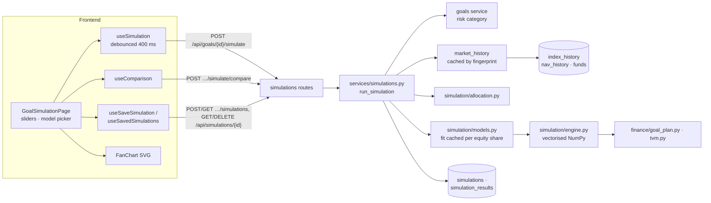
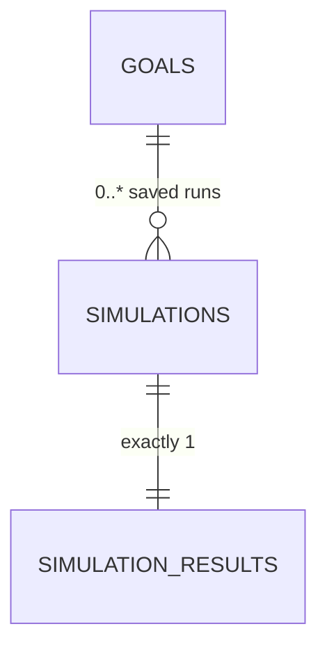
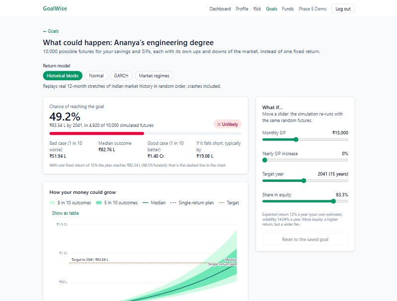
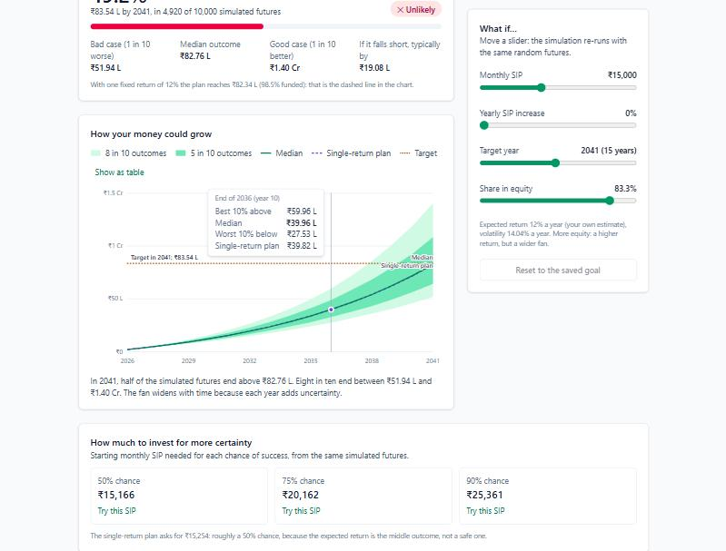
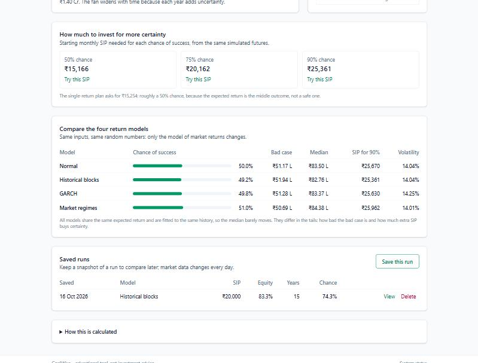
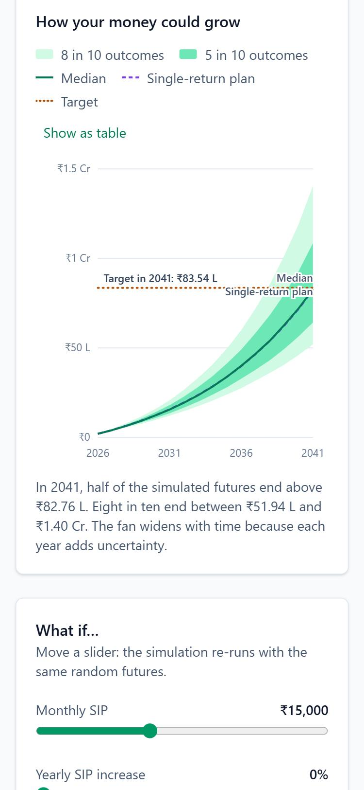

# Phase 5 – Monte Carlo Simulation Engine

| | |
|---|---|
| Branch | `phase-05-simulation` |
| Tag | `v0.5.0` |
| Dates | 2026-10-16 |
| Merge | Merged into `main` with a merge commit after CI passed (GitHub CLI not installed, so no PR) |
| Synopsis objective(s) covered | Goal-based planning under uncertainty: the probability of reaching each goal, the range of likely outcomes, and the investment needed for a chosen level of certainty, using real Indian market data |

## 1. Summary

A logged-in user can now open any goal and see:

1. The **chance of reaching it**: the share of 10,000 simulated market futures in which the savings and SIPs reach the inflation-adjusted target.
2. A **fan chart** of how the money could grow, year by year: the middle 50% and 80% of outcomes, the median, the single-return plan from Phase 3 and the target.
3. **What-if sliders** for the SIP, the yearly step-up, the target year and the share in equity; the simulation re-runs as they move.
4. The **SIP needed for a 50%, 75% or 90% chance** of success, worked out exactly from the same paths.
5. A **comparison of four return models** (historical blocks, normal, GARCH, market regimes) on identical inputs and random numbers.
6. **Saved runs**: snapshots of a simulation that can be reopened later.

| Before Phase 5 | After Phase 5 |
|---|---|
| 10 tables | 12 tables (+ `simulations`, `simulation_results`) |
| 25 endpoints | 31 endpoints (+ 6 simulations) |
| 255 tests | 325 tests |
| One number per goal ("₹82.34 L, 98.5% funded") | A probability and a range ("49.2% chance; 8 in 10 futures between ₹51.94 L and ₹1.40 Cr") |

## 2. Why this phase

The Phase 3 projection assumes the market returns exactly 12% every year. It never does. Nifty 500 returns over the last 13 years ranged from −24% in a single month (March 2020) to +15% in the next (April 2020). A plan built on one number answers "what if everything goes as expected?", but a family wants to know **"how likely is it that we will have the money?"** and **"how bad could it be?"**.

Monte Carlo simulation answers both by brute force: draw thousands of possible sequences of monthly returns, run the plan along each one, and count. Three things make it necessary rather than decorative:

- **Volatility.** The same average return gives very different outcomes.
- **Sequence-of-returns risk.** For a SIP, *when* the bad years come matters (section 4.1). A single-return projection cannot show this at all.
- **Certainty has a price.** Investing the Phase 3 "required SIP" gives only about a 50% chance (section 4.7). Knowing what a 90% chance costs is the decision a planner actually faces.

The simulation re-uses the Phase 3 formulas' conventions and the Phase 4 market data, and it is the function the chatbot (Phase 10) will call when a user asks "will I make it?".

## 3. What was added

### 3.0 Big picture



### 3.1 Database

**Migration `0006_create_simulation_tables`** (full dictionary in `docs/database.md`).



**`simulations`** – the question: one row per saved run.

| Column | Type | Constraint | Meaning |
|---|---|---|---|
| `id` | integer | PK | |
| `goal_id` | integer | FK → `goals.id` ON DELETE CASCADE; index `(goal_id, run_at)` | The goal simulated |
| `model` | varchar(20) | CHECK in (normal, bootstrap, garch, hmm) | Return model |
| `parameters` | jsonb | NOT NULL | Resolved inputs (after what-if changes), paths, seed, Phase 3 projection, volatility, fitted model parameters, data window |
| `run_at` | timestamptz | default `now()` | |

**`simulation_results`** – the answer: exactly one per simulation.

| Column | Type | Constraint | Meaning |
|---|---|---|---|
| `simulation_id` | integer | PK and FK → `simulations.id` ON DELETE CASCADE | Shared primary key = one-to-one |
| `success_probability` | double precision | CHECK 0–100 | % of paths reaching the target |
| `median_final` | double precision | NOT NULL | P50 at the goal date |
| `median_shortfall` | double precision | NULL allowed | Typical gap of the paths that miss |
| `final_percentiles` | jsonb | NOT NULL | P10, P25, P50, P75, P90, mean at the goal date |
| `required_sip` | jsonb | NOT NULL | SIP for a 50 / 75 / 90% chance |
| `bands` | jsonb | NOT NULL | One entry per year: P10–P90 + deterministic value (the fan chart) |
| `elapsed_ms` | integer | NOT NULL | Fit + simulation time |

Design points:

- **Stored, unlike projections.** Phase 3 recomputes projections on every read because they are cheap, exact and depend on today's date (ADR-006). A simulation run is random (reproducible only through its seed), depends on market data that changes every day, and takes up to a second. A saved run is therefore a **snapshot**: it records what the user was shown, like a printed report. Only runs the user saves are stored; the slider previews are not (they would add hundreds of rows per minute).
- **Two tables, one-to-one.** The run list needs the model, date, inputs and success probability, not the bands (16–61 entries × 7 numbers). Splitting the small "question" from the bulky "answer" keeps the list query light. The shared primary key (`simulation_results.simulation_id` is both PK and FK) makes "exactly one result per run" a structural fact rather than a rule.
- **JSONB for the bands and parameters.** Their shape depends on the goal (number of years) and the model (GARCH has α and β, the HMM a transition matrix). They are always read and written as a whole and never searched inside, which is when a document column beats extra tables. The values that *are* queried or listed (`success_probability`, `median_final`, `model`, `run_at`) are real columns.
- **`double precision`**, as for the Phase 4 metrics: these are statistics of a random experiment, not money.
- **Composite index `(goal_id, run_at)`** serves the only query, "runs of goal X, newest first", in index order.
- **Cascade.** Deleting a goal deletes its runs and their results (tested).

### 3.2 Backend

| File | Responsibility |
|---|---|
| `app/simulation/allocation.py` | `equity_share_for_return`, `return_for_equity_share`: the 13% equity / 7% debt blend (section 4.8) |
| `app/simulation/history.py` | `MarketHistory` (aligned monthly equity and debt returns); `align` (longest unbroken common run, latest incomplete month dropped); `portfolio_log_returns` (monthly rebalanced mix); `annualised_volatility` |
| `app/simulation/models.py` | `NormalModel`, `BlockBootstrapModel`, `GarchModel`, `RegimeModel` (2-state HMM): `fit` from a history, `shocks(rng, paths, months)` → centred log-return shocks, `annual_volatility`, `details()`; `preload_fitting_libraries` |
| `app/simulation/engine.py` | `run(goal, model, paths, seed)` → `SimulationOutcome` (success probability, percentiles, bands, median shortfall, required SIP for 50/75/90%); `year_end_components` (vectorised wealth); `deterministic_values` (Phase 3 line); `final_values_loop` (plain-loop reference) |
| `app/simulation/benchmark.py` | `python -m app.simulation.benchmark`: loops vs NumPy timing |
| `app/models/simulation.py` | `Simulation`, `SimulationResult` |
| `app/schemas/simulation.py` | `SimulationOverrides`, `SimulationRequest`, `ComparisonRequest`, `SimulationResultOut`, `SimulationRead`, `SimulationSummary`, `ComparisonOut` |
| `app/services/simulations.py` | SQL for monthly equity and debt returns; history cache keyed by a data fingerprint; fitted-model cache; `resolve_inputs` (overrides, automatic return, equity share); **`run_simulation`**; `compare_models`; save/list/read/delete |
| `app/api/routes/simulations.py` | Endpoints below; `409` for `SimulationUnavailable` |
| `app/schemas/goal.py` | `check_target_year` shared by goals and what-if overrides |
| `app/main.py` | Imports `arch`/`hmmlearn` in a background thread at start-up |
| `alembic/versions/0006_create_simulation_tables.py` | Migration |

New dependencies: `numpy` (now direct), `arch` 8.0 (GARCH fitting), `hmmlearn` 0.3 (HMM fitting); they bring SciPy, scikit-learn and statsmodels, which Phase 7 needs anyway.

**Endpoints added** (all require login)

| Method | Path | Request | Response | Errors |
|---|---|---|---|---|
| POST | `/api/goals/{id}/simulate` | `SimulationRequest` | `200` `SimulationResultOut` – **nothing saved** | `404` goal, `409` due / no data, `422` |
| POST | `/api/goals/{id}/simulate/compare` | `ComparisonRequest` | `200` `ComparisonOut` (4 models) | `404`, `409`, `422` |
| POST | `/api/goals/{id}/simulations` | `SimulationRequest` | `201` `SimulationRead` | `404`, `409`, `422` |
| GET | `/api/goals/{id}/simulations` | – | `200` list of `SimulationSummary`, newest first | `404` |
| GET | `/api/simulations/{id}` | – | `200` `SimulationRead` | `404` missing or another user's |
| DELETE | `/api/simulations/{id}` | – | `204` | `404` |

Example request (the what-if sliders send this):

```json
{ "model": "bootstrap", "paths": 10000, "overrides": { "monthly_sip": 20000, "equity_percent": 70 } }
```

Example response for the worked example (section 4.9), abridged:

```json
{
  "model": "bootstrap", "paths": 10000, "seed": 2026,
  "inputs": { "years": 15, "target_year": 2041, "inflated_target": 8354496.34, "monthly_sip": 15000,
              "expected_return": 12.0, "expected_return_source": "custom",
              "equity_percent": 83.3, "equity_source": "implied", "...": "..." },
  "success_probability": 49.2,
  "final": { "p10": 5194315.34, "p25": 6415922.72, "p50": 8275616.6, "p75": 10847823.11, "p90": 14049915.83, "mean": 9094727.89 },
  "median_shortfall": 1908237.32,
  "required_sip": [ { "probability": 50, "monthly_sip": 15166 }, { "probability": 75, "monthly_sip": 20162 },
                    { "probability": 90, "monthly_sip": 25361 } ],
  "deterministic": { "projected_value": 8233684.14, "funded_percent": 98.5, "on_track": false, "required_sip": 15254 },
  "annual_volatility": 14.04,
  "model_details": { "block_months": 12, "history_months": 164 },
  "history": { "equity_source": "Nifty 500 (^CRSLDX) month-end closes",
               "debt_source": "median monthly return of up to 137 bond funds (growth option)",
               "start": "2013-02-01", "end": "2026-09-01", "months": 164 },
  "bands": [ { "year": 0, "calendar_year": 2026, "p10": 200000.0, "...": "...", "deterministic": 200000.0 }, "… 15 more" ],
  "elapsed_ms": 139
}
```

**Why `409 Conflict`:** the request is well-formed (so not `422`) and the goal exists (not `404`), but the system is not in a state to answer: the goal is due this year (nothing to simulate), or a history-based model was asked for before the market data pipeline has run.

### 3.3 Frontend

| File | Responsibility |
|---|---|
| `src/api/simulations.ts` | Types mirroring the schemas; one function per endpoint |
| `src/hooks/useSimulations.ts` | `useSimulation` (400 ms debounce, previous result kept while re-running, cache by content and goal version), `useComparison` (on demand), `useSavedSimulations`, `useSavedSimulation`, `useSaveSimulation`, `useDeleteSimulation` |
| `src/components/FanChart.tsx` | Dependency-free SVG fan chart: two bands, median, dashed single-return plan, dotted target; legend and direct labels; crosshair tooltip; arrow keys / Home / End; "Show as table" |
| `src/pages/GoalSimulationPage.tsx` | Model picker (radio group), headline chance with verdict label and meter, key numbers, fan chart with a sentence summary, what-if sliders, SIP for 50/75/90% ("Try this SIP"), model comparison table, saved runs (save, view in a dialog, delete), "How this is calculated" |
| `src/pages/GoalsPage.tsx` | "Simulate" button on every goal card |
| `src/lib/chart.ts` | `niceTicks`, now shared by `LineChart` and `FanChart` |
| `src/lib/format.ts` | `formatAxisMoney` (₹50 L, ₹1.5 Cr), model names and one-line descriptions |
| `src/router.tsx`, `src/components/Layout.tsx` | `/goals/:goalId/simulate`; "Goals" stays highlighted there |

**Chart design.** A fan chart shows a *distribution over time*, so the bands use one hue from light to dark (a sequential ramp: the wider, less likely band is lighter). The median is the darkest line. The Phase 3 projection is a dashed violet line and the target a dotted amber line, colours checked with a palette validator for colour-blind separation and contrast on white; each also has a distinct dash pattern, a legend entry and a direct label, so colour is never the only cue. The chance of success is a **single number**, so it is shown as a large figure with a verdict label (✓ Likely ≥ 80%, ! Uncertain 50–80%, ✕ Unlikely < 50%: icon and word, not colour alone) rather than a decorative dial. The plan suggested a Plotly chart; the existing dependency-free SVG approach of Phase 4 was kept instead (Plotly adds ~1 MB gzipped to a bundle that is already over 500 kB).

### 3.4 Integration and orchestration

**Moving a slider**

```mermaid
sequenceDiagram
    participant U as User
    participant P as GoalSimulationPage
    participant Q as useSimulation (TanStack Query)
    participant API as POST /api/goals/4/simulate
    participant S as services/simulations.py
    participant C as caches
    participant E as engine + models
    U->>P: drags "Monthly SIP" 15,000 → 20,000 (10 steps)
    P->>Q: new request object on every step
    Q->>Q: wait until 400 ms without change (1 request, not 10)
    Q->>API: {model, overrides: {monthly_sip: 20000}}
    API->>S: run_simulation(user, goal, request)
    S->>S: resolve_inputs: SIP 20,000; return 12% (custom); equity 83.3% (implied)
    S->>C: market_history(db): fingerprint unchanged → cached history
    S->>C: _fitted("bootstrap", history, 0.833) → cached model
    S->>E: engine.run(inputs, model, 10,000 paths, seed 2026)
    E-->>S: outcome (~0.1 s)
    S-->>API: SimulationResultOut
    API-->>Q: 200
    Q-->>P: chance 49.2% → 74.3%; fan and numbers update
```

| Concern | How it is handled |
|---|---|
| Formulas in one place | The engine reuses `goal_plan.GoalInputs`, `project_goal` and `tvm`; the frontend never simulates |
| Not flooding the server | 400 ms debounce; identical requests answered from the browser cache (same inputs + seed = same answer) |
| Expensive steps done once | The market history (≈1.1 s SQL over 2.5 M NAVs) is cached until the data changes (fingerprint: latest dates and row counts); fitted models are cached per (model, history, equity share); `arch`/`hmmlearn` are imported at start-up |
| Comparable runs | Fixed default seed: a slider changes only its input, not the random numbers |
| Edits to the goal | The goal's `updated_at` is part of the query key, so saved changes trigger a fresh run |
| Units | Percentages at the API, fractions in `app/simulation`, converted in the service, as in Phase 3 |

## 4. Key logic explained

Notation: *r* = expected annual return, *i* = (1 + r)^(1/12) − 1 (Phase 3's effective monthly rate), *μ* = ln(1 + i) = ln(1 + r)/12, *σ* = monthly volatility, *V* = value of the plan, *P* = SIP.

### 4.1 Why simulate: sequence-of-returns risk

Two three-year market histories with exactly the same returns in a different order:

| Year | Sequence A | Sequence B |
|---|---|---|
| 1 | +30% | −20% |
| 2 | 0% | 0% |
| 3 | −20% | +30% |
| **Lump sum ₹3 L invested at the start** | 3 × 1.3 × 1.0 × 0.8 = **₹3.12 L** | 3 × 0.8 × 1.0 × 1.3 = **₹3.12 L** |
| **₹1 L invested at the start of each year** | 1.3 → 2.3 → 3.3 × 0.8 = **₹2.64 L** | 0.8 → 1.8 → 2.8 × 1.3 = **₹3.64 L** |

Multiplication does not care about order, so the lump sum ends the same. A SIP does: in sequence A the crash hits when the most money is invested. The difference (₹1 L, 38%) is invisible to any single-return projection. Monte Carlo simulates both orders, and every other one, many times.

### 4.2 The engine

Each path starts with today's savings and runs month by month, with the Phase 3 cash-flow rules:

  V₀ = current savings  V_{t+1} = (V_t + P_t) × e^{R_t}  R_t = μ + ε_t  P_t = P × (1 + s)^⌊t/12⌋

The SIP is invested at the start of the month (annuity due) and raised by the step-up *s* every 12 months. ε_t is the **shock** drawn by the return model, with mean 0.

**Zero volatility gives Phase 3 exactly.** With ε = 0, e^{R} = e^{ln(1+i)} = 1 + i, the same monthly growth as Phase 3, and the recursion becomes the month-by-month check of Phase 3 section 4.3:

| Worked example (Phase 3, section 4.5) | Phase 3 formula | Engine, σ = 0 |
|---|---|---|
| Savings ₹2 L for 15 years at 12% | 2,00,000 × 1.12¹⁵ = 10,94,713.15 | same path |
| SIP ₹15,000 for 180 months | 15,000 × 475.9314 = 71,38,970.99 | same path |
| **Value in 2041** | **₹82,33,684.14** | **₹82,33,684.14** (to 12 significant digits, every percentile) |
| SIP for any success level | ₹15,254 | ₹15,254 |
| Chance of reaching ₹83,54,496.34 | 98.5% funded → not on track | **0%** (every path is ₹1,20,812 short) |

Tested for a flat SIP and a 10% step-up (`test_zero_volatility_reproduces_the_phase_3_projection`).

**Vectorised.** Write G_t = e^{R_0 + … + R_{t−1}} for the growth of ₹1 from today to month *t*. A rupee invested at month *s* has grown by G_t / G_s at month *t*, so

  V_t = G_t × (V₀ + Σ_{s<t} P_s / G_s)

and the whole 10,000 × 180 grid is two cumulative sums (`np.cumsum`) and one `np.exp`, with no Python loop over paths or months. The value at the goal date is **linear in the SIP**:

  V_n = A + P × B,  A = V₀ × G_n,  B = Σ_s k_s × G_n / G_s  (k_s = step-up factor of month s)

which gives the exact SIP for any success probability (section 4.7).

**Hand-checkable case** (`test_hand_calculated_two_paths`): ₹1,00,000 for one year, no SIP, target ₹1,00,000, two paths whose monthly log return is +1% or −1% every month.

| | Path 1 | Path 2 |
|---|---|---|
| Value after 12 months | 1,00,000 × e^{0.12} = **₹1,12,749.69** | 1,00,000 × e^{−0.12} = **₹88,692.04** |
| Reaches ₹1,00,000? | yes | no, short by ₹11,307.96 |
| B = value of ₹1 a month, start of month | | Σ e^{−0.01(12−s)}, s = 0..11 = 11.2515 |
| SIP needed | 0 | 11,307.96 ÷ 11.2515 = 1,005.02 → **₹1,006** |

Chance of success 1 of 2 = 50%; SIP for a 50% chance ₹0, for a 90% chance (both paths) ₹1,006; P50 = midpoint = ₹1,00,720.86.

### 4.3 The expected return is the median, not the mean (ADR-008)

Log returns add up: after *n* months, ln(G_n) = nμ + Σε, which is approximately normal with mean nμ. So the **median** of G_n is e^{nμ} = (1 + r)^{n/12}, exactly the Phase 3 growth: half the paths grow faster than the plan assumes, half slower. The **mean** is higher, because a log-normal distribution is skewed to the right:

  E[G_n] = e^{nμ + nσ²/2} = median × e^{nσ²/2}

With 15% annual volatility for 10 years (σ² = 0.15²/12, n = 120): e^{0.1125} = 1.119, so the average outcome is 11.9% above the median while the typical outcome is the plan (`test_median_of_a_lump_sum_is_the_deterministic_value`). Consequence: **a plan that is exactly 100% funded on paper has only a ~50% chance** (`test_a_plan_that_exactly_meets_the_target_succeeds_about_half_the_time`).

Why the median: people quote returns as CAGRs, and with this convention the deterministic plan is the middle of the fan, so the Phase 3 page and the simulation page tell the same story. Treating 12% as the *mean* would put the median *below* the plan ("volatility drag": the median compound growth ≈ mean − σ²/2).

### 4.4 Where the volatility comes from: Phase 4 data

| Series | Source table | Construction |
|---|---|---|
| Equity | `index_history` | Nifty 500 (`^CRSLDX`) close on the last trading day of each month; monthly change |
| Debt | `nav_history` + `funds` | For every growth-option bond fund (corporate bond, banking & PSU, short/medium duration, gilt, dynamic bond; old and new SEBI names), the last NAV of each month and its monthly change; the **median** across funds each month (at least 3 funds) |
| Portfolio | – | ln(1 + e × R_equity + (1 − e) × R_debt): a mix rebalanced every month, *e* = equity share |

Rules: only consecutive months count (a gap is never treated as one long month); the two series are aligned on the **longest unbroken run** of common months; the month of the newest data is dropped because it is incomplete. Liquid, overnight and money-market funds are excluded (they behave like cash), as are credit-risk funds (defaults and side pockets), and IDCW options (their NAV drops at every payout, which is not a loss). The median makes a single fund's accident irrelevant.

Real numbers (local data, 16 Oct 2026): **Feb 2013 – Sep 2026, 164 months**, up to 137 bond funds.

| | Equity | Debt |
|---|---|---|
| Annual volatility | 16.82% | 2.18% |
| Worst month | −24.25% (March 2020) | |
| Best month | +14.52% (April 2020) | |
| Correlation | 0.248 | |

| Equity share | 0% | 16.7% | 50% | 83.3% | 100% |
|---|---|---|---|---|---|
| Portfolio volatility | 2.18% | 3.65% | 8.63% | 14.04% | 16.82% |

At 83.3% equity the monthly returns have a **kurtosis of 8.8** (a normal distribution has 3: real markets have fat tails) and the squared returns have a lag-1 autocorrelation of 0.21 (volatility clusters), while the returns themselves are uncorrelated (−0.007). Those are exactly the facts the models below try to capture.

Each model is fitted to the history **minus its mean**: it supplies the shape of risk, the goal supplies the level (section 4.3). Historical averages are too noisy to plan with: the standard error of 13.7 years of equity returns is 16.8% / √13.7 = 4.5% a year.

### 4.5 The four return models

All four produce centred shocks ε (mean 0); they differ in how the shocks are distributed and how they depend on each other.

**1. Normal (log-normal prices).** ε_t = σ z_t with z_t ~ N(0, 1), independent. σ = sample standard deviation of the monthly log returns (0.04054 a month = 14.04% a year at 83.3% equity). The textbook model; misses fat tails and clustering.

**2. Block bootstrap (default).** No distribution is assumed: the future is assembled from real months. Draw a random starting month, copy the next 12 months of (centred) history, repeat until the horizon is covered:

```
history (centred):  m0 m1 m2 … m163
path:  [m57 m58 … m68] [m151 m152 m153 … m163 m0 m1 m2 m3 m4 m5]  [m12 …]
        block 1          block 2 (wraps around the end: "circular")
```

- *Why blocks:* single months would keep the distribution (fat tails, the March 2020 crash) but destroy patterns across months, such as a crash followed by a rebound. Blocks of 12 keep them inside each block (`test_bootstrap_blocks_keep_month_to_month_patterns`: a history that alternates +5%/−5% keeps an autocorrelation below −0.8 with blocks, ~0 with single months).
- *Why circular:* wrapping from the last month to the first makes every month equally likely to be drawn, so the shocks average exactly 0 (with a plain moving-block bootstrap the first and last months are drawn less often).

**3. GARCH(1, 1): volatility that clusters.**

  ε_t = σ_t z_t,  σ²_t = ω + α ε²_{t−1} + β σ²_{t−1}

A large shock last month (ε²) raises this month's variance (α); a high variance persists (β). If α + β < 1 the variance returns to its long-run level ω / (1 − α − β). Paths start at that long-run level. Hand example (ω = 0.0002, α = 0.1, β = 0.8, long-run variance 0.002 = 15.5% a year): after a −10% shock, next month's variance is 0.0002 + 0.1 × 0.01 + 0.8 × 0.002 = 0.0028 (18.3% a year), then it decays back by a factor α + β = 0.9 a month (half-life ln 0.5 / ln 0.9 = 6.6 months).

Fitted by maximum likelihood (`arch`) to the 83.3%-equity history: **ω = 0.00113, α = 0.33, β ≈ 0**, persistence 0.33, half-life 0.6 months, long-run volatility 14.25%. On *monthly* data volatility shocks fade within about a month: the clustering is real (squared-return autocorrelation 0.21) but short, and GARCH's strength is daily data. The test `test_garch_fit_recovers_known_parameters` shows the fitting itself works: on 5,000 simulated months with α = 0.15, β = 0.75 it recovers both within tolerance.

**4. Two-state hidden Markov model: market regimes.** The market is in a hidden *calm* or *turbulent* regime; each regime has its own mean and volatility, and the regime moves on each month by a transition matrix P (P[i][j] = probability of moving from i to j):

  P = [[P_cc, P_ct], [P_tc, P_tt]],  long-run share of calm months π_c = P_tc / (P_ct + P_tc),  average stay in regime k = 1 / (1 − P_kk)

Hand example (test): P = [[0.9, 0.1], [0.3, 0.7]] gives π = (0.3/0.4, 0.1/0.4) = (75%, 25%), calm spells of 10 months, turbulent spells of 3.3 months.

Fitted by the EM (Baum–Welch) algorithm (`hmmlearn`, best of 5 starting points) to the real history:

| Regime | Volatility | Return vs average | Stays next month | Average spell | Share of months |
|---|---|---|---|---|---|
| Calm | 12.2% a year | +1.8% a year | 98.0% | 49.6 months | 96.9% |
| Turbulent | 38.0% a year | −55% a year | 37.6% | 1.6 months | 3.1% |

The model found what an investor would: long calm stretches interrupted by short, violent crashes. Paths start in a regime drawn from the long-run shares, and the regime means are shifted together so the shocks average 0.

| | Normal | Bootstrap | GARCH | HMM |
|---|---|---|---|---|
| Fat tails | no | yes (real months) | some | yes (mixture) |
| Volatility clustering | no | inside blocks | yes | yes (regimes) |
| Distribution assumed | normal | none | normal given σ_t | normal per regime |
| Parameters | 1 | 0 (the data) | 3 | 6 |

### 4.6 Allocation and return

The equity slider needs to change both risk and return. Two long-run planning returns, equity 13% and debt 7%, link them:

  r = 7% + 6% × e  e = (r − 7%) / 6% (clamped to 0–100%)

| Phase 3 assumption | 7% (< 3 years) | 8% conservative | 10% moderate / default | 12% aggressive |
|---|---|---|---|---|
| Implied equity share | 0% | 16.7% | 50% | 83.3% |

A goal's return (custom, risk profile, short horizon) sets its default equity share; moving the slider sets the return (source "allocation"). Example: 30% equity → 7% + 1.8% = **8.8%** (`test_what_if_overrides`). Phase 8 replaces the blend with an optimised allocation.

### 4.7 Results: success probability, percentiles, SIP for a chosen certainty

- **Success probability** = share of paths whose value at the goal date reaches the inflated target (half-rupee tolerance, as Phase 3's on-track test).
- **Percentile bands:** for each year, the 10th, 25th, 50th, 75th and 90th percentile of the values across paths. "8 in 10 outcomes" = P10–P90. These are *not* paths: the P10 line in 2035 and in 2041 may come from different paths.
- **Median shortfall:** among the paths that miss, the typical gap ("if it falls short, typically by ₹19.08 L").
- **SIP for probability q, exactly:** on path *p* the goal is reached when A_p + P × B_p ≥ target, i.e. P ≥ (target − A_p) / B_p. Sort those 10,000 thresholds; the one at position ⌈q × 10,000⌉ is the smallest SIP with which at least q of the paths succeed (NumPy `quantile(..., method="inverted_cdf")`), rounded **up** to the rupee as in Phase 3. One run gives every probability, with no trial and error; `test_required_sip_reaches_its_success_level` checks that the SIP reaches its level and that one rupee less does not.

**How many paths?** The success probability is an average of 10,000 yes/no outcomes, so by the law of large numbers its standard error is √(p(1 − p)/N): at p = 0.5 and N = 10,000, **0.5 percentage points** (a 95% interval of about ±1 point). Precision grows only with √N: 16 times the paths give 4 times the precision (`test_estimate_error_shrinks_with_the_square_root_of_paths`: measured ratio between 2.5 and 6 across 30 seeds). 100,000 paths would cost 10× the time to narrow ±1 point to ±0.3.

**Common random numbers.** The default seed is fixed (2026). Moving one slider re-runs the *same* 10,000 market futures with a different SIP, so the change in probability is caused by the SIP alone and a higher SIP can never show a lower chance (`test_common_random_numbers_make_a_higher_sip_never_worse`). The seed is stored with every saved run, which can be reproduced exactly.

### 4.8 Vectorisation (timing)

`uv run python -m app.simulation.benchmark` (10,000 paths × 180 months = 1.8 million path-months, same shocks for both):

| Implementation | Time | |
|---|---|---|
| Plain Python loops over paths and months | 1,671 ms | |
| NumPy: `cumsum`, `exp`, `divide`, `cumsum` | **56 ms** | **30× faster**, largest difference ₹0.000000 |
| Full `engine.run` (random draws + wealth + percentiles + required SIPs) | 213 ms | |

NumPy runs each operation as one compiled loop over a contiguous array, instead of 1.8 million interpreted Python steps. GARCH and the HMM still loop over the 180 months (each month depends on the last), but each step works on all 10,000 paths at once.

### 4.9 Worked example: Ananya's engineering degree

Same goal as Phase 3: ₹20 L today, 2041, education inflation 10%, return 12% (custom), ₹2 L saved, ₹15,000 a month. The return implies 83.3% equity (section 4.6), portfolio volatility 14.04%.

| Model (10,000 paths, seed 2026) | Chance | Bad case P10 | Median | Good case P90 | SIP for 90% |
|---|---|---|---|---|---|
| Single-return plan (Phase 3) | 0% (98.5% funded) | | ₹82.34 L | | ₹15,254 for "on track" |
| Normal | 50.0% | ₹51.17 L | ₹83.50 L | ₹1.41 Cr | ₹25,670 |
| **Historical blocks (default)** | **49.2%** | **₹51.94 L** | **₹82.76 L** | **₹1.40 Cr** | **₹25,361** |
| GARCH | 49.8% | ₹51.28 L | ₹83.37 L | ₹1.41 Cr | ₹25,630 |
| Market regimes | 51.0% | ₹50.69 L | ₹84.38 L | ₹1.42 Cr | ₹25,962 |

Reading it:

1. The plan is 98.5% funded on paper, so it succeeds in **about half** of the futures (section 4.3).
2. In a bad case (1 in 10) the family has ₹51.94 L, **₹31.6 L short** of ₹83.54 L; when it misses, it typically misses by ₹19.08 L.
3. For a 75% chance invest **₹20,162** a month; for 90%, **₹25,361**, 66% more than the ₹15,254 the single-number plan asks for. Certainty is expensive.
4. With ₹20,000 a month (what-if slider) the chance rises to **74.3%**; adding a 10% yearly step-up to ₹15,000 makes the plan on track on paper.
5. The four models agree on the median (pinned by the 12% assumption) and differ in the tails: the regime model has the widest spread and needs the most for 90%, the bootstrap the least.

| Simulation page | Fan chart with tooltip | Model comparison and saved runs | Phone |
|---|---|---|---|
|  |  |  |  |

## 5. Design decisions

| Decision | Alternatives considered | Why this choice |
|---|---|---|
| Expected return = median growth rate | Arithmetic mean | Zero volatility = Phase 3 exactly; matches how returns are quoted (ADR-008) |
| Level from the goal, shape from history | Historical mean and volatility | Historical means have a ±4.5%/year standard error; the user owns the assumption |
| Bootstrap as default model | Normal | No distribution assumed; real crashes and tails included |
| 12-month circular blocks | Single months; stationary bootstrap | Keeps within-year patterns; every month equally likely; simple |
| `arch`/`hmmlearn` to fit, own NumPy to simulate | All own code; libraries for both | Robust optimisation; vectorised, seeded simulation with visible parameters |
| GARCH/HMM start at the long-run state | Today's state | Long plans should not depend on this month's mood; stable day to day |
| One rebalanced portfolio series | Two correlated series | Simpler models; standard planning assumption |
| Equity share ↔ return via 13%/7% | Independent sliders | Consistent with the Phase 3 table; more equity = more return and more risk |
| Fixed default seed, stored | New randomness each run | Reproducible; sliders compare like with like |
| Store only saved runs, two tables 1:1 | Store every run; one table | Previews would flood the table; list query stays light |
| Exact SIP from the linear form | Bisection search over re-runs | One run, exact, every probability |
| 10,000 paths | 1,000 / 100,000 | ±1 point at 95%; ~0.1–0.2 s |
| History and fits cached in memory | Recompute per request; store in the DB | 1.1 s SQL and up to 0.5 s HMM fit avoided per slider move; fingerprint invalidates on new data |
| SVG fan chart | Plotly | No 1 MB dependency; same look, keyboard and table access as Phase 4 |
| `409` for "goal due" / "no market data" | `400`, `422` | Valid request, system state does not allow it |

## 6. Testing

| Test file | Tests | What is checked |
|---|---|---|
| `test_simulation_engine.py` | 27 | **Zero volatility = Phase 3** (flat and step-up: every percentile, every year, required SIP, success all-or-nothing); required SIP gives 100%; documented worked-example numbers; **hand-calculated two-path case**; vectorised = plain loops (to 10⁻¹²); step-up schedule; bands start at savings, widen and are ordered; **required SIP reaches its level, one rupee less does not**; due goal raises; same seed same answer; common random numbers; **median of a lump sum = deterministic, mean = median × e^{nσ²/2}**; **100%-funded plan ≈ 50%** (within 3 standard errors); more volatility → wider and less certain; **error shrinks with √N**; allocation mapping (7 cases) and inverse; portfolio return by hand; alignment rules |
| `test_simulation_models.py` | 17 | Normal: mean 0 and fitted σ; assumed volatility by hand. Bootstrap: draws whole circular blocks of real months, centred, keeps fat tails (kurtosis > 3.5) and month-to-month patterns. GARCH: long-run variance and half-life by hand, clustering of squared shocks (normal model has none), **fit recovers known α, β**. HMM: stationary shares and spells by hand, centred mixture volatility, **fit finds the two regimes** of synthetic data. All four: reproducible with a seed, centred, keep the history's volatility |
| `test_simulations_api.py` | 26 | Login required; worked example end to end (inputs, implied equity, Phase 3 comparison, bands, history window); all four models; reproducible with a seed; what-if overrides (SIP, year, equity → 8.8%, step-up) do not change the goal; automatic return → 50% equity; preview saves nothing; 9 invalid requests → 422; without market data only normal runs (assumed volatility 15.01%), others 409; due goal 409; comparison = individual runs; save → read returns the identical body, list newest first, delete; other users get 404; goal delete cascades; database CHECKs |
| Earlier phases | 255 | Unchanged, all passing |
| **Total** | **325** | **All passed** locally (~70 s); GitHub Actions: see below |

Every random test uses a fixed seed, so the statistical tests are deterministic (no flaky failures); their tolerances are set from the theory (standard errors) rather than tuned to pass.

**Manual end-to-end test in the browser** (2026-10-16, local data):

| Step | Expected | Result |
|---|---|---|
| Goals → **Simulate** on the worked example | Bootstrap model, 49.2%, "✕ Unlikely", fan chart with target ₹83.54 L, Phase 3 line ₹82.34 L | Pass |
| Drag "Monthly SIP" 10 steps to ₹20,000 | **One** `/simulate` request after the pause; 74.3% | Pass |
| Market regimes model | 74.8%, description changes | Pass |
| Compare models | Four rows, same inputs | Pass |
| Save this run → View | Run listed; dialog shows the same numbers and seed | Pass |
| Hover / arrow keys on the chart | Year read-out with best 10%, median, worst 10%, plan | Pass |
| Goal with automatic return (no risk profile) | 10% "default", 50% equity, volatility 8.63% | Pass |
| Phone width (375 px) | No horizontal scrolling; sliders below the chart | Pass |
| Console | No errors except the existing 404s for a user without a profile | Pass |

## 7. How to run / demo this phase

```bash
cd backend
uv sync
uv run alembic upgrade head
uv run pytest -v tests/test_simulation_engine.py tests/test_simulation_models.py tests/test_simulations_api.py
uv run python -m app.simulation.benchmark          # loops vs NumPy
```

1. Start database, backend and frontend as in Phase 0; load market data as in Phase 4 (otherwise only the normal model runs).
2. Log in → **Goals** → **Simulate** on a goal (e.g. the Phase 3 worked example).
3. Read the chance and the fan chart; hover the chart; switch models.
4. Move the sliders; press **Try this SIP** under "90% chance" and watch the chance reach 90%.
5. **Compare models**; **Save this run**, then **View** it.
6. In Swagger (`/docs`): `POST /api/goals/{id}/simulate` with `{"model": "garch", "overrides": {"equity_percent": 40}}`.
7. Inspect saved runs:

   ```bash
   docker exec goalwise-db psql -U goalwise -d goalwise -c "SELECT s.id, s.model, s.run_at, r.success_probability, r.median_final, s.parameters->'inputs'->>'monthly_sip' AS sip FROM simulations s JOIN simulation_results r ON r.simulation_id = s.id;"
   ```

## 8. Problems faced and how they were solved

| Problem | Cause | Fix |
|---|---|---|
| The first GARCH request took ~13 s | Importing `arch` loads pandas, SciPy and statsmodels; slow on Windows | Import `arch` and `hmmlearn` in a background thread when the API starts |
| Debt fund returns looked like losses on some months | IDCW options' NAV drops on every payout | Growth options only; median across funds |
| Bootstrap shocks did not average exactly zero | A moving-block bootstrap draws the first and last months less often | Circular blocks (wrap around) |
| GARCH fitted on monthly returns had β ≈ 0 | Monthly data averages out short-lived volatility clusters; on 164 points the likelihood prefers ARCH(1) | Kept (it is the honest estimate); documented; parameter-recovery test proves the fitter on synthetic data; persistence capped below 1 if a fit ever reaches it |
| The HMM converged to different answers | EM finds a local maximum depending on the start | Best of 5 seeded starts by likelihood; states ordered by volatility |
| `hmmlearn` printed hundreds of NumPy deprecation warnings in the tests | Library code sets `ndarray.shape` (deprecated in NumPy 2.5) | Filtered in `pyproject.toml` with a comment; not our code |
| Zero-volatility test failed by ₹0.0004 | Phase 3 rounds `projected_value` to the paisa | Compare to the paisa against Phase 3 and to 10⁻¹² against the unrounded formula |
| The fan chart's top had no gridline label | Ticks stopped below the highest P90 | Extend the axis to the next round tick; compact labels (₹1.5 Cr) |
| Ports 8000/5173 held by another session | Parallel work | Backend on 8001 and the `frontend-8001` launch configuration |

## 9. Viva questions and answers

1. **Q: What is Monte Carlo simulation and why use it for goal planning?**
   A: Estimating something uncertain by simulating many random scenarios and counting outcomes. A single-return projection hides the spread of outcomes and sequence risk; simulating 10,000 market futures gives the probability of success, a bad case, and the SIP for a chosen certainty.

2. **Q: How does the law of large numbers decide the number of paths?**
   A: The estimated probability is an average of N yes/no results, so it converges to the true value with standard error √(p(1−p)/N). For N = 10,000 and p = 0.5 that is 0.5 points (±1 at 95%). Precision grows with √N, so 10× more paths give only ~3× more precision.

3. **Q: What is sequence-of-returns risk?**
   A: For regular investments (or withdrawals) the order of returns matters, because the amount exposed changes over time. Table 4.1: the same three returns give ₹2.64 L or ₹3.64 L for a SIP depending on order, but the same ₹3.12 L for a lump sum.

4. **Q: Why does a plan that is 100% funded have only about a 50% chance?**
   A: The expected return is the median growth rate. Half the futures grow faster, half slower, so a plan that exactly reaches the target at the median reaches it in about half the futures. Certainty needs a margin: here ₹25,361 instead of ₹15,254 for 90%.

5. **Q: Why is the median above, below or equal to the mean of the final value?**
   A: Below. Compounding makes final values log-normal, skewed right: mean = median × e^{nσ²/2}. A few very good paths pull the mean up; the typical outcome is the median.

6. **Q: How did you check the simulation is correct?**
   A: Four ways: zero volatility reproduces the Phase 3 projection to 12 digits; a hand-calculated two-path case; the vectorised engine equals a plain-loop implementation; statistical properties match theory (median, mean, ~50% for a funded plan, √N error), all with fixed seeds.

7. **Q: Why bootstrap in blocks rather than single months?**
   A: Single months keep the distribution but destroy dependence between months (crash then rebound, calm years). Blocks of 12 keep those patterns. Circular blocks make every month equally likely, so the shocks average exactly zero.

8. **Q: What does GARCH(1,1) capture? Explain α and β.**
   A: Volatility clustering. Next month's variance = ω + α × (last shock)² + β × (last variance). α is the reaction to news, β the memory; α + β is persistence, the long-run variance is ω/(1 − α − β). On our monthly data α = 0.33, β ≈ 0: shocks fade within a month.

9. **Q: What does the hidden Markov model capture?**
   A: Regimes: the market is calm or turbulent, each with its own mean and volatility, and switches by a transition matrix. Fitted: calm 12% volatility lasting ~50 months, turbulent 38% volatility lasting ~1.6 months, 3% of the time: crashes.

10. **Q: Why is it "hidden"?**
    A: We only observe returns, never the regime. The EM (Baum–Welch) algorithm estimates the regime probabilities and parameters together, maximising the likelihood of the observed returns.

11. **Q: If the models are so different, why do they give similar success probabilities?**
    A: The median is pinned by the same 12% assumption and all are fitted to the same history, so they share the volatility. They differ in the tails (P10, SIP for 90%), which matters most for a cautious plan.

12. **Q: Why not use the historical average return?**
    A: Thirteen years of equity returns give an average with a standard error of ~4.5% a year: the true long-run return could plausibly be 8% or 17%. The user's (or risk profile's) assumption is explicit and controllable; history supplies the risk.

13. **Q: How do you compute the SIP needed for a 90% chance?**
    A: Value at the goal date is A + SIP × B on every path, so each path has a threshold SIP (target − A)/B. The 90th percentile of the thresholds (inverted-CDF) is the smallest SIP with which 90% of paths succeed. One run, exact.

14. **Q: What are common random numbers and why use a fixed seed?**
    A: Using the same random draws when comparing alternatives, so differences come from the change, not from noise. With a fixed seed, moving the SIP slider shows only the SIP's effect, and saved runs can be reproduced exactly.

15. **Q: Vectorisation vs loops: show the timing.**
    A: 1.8 million path-months: 1,671 ms with Python loops, 56 ms with NumPy cumulative sums (30× faster), identical results. NumPy executes compiled loops over contiguous arrays instead of interpreting each step.

16. **Q: How can the wealth recursion be vectorised when each month depends on the last?**
    A: It has a closed form: V_t = G_t × (V₀ + Σ P_s / G_s), with G the cumulative growth. Cumulative growth is `exp(cumsum(log returns))`, and the sum is another `cumsum`. GARCH variance has no such form, so it loops over months but vectorises across paths.

17. **Q: Why are simulation runs stored but goal projections are not?**
    A: A projection is cheap, exact and depends on today's date, so storing it would make it stale. A simulation is random, depends on market data that changes daily and costs time; the saved copy is a snapshot of what the user saw, with its seed for reproduction.

18. **Q: Why two tables for one run?**
    A: The list of runs needs small fields; the bands are bulky JSON. A one-to-one split with a shared primary key keeps the list query light and makes "exactly one result per run" structural.

19. **Q: Why JSONB for the bands instead of a table of rows?**
    A: Their length depends on the goal and they are always read and written as a whole, never queried inside. Columns that are filtered or listed (success probability, model, date) are proper columns.

20. **Q: How is the equity slider connected to the return?**
    A: r = 7% + 6% × equity share, from long-run equity 13% and debt 7%. It reproduces the Phase 3 table (e.g. 12% = 83.3% equity), so more equity means both higher return and higher volatility.

21. **Q: Where does the volatility data come from?**
    A: Phase 4 tables: Nifty 500 month-end closes and the median monthly return of ~137 growth-option bond funds, aligned over Feb 2013 – Sep 2026 (164 months). Without that data only the normal model runs with assumed volatilities.

22. **Q: What are the limitations?**
    A: Inflation is fixed; taxes and fund costs are ignored; history starts in 2013 (no 2008 crash); one rebalanced portfolio rather than separate assets; return assumptions are planning numbers. The result is a planning aid, not a forecast.

## 10. Report mapping

- **System Analysis – Problem definition**: section 2 (uncertainty, sequence risk), 4.1
- **System Design – Database Design**: section 3.1 (snapshots vs computed-on-read, one-to-one with shared key, JSONB vs columns, composite index)
- **System Design – API Design**: section 3.2 (preview vs save endpoints, `409`)
- **Mathematical and Statistical Techniques**: sections 4.2–4.8 (engine equations, median vs mean, bootstrap, GARCH, HMM, quantile SIP, law of large numbers, vectorisation)
- **Implementation – Simulation module**: sections 3.2–3.4
- **Results**: section 4.9 (worked example, model comparison), 4.8 (timing)
- **Testing**: section 6 (hand-checked, statistical, API, manual)
- **Limitations**: deterministic inflation; no taxes or costs; history from 2013; univariate portfolio; return assumptions fixed until Phase 8
- **Future Enhancements**: stochastic inflation; stationary bootstrap with automatic block length; multi-asset models with correlation; glide path (less equity as the goal nears); goal-level confidence targets feeding the Phase 8 recommendations
