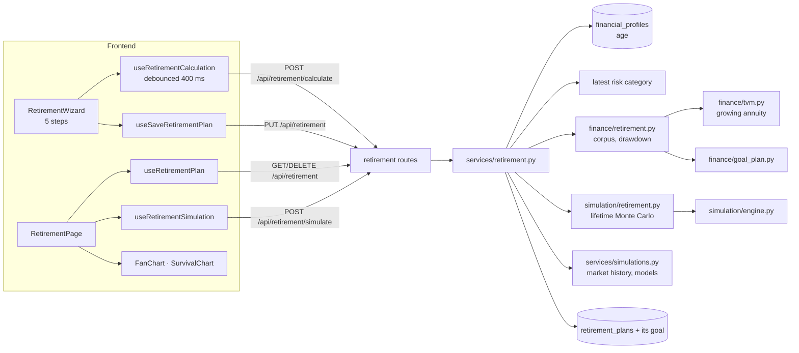
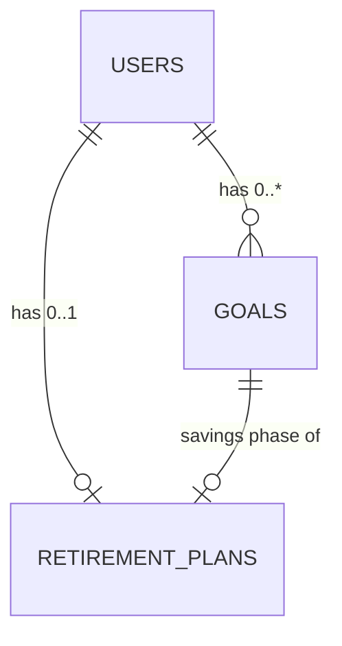
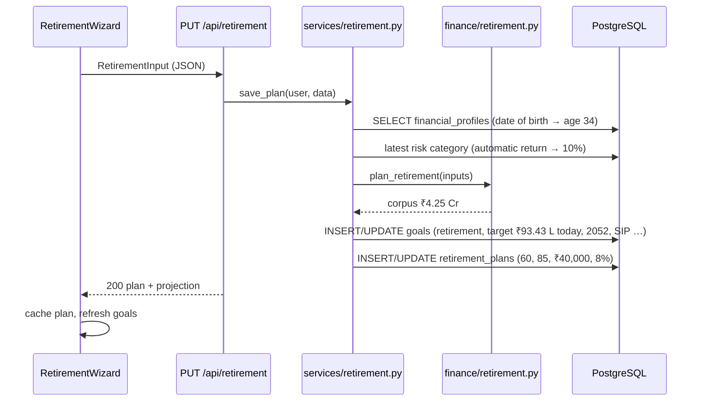
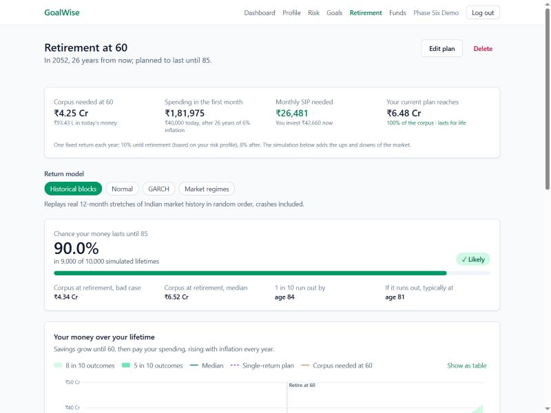
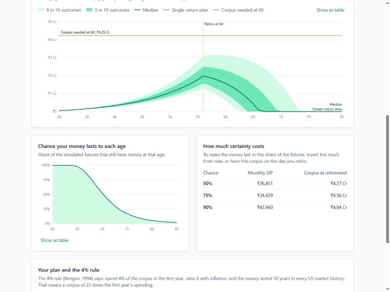

# Phase 6 – Retirement Planner

| | |
|---|---|
| Branch | `phase-06-retirement` |
| Tag | `v0.6.0` |
| Dates | 2026-10-16 |
| Merge | Merged into `main` with a merge commit after CI passed (GitHub CLI not installed, so no PR) |
| Synopsis objective(s) covered | Retirement planning: the corpus needed at retirement, the investment needed to build it, and the probability that the money lasts for life (longevity risk), using real Indian market data |

## 1. Summary

A logged-in user with a financial profile can now:

1. Plan retirement in a **five-step wizard** (when, spending, savings, returns, review) with a live preview of the plan beside it.
2. See the **corpus needed** at retirement: enough to pay their spending, rising with inflation every year, from the retirement age to the age they plan for.
3. See the **monthly SIP needed** to build it, and how far their current savings and SIP get them, including **the age the money would run out**.
4. See the **chance the money lasts for life** across 10,000 simulated lifetimes, a **lifetime fan chart** (savings growing, then being drawn down) and the **chance of still having money at each age**.
5. See what **certainty costs**: the SIP, or the corpus on the day of retirement, needed for a 50%, 75% or 90% chance.
6. Compare their plan with the **4% rule**.

The retirement savings also appear as a high-priority goal on the Goals page, where they can be simulated like any other goal; the dashboard gained a fourth step.

| Before Phase 6 | After Phase 6 |
|---|---|
| 12 tables | 13 tables (+ `retirement_plans`) |
| 31 endpoints | 36 endpoints (+ 5 retirement) |
| 325 tests | 386 tests |
| Retirement only as a generic goal with a target typed in by hand | A planner that works out the target, the SIP and the chance the money lasts until 85 |

## 2. Why this phase

Retirement is different from every other goal: reaching the target is only half of it. A child's education is paid once; a retirement corpus has to **pay out every month for 20–30 years**, while prices keep rising. Three questions matter, and the earlier phases answer none of them:

- **How much is enough?** "₹1 crore" sounds large, but ₹40,000 a month today is ₹1.82 lakh a month in 26 years at 6% inflation, and it keeps rising after retirement. The answer depends on inflation, the return after retirement and how long the money must last.
- **Longevity risk.** Nobody knows how long they will live. Running out of money at 78 is far worse than leaving some unspent; so the plan must last to an age most people do not reach.
- **Sequence risk, twice.** Phase 5 showed that the order of returns matters while saving. It matters even more while withdrawing: a crash early in retirement forces selling at low prices to pay the bills, and the money may never recover.

The 4% rule, the best-known rule of thumb, comes from US data with ~3% inflation. Section 4.6 tests it on Indian data.

## 3. What was added

### 3.0 Big picture



### 3.1 Database

**Migration `0007_create_retirement_plans_table`.**



**`retirement_plans`** – the retirement-only inputs; one per user.

| Column | Type | Constraint | Meaning |
|---|---|---|---|
| `id` | integer | PK | |
| `user_id` | integer | FK → `users.id` ON DELETE CASCADE, **UNIQUE** | One plan per user |
| `goal_id` | integer | FK → `goals.id` ON DELETE CASCADE, **UNIQUE** | The goal holding the savings phase |
| `retirement_age` | smallint | CHECK 30–80 | Age at retirement |
| `life_expectancy` | smallint | CHECK > retirement age and ≤ 105 | Plan until this age |
| `monthly_expense` | numeric(14,2) | CHECK > 0 | Spending in retirement, today's rupees |
| `post_retirement_return` | numeric(5,2) | default 8, CHECK 0–30 | % a year after retiring |
| `created_at`, `updated_at` | timestamptz | default `now()` | |

The **linked goal** (`goal_type = 'retirement'`, priority 1) stores the savings phase: `current_savings`, `monthly_sip`, `step_up_rate`, `inflation_rate` and `expected_return` (the pre-retirement return; NULL = automatic). The planner writes its `target_amount` (the corpus in today's money) and `target_year` (the retirement year).

Design points:

- **Split without duplication.** The savings phase *is* a goal: savings and a SIP growing towards a target by a date. Storing those fields on the goal means the Goals page, the Phase 5 simulation and later recommendations (Phase 8) see retirement like any other goal, and no value is stored twice. Only what is specific to retirement lives in the new table. The plan suggested an "assumptions JSON" column; typed columns with CHECK constraints validate better, and every field is always present, so a JSON document would add nothing (ADR-009).
- **Two one-to-one relationships.** `user_id UNIQUE` (one plan per user) and `goal_id UNIQUE` (each plan owns exactly one goal). Both cascade: deleting the user or the goal deletes the plan; the API's delete removes the goal, which removes the plan.
- **Derived fields on the goal, kept in sync.** The goal's target and year are computed from the plan, so the planner writes them and the goals API refuses direct edits of that goal (`409`). A new date of birth moves the retirement year, so saving the profile re-syncs the goal.
- **Why the target in today's money stays constant.** corpus = W × K with W = spending × (1 + π)ⁿ, so corpus ÷ (1 + π)ⁿ = spending × K, independent of n. Phase 3 re-inflates the target every year, so the goal stays right as time passes.
- **Nothing computed is stored.** Projections and simulations depend on today's date, the profile and the risk profile, so they are computed on every read (ADR-006).

### 3.2 Backend

| File | Responsibility |
|---|---|
| `app/finance/tvm.py` | New `annuity_due_present_factor`, `present_value_growing_annuity` |
| `app/finance/retirement.py` | `RetirementInputs` (validates ages); `first_monthly_withdrawal`, `corpus_needed`, `withdrawal_amount`, `accumulation_goal` (savings phase as a Phase 3 goal), `drawdown` (month by month, when the money runs out), `plan_retirement` → `RetirementProjection` (corpus, multiple, withdrawal rate, accumulation, depletion age, year-by-year lifetime), `sustainable_withdrawal_rate` |
| `app/simulation/retirement.py` | `run(plan, pre_model, post_model, paths, seed)` → `RetirementOutcome`: success probability, corpus percentiles, survival by age, depletion ages, SIP and corpus for 50/75/90%, lifetime bands |
| `app/models/retirement.py` | `RetirementPlan`; `Goal.retirement_plan` and `User.retirement_plan` relationships |
| `app/schemas/retirement.py` | `RetirementInput` (limits, ≤ 50 years of retirement), `RetirementSimulationRequest`, `RetirementProjectionOut`, `RetirementPlanRead`, `RetirementSimulationOut` |
| `app/services/retirement.py` | `resolve` (age from profile, automatic return), `calculate`, `get_plan`, `save_plan` (plan + goal), `delete_plan`, `resync_after_profile_change`, `simulate` |
| `app/api/routes/retirement.py` | Endpoints below |
| `app/api/routes/goals.py` | `PUT` on the retirement goal → `409` |
| `app/api/routes/profile.py` | Re-syncs the retirement goal after the profile is saved |
| `app/services/simulations.py` | `history_out` made public for reuse |
| `alembic/versions/0007_create_retirement_plans_table.py` | Migration |

**Endpoints added** (all require login)

| Method | Path | Request | Response | Errors |
|---|---|---|---|---|
| GET | `/api/retirement` | – | `200` `RetirementPlanRead` (inputs + projection) | `404` no plan |
| PUT | `/api/retirement` | `RetirementInput` | `200` `RetirementPlanRead`; creates or updates the plan and its goal | `409` no profile, `422` |
| DELETE | `/api/retirement` | – | `204`; deletes the plan and its goal | `404` |
| POST | `/api/retirement/calculate` | `RetirementInput` | `200` `RetirementProjectionOut` – **nothing saved** | `409`, `422` |
| POST | `/api/retirement/simulate` | `RetirementSimulationRequest` | `200` `RetirementSimulationOut` – **nothing saved** | `409` no profile / no market data for the model, `422` |

Example request (the worked example of section 4.5):

```json
{ "retirement_age": 60, "life_expectancy": 85, "monthly_expense": 40000, "inflation_rate": 6,
  "pre_retirement_return": null, "post_retirement_return": 8,
  "current_savings": 500000, "monthly_sip": 10000, "step_up_rate": 0 }
```

Response of `calculate`, abridged:

```json
{ "current_age": 34, "years_to_retirement": 26, "retirement_year": 2052, "retirement_years": 25,
  "pre_retirement_return_used": 10.0, "pre_retirement_return_source": "risk_profile",
  "post_retirement_return": 8.0, "real_post_return": 1.89,
  "first_monthly_withdrawal": 181975.32, "corpus_needed": 42505424.85, "corpus_needed_today": 9343118.66,
  "corpus_multiple": 19.46, "withdrawal_rate": 5.14, "bengen_corpus": 54592596.0,
  "accumulation": { "savings_value": 5959088.27, "sip_value": 13801161.03, "projected_value": 19760249.3,
                    "shortfall": 22745175.55, "required_sip": 26481.0, "funded_percent": 46.4, "on_track": false },
  "money_lasts_until": 70.2,
  "lifetime": [ { "year": 0, "calendar_year": 2026, "age": 34, "balance": 500000.0, "phase": "accumulation" }, "… 51 more" ] }
```

**Why `409` without a profile:** the request is valid, but the current age (from the date of birth) is missing, the same situation as a risk assessment before a profile (Phase 2). **Why `422` for "retire at 33" when you are 34:** the body passes schema validation on its own, but not for this user; the message names the current age.

### 3.3 Frontend

| File | Responsibility |
|---|---|
| `src/api/retirement.ts` | Types mirroring the schemas; one function per endpoint (`404` → `null`; 60 s timeout for the simulation) |
| `src/hooks/useRetirement.ts` | `useRetirementPlan`, `useSaveRetirementPlan` / `useDeleteRetirementPlan` (both refresh goals), `useRetirementCalculation` and `useRetirementSimulation` (400 ms debounce, previous result kept, cached by content) |
| `src/lib/retirementSchema.ts` | zod rules mirroring `RetirementInput`; empty pre-retirement return → `null`; defaults (spending from the profile) |
| `src/components/RetirementWizard.tsx` | Five steps, each validated before "Next" (`trigger(fields)`); Enter moves forward; a saved plan can jump to any step; live "Your retirement" panel |
| `src/components/SurvivalChart.tsx` | SVG chart of the chance of still having money at each age; tooltip, arrow keys, table view |
| `src/components/FanChart.tsx` | Now generic over its band type, with optional age labels, a vertical marker ("Retire at 60"), a target label, and end labels kept above the axis |
| `src/pages/RetirementPage.tsx` | No profile → prompt; no plan → wizard; plan → key numbers, model picker, chance of lasting until the planned age, lifetime fan chart, survival chart, certainty table, 4% rule card, "How this is calculated" |
| `src/lib/verdict.ts` | The "Likely / Uncertain / Unlikely" verdict, shared with the Phase 5 page |
| `src/pages/GoalsPage.tsx` | The retirement goal shows "Open planner" instead of "Edit"; deleting it warns that the plan goes too |
| `src/pages/DashboardPage.tsx` | Step 4: retirement plan |
| `src/hooks/useProfile.ts`, `useRisk.ts`, `useGoals.ts` | Refresh the plan when the age, risk category or goals change |
| `src/router.tsx`, `src/components/Layout.tsx` | `/retirement` and a "Retirement" link |

### 3.4 Integration and orchestration

**Saving the plan**



| Concern | How it is handled |
|---|---|
| Formulas in one place | Only `app/finance` and `app/simulation` calculate; the wizard preview calls `/calculate` |
| Consistency with goals | The goal reproduces the planner's corpus and SIP through Phase 3 maths (`test_save_creates_plan_and_retirement_goal`) |
| Inputs changing elsewhere | Profile save re-syncs the goal; the frontend invalidates the plan after profile, risk and goal changes |
| Speed | 10,000 lifetimes of 51 years in 0.4–1.7 s (model fits cached as in Phase 5); 400 ms debounce |
| Units | Percentages at the API, fractions in `app/finance` and `app/simulation` |

## 4. Key logic explained

Notation: *E* = monthly spending today, *π* = inflation, *n* = years to retirement, *m* = years in retirement, *r* = post-retirement return, *i* = (1 + r)^(1/12) − 1, *W₁* = first monthly withdrawal.

### 4.1 Spending at retirement

W₁ = E × (1 + π)ⁿ. Withdrawals are taken at the **start** of each month (annuity due, as SIPs) and raised by inflation **once a year**: in retirement year k the monthly withdrawal is W₁(1 + π)ᵏ.

### 4.2 Corpus needed: present value of a growing annuity

One year's twelve withdrawals, valued at the start of that year:

  a₁₂ = (1 − (1 + i)⁻¹²) / i × (1 + i)   (annuity-due present-value factor)

Year k's block is worth W₁(1 + π)ᵏ × a₁₂ at the start of year k, and (1 + r)⁻ᵏ of that at retirement. Summing a geometric series with ratio q = (1 + π)/(1 + r):

  **Corpus = W₁ × a₁₂ × (1 − qᵐ) / (1 − q)**  (= W₁ × a₁₂ × m when q = 1, i.e. π = r)

*Derivation of the series:* Σₖ₌₀^{m−1} qᵏ = 1 + q + … + q^{m−1}; multiply by (1 − q) and all middle terms cancel, leaving 1 − qᵐ.

Checks in the tests: the formula equals discounting each of the 300 payments one by one (`test_growing_annuity_matches_payment_by_payment_discounting`), and **withdrawing from exactly this corpus empties it with the last payment** while 1% less runs out in the final year (`test_exact_corpus_lasts_exactly_until_life_expectancy`).

### 4.3 Saving for it, and how long the money lasts

The savings phase is a Phase 3 goal with target = corpus and no extra inflation (the corpus is already in retirement-year rupees): FV of savings + FV of the SIP (annuity due, optional step-up) at the pre-retirement return; required SIP = (corpus − FV of savings) ÷ annuity factor, rounded **up** to the rupee.

Drawdown, month by month: balance −= withdrawal; if it goes below zero the money has run out (that age is reported); otherwise balance × (1 + i).

### 4.4 Withdrawal rate and the 4% rule

- **Withdrawal rate** = first year's spending ÷ corpus = 12 W₁ ÷ corpus. **Corpus multiple** = its reciprocal.
- **Sustainable withdrawal rate** for a horizon = 12 ÷ PV of a growing annuity of ₹1 a month: the highest starting rate that lasts exactly that long with a fixed return.

**Bengen's 4% rule (1994):** withdraw 4% of the corpus in the first year, raise it with inflation; in every 30-year US period since 1926, a stock/bond portfolio lasted. That means a corpus of 25× the first year's spending. It depends on the **real** return, not the nominal one:

| Inflation | Return after retiring | Real return | Sustainable rate, 30 years |
|---|---|---|---|
| 6% | 6% | 0% | 3.42% |
| 6% | 7% | 0.94% | 3.93% |
| 6% | 8% | 1.89% | **4.47%** |
| 6% | 10% | 3.77% | 5.66% |
| 3% (US-like) | 7% | 3.88% | 5.66% |

(Fixed returns, no volatility.) Two portfolios with the same real return support the same rate: 10% with 6% inflation ≈ 7% with 3% inflation.

### 4.5 Worked example

A 34-year-old (born 1992) retiring at 60 (in 2052), planning to 85; spends ₹40,000 a month today; inflation 6%; return 10% before retiring (automatic: moderate risk profile) and 8% after; ₹5 lakh saved; ₹10,000 a month SIP.

| Step | Calculation | Result |
|---|---|---|
| 1. First month's spending at 60 | 40,000 × 1.06²⁶ = 40,000 × 4.549383 | **₹1,81,975.32** |
| 2. Monthly rate after retiring | 1.08^(1/12) − 1 | 0.0064340 |
| 3. One year of withdrawals (factor) | a₁₂ = (1 − 1.08⁻¹) / 0.0064340 × 1.0064340 | 11.586932 |
| 4. Ratio q | 1.06 / 1.08 | 0.981481 |
| 5. Sum over 25 years | (1 − 0.981481²⁵) / (1 − 0.981481) = (1 − 0.626690) / 0.018519 | 20.158742 |
| 6. **Corpus needed at 60** | 1,81,975.32 × 11.586932 × 20.158742 | **₹4,25,05,424.85** (₹4.25 Cr) |
| 7. In today's money | ÷ 1.06²⁶ | ₹93,43,118.66 |
| 8. Multiple / withdrawal rate | 4.25 Cr ÷ (12 × 1,81,975.32) | 19.46× / **5.14%** |
| 9. Savings at 60 | 5,00,000 × 1.10²⁶ = 5,00,000 × 11.918177 | ₹59,59,088.27 |
| 10. SIP at 60 | 10,000 × 1,380.1161 (annuity factor, 312 months at 10%) | ₹1,38,01,161.03 |
| 11. Current plan reaches | 59,59,088.27 + 1,38,01,161.03 | ₹1,97,60,249.30 (**46.4%**) |
| 12. **SIP needed** | (4,25,05,424.85 − 59,59,088.27) ÷ 1,380.1161 = 26,480.62 → up | **₹26,481 a month** |
| 13. Current plan lasts until | drawdown of ₹1.98 Cr | **about age 70** |

With a 10% yearly step-up, the starting SIP needed falls to **₹10,264**. Planning to 90 instead of 85 raises the corpus to ₹4.89 Cr (+15%).

**Monte Carlo, 10,000 lifetimes** (Phase 4 data, Feb 2013 – Sep 2026; 10% before = 50% equity, volatility 8.63%; 8% after = 16.7% equity, volatility 3.65%):

| Model | Chance it lasts to 85, SIP ₹10,000 | … with SIP ₹26,481 | SIP for 90% | Corpus for 90% | Time |
|---|---|---|---|---|---|
| **Historical blocks (default)** | **2.1%** | **50.1%** | **₹42,660** | **₹4.84 Cr** | 0.44 s |
| Normal | 2.2% | 50.3% | ₹42,981 | ₹4.85 Cr | 0.41 s |
| GARCH | 2.2% | 50.7% | ₹42,910 | ₹4.81 Cr | 0.65 s |
| Market regimes | 3.0% | 51.0% | ₹45,870 | ₹5.13 Cr | 0.84 s |

Reading it:

1. The single-return plan's SIP (₹26,481) succeeds in **about half** the lifetimes, as in Phase 5: the expected return is the median (ADR-008).
2. With ₹10,000 a month, 1 in 10 lifetimes run out by **66**; when it runs out, typically at 70.
3. A 90% chance needs **₹42,660** a month (61% more than ₹26,481), or a corpus of ₹4.84 Cr at 60 instead of ₹4.25 Cr. Saving the plan with ₹42,660 gives exactly **90.0%** in the app.
4. The regime model needs the most for 90%: it has the widest spread (crash regimes).

| Plan with SIP ₹42,660 (90%) | Lifetime fan chart, chance by age, certainty table |
|---|---|
|  |  |

### 4.6 Lifetime Monte Carlo in closed form

Accumulation (n years): the Phase 5 engine's vectorised recursion with the pre-retirement return; the corpus on path p is A_p + SIP × B_p.

Withdrawal (m years), with D_t = e^{R₀ + … + R_{t−1}} the growth since retirement:

  V_{t+1} = (V_t − W_t) e^{R_t}  ⟹  **V_t = D_t × (corpus − Σ_{s<t} W_s / D_s)**

(by induction: subtracting W_t at time t is subtracting W_t / D_t from the bracket, then everything grows by D_{t+1}/D_t). The bracket only falls, so:

- the money **runs out** at the first month where the bracket would go negative (that month's withdrawal cannot be paid in full);
- it **lasts for life** exactly when corpus ≥ **C_p = Σ_{all months} W_s / D_s**, the present value of all withdrawals *along that path* (the corpus that path needs);
- the **SIP for a q chance** = q-quantile of (C_p − A_p)/B_p, and the **corpus for a q chance** = q-quantile of C_p, exactly, from one run (as Phase 5).

Two cumulative sums over (10,000 × 300) arrays; no Python loop over paths or months. The tests compare it with a plain loop (`test_vectorised_simulation_matches_a_plain_loop`) and check that zero volatility reproduces section 4.5 exactly (`test_zero_volatility_reproduces_the_plan`).

### 4.7 Does the 4% rule work in India?

Simulation of a 30-year retirement (60–90), first-year withdrawal = 4% of the corpus, raised with inflation, block bootstrap on the Phase 4 data, 10,000 lifetimes:

| Inflation | Return after retiring (equity share) | Chance the money lasts 30 years |
|---|---|---|
| 6% | 8% (16.7%) | **84.0%** |
| 6% | 10% (50%) | 92.5% |
| 6% | 12% (83.3%) | 92.4% |
| 3% | 8% (16.7%) | 100.0% |
| 3% | 10% (50%) | 99.9% |
| 3% | 12% (83.3%) | 99.3% |

Lower starting rates at 6% inflation:

| First-year withdrawal | 8% return | 10% return |
|---|---|---|
| 3% | 100.0% | 99.7% |
| 3.5% | 98.8% | 97.7% |
| 4% | 84.0% | 92.5% |

At US-like inflation the rule is almost never wrong, as Bengen found. At Indian inflation it fails in **1 in 6** retirements with a debt-heavy portfolio and about **1 in 13** with a balanced one. More equity does not help beyond a point: the higher return is offset by deeper crashes early in retirement (sequence risk). A starting rate of **3–3.5%** lasts in about 98–100% of the simulated lifetimes; better still is the rate from the user's own plan, which is what the planner computes. (Returns here are planning assumptions, as everywhere in the app; only the shape of risk comes from history.)

## 5. Design decisions

| Decision | Alternatives considered | Why this choice |
|---|---|---|
| Corpus = PV of a growing annuity (annuity due, yearly raise) | 25× spending; level annuity | Follows the user's own horizon, inflation and return; exactly exhausted at the planned age. ADR-009 |
| Spending in today's rupees | Replacement ratio of income | People know what they spend now |
| Plan + linked goal, no duplicated fields | One table with everything; assumptions JSON | The savings phase is a goal; reused by Goals, Phase 5 and Phase 8; typed columns validate |
| Goal edits refused (`409`); profile save re-syncs | Allow edits | The goal's target and year are derived from the plan |
| Separate pre- and post-retirement returns | One return | Retirees hold less equity; each phase gets its own volatility |
| Success = every withdrawal paid in full until the planned age | Balance > 0 at the end | Running dry before the end is the failure that matters |
| Closed-form vectorised withdrawals | Loop over months | Exact SIP and corpus quantiles from one run; ~0.4 s for 10,000 × 51 years |
| ≤ 50 years of retirement, retire 30–80 | No limit | Keeps arrays (10,000 × 600 months) within memory |
| Fixed "plan until" age | Mortality tables | Explainable; advises planning beyond the average |
| Wizard in five validated steps | One long form | Fewer fields at once; each step checked before moving on; live preview throughout |
| SVG survival chart, generic `FanChart` | Plotly; a copy of the fan chart | No new dependency; one chart component for goals and lifetimes |

## 6. Testing

| Test file | Tests | What is checked |
|---|---|---|
| `test_retirement_plan.py` | 21 | Annuity-due factor by hand; growing annuity = payment-by-payment discounting (4 cases), q = 1, no growth; worked-example corpus and every output of the plan; exact corpus empties to ₹0, 1% less runs out in the last year; withdrawals rise yearly; corpus moves the right way with return, inflation and longevity; lifetime covers every age; required SIP makes the money last; step-up lowers it; savings already enough; impossible ages rejected; sustainable withdrawal rates |
| `test_retirement_simulation.py` | 13 | **Zero volatility = the plan** (every band, success, depletion age, SIP and corpus); required SIP → 100% at zero volatility; **vectorised = plain loop** (flat and step-up); an exactly funded plan succeeds about half the time; survival falls and ends at the success probability; more certainty costs more and the median corpus ≈ the single-return corpus; SIP for q% reaches q% and one rupee less does not (3 levels); a higher SIP is never worse; reproducible; failed paths run out after retirement |
| `test_retirement_api.py` | 27 | Login and profile required; 404 before a plan; worked example through the API; nothing saved by `calculate`; automatic and short-horizon returns; 8 invalid inputs → 422; "retire before your current age" names the age; save creates the plan and a goal that **reproduces the corpus and SIP through the Phase 3 maths**; save is idempotent (one plan, one goal); inputs read back; goal edit → 409; delete removes both; deleting the goal deletes the plan; new date of birth moves the year; users isolated; DB CHECK; cascade on user delete; simulation shape, survival, bands, equity shares; reproducible; history models need data (409) |
| Earlier phases | 325 | Unchanged, all passing |
| **Total** | **386** | **All passed** (local, ~83 s) |

**Manual end-to-end test in the browser** (2026-10-16, local data):

| Step | Expected | Result |
|---|---|---|
| Retirement page, profile and risk profile done | Wizard; spending pre-filled with ₹60,000 from the profile; "You are 34 now" | Pass |
| Enter the worked example step by step | Live panel: ₹4.25 Cr (₹93.43 L today), ₹1,81,975, ₹26,481, ₹1.98 Cr · 46.4%, runs out at about 70; three `/calculate` requests for the whole wizard | Pass |
| Save | Plan page; chance 2.1% (historical blocks); 1 in 10 run out by 66; certainty ₹26,451 / ₹34,429 / ₹42,660 | Pass |
| Edit → step 3 directly → SIP ₹42,660 → save | Chance **90.0%**, "Likely"; plan lasts for life | Pass |
| Goals page | "Retirement at 60", target ₹4.25 Cr, SIP needed ₹26,481, "Open planner" | Pass |
| Dashboard | Step 4 ticked: "Retire at 60 · corpus ₹4.25 Cr · ₹26,481 a month needed" | Pass |
| Phone width (375 px) | No horizontal scrolling | Pass |
| Console | Only the expected `404` for "no plan yet" | Pass |

## 7. How to run / demo this phase

```bash
cd backend
uv run alembic upgrade head
uv run pytest -v tests/test_retirement_plan.py tests/test_retirement_simulation.py tests/test_retirement_api.py
```

1. Start database, backend and frontend as in Phase 0; load market data as in Phase 4 (otherwise choose the "Normal" model).
2. Log in, complete the profile and risk profile → **Retirement** → follow the five steps with the worked example (section 4.5) and watch the panel on the right.
3. Save; read the chance, the fan chart and the chance by age; switch models.
4. **Edit plan** → Savings → enter the SIP for 90% → save: the chance becomes 90%.
5. Open **Goals**: the retirement goal shows the same corpus and SIP.
6. Inspect the stored rows:

   ```bash
   docker exec goalwise-db psql -U goalwise -d goalwise -c "SELECT p.retirement_age, p.life_expectancy, p.monthly_expense, g.target_amount, g.target_year, g.monthly_sip FROM retirement_plans p JOIN goals g ON g.id = p.goal_id;"
   ```

## 8. Problems faced and how they were solved

| Problem | Cause | Fix |
|---|---|---|
| A hand check said an "exact" corpus ran out in the last month | The check passed *rounded* values (a withdrawal rounded up by a fraction of a paisa, 300 times, grows to ₹2.34) | The plan always uses unrounded values; the test checks the unrounded corpus empties to ₹0 and 1% less runs out |
| Saved amounts came back as strings (`"50000.00"`) | The read schema inherited `Decimal` fields from the input schema | A separate read schema with `float` fields, like every other read schema |
| The retirement-before-current-age test hit a different error | 33 → 85 is 52 years, over the 50-year limit, which is checked first | Adjusted the test to plan until 80 |
| "Median" and "Single-return plan" labels overlapped the x-axis | Both lines end at ₹0 when the money runs out; the label nudge pushed one below the axis | Labels are kept above the axis |
| Editing a saved plan needed clicking through all steps | Later steps were disabled until reached | A saved plan can jump to any step |
| A claim in the 4% card ("US average ≈ 4% real") could not be backed up | Written from memory | Replaced with the plan's own return and inflation |
| Lint: a non-component export in `ui.tsx` | `verdict` moved there for reuse | Moved to `src/lib/verdict.ts` |

## 9. Viva questions and answers

1. **Q: How is the retirement corpus calculated?**
   A: As the present value, at retirement, of the monthly withdrawals until the planned age, with the withdrawal growing with inflation each year: W₁ × a₁₂ × (1 − qᵐ)/(1 − q), q = (1 + π)/(1 + r). Walk through table 4.5.

2. **Q: Derive the present value of a growing annuity.**
   A: Payment k is C(1 + g)ᵏ, discounted by (1 + r)⁻ᵏ, so PV = C Σ qᵏ with q = (1 + g)/(1 + r), a geometric series = C(1 − qⁿ)/(1 − q). Here each "payment" is a year of 12 monthly withdrawals worth W × a₁₂.

3. **Q: What happens to the formula when inflation equals the return?**
   A: q = 1 and the series is just n terms of 1: the corpus is W₁ × a₁₂ × m: spending and growth cancel, so you need one year's money for every year.

4. **Q: What is the 4% rule and why may it not suit India?**
   A: Bengen (1994): a 4% first-year withdrawal, raised with inflation, lasted 30 years in all US history. It depends on the real return; with ~6% Indian inflation and a debt-heavy portfolio the real return is lower and our simulation shows 1 in 6 failures (table 4.7).

5. **Q: What is longevity risk and how does the planner handle it?**
   A: The risk of outliving the money. The user plans to an age beyond the average (default 85), success means paying every withdrawal until then, and the survival chart shows the chance of still having money at each age.

6. **Q: Why simulate the withdrawal phase at all?**
   A: Sequence-of-returns risk: a crash early in retirement forces selling low to pay bills, and the money may not recover even if the average return is fine. A fixed-return drawdown cannot show it.

7. **Q: Explain the closed form of the withdrawal phase.**
   A: V_t = D_t (corpus − Σ W_s/D_s). The bracket is the corpus minus the present value of withdrawals so far; it only falls, so the money lasts iff corpus ≥ C_p, the path's PV of all withdrawals.

8. **Q: How do you get the SIP needed for a 90% chance without trial and error?**
   A: The corpus is A_p + SIP × B_p on every path, and the path succeeds iff that ≥ C_p, i.e. SIP ≥ (C_p − A_p)/B_p. The 90% quantile of those thresholds is the SIP. Exact from one run; verified in the app (90.0%).

9. **Q: Why are there two returns?**
   A: Before retiring the money can take more equity risk; after, it pays the bills and usually holds more debt. Each maps to an equity share and its own volatility.

10. **Q: Why is the plan stored as a separate table plus a goal?**
    A: The savings phase is a goal (savings + SIP towards a target by a date), so it is reused by the Goals page and the simulation. Only retirement-specific inputs go in the new table: no field is stored twice (normalisation).

11. **Q: What are the relationships of `retirement_plans`?**
    A: One-to-one with users (`user_id` UNIQUE) and one-to-one with goals (`goal_id` UNIQUE), both ON DELETE CASCADE.

12. **Q: Why does the API refuse edits to the retirement goal?**
    A: Its target and year are derived from the plan (corpus, age). Allowing edits would let the two disagree; `409 Conflict` says "edit it in the planner".

13. **Q: Why is the target stored in today's money and why does it not change each year?**
    A: Phase 3 goals store today's money and inflate it. Corpus ÷ (1 + π)ⁿ = E × K, independent of n, so it stays correct as years pass.

14. **Q: What does the withdrawal rate tell you?**
    A: First year's spending ÷ corpus. Above the sustainable rate for your horizon, the money runs out early; the corpus multiple is its reciprocal.

15. **Q: How did you test the corpus formula?**
    A: Against discounting every payment separately, by drawing down exactly that corpus to ₹0 (and 1% less running out), and by hand (table 4.5).

16. **Q: Why does an exactly funded plan have only a ~50% chance?**
    A: The expected returns are medians (ADR-008): half the market futures do better, half worse.

17. **Q: Why limit retirement to 50 years?**
    A: 10,000 paths × 600 months × 8 bytes is 48 MB per array; longer horizons would multiply memory with no planning value.

18. **Q: What is not modelled?**
    A: Taxes, fund costs, pensions (EPS, NPS annuity), rent, lump-sum expenses, medical inflation, mortality probabilities.

19. **Q: Why the wizard rather than one form?**
    A: Fewer fields at once, each step validated before moving on, and a live preview so the effect of each answer is visible.

20. **Q: How does the frontend stay consistent when the profile changes?**
    A: Saving the profile re-syncs the goal on the backend, and the frontend invalidates the retirement and goals caches, so every screen refetches.

## 10. Report mapping

- **System Analysis – Requirements**: section 2 (two phases, longevity and sequence risk)
- **System Design – Database Design**: section 3.1 (plan + goal, two one-to-one relationships, derived fields kept in sync)
- **System Design – API Design**: section 3.2 (endpoints, 409 vs 422)
- **Mathematical Techniques**: section 4 (growing annuity derivation, withdrawal rate, closed-form lifetime simulation, worked example, 4% rule test)
- **Implementation – Retirement module**: sections 3.2–3.4
- **Testing**: section 6
- **Results**: tables 4.5 and 4.7
- **Limitations**: fixed planning age; same inflation before and after; returns are assumptions; items in Q18
- **Future Enhancements**: mortality-weighted success; pensions and annuities; tax-aware withdrawals; dynamic spending rules (cut spending after bad years); separate medical inflation
