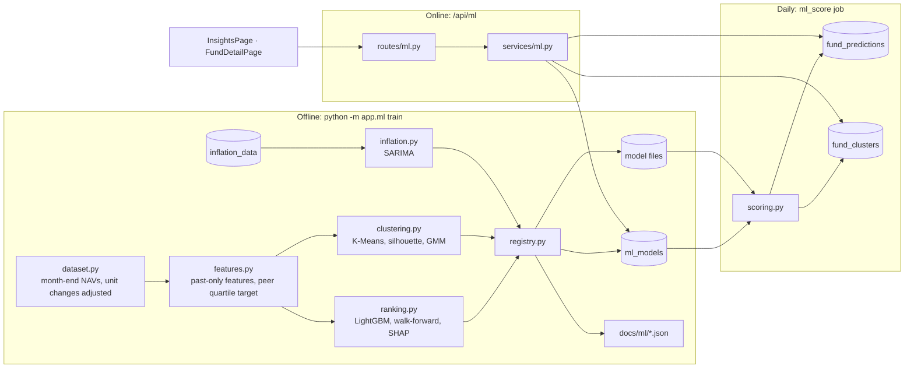
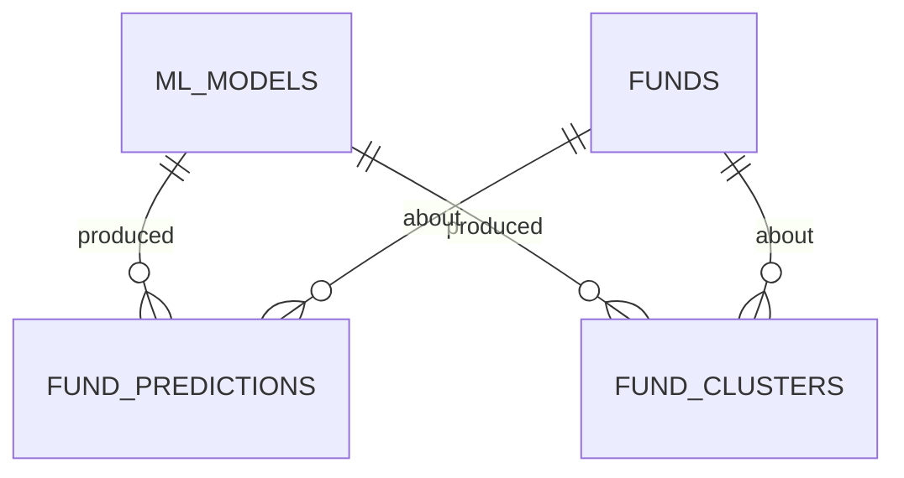
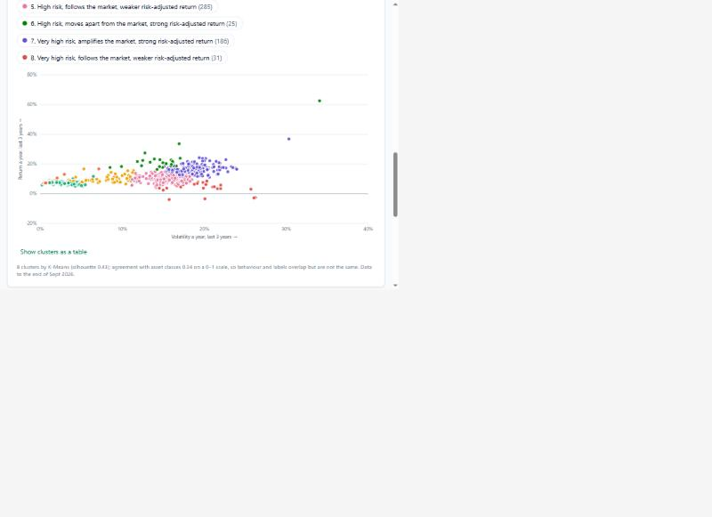
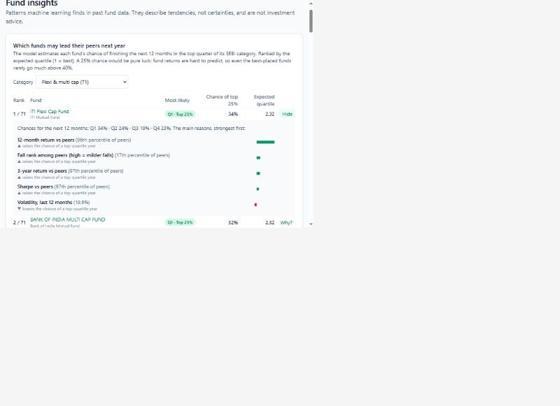
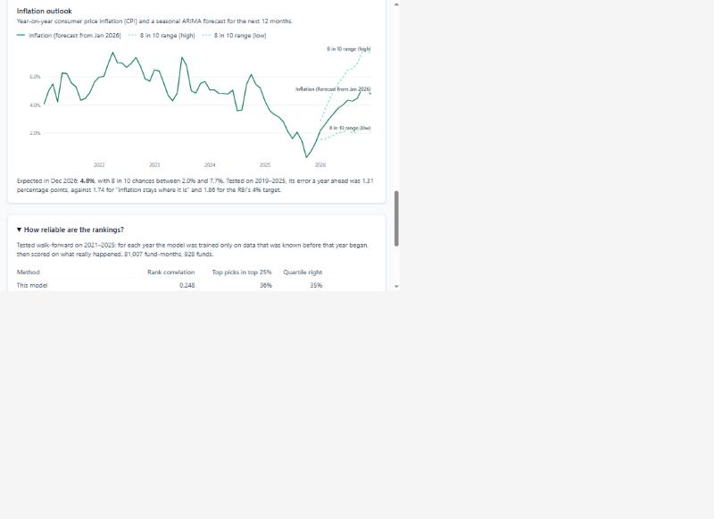
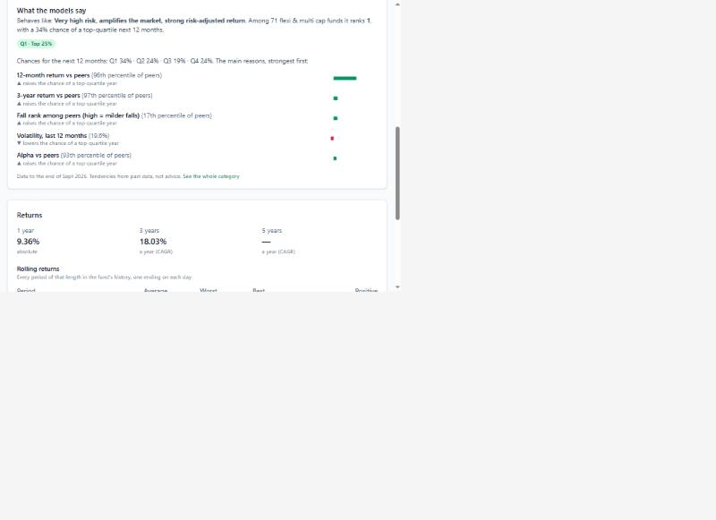

# Phase 7 – ML: Fund Intelligence

| | |
|---|---|
| Branch | `phase-07-ml` |
| Tag | `v0.7.0` |
| Dates | 2026-10-16 – 2026-10-17 |
| Merge | Merged into `main` with a merge commit after CI passed (GitHub CLI not installed, so no PR) |
| Synopsis objective(s) covered | Machine learning on Indian mutual-fund data: ranking funds within their category with explanations, grouping funds by behaviour, and forecasting inflation |

## 1. Summary

A logged-in user can now open **Insights** and see:

1. **Which funds may lead their peers next year:** for each SEBI category, every fund's chance of finishing the next 12 months in the top quarter of its category, ranked, with a **"Why?"** that shows the main reasons as SHAP bars.
2. **How funds actually behave:** a scatter of about 1,000 funds by risk and return, coloured by **eight behaviour clusters** found by K-Means ("Very high risk, amplifies the market…", "High risk, moves apart from the market…").
3. **The inflation outlook:** CPI inflation for the last five years and a **SARIMA forecast** for the next 12 months with an 80% band.
4. **How reliable the rankings are:** the model against simply following last year's winners and against random picks, tested walk-forward.

Every fund page also shows **"What the models say"**: its quartile, chance, rank in its category, cluster and reasons.

| Before Phase 7 | After Phase 7 |
|---|---|
| 13 tables | 16 tables (+ `ml_models`, `fund_predictions`, `fund_clusters`) |
| 36 endpoints | 41 endpoints (+ 5 ML) |
| 386 tests | 429 tests |
| Funds compared by past numbers only | A validated forecast with explanations, behaviour clusters, an inflation forecast |

## 2. Why this phase

Phase 4 gave every fund's history; Phase 8 will recommend funds for each goal. Between the two, the system needs a view on **which funds within a category are likely to do better**, and it must be honest about how good that view is. Three things make fund prediction hard:

- **Noise.** A fund's next-year return depends mostly on the market and luck; differences in skill are small.
- **Look-ahead bias.** It is very easy to let information from the future leak into training or validation and report skill that does not exist.
- **Explainability.** A recommendation an investor cannot understand will not be trusted, and should not be.

The plan also asked for clusters (categories describe what a fund *promises*; behaviour describes what it *did*) and an inflation forecast (Phase 3 asks users for an inflation rate; Phase 6 depends on it heavily).

## 3. What was added

### 3.0 Big picture



### 3.1 Database

**Migration `0008_create_ml_tables`.**



**`ml_models`** – the model registry: one row per trained version.

| Column | Type | Constraint | Meaning |
|---|---|---|---|
| `id` | integer | PK | |
| `name` | varchar(40) | CHECK in (fund_ranker, fund_clusters, inflation_forecast) | |
| `version` | integer | UNIQUE with `name` | 1, 2, 3 … |
| `algorithm` | varchar(80) | | e.g. "LightGBM multiclass" |
| `params` | jsonb | NOT NULL | Hyper-parameters, or the whole model when it is just numbers (cluster centroids) |
| `metrics` | jsonb | NOT NULL | Validation results, importance, cluster profiles, the inflation forecast |
| `features` | jsonb | default `[]` | Input order the model file expects |
| `file_path` | varchar(255) | NULL allowed | Model file (ranker only) |
| `data_start`, `data_end` | date | NOT NULL | Data window used |
| `trained_at` | timestamptz | default `now()` | |
| `is_active` | boolean | default false; **partial unique index on `name` WHERE `is_active`** | At most one active version per name |

**`fund_predictions`** – the active ranker's view of each fund (PK `model_id, fund_id`; index `(model_id, peer_group, expected_quartile)`).

| Column | Type | Meaning |
|---|---|---|
| `model_id`, `fund_id` | integer | FKs, ON DELETE CASCADE |
| `as_of` | date | Month-end the features describe |
| `peer_group` | varchar(30) | Canonical category |
| `predicted_quartile` | smallint, CHECK 1–4 | Most likely quartile |
| `prob_top` | float, CHECK 0–1 | P(top quartile) |
| `probabilities` | jsonb | P(Q1) … P(Q4) |
| `expected_quartile` | float | Σ q × P(q): the ranking score (lower = better) |
| `peer_rank`, `peer_size` | integer | 1 = best in the peer group |
| `factors` | jsonb | Top 5 SHAP factors: feature, label, value, contribution |

**`fund_clusters`** – PK `(model_id, fund_id)`: `as_of`, `cluster`, `distance` to the centre, and the two scatter coordinates `volatility`, `return_3y`.

Design points:

- **Registry, not overwrite.** Each training run adds a version; the partial unique index (the same pattern as `job_runs` in Phase 4) lets the *database* guarantee one active version. Activating swaps the flag in one transaction. Predictions point at the version that made them, so every number shown can be traced to a model, its data window and its metrics.
- **Stored predictions.** Unlike goal projections (ADR-006), predictions are stored: scoring needs the whole NAV panel and a model file, which takes seconds, while the page must answer instantly. They are replaced by each scoring run.
- **JSONB for metrics, probabilities and factors:** read and written as a whole, shape varies by model.

### 3.2 Backend

| File | Responsibility |
|---|---|
| `app/finance/nav_adjust.py` | Detects face-value changes (a monthly NAV ratio within 3% of 10^k) and rescales the earlier history |
| `app/ml/peers.py` | ~30 canonical peer groups from AMFI category text (keyword rules, first match wins), labels, unranked groups |
| `app/ml/dataset.py` | SQL → month-end NAVs of direct-growth funds (newest, incomplete month dropped), Nifty 500 month-ends, fund metadata |
| `app/ml/features.py` | 26 past-only features, the forward return, the peer-quartile target, the panel; `snapshot` for clustering |
| `app/ml/ranking.py` | LightGBM training, probabilities, expected quartile, SHAP contributions, purged walk-forward folds, metrics, baselines, leaky comparison, global importance |
| `app/ml/clustering.py` | K-Means for k = 2–10 with silhouette, GMM with BIC and ARI, cluster naming, `ClusterModel` (JSON) |
| `app/ml/inflation.py` | Year-on-year inflation, SARIMA order by AIC, walk-forward evaluation, 12-month forecast band |
| `app/ml/registry.py` | Versions, model files, activation, cached model loading |
| `app/ml/scoring.py` | Writes `fund_predictions` (with top factors) and `fund_clusters` for the latest month |
| `app/ml/train.py`, `app/ml/__main__.py` | `python -m app.ml train all|ranker|clusters|inflation`, `python -m app.ml score`; experiment reports in `docs/ml/` |
| `app/models/ml.py`, `app/schemas/ml.py`, `app/services/ml.py`, `app/api/routes/ml.py` | Tables, response shapes, read services, endpoints |
| `app/data_pipeline/jobs.py`, `scheduler.py` | New `ml_score` job, run daily after the NAV load and fund metrics |

New dependencies: `lightgbm`, and `scikit-learn`, `pandas`, `statsmodels` as direct dependencies (already present through Phase 5).

**Endpoints added** (all require login, all read-only)

| Method | Path | Response | Errors |
|---|---|---|---|
| GET | `/api/ml/models` | Active models with headline validation results | |
| GET | `/api/ml/rankings?peer_group=` | Peer groups, and the ranked funds of one group with probabilities and factors (default: the largest group except sectoral/thematic) | `409` not trained |
| GET | `/api/ml/clusters` | Cluster profiles and one point per fund | `409` |
| GET | `/api/ml/funds/{id}` | The fund's prediction and cluster (empty when not covered) | `404` fund |
| GET | `/api/ml/inflation` | Last five years of CPI inflation and the 12-month forecast band | `409` |

**Why `409` when a model is missing:** the request is valid, but the system is not in a state to answer until `python -m app.ml train` has run.

### 3.3 Frontend

| File | Responsibility |
|---|---|
| `src/api/ml.ts`, `src/hooks/useMl.ts` | Types and queries (5-minute stale time: outputs change daily) |
| `src/pages/InsightsPage.tsx` | Rankings (category select in the URL, top 20 / show all, "Why?" rows), clusters (scatter + table), inflation outlook, reliability card |
| `src/components/MlInsight.tsx` | `QuartileBadge`, `Why`, `FundInsightCard` (fund page) |
| `src/components/ShapBars.tsx` | Diverging SHAP bars with "▲ raises / ▼ lowers" in words |
| `src/components/ClusterScatter.tsx` | SVG scatter: 8-colour categorical palette (validated for colour-vision deficiency), white rings, legend as toggle buttons to highlight a cluster, hover tooltip, axes that always cover every point |
| `src/lib/chart.ts` | `coveringTicks`, `CLUSTER_COLORS` |
| `src/lib/format.ts` | `formatFactorValue`, `ordinal` |
| `src/pages/FundDetailPage.tsx`, `src/router.tsx`, `src/components/Layout.tsx` | "What the models say" card, `/insights`, "Insights" link |

### 3.4 Integration and orchestration

| Step | When | What happens |
|---|---|---|
| Train | Offline, by an administrator (`python -m app.ml train all`, ~5 min) | Load data → features → validate (tuning and reported years, leaky comparison) → fit final model on everything known → save file → register and activate → write `docs/ml/*.json` → score |
| Score | Daily after `daily_nav` and `fund_metrics` (scheduler), or `python -m app.ml score` | Active models → latest month → `fund_predictions`, `fund_clusters` replaced |
| Serve | Every page view | Database reads only (~0.3 s), never a model in the request |

## 4. Key logic explained

### 4.1 Data and the unit-change fix

1,832 direct-growth funds, monthly from April 2006 to September 2026 (the October month is incomplete and dropped). Month-end NAV = the last NAV of the month; a missing month is a gap (NaN), never one long "month".

**Unit changes.** While checking the cluster plot, *UTI Liquid Fund* showed 133% volatility and a −50% return: in June 2026 its NAV fell from about ₹4,567 to ₹460, a 1:10 change of face value, not a loss. A search found **14 such events** (12 funds re-denominated from ₹10 to ₹1,000, one ×10, one ÷10). No real month moves a fund by a factor of ten, so a monthly ratio within 3% of 10^k (k ≠ 0) is treated as a unit change and the history *before* it is multiplied by 10^k. Real large moves stay: Bank of India Credit Risk −44% (default) and +109% (recovery), March 2020 −35%. (The same flaw affects the Phase 4 fund metrics of UTI Liquid Fund; see section 8.)

### 4.2 Features (26, all from data up to month-end t)

| Group | Features |
|---|---|
| Returns | 1, 3, 6, 12 months; 3-year CAGR |
| Risk | Volatility (12 and 36 months, annualised log returns), downside volatility, worst fall in 3 years (maximum drawdown) |
| Risk-adjusted | Sharpe (36 months, risk-free 6%) |
| Market link (Nifty 500, 36 months) | Beta = cov(fund, market) / var(market); alpha = annualised (mean fund − β × mean market); correlation |
| Peer-relative | Percentile rank within the peer group that month of 12-month return, 3-year return, Sharpe, volatility, alpha, worst fall; peer group size |
| Context | Months of history; market return and volatility over 12 months; asset class (equity / debt / hybrid) |

A **test changes every NAV after month t to three times its value and checks that no feature at or before t moves** (`test_features_never_look_ahead`).

### 4.3 Target and class balance

Forward return r_f = NAV(t + 12) / NAV(t) − 1. Within each (month, peer group) with at least 8 funds, funds are ranked by r_f; quartile = ⌈rank percentile × 4⌉, 1 = best 25%. Quartiles are balanced **by construction**: Q1 19,013 · Q2 20,611 · Q3 19,867 · Q4 21,516 of 81,007 labelled fund-months (2014–2025; 928 funds, 28 peer groups). So class imbalance is not an issue, unlike "will this fund beat the index?", where the answer depends heavily on the year. Index funds are not ranked: tracking different indices on purpose, their "quartile" would only say which index rose most.

### 4.4 Walk-forward validation (and why a random split lies)

For test year Y, train on every month t with **t + 12 months ≤ 1 January Y**, test on the months of Y. The 12-month **purge** matters: a fund-month from June of Y − 1 has a target that ends in June of Y, inside the test year, so it must not be used.

```
train ─────────────────────────┤ purge (12 months) │ test year Y │
2014 ...................... Dec Y-2                 Jan–Dec Y
```

**Choosing hyper-parameters without peeking.** Settings were compared on the tuning years 2018–2020 only (mean rank correlation):

| Setting | Rank correlation 2018–2020 |
|---|---|
| A: 15 leaves, ≥ 100 rows per leaf, 300 rounds | 0.076 |
| B: A without market features | 0.076 |
| C: B, ≥ 500 rows per leaf, 150 rounds | 0.110 |
| D: C, 7 leaves, 100 rounds | 0.120 |
| E: D with market features | 0.122 |
| **F: 4 leaves, ≥ 1,000 rows per leaf, 100 rounds (chosen)** | **0.126** |
| G: F with 200 rounds | 0.124 |
| H: 7 leaves, ≥ 1,000 rows, 200 rounds | 0.116 |
| Momentum baseline | 0.133 |

Simpler models generalise better to the next year: fund returns are noisy, and deeper trees learn year-specific patterns. (Setting A was also run once on all years before this selection, an exploratory run reported below for the look-ahead comparison.)

**Look-ahead bias, measured.** The same data with a shuffled 5-fold split:

| Model | Walk-forward rank correlation / accuracy | Shuffled K-fold | Inflation |
|---|---|---|---|
| A (flexible, exploratory run 2018–2025) | 0.158 / 31.6% | **0.433 / 42.9%** | ×2.7 |
| F (chosen, 2021–2025) | 0.248 / 34.9% | 0.241 / 35.4% | none |

The flexible model "learned" fund identities across overlapping 12-month targets and looked brilliant on a random split; walk-forward exposed it. The constrained model cannot memorise, so it scores the same either way, which is evidence that it is not over-fitting.

### 4.5 Results on the reported years 2021–2025

Pooled over 42,435 fund-months:

| Method | Rank correlation | Top picks that ended in the top 25% | Median excess return of top picks | Accuracy | Macro-F1 | Log-loss |
|---|---|---|---|---|---|---|
| **LightGBM** | **0.248** | **36.1%** | **+0.22 pp** | **34.9%** | 0.330 | 1.320 |
| Momentum (last year's peer rank) | 0.254 | 36.9% | +0.27 pp | 35.6% | 0.356 | – |
| Random | −0.006 | 23.8% | −0.03 pp | 25% | – | 1.386 (= ln 4) |

| Year | Train rows | Model rank corr. | Momentum | Model hit rate | Momentum |
|---|---|---|---|---|---|
| 2021 | 32,229 | 0.268 | 0.384 | 33.7% | 42.6% |
| 2022 | 39,175 | **0.374** | 0.312 | **43.8%** | 40.5% |
| 2023 | 46,648 | 0.420 | 0.438 | 45.7% | 47.1% |
| 2024 | 54,785 | **0.041** | 0.039 | 25.9% | 26.3% |
| 2025 | 63,782 | **0.166** | 0.136 | **32.5%** | 30.1% |

Reading it:

1. The model picks top-quartile funds **1.4× as often as chance** (36% vs 25%).
2. It is **level with momentum**: better in 2022, 2024 and 2025, worse in 2021 and 2023. Its log-loss (1.320) beats the uninformed 1.386, so its probabilities are informative but modest: the best-placed funds get 30–40%, not 80%.
3. **2024 had almost no predictability** for either method: one year in five where last year's ranking said almost nothing.
4. Momentum has no probabilities; the model adds calibrated chances and reasons, and folds risk into the ranking.

### 4.6 Explanations: tree SHAP

For one fund, LightGBM's `pred_contrib` gives the exact Shapley value of each feature for the top-quartile class: base value + Σ contributions = the model's raw score (log-odds) for that class (`test_shap_values_add_up_to_the_model_output`). The page shows the five largest, with direction in words.

Global importance (mean |SHAP|, top-quartile class):

| Feature | Mean \|SHAP\| |
|---|---|
| 12-month return vs peers (momentum) | 0.170 |
| Volatility, last 12 months | 0.054 |
| Fall rank among peers (high = milder falls) | 0.047 |
| 3-year return vs peers | 0.031 |
| Worst fall, 3 years | 0.023 |
| Volatility, 3 years | 0.015 |
| Alpha vs peers | 0.013 |

So the model is mostly **momentum**, tilted by **risk**: high recent volatility lowers the chance of a top-quartile year. Example (ITI Flexi Cap Fund, rank 1 of 71 flexi & multi cap funds, September 2026): Q1 34% · Q2 24% · Q3 19% · Q4 24%; raised by its 96th-percentile 12-month return, 97th-percentile 3-year return and 93rd-percentile alpha; lowered by 19.6% volatility.

### 4.7 Behaviour clusters

1,004 funds with three full years (September 2023 – September 2026), 7 features standardised (z-scores clipped at ±4).

| k | 2 | 3 | 4 | 5 | 6 | 7 | **8** | 9 | 10 |
|---|---|---|---|---|---|---|---|---|---|
| Silhouette | 0.615 | 0.546 | 0.420 | 0.427 | 0.424 | 0.427 | **0.434** | 0.397 | 0.398 |

Silhouette s(i) = (b − a) / max(a, b), with a = mean distance to the own cluster and b = to the nearest other cluster: near 1 = well separated. k = 2 and 3 score highest but only split cash / bonds / equity, which the categories already say; among k ≥ 4, **k = 8** is best (a local maximum). A Gaussian mixture prefers ever more components by BIC (k = 10); its labels agree with K-Means at k = 8 with ARI 0.54. Agreement with asset classes is ARI 0.34: behaviour and labels overlap, but are not the same.

| # | Cluster (named from its centre) | Funds | Volatility | Return a year | Worst fall | Beta | Commonest categories |
|---|---|---|---|---|---|---|---|
| 1 | Cash-like (volatility 0.2%) | 39 | 0.2% | 7.0% | 0% | 0.01 | liquid, ultra short |
| 2 | Cash-like (volatility 0.8%: the centre; median 0.6%) | 142 | 0.6% | 7.4% | 0% | 0.01 | arbitrage, money market, index |
| 3 | Low risk | 217 | 1.7% | 7.0% | −0.5% | 0.05 | overnight, medium duration, gilt |
| 4 | Moderate risk, follows the market | 79 | 7.3% | 8.6% | −6.7% | 0.41 | balanced advantage, equity savings |
| 5 | High risk, follows the market | 285 | 15.1% | 9.8% | −16.3% | 0.92 | sectoral, index, flexi, large cap |
| 6 | **High risk, moves apart from the market**, strong risk-adjusted return | 25 | 15.0% | 20.9% | −13.1% | 0.65 | pharma & healthcare, international (US, Japan, Taiwan, Asia), multi asset |
| 7 | Very high risk, amplifies the market | 186 | 18.6% | 16.0% | −21.4% | 1.08 | sectoral, mid cap, flexi |
| 8 | Very high risk, follows the market, weaker return | 31 | 20.1% | 5.4% | −26.6% | 0.99 | technology, housing, MNC, consumption |



### 4.8 Inflation forecast

SARIMA(p, 1, q)(P, 1, Q)₁₂ on log CPI, orders chosen by AIC on 2011–2018: **(0,1,1)(0,1,1)₁₂, the "airline model"** (AIC −645.6). Log CPI with one ordinary and one seasonal difference: the model describes changes in inflation and the yearly pattern. Walk-forward from 13 origins (Dec 2018 – Dec 2024, every 6 months), mean absolute error of year-on-year inflation:

| Months ahead | 1 | 3 | 6 | 9 | 12 |
|---|---|---|---|---|---|
| SARIMA | 0.50 | 0.74 | 1.07 | 1.01 | **1.31** pp |
| Naive (current rate persists) | 0.71 | 0.92 | 1.42 | 1.22 | 1.74 pp |
| RBI 4% target | 1.79 | 1.55 | 1.72 | 1.66 | 1.86 pp |

**Band without simulation.** For h ≤ 12 the CPI a year before the forecast month is known, so YoY = exp(log CPI forecast − log CPI known) − 1; the log forecast is normal, so its 10th/50th/90th percentiles map directly to YoY percentiles. The latest CPI (base 2012) is December 2025 at 1.33% (MOSPI's base-2012 series ends there); the forecast rises to **4.8% by December 2026 (80% band 2.0–7.7%)** as the unusually low 2025 base drops out.

## 5. Design decisions

| Decision | Alternatives | Why |
|---|---|---|
| Quartile within the peer group | Return regression; beat-the-index | Comparable funds; balanced classes; robust to outliers. ADR-010 |
| Purged walk-forward; tuning and reported years separated | Random K-fold; one split | No look-ahead; honest numbers; the leaky split kept as evidence |
| Momentum baseline | Random only | The model must beat the simplest real rule |
| Rank correlation, hit rate, median excess | Accuracy only; mean excess | What the page shows is a ranking; means were dominated by a few thematic funds |
| Very shallow LightGBM | Deeper trees; XGBoost; logistic regression | Best on the tuning years; small dependency; NaN handling |
| Built-in tree SHAP | `shap` package | Exact, fast, no numba/llvmlite |
| K-Means, k by silhouette among k ≥ 4, GMM for comparison | k by silhouette overall; GMM; categories | k ≤ 3 = asset classes; plain JSON model |
| SARIMA, airline model by AIC on early data | Prophet; naive | Explainable, light, beats both baselines |
| Offline training, stored predictions, daily scoring | Train or predict per request | Training takes minutes; requests stay fast |
| Registry with one active version (database-enforced) | Overwrite files | Traceability and rollback |
| Unit-change adjustment | Ignore; drop affected funds | Keeps the history of 14 funds correct |
| Training code in `backend/app/ml` (not a top-level `ml/` folder) | Separate notebooks | Training and serving share the feature code, so they cannot drift |

## 6. Testing

| Test file | Tests | What is checked |
|---|---|---|
| `test_ml_features.py` | 19 | Peer-group mapping (9 labels, including "Large & Mid" vs "Large", "Ultra Short to Short" vs "Ultra Short", generic labels → none); trailing returns and CAGR; steady growth has zero volatility and drawdown; a designed 30% fall is the worst fall; a fund equal to the market has β = 1, α = 0, ρ = 1; **features never look ahead**; forward return; quartiles within a peer group; small and index groups excluded; **face-value change adjusted to a smooth series; splits told apart from real crashes** |
| `test_ml_models.py` | 14 | **Walk-forward folds purge the target window**; the model learns a planted signal (rank corr. > 0.3, accuracy > 30%); no signal → no skill; **SHAP values add up to the model output**; the planted feature is the most important; perfect scores → perfect metrics; expected quartile; validation compares model, baselines and the leaky split; clusters recover 5 separated groups (ARI 1, safest first, unique names); cluster model survives JSON; names describe risk and market link; YoY inflation; forecast band ordered, near trend and widening; AIC selection and walk-forward evaluation |
| `test_ml_api.py` | 10 | Login required; untrained models → 409 with the command to run; registering a version deactivates the old one; **the database refuses two active versions**; scoring writes ranked predictions with probabilities summing to 1 and 5 factors, and re-scoring replaces them; rankings endpoint (groups, order, filter, as-of); clusters and fund insight; uncovered fund; model cards; inflation |
| Earlier phases | 386 | Unchanged |
| **Total** | **429** | **All passed** |

**Real-data runs** (`python -m app.ml train all`, 2026-10-17): ranker 172 s (13 trainings: 3 tuning folds, 5 reported folds, 5 leaky folds, plus the final model); clusters 15 s; inflation 31 s; scoring 1,024 predictions and 1,004 cluster assignments in 16 s. Full records: `docs/ml/fund_ranker-v2.json`, `fund_clusters-v3.json`, `inflation_forecast-v2.json`.

**Manual test in the browser** (2026-10-17):

| Step | Expected | Result |
|---|---|---|
| Insights, default category | Flexi & multi cap (71), top 20 shown, "Show all 71 funds" | Pass |
| "Why?" on rank 1 | Chances per quartile and five reasons with direction in words | Pass |
| Cluster scatter | 8 named clusters, legend highlight, every point inside the axes, table view | Pass (after fixes, section 8) |
| Inflation outlook | History to Dec 2025, forecast and 80% band to Dec 2026, errors vs baselines | Pass (after fix) |
| Reliability card | Model 0.248 / 36%, momentum 0.254 / 37%, random −0.006 / 24% | Pass |
| Fund page | "What the models say": cluster, rank 1 of 71, 34%, reasons | Pass |
| Phone width | No horizontal scrolling; tables scroll inside their box | Pass |

| Rankings with reasons | Behaviour clusters | Inflation outlook | Fund page |
|---|---|---|---|
|  |  |  |  |

## 7. How to run / demo this phase

```bash
cd backend
uv run alembic upgrade head
uv run python -m app.ml train all     # needs the Phase 4 data; ~5 minutes
uv run pytest -v tests/test_ml_features.py tests/test_ml_models.py tests/test_ml_api.py
```

1. Open **Insights**; choose a category; open "Why?" on the first and the last fund.
2. Click a cluster in the legend to highlight it; hover dots; open the table.
3. Expand "How reliable are the rankings?".
4. Open a fund from the table: "What the models say".
5. Inspect the registry:

   ```bash
   docker exec goalwise-db psql -U goalwise -d goalwise -c "SELECT name, version, is_active, algorithm, trained_at FROM ml_models ORDER BY name, version;"
   ```

## 8. Problems faced and how they were solved

| Problem | Cause | Fix |
|---|---|---|
| A first model ranked worse than momentum and looked far better on a random split | Too flexible: it memorised fund-specific patterns across overlapping targets | Compared settings on the tuning years only and chose very shallow trees; kept the leaky split as evidence (4.4) |
| "Top-quartile excess return" negative while rank correlation was clearly positive | Means dominated by a few thematic funds that doubled | Hit rate and median excess instead |
| K-Means picked 3 clusters | Silhouette is dominated by the gap between equity and debt | k chosen among k ≥ 4 (8), justified with the k table |
| Two clusters both named "Cash-like … strong" | Same risk band and quality | Names carry the volatility when they collide |
| UTI Liquid Fund at 133% volatility, −50% return | A 1:10 face-value change in June 2026 (14 such events in total) | `finance/nav_adjust.py`; models retrained. Phase 4's fund metrics have the same flaw for this fund: a follow-up applies the adjustment there too |
| Scatter squashed; some dots outside the axes | One outlier stretched the scale; tick helper did not cover the data | Unit-change fix; `coveringTicks` |
| Inflation forecast not drawn | `LineChart` takes its time range from the first series (history only) | The first series runs through history and the forecast median |
| `statsmodels` `simulate()` failed ("random_state or rng, not both") | Incompatibility with the installed pandas | Exact 12-month band from the forecast distribution, no simulation needed |
| Labels like "Worst fall vs peers (17th percentile)" were ambiguous, and the code comment had the direction wrong | Percentile of a negative number | Labels state the direction ("high = milder falls"); comment fixed; "93th" → "93rd" |
| Default category was "Sectoral & thematic" | Largest group, but the weakest peer group | Largest group except sectoral/thematic |

## 9. Viva questions and answers

1. **Q: Why walk-forward validation instead of a random split?**
   A: Time series: a random split trains on the future of the same funds and on overlapping 12-month targets. Walk-forward trains only on what was known before each test year, as the model would be used. Our flexible model scored 0.43 on a random split and 0.16 walk-forward.

2. **Q: What is the purge and why 12 months?**
   A: A sample at month t has a target that ends at t + 12. Any training sample whose target window reaches into the test year leaks test outcomes, so training stops 12 months before the test year.

3. **Q: Is there class imbalance?**
   A: No: quartiles within each peer group are balanced by construction (19–21k each). Imbalance would arise with targets like "beats the index", which depend on the year.

4. **Q: Why these metrics?**
   A: The product ranks funds, so rank correlation within each category and the hit rate of the top 25% matter most; accuracy and log-loss check the probabilities; medians avoid a few extreme funds deciding the result.

5. **Q: The model is not better than momentum. Is it useless?**
   A: It is as good as the best simple rule, gives calibrated probabilities and reasons, and folds risk into the ranking. Admitting this is the honest result; fund returns are hard to predict, and the strongest signal in the data is momentum, which SHAP confirms.

6. **Q: What are SHAP values?**
   A: Shapley values from cooperative game theory: each feature's fair share of the difference between this prediction and the average prediction, averaged over all orders in which features could be added. For trees they are computed exactly (TreeSHAP), and they add up to the model output.

7. **Q: Why did you not use the `shap` library?**
   A: LightGBM computes exact TreeSHAP itself (`pred_contrib`), which avoids a heavy dependency; a test checks that contributions sum to the raw score.

8. **Q: What is the silhouette score?**
   A: (b − a) / max(a, b) per point, a = mean distance within its cluster, b = to the nearest other cluster; the average over points, from −1 to 1. Higher = tighter, better separated clusters.

9. **Q: Why 8 clusters if 2 had the highest silhouette?**
   A: 2–3 clusters only separate cash, bonds and equity, which categories already do. Among k ≥ 4 the silhouette peaks at 8, which also gives interpretable groups (e.g. funds that move apart from the market).

10. **Q: K-Means vs a Gaussian mixture?**
    A: K-Means assigns each point to the nearest centre (spherical clusters, hard labels); a GMM fits elliptical Gaussians with soft probabilities, chosen by BIC. We report both; they agree with ARI 0.54.

11. **Q: Why standardise before clustering?**
    A: Distances would otherwise be dominated by the features with the largest units (returns in %) over ratios like beta.

12. **Q: Explain the SARIMA model.**
    A: Seasonal ARIMA(0,1,1)(0,1,1)₁₂ on log CPI: one ordinary and one 12-month difference make the series stationary; one moving-average term for each. It forecasts the next 12 months; AIC chose it from a grid on 2011–2018.

13. **Q: Why log CPI?**
    A: Prices grow multiplicatively; in logs, growth is additive and its variance more stable, and year-on-year inflation is a difference of logs.

14. **Q: What is the AIC?**
    A: 2k − 2 ln L: rewards fit (likelihood L), penalises parameters (k), to avoid over-fitting. Lower is better.

15. **Q: Training offline vs serving online?**
    A: Training (minutes, all data) runs from a command; scoring writes predictions daily; the API only reads them, so pages answer in ~0.3 s and a model can be checked before activation.

16. **Q: How are models versioned?**
    A: `ml_models` has (name, version) unique and a partial unique index allowing one active row per name; predictions reference their model version; metrics and data window are stored with it, and `docs/ml/` keeps the full experiment record.

17. **Q: What is survivorship bias here?**
    A: Only funds alive today were backfilled; closed or merged funds (often poor performers) are missing from history, which can make past rankings look easier than they were.

18. **Q: How did you make sure no feature looks ahead?**
    A: All rolling windows look backward; a test rewrites every NAV after month t and checks that no feature at or before t changes.

19. **Q: What was the unit-change problem?**
    A: Funds that re-denominate units (₹10 → ₹1,000) show a 100× NAV jump that is not a return. A ratio within 3% of a power of ten is adjusted; real crashes and defaults are kept.

20. **Q: Why LightGBM?**
    A: Gradient-boosted trees handle non-linear interactions and missing values (young funds have no 3-year features) natively; LightGBM is fast, small to install and computes SHAP; shallow trees regularise it.

## 10. Report mapping

- **System Analysis – Requirements**: section 2
- **System Design – Database Design**: section 3.1 (registry, partial unique index, stored predictions)
- **Machine Learning Methodology**: sections 4.1–4.4 (data, features, target, walk-forward, purge, tuning protocol, look-ahead experiment)
- **Results**: sections 4.5–4.8 (rankings vs baselines by year, SHAP importance, clusters, inflation errors)
- **Implementation – ML module**: sections 3.2–3.4
- **Testing**: section 6
- **Limitations**: survivorship bias; momentum-level skill; 12-month horizon only; fixed risk-free rate; base-2012 CPI ends Dec 2025; expense ratios not yet available as a feature
- **Future Enhancements**: expense ratio and fund size as features; ranking objective (LambdaRank); conformal prediction intervals; drift monitoring that triggers retraining; CPI base-2024 series
