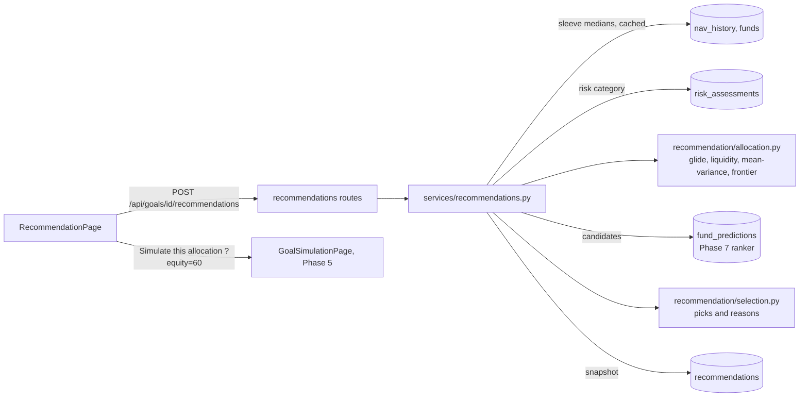
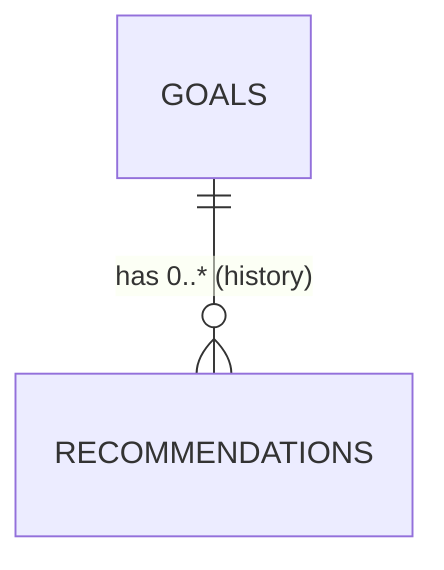

# Phase 8 – Recommendations

| | |
|---|---|
| Branch | `phase-08-recommendations` |
| Tag | `v0.8.0` |
| Dates | 2026-10-17 |
| Merge | Merged into `main` with a merge commit after CI passed (GitHub CLI not installed, so no PR) |
| Synopsis objective(s) covered | Goal-based recommendations: an asset allocation for each goal from the risk profile and horizon (with mean-variance optimisation), specific funds chosen with the ML rankings, and the reasons for every choice |

## 1. Summary

A logged-in user can now press **Recommend** on any goal and get:

1. **How to split the money** across four parts (large-cap equity, mid & small-cap equity, longer-term bonds, short-term debt), with the expected return and risk.
2. **Why**, in plain sentences: how the risk profile and the years left set the equity share, and how the optimiser split it.
3. **Which funds**: two per part (one for small parts), the best-placed by the Phase 7 fund model, never two from the same fund house, each with its reason.
4. **The efficient frontier**: a chart of the best expected return for each level of risk, with each part and the recommended portfolio on it.
5. **Simulate this allocation**: the Phase 5 simulation opens with the recommended equity share.
6. **History**: every recommendation is stored and can be reopened exactly as it was shown.

| Before Phase 8 | After Phase 8 |
|---|---|
| 16 tables | 17 tables (+ `recommendations`) |
| 41 endpoints | 45 endpoints (+ 4) |
| 436 tests | 464 tests |
| An equity share implied by the goal's return assumption | An optimised allocation per goal, funds and reasons |

## 2. Why this phase

The earlier phases say *how much* to invest (Phase 3), *how likely* it is to work (Phase 5) and *which funds look good* (Phase 7). The question users actually ask is **"so what should I buy for this goal?"**. A good answer must:

- depend on the **horizon**: money needed in two years cannot sit in mid and small caps, whose typical fund fell 34% from December 2017 to March 2020 (−27.7% in March 2020 alone) in our data;
- depend on the **risk profile**: the same goal deserves less equity for a conservative investor;
- **diversify** across asset classes that do not move together;
- be **explainable and auditable**: every number traceable to a rule, an assumption or a model.

## 3. What was added

### 3.0 Big picture



### 3.1 Database

**Migration `0009_create_recommendations_table`.**



| Column | Type | Constraint | Meaning |
|---|---|---|---|
| `id` | integer | PK | |
| `goal_id` | integer | FK → `goals.id` ON DELETE CASCADE; index `(goal_id, created_at)` | |
| `created_at` | timestamptz | default `now()` | |
| `as_of` | date | NOT NULL | Last month of market data used |
| `risk_category` | varchar(20) | NULL allowed | Risk profile at the time (NULL = none yet, treated as moderate) |
| `years_to_goal` | smallint | NOT NULL | |
| `equity_share`, `expected_return`, `volatility` | double precision | NOT NULL | Fractions |
| `allocation` | jsonb | NOT NULL | Per sleeve: label and weight (%) |
| `funds` | jsonb | NOT NULL | Picks: fund, sleeve, weight, basis (model / sharpe), reason, quartile, chance |
| `reasons` | jsonb | NOT NULL | Why this allocation, sentence by sentence |
| `inputs` | jsonb | NOT NULL | Capital market (assumed returns, measured volatility, correlations, window), efficient frontier, rules applied, goal's return, fund model version, notes |

Design points:

- **Stored snapshots.** Goal projections are recomputed on every read (ADR-006); a recommendation is not: it depends on that day's market data, fund rankings and risk profile. Storing it gives an **audit trail** ("what was advised, on what basis?") and a **history** of how advice changed. The test `test_recommendations_are_kept_as_history` checks that an old recommendation reads back identical to what was returned.
- **JSONB for the parts that are read as a whole** and whose shape may grow (more sleeves, more rules); the values listed or filtered (`created_at`, `equity_share`, `expected_return`, `years_to_goal`) are columns.
- **Composite index `(goal_id, created_at)`** serves "latest for a goal" and the history list.

### 3.2 Backend

| File | Responsibility |
|---|---|
| `app/recommendation/allocation.py` | Sleeves and planning returns, `capital_market` (annual covariance), `glide_equity`, `mid_small_limit`, `short_debt_minimum`, `optimise` (SLSQP), `allocate`, `efficient_frontier`, `portfolio_stats` |
| `app/recommendation/selection.py` | Sleeve → peer groups, `pick_funds` (rank, one per fund house, split, fold tiny sleeves), `allocation_reasons` |
| `app/models/recommendation.py`, `app/schemas/recommendation.py` | Table and API shapes |
| `app/services/recommendations.py` | Sleeve returns (SQL medians, cached by data fingerprint), candidates (active ranker or Sharpe), `recommend` (allocate → pick → explain → store), history |
| `app/api/routes/recommendations.py` | Endpoints below |
| `alembic/versions/0009_create_recommendations_table.py` | Migration |

**Endpoints added** (all require login; only the goal's owner)

| Method | Path | Response | Errors |
|---|---|---|---|
| POST | `/api/goals/{id}/recommendations` | `201` the new recommendation (stored) | `404` goal, `409` not enough market data |
| GET | `/api/goals/{id}/recommendations` | Earlier recommendations, newest first (summaries) | `404` |
| GET | `/api/goals/{id}/recommendations/latest` | The newest one | `404` none yet |
| GET | `/api/goals/{id}/recommendations/{rec_id}` | One stored recommendation | `404` |

### 3.3 Frontend

| File | Responsibility |
|---|---|
| `src/api/recommendations.ts`, `src/hooks/useRecommendations.ts` | Types and queries (a stored recommendation is cached for good) |
| `src/components/AllocationChart.tsx` | `AllocationBar` (one bar split by sleeve, 2px gaps, legend with values), `FrontierChart` (SVG: efficient frontier, labelled sleeves, recommended portfolio, hover) |
| `src/pages/RecommendationPage.tsx` | Recommend button, allocation and reasons, "Simulate this allocation", frontier, funds table, assumptions and rules, earlier recommendations (with time) |
| `src/pages/GoalSimulationPage.tsx` | Starts from `?equity=` and says it is simulating the recommended allocation |
| `src/pages/GoalsPage.tsx`, `src/router.tsx` | "Recommend" on each goal card; `/goals/:goalId/recommend` |
| `src/lib/chart.ts` | `SLEEVE_COLORS` (the validated categorical palette, in fixed order) |

## 4. Key logic explained

### 4.1 Four sleeves and their data

| Sleeve | Peer groups (Phase 7) | Expected return (assumed) | Volatility (measured) | Funds in the median (Sep 2026) |
|---|---|---|---|---|
| Large-cap equity | large cap | 12.5% | 15.4% | 34 |
| Mid & small-cap equity | mid cap, small cap | 13.5% | 18.6% | 69 |
| Longer-term bonds | corporate bond, banking & PSU, gilt, dynamic bond, short duration | 7.5% | 2.0% | 116 |
| Short-term debt | liquid, money market, ultra short, low duration | 6.5% | 0.55% | 124 |

Each sleeve's monthly return is the **median** month-on-month return of its direct-growth funds (only consecutive months; at least 3 funds), aligned on 164 common months (Feb 2013 – Sep 2026). The median makes one fund's accident (a default, a unit change) irrelevant.

**Correlations:**

| | Large | Mid & small | Longer bonds | Short-term |
|---|---|---|---|---|
| Large | 1 | 0.90 | 0.26 | 0.08 |
| Mid & small | 0.90 | 1 | 0.20 | 0.06 |
| Longer bonds | 0.26 | 0.20 | 1 | 0.54 |
| Short-term | 0.08 | 0.06 | 0.54 | 1 |

Equity and debt barely move together, which is why mixing them reduces risk far more than it reduces return. **Returns are assumptions** (an equity average of 13% and debt of ~7%, as Phase 5); **risk is measured**, because second moments are estimated far more precisely than means.

### 4.2 Rules: glide path, mid & small-cap limit, liquidity

| Rule | Formula | At 20 y | 10 y | 6 y | 3 y | 1 y |
|---|---|---|---|---|---|---|
| Equity share (moderate base 60%) | base × clamp((years − 1)/9, 0, 1) | 60% | 60% | 33% | 13% | 0% |
| Mid & small cap, most of the equity | 50% × clamp((years − 3)/7, 0, 1) | 50% | 50% | 21% | 0% | 0% |
| Short-term debt, least of the debt | clamp((5 − years)/4, 0, 1) | 0% | 0% | 0% | 50% | 100% |

Base equity: conservative 30%, moderate 60% (also with no risk profile), aggressive 85%. **Emergency funds**: 100% short-term debt at any horizon.

### 4.3 Mean-variance optimisation (Markowitz)

With w the sleeve weights, μ the expected returns and Σ the covariance matrix:

  **maximise U(w) = wᵀμ − (γ/2) wᵀΣw**

subject to Σwᵢ = 1; wᵢ ≥ 0 (no short selling); w_large + w_mid = equity share (glide); w_mid ≤ limit × equity share; w_short ≥ minimum × debt share.

The first term rewards return, the second penalises variance; γ is the **risk aversion**: 8 conservative, 4 moderate, 2 aggressive. These are close to the γ **implied** by each base equity share in a two-asset portfolio (from the first-order condition μₑ − μ_d = γ[wσₑ² − (1 − w)σ_d² + (1 − 2w)σₑ_d]): 7.0, 3.6 and 2.6. It is solved with **SLSQP** (sequential quadratic programming, SciPy) using the analytic gradient μ − γΣw. A test checks the result against the closed-form two-asset solution.

**The efficient frontier** is the set of portfolios with the lowest variance for each expected return (long-only, weights summing to 1): minimise wᵀΣw subject to wᵀμ = target, solved for 25 targets from the minimum-variance portfolio to the highest-return sleeve. No portfolio can lie above it.

### 4.4 Corner solutions, and how the rules fix them

The first version used a 14% mid/small return (2% premium) and no horizon rules. Every investor and every horizon got:

| | Conservative 20 y | Moderate 20 y | Aggressive 20 y | Any, 1 year |
|---|---|---|---|---|
| Mid & small, share of equity | 50% (the cap) | 50% (the cap) | 50% (the cap) | – |
| Short-term debt | 0% | 0% | 0% | **0%: all longer bonds** |

The optimiser always took the highest-return asset up to its limit: with a 0.90 correlation, mid/small adds little *portfolio* variance per unit of extra return, so a 2% premium always wins. This is the textbook weakness of Markowitz (estimation and assumption error are magnified into extreme weights). Three changes made the result sensible and explainable:

1. **A 1% premium** (12.5% / 13.5%, still a 13% equity average): the split now responds to γ.
2. **The mid & small limit glides to 0** within 3 years: with little equity left, its extra risk barely showed in the total, so the share of mid/small inside equity had been *rising* as the goal approached.
3. **The liquidity rule:** longer bonds can fall when rates rise; money needed within a year belongs in short-term debt.

Final allocations (real data):

| Investor | 20 years | 10 years | 6 years | 3 years | 1 year |
|---|---|---|---|---|---|
| Conservative | 20% L · 10% M · 70% B | same | 13% L · 4% M · 83% B | 7% L · 47% B · 47% S | 100% S |
| Moderate | 42% L · 18% M · 40% B | same | 26% L · 7% M · 67% B | 13% L · 43% B · 43% S | 100% S |
| Aggressive | 42.5% L · 42.5% M · 15% B | same | 37% L · 10% M · 53% B | 19% L · 41% B · 41% S | 100% S |

(L large cap, M mid & small cap, B longer bonds, S short-term debt.) Mid & small shares of equity: 32% conservative, 31% moderate, 50% (the cap) aggressive: more caution, fewer small caps, as it should be.

### 4.5 Fund selection

For each sleeve with weight ≥ 2% (smaller ones fold into the nearest sleeve of the same kind): candidates are active direct-growth funds in the sleeve's peer groups with a Phase 7 prediction, sorted by **expected quartile** (then chance of a top-quartile year). Two funds if the sleeve is ≥ 10%, one otherwise, **never two from the same fund house** (a fund house's bad year would hit both). Each reason quotes the rank, the chance and the strongest positive SHAP factor. Without a trained model, the 3-year Sharpe ratio decides and the reason says so.

### 4.6 Worked example

*Ananya's engineering degree* (Phase 3): 15 years away, moderate risk profile, goal currently assuming 10% (automatic).

| Step | Result |
|---|---|
| Base equity (moderate) | 60% |
| Glide at 15 years (≥ 10) | 60% equity |
| Mid & small limit at 15 years | 50% of equity; optimiser chooses **31%** (18.4% of the money) |
| Short-term minimum at 15 years | 0%; optimiser puts all debt in longer bonds (more return, 2% volatility) |
| **Allocation** | **41.6% large cap · 18.4% mid & small cap · 40% longer bonds** |
| Expected return / volatility | **10.7% a year / 9.8%** (on the efficient frontier) |
| Funds | quant Large Cap and Taurus Large Cap (ranks 1–2 of 32, 36% and 33% chances), Bank of India Small Cap and HSBC Midcap (rank 1 in their groups), Franklin India Corporate Bond and UTI Banking & PSU Debt (40% and 41%) |
| Simulate (Phase 5, 60% equity) | **31% chance** with the current ₹15,000 SIP: the allocation is sound, the SIP is too low (Phase 5 gives the SIP for 50/75/90%) |

Other goals of the same investor:

| Goal | Allocation | Expected return | Reason shown first |
|---|---|---|---|
| Family car, 2 years | 6.7% large cap · 23.3% longer bonds · 70% short-term | 7.1% (1.4% volatility) | "with 2 years to go, the glide rule sets 7%" |
| Emergency fund | 100% short-term debt (two liquid funds) | 6.5% | "must be available at a day's notice…" (and the goal's 10% assumption is shown as too high) |

| Allocation and reasons | Efficient frontier |
|---|---|
|  |  |

## 5. Design decisions

| Decision | Alternatives | Why |
|---|---|---|
| Glide rule sets the equity share | Optimiser alone | Stable, horizon-aware, explainable. ADR-011 |
| Mean-variance splits within equity and debt | Fixed ratios | Uses the measured correlations where they matter |
| Assumed returns, measured covariance | Historical means | Means too noisy; avoids extreme weights |
| 1% mid/small premium | 2% | Avoids a corner solution for everyone |
| Horizon rules for mid/small and short-term debt | None | A one-period model cannot see horizon or liquidity |
| γ by risk category (8/4/2) | One γ | Close to the implied 7.0/3.6/2.6 |
| SLSQP with analytic gradient | cvxpy; closed form | Handles equality and inequality constraints; SciPy already present |
| Funds from the Phase 7 ranker, one per fund house | Best past return | Validated model with reasons; diversified |
| Stored snapshots | Compute on read | Audit and history |
| Simulation through Phase 5 | Separate engine | One simulation model |

## 6. Testing

| Test file | Tests | What is checked |
|---|---|---|
| `test_recommendation.py` | 19 | Glide equity (7 cases); liquidity and mid/small limits glide; **every constraint holds for every goal** (3 profiles × 7 horizons); more risk aversion → fewer mid/small; **optimiser = closed-form two-asset solution**; due goal and emergency fund → all short-term; portfolio return and volatility by hand; covariance estimated from simulated returns; **frontier increasing, ends at the highest-return sleeve, nothing recommended lies above it**; best-ranked funds, one per fund house, sleeve split; tiny sleeves folded, small sleeves one fund, missing sleeve noted; Sharpe fallback; reasons (long goal, near goal) |
| `test_recommendations_api.py` | 9 | Login and own goal; 409 without market data; long goal (sums, glide, limits, Sharpe fallback, reasons, capital market, frontier, goal return); near goal all short-term; emergency fund liquid; picks follow a trained ranker (order, reason, notes); **stored history: newest first, latest, an old one reads back identical**; 404s; goal deletion cascades |
| Earlier phases | 436 | Unchanged |
| **Total** | **464** | **All passed** (local, ~130 s; GitHub Actions run #28: passed in 1 min 4 s) |

**Manual test in the browser** (2026-10-17, real data):

| Step | Expected | Result |
|---|---|---|
| Goals → Recommend (education, 15 years) | "No recommendation yet" and a button | Pass |
| Get a recommendation | 41.6 / 18.4 / 40 / 0, four reasons, six funds with reasons, frontier with labelled sleeves and the recommended point | Pass (after label fixes) |
| Simulate this allocation | Simulation with 60% equity and a note linking back; 31% chance | Pass |
| Recommend again | History lists both, with times | Pass (after adding the time) |
| Car (2 years), emergency fund | Mostly short-term debt; all liquid | Pass |
| Phone width | No horizontal scrolling | Pass |

## 7. How to run / demo this phase

```bash
cd backend
uv run alembic upgrade head
uv run pytest -v tests/test_recommendation.py tests/test_recommendations_api.py
```

1. With market data loaded (Phase 4) and the models trained (Phase 7): Goals → **Recommend** on a long goal, then on a goal due within two years, and compare.
2. Open **Assumptions and rules**; hover the frontier.
3. **Simulate this allocation**; change the equity slider to see the trade-off.
4. Retake the risk questionnaire and recommend again: the history keeps both.

## 8. Problems faced and how they were solved

| Problem | Cause | Fix |
|---|---|---|
| Every allocation put mid & small caps at their cap and no money in short-term debt, even one year before the goal | Corner solutions: a 2% premium with 0.90 correlation always wins; a one-period model ignores horizon and liquidity | 1% premium; gliding mid/small limit; liquidity rule (4.4) |
| The share of mid & small caps inside equity rose as goals approached | With little equity, its extra risk barely showed in the total variance | Mid & small limit glides to 0 within 3 years |
| No gold sleeve | Gold FoFs/ETFs were not backfilled (no 5-year history) | Left out; listed as a limitation |
| "100% goes to longer-term bonds…, the rest to short-term debt" | One sentence for every split | Separate sentences for all-long, all-short and mixed debt |
| "banking & psu" in reasons | Lower-casing the whole label | Only the first letter is lower-cased |
| Frontier dots had no labels; the curve label collided with them | Labels only on hover | Direct labels at each sleeve; curve label moved along the line |
| Two recommendations on the same day looked identical in the history | Date only | Date and time |
| "version v2" in the funds note | String replacement | "version 2" |

## 9. Viva questions and answers

1. **Q: What is the Markowitz efficient frontier?**
   A: The set of portfolios with the lowest risk (variance) for each level of expected return, or equivalently the highest return for each risk. Portfolios below it are inefficient; none can lie above it.

2. **Q: Write the optimisation you solve.**
   A: Maximise wᵀμ − (γ/2)wᵀΣw subject to Σw = 1, w ≥ 0, equity weights summing to the glide share, mid/small ≤ a limit, short-term debt ≥ a minimum. Solved with SLSQP.

3. **Q: Why add constraints at all?**
   A: Unconstrained mean-variance with uncertain inputs gives extreme, unstable weights (corner solutions, short positions). Constraints encode what the model cannot know: no short selling, horizon, liquidity, concentration.

4. **Q: What does γ mean and how did you choose it?**
   A: Risk aversion: how much expected return the investor gives up per unit of variance. 8/4/2 by category, close to the γ implied by each category's base equity share in a two-asset portfolio (7.0/3.6/2.6).

5. **Q: Why assume returns but estimate covariances?**
   A: The standard error of a mean grows with volatility and shrinks only with √years (±4.5% a year for 13 years of equity); variances and correlations are estimated far more precisely from the same data.

6. **Q: What is a glide path?**
   A: Reducing risk as the goal approaches, here linearly from 10 years to 1 year, because there is less time to recover from a crash. Target-date funds work the same way.

7. **Q: Why is short-term debt forced near the goal when longer bonds have higher expected return?**
   A: Longer bonds lose value when interest rates rise (duration risk) and the money will be needed soon; a one-period mean-variance model does not see when the money is needed.

8. **Q: What is a corner solution and where did you meet one?**
   A: An optimum at the boundary of the constraints. With a 2% premium every investor got mid/small at its cap and no short-term debt; a smaller premium and horizon rules fixed it.

9. **Q: Why diversify across fund houses?**
   A: Funds of one house share processes, people and sometimes holdings; a bad year or a governance problem would hit both picks.

10. **Q: How are funds chosen?**
    A: Within the sleeve's SEBI peer groups, by the Phase 7 model's expected quartile; two per sleeve ≥ 10%, one otherwise, one per fund house; Sharpe if the model is not trained.

11. **Q: Why are recommendations stored when projections are not?**
    A: A recommendation depends on that day's market data, model and risk profile; storing it keeps an audit trail and history and lets the user see exactly what was advised. Projections are pure functions of stored inputs.

12. **Q: How does a recommendation relate to the Phase 5 simulation?**
    A: "Simulate this allocation" passes the recommended equity share to the simulation, which models the mix with real Indian volatility, so the user sees the chance of success and the SIP for a chosen certainty.

13. **Q: What is SLSQP?**
    A: Sequential Least Squares Programming: at each step it solves a quadratic approximation of the problem with linearised constraints; suited to smooth objectives with equality and inequality constraints.

14. **Q: Why the median of funds for each sleeve, not an index?**
    A: Investors buy funds, not indices; the median is the return of a typical fund after costs, and it is robust to any one fund's accident. Index data for mid caps also starts only in 2019.

15. **Q: Is the recommended portfolio always on the efficient frontier?**
    A: When no horizon rule binds, yes (it is a utility maximum among long-only portfolios). Near the goal the rules can push it slightly below; the chart shows where it sits.

16. **Q: What is not considered?**
    A: Taxes and exit loads, expense ratios, minimum amounts, gold and international funds, rebalancing.

## 10. Report mapping

- **System Analysis – Requirements**: section 2
- **System Design – Database Design**: section 3.1 (snapshot table, audit trail)
- **Mathematical Techniques**: sections 4.2–4.4 (glide rules, mean-variance utility, constraints, efficient frontier, implied risk aversion, corner solutions)
- **Implementation – Recommendation module**: sections 3.2–3.5
- **Results**: tables 4.4 and 4.6
- **Testing**: section 6
- **Limitations**: assumed returns; four sleeves (no gold/international); fund picks only as good as the Phase 7 model; no taxes or costs
- **Future Enhancements**: Black-Litterman returns; gold and international sleeves; tax-aware fund choice; automatic rebalancing alerts (Phase 9)
