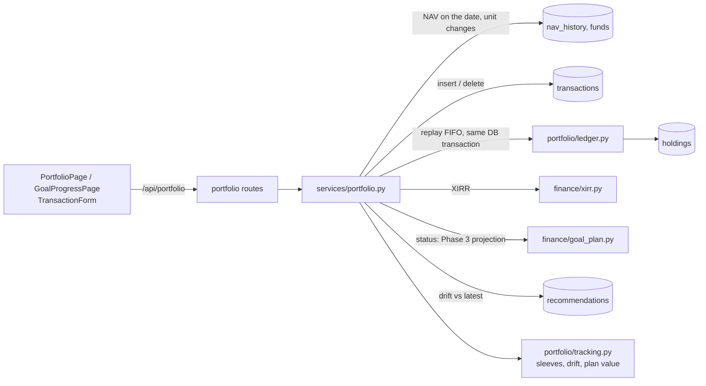
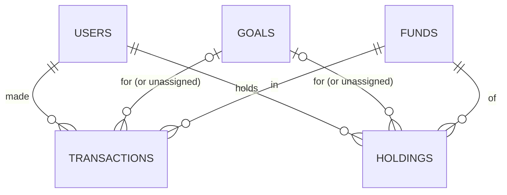
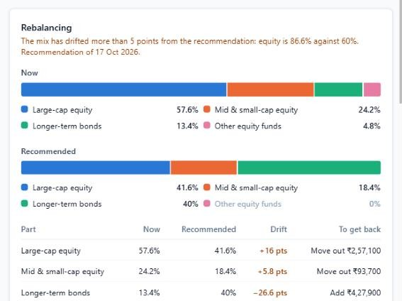

# Phase 9 – Portfolio tracker

| | |
|---|---|
| Branch | `phase-09-portfolio` |
| Tag | `v0.9.0` |
| Dates | 2026-10-17 |
| Merge | Merged into `main` with a merge commit after CI passed (GitHub CLI not installed, so no PR) |
| Synopsis objective(s) covered | Tracking actual investments against the plan: holdings valued at market prices, the real return (XIRR), whether each goal is on track, and alerts when a goal's asset mix needs rebalancing |

## 1. Summary

A logged-in user can now record what they actually invested and see how it is doing:

1. **Transactions**: lump-sum purchases, a SIP's past instalments in one go, and redemptions (by amount, by units or "everything"), each at that day's NAV and assigned to a goal.
2. **Holdings**: units, average cost, invested amount, value at the latest NAV, gain and XIRR for every fund in every goal, kept in step with the transactions.
3. **Portfolio summary**: invested, current value, gain and the portfolio's XIRR.
4. **Goal progress**: the goal's value over time against the plan (the money put in, grown at the plan's return), and where today's value plus the SIP is heading against the inflated target; on track or off track, with the SIP that would close the gap.
5. **Rebalancing**: the goal's mix compared with its Phase 8 recommendation; when it drifts more than 5 points, an alert and the amounts to move.
6. **Alerts** on the portfolio page and the dashboard.

| Before Phase 9 | After Phase 9 |
|---|---|
| 17 tables | 19 tables (+ `transactions`, `holdings`) |
| 45 endpoints | 51 endpoints (+ 6) |
| 464 tests | 510 tests |
| Plans only | Plans compared with real investments |

## 2. Why this phase

A plan is only useful if the user follows it and checks it. Three questions come up once money is invested:

- **"What return am I really getting?"** With a SIP every instalment has been invested for a different time, so neither the absolute gain nor CAGR answers it; XIRR does.
- **"Am I still on track?"** Markets do not deliver the planned return smoothly; the answer has to be recomputed from today's value.
- **"Is my mix still right?"** Equity that grows faster than bonds raises the risk over time, and the safe equity share falls as the goal nears (Phase 8 glide path). Drift has to be measured and acted on.

## 3. What was added

### 3.0 Big picture



### 3.1 Database

**Migration `0010_create_portfolio_tables`.**



**`transactions`** – the source of truth (insert and delete only)

| Column | Type | Constraint | Meaning |
|---|---|---|---|
| `id` | integer | PK | |
| `user_id` | integer | FK → `users.id` ON DELETE CASCADE; index `(user_id, txn_date)` | |
| `goal_id` | integer | FK → `goals.id` **ON DELETE SET NULL**; index | NULL = not assigned to a goal |
| `fund_id` | integer | FK → `funds.id` **ON DELETE RESTRICT**; index | |
| `txn_type` | varchar(4) | CHECK `buy` / `sell` | |
| `txn_date` | date | NOT NULL | |
| `amount` | numeric(14,2) | CHECK > 0 | Rupees paid or received |
| `units` | numeric(18,4) | CHECK > 0 | As on the statement that day |
| `nav` | numeric(18,8) | CHECK > 0 | Price used |
| `note` | varchar(200) | | "SIP" for generated instalments |
| `created_at` | timestamptz | default `now()` | |

**`holdings`** – derived from the transactions and stored (materialised)

| Column | Type | Constraint | Meaning |
|---|---|---|---|
| `id` | integer | PK | |
| `user_id` | integer | FK → `users.id` ON DELETE CASCADE; index | |
| `goal_id` | integer | FK → `goals.id` ON DELETE CASCADE | NULL = unassigned |
| `fund_id` | integer | FK → `funds.id` ON DELETE RESTRICT | |
| | | **UNIQUE (`user_id`, `goal_id`, `fund_id`) NULLS NOT DISTINCT** | One position per fund per goal, including the unassigned one |
| `units` | numeric(20,6) | CHECK ≥ 0 | In the fund's current units |
| `cost` | numeric(14,2) | CHECK ≥ 0 | FIFO cost of the units held |
| `realised_gain` | numeric(14,2) | default 0 | Gains booked by redemptions |
| `first_date`, `last_date` | date | | First and last transaction |
| `updated_at` | timestamptz | | |

Design points:

- **Derived vs stored.** Holdings are a pure function of the transactions. They are stored because every portfolio page needs the units and cost of all positions, and computing them means replaying FIFO lots and unit changes for every fund. The value is *not* stored: it changes with each day's NAV, so it is computed when read (units × latest NAV). A test (`test_materialised_holdings_equal_a_full_rebuild`) rebuilds everything from the transactions and compares.
- **Consistency.** Each write inserts or deletes a transaction, then rebuilds that one (user, goal, fund) holding, **in the same database transaction**: either both change or neither. An over-redemption raises an error during the rebuild, the transaction is rolled back, and nothing is stored.
- **`NULLS NOT DISTINCT`** (PostgreSQL 15+): without it two "unassigned" rows for the same fund would both be allowed, because NULL ≠ NULL in an ordinary unique constraint.
- **Deleting a goal** keeps its transactions (they really happened): `SET NULL` releases them to unassigned, `CASCADE` drops the goal's holdings, and the service rebuilds the user's holdings before committing.
- **`RESTRICT` on funds**: a fund someone holds cannot be deleted from under them.

### 3.2 Backend

| File | Responsibility |
|---|---|
| `app/finance/xirr.py` | `xnpv`, `xirr` (Newton-Raphson, bisection fallback), `XirrResult` (rate, iterations, method) |
| `app/portfolio/ledger.py` | `units_for` (stamp duty, 3 decimals), `replay` (FIFO lots → units, cost, realised gain), `InsufficientUnits` |
| `app/portfolio/tracking.py` | `sleeve_of` (fund → rebalancing row, index funds by name), `rebalance` (drift, trades, 5-point rule), `grown_contributions` (plan value) |
| `app/models/portfolio.py`, `app/schemas/portfolio.py` | Tables and API shapes |
| `app/services/portfolio.py` | `NavSeries` (NAV on a date, unit changes), advisory lock, `add_transaction`, `add_sip`, `delete_transaction`, `rebuild_user`, valuation, goal status, alerts, goal progress (history, projection, rebalancing) |
| `app/services/goals.py` | `delete_goal` rebuilds holdings in the same transaction |
| `app/api/routes/portfolio.py` | Endpoints below |

**Endpoints added** (all require login; users only ever see their own data)

| Method | Path | Response | Errors |
|---|---|---|---|
| GET | `/api/portfolio` | Totals (cost, value, gain, XIRR, NAV date), holdings, status of every goal, alerts | |
| GET | `/api/portfolio/transactions` | Newest first; filters `goal_id`, `fund_id` | |
| POST | `/api/portfolio/transactions` | `201` the transaction (NAV and units filled in) | `404` fund or goal, `422` future date, no NAV within a week, more units than held |
| POST | `/api/portfolio/transactions/sip` | `201` the monthly instalments created | `404`, `422` (a month without a NAV) |
| DELETE | `/api/portfolio/transactions/{id}` | `204` | `404`, `409` a later redemption needs these units |
| GET | `/api/portfolio/goals/{goal_id}` | Status, monthly history (invested, value, plan), projection to the target year, target, rebalancing, holdings | `404` |

### 3.3 Frontend

| File | Responsibility |
|---|---|
| `src/api/portfolio.ts`, `src/hooks/usePortfolio.ts` | Types and queries; every write refetches all portfolio data |
| `src/components/TransactionForm.tsx` | Purchase / monthly SIP / redemption; fund search showing plan and option (names repeat across them); goal; redeem everything |
| `src/components/PortfolioTables.tsx` | Status chip, holdings table, transactions table with delete |
| `src/components/PortfolioAlerts.tsx` | Alerts with a link to act on each |
| `src/pages/PortfolioPage.tsx` | Summary, alerts, goal status cards, holdings, transactions |
| `src/pages/GoalProgressPage.tsx` | Value against plan chart, projection against target chart, rebalancing (bars, drift, amounts), holdings and transactions of the goal |
| `src/pages/DashboardPage.tsx`, `GoalsPage.tsx`, `Layout.tsx`, `router.tsx` | Step 5 "Track your investments" and warnings; "Progress" on goal cards; "Portfolio" in the menu; routes `/portfolio`, `/goals/:goalId/progress` |

## 4. Key logic explained

### 4.1 XIRR

XIRR is the annual rate r at which the net present value of all dated cash flows is zero:

  Σᵢ CFᵢ / (1 + r)^((dᵢ − d₀)/365) = 0

Money put in is negative; redemptions and today's value (as if redeemed) are positive. **CAGR** knows only a start value, an end value and the years, so it suits a single lump sum; for a SIP it would treat the last instalment as if it had been invested for the whole period. For one investment and one final value the two are equal (tested).

Example: ₹10,000 every month for 12 months is worth ₹1,30,000 a month after the last instalment. The absolute gain is 8.3%, and CAGR on ₹1,20,000 over a year is also 8.3%, but XIRR is **15.7%**: on average the money was invested for only about half a year.

### 4.2 Newton-Raphson

f(r) = XNPV(r) is smooth and, for an ordinary investment (money in first, money out later), decreasing. Newton's method improves a guess using the slope:

  rₙ₊₁ = rₙ − f(rₙ) / f′(rₙ), f′(r) = Σ −tᵢ CFᵢ (1 + r)^(−tᵢ−1)

Starting from 10% (Excel's default guess), on the example in Microsoft's XIRR documentation:

| Iteration | r | f(r) | Next r |
|---|---|---|---|
| 1 | 10.000000% | 1,994.51 | 31.848185% |
| 2 | 31.848185% | 333.56 | 37.115680% |
| 3 | 37.115680% | 12.89 | 37.335897% |
| 4 | 37.335897% | 0.0208 | 37.336253% |
| 5 | 37.336253% | 0.0000 | converged |

Excel returns 0.373362535; ours is 0.3733625335 (test `test_xirr_matches_excel_documentation_example`). The number of correct digits roughly doubles each step (**quadratic convergence**) once close to the root.

Newton can fail: a flat slope, or a step that jumps below −100% where (1 + r)^t is undefined. Example: ₹100 in, ₹1 back a year later (r = −99%): the first step from 10% lands at −11,980%. Then the solver switches to **bisection**: it widens a bracket until f changes sign and halves it until it is narrower than 10⁻⁹. Bisection is slow (one bit per step) but cannot fail once the root is bracketed. Both paths are tested.

XIRR is not shown when the first flow is less than a year old: annualising a few weeks' return exaggerates it (2% in a month "is" 27% a year). The absolute return is shown instead.

### 4.3 From transactions to holdings (FIFO)

Purchases create lots; a redemption uses the oldest units first.

| Transaction | Lots after it | Cost held | Gain booked |
|---|---|---|---|
| Buy 100 units for ₹1,000 (₹10) | 100 @ ₹10 | ₹1,000 | |
| Buy 100 units for ₹2,000 (₹20) | 100 @ ₹10, 100 @ ₹20 | ₹3,000 | |
| Sell 150 units for ₹4,500 (₹30) | 50 @ ₹20 | ₹1,000 | ₹4,500 − (₹1,000 + ₹1,000) = ₹2,500 |

The replay runs in date order (purchases before redemptions on the same day). A redemption of more units than were held **on its date** is refused, even if later purchases would cover it. Units are allotted after the 0.005% stamp duty (from July 2020) and rounded down to three decimals, as on account statements; the cash flow is the full amount, so the stamp duty lowers the XIRR slightly, as it should.

**Face-value changes.** If a fund re-denominates its units (₹10 → ₹1,000), units bought before are divided by the same power of ten, using the Phase 4 detection rule, so the value and XIRR are unaffected (tested with a synthetic 1:100 change).

### 4.4 Consistency under concurrency

Two redemption requests arriving together could each see enough units and both succeed. Every write first takes `pg_advisory_xact_lock(9, user_id)`: a lock held until the transaction ends, so one user's writes run one at a time while different users never wait for each other. It works even for the first purchase of a fund, when there is no holdings row to lock with `SELECT … FOR UPDATE`.

### 4.5 Goal status

- **Plan value**: every contribution grown at the goal's assumed return to today, minus redemptions grown the same way. Value above it = the investments beat the plan's assumption.
- **On track**: the Phase 3 projection with today's holdings in place of "current savings": today's value grown at the plan's return plus the SIP (with step-up), compared with the inflated target. Off track → the SIP that would close the gap.
- Goals without transactions keep their Phase 3 projection ("No investments yet").

### 4.6 Rebalancing

Each holding is placed in a row: the four Phase 8 sleeves through the fund's SEBI peer group; index funds by the index in their name (Nifty 50 → large cap; Midcap 150 → mid & small cap; gilt → longer-term bonds; gold → other); other equity funds (flexi cap, ELSS, sectoral) in "other equity"; everything else (hybrid, gold, international) in "other".

Drift = actual share − recommended share. An alert is raised when **the equity share, or any row, is more than 5 percentage points away**. The amounts to move restore every row to its recommended share of today's value (to the nearest ₹100). Redeeming can cost capital-gains tax and exit loads, so the page also suggests pointing new SIP money at the underweight parts. A recommendation made when the goal had a different number of years left, or more than a year ago, gets a "refresh" alert, because the glide path has moved.

### 4.7 Worked example (real data, demo account)

"Daughter's education" (2036, 10 years away, plan 10% a year): ₹10,000 a month into Nippon India Large Cap since January 2021, ₹5,000 a month into HDFC Mid Cap since April 2022, ₹1,50,000 into ICICI Prudential Corporate Bond in March 2021, ₹50,000 into Parag Parikh Flexi Cap in June 2023, and ₹40,000 redeemed from the large-cap fund in February 2025. NAVs of 15 October 2026.

| | Value |
|---|---|
| Invested (cost of units held) | ₹11,56,056 |
| Value | ₹16,05,939 |
| Plan value (money put in at 10%) | ₹15,57,358, so **ahead by ₹48,581** |
| XIRR | **10.98%** against 10% assumed |
| Projected by 2036 with the ₹15,000 SIP | ₹71.87 L against ₹44.77 L needed: **on track** |
| Gain booked by the redemption (FIFO) | ₹21,056 |

| Row | Now | Recommended | Drift | To get back |
|---|---|---|---|---|
| Large-cap equity | 57.6% | 41.6% | +16.0 pts | move out ₹2,57,100 |
| Mid & small-cap equity | 24.2% | 18.4% | +5.8 pts | move out ₹93,700 |
| Longer-term bonds | 13.4% | 40.0% | −26.6 pts | add ₹4,27,900 |
| Other equity (flexi cap) | 4.8% | 0% | +4.8 pts | move out ₹77,000 |

Equity is 86.6% against 60% recommended: the SIPs all went into equity while the plan wants 40% in bonds, so a rebalance alert is raised. The 2-year "New car" goal, ₹3,00,000 in a large-cap fund, is 100% equity against 6.7% recommended and off track (XIRR 1.89% against 7%).

| Portfolio | Goal progress |
|---|---|
|  |  |



## 5. Design decisions

| Decision | Alternatives | Why |
|---|---|---|
| Transactions are the source of truth, insert/delete only | Editable holdings | Traceable; corrections are delete + re-enter. ADR-012 |
| Holdings materialised, rebuilt in the same DB transaction | View computed on read; materialised view | Read speed with guaranteed consistency; value still computed on read |
| Holding per (user, goal, fund) | Per (user, fund) as planned | Goal progress and drift need money per goal |
| FIFO | Average cost | Registrars' method; defines realised gains |
| Advisory lock per user | Row locks; serialisable isolation | Covers the first purchase too; no cross-user waits |
| XIRR, Newton + bisection | CAGR; absolute return | Correct for irregular flows; robust |
| XIRR hidden under a year | Always shown | Annualising short periods misleads |
| On track = re-projection from today | Planned path from goal creation | Reuses Phase 3; works for back-dated transactions |
| 5-point absolute band | Calendar; 5/25 relative rule | Simple and common; equity share first |
| SIP history in one request | One form per instalment | Back-filling years of SIPs is the common case |

## 6. Testing

| Test file | Tests | What is checked |
|---|---|---|
| `test_portfolio.py` | 24 | **XIRR = Excel's documented example** (0.373362535); lump sum XIRR = CAGR; a SIP's XIRR recovers the rate every instalment earned (CAGR would understate it); a loss (−50%); **Newton's failure falls back to bisection**; no rate without flows of both signs or time; FIFO cost and gain; order of entry irrelevant; over-redemption and redemption before purchase refused; same-day buy and sell, rounding tolerance; stamp duty and three-decimal units; sleeve mapping (10 cases incl. index-fund names, "Nifty 500" ≠ "Nifty 50"); drift beyond, within and exactly at the threshold; other equity counted as equity; plan value |
| `test_portfolio_api.py` | 22 | Login; empty portfolio; purchase at that day's NAV with stamp duty, holding, value, **XIRR 12% on a fund growing 12%**; weekend uses Friday's NAV, no NAV before launch, no future dates; validation; redemption by units with **FIFO gain through the API**; **over-redemption refused and nothing changes**; delete refused while a later redemption needs the units; privacy (other users' goals, transactions, progress); SIP of 25 instalments with XIRR ≈ 12%; SIP without NAVs refused; **units bought before a 1:100 unit change are restated (XIRR 6%, not −99%)**; **stored holdings = full rebuild**; deleting a goal releases its transactions and rebuilds holdings; drift alert, trades summing to zero; off-track and stale-recommendation alerts in order; progress history, plan value, projection and target; Indian digit grouping (5 cases) |
| Earlier phases | 464 | Unchanged |
| **Total** | **510** | **All passed** (local, ~156 s; GitHub Actions run #31: passed in 1 min 5 s) |

**Manual test in the browser** (2026-10-17, real data):

| Step | Expected | Result |
|---|---|---|
| Portfolio with no transactions | Empty state explaining what to add | Pass |
| SIPs, lump sums and a redemption through the API, then the portfolio page | Totals, XIRR 9.6%, two goal cards, three alerts, holdings, transactions | Pass |
| Add a purchase through the form (fund search, goal, date, amount) | Dialog closes; invested +₹50,000; flexi cap counted as other equity | Pass, after showing plan and option in the search (four funds had the same name) |
| Redeem 1,000 units dated before most purchases | "On 2022-06-01 only 101.688 units were held; cannot redeem 1,000.000" | Pass |
| Goal progress | Value above the plan line; projection crosses the target; rebalancing table with amounts | Pass |
| Dashboard | Step 5 with value and XIRR; warnings at the top | Pass |
| Phone width | No horizontal scrolling | Pass |

## 7. How to run / demo this phase

```bash
cd backend
uv run alembic upgrade head
uv run pytest -v tests/test_portfolio.py tests/test_portfolio_api.py
```

1. With market data loaded (Phase 4): Portfolio → **Add transaction** → *Monthly SIP (past instalments)*, pick a fund and a goal, a start date a few years back.
2. Add a lump sum into a bond fund for the same goal, then make a recommendation for the goal (Phase 8).
3. Open the goal's **Progress**: value against plan, projection against target, rebalancing amounts.
4. Try to redeem more units than were held on an earlier date; try to delete a purchase that a later redemption needs.

## 8. Problems faced and how they were solved

| Problem | Cause | Fix |
|---|---|---|
| Four identical "Parag Parikh Flexi Cap Fund" rows in the fund search | AMFI names repeat across direct/regular and growth/IDCW | Plan and option shown in the search, the chosen fund and the holdings table |
| "Nifty 500" index fund classified as large cap | Keyword "nifty 50" matched inside "nifty 500" | Keywords must start a word and not run into more digits |
| Alerts showed "₹874,512" | Python's `,` grouping is Western | `inr()` with Indian grouping (₹8,74,512), tested |
| Rebalance alert repeated itself ("equity is 100%…; large-cap equity is 100%…") | Always named the equity share and the worst row | Names the equity share when that drifted, otherwise the worst row |
| SIP test expected 25 instalments, got 24 | 730 days after the start falls a day before the 24th monthly date | The test's end date moved to 740 days; the code was right |
| The API dev server kept serving the old routes | Its file watcher stopped reloading after a new package was added | Restarted the server |

## 9. Viva questions and answers

1. **Q: What is XIRR and why not CAGR?**
   A: The annual rate that makes the present value of all dated cash flows zero. CAGR uses only a start and end value, so it is right for one lump sum but wrong for SIPs and redemptions, where each amount is invested for a different time. For a single investment they are equal.

2. **Q: Explain Newton-Raphson.**
   A: To solve f(r) = 0, start from a guess and repeatedly move to where the tangent crosses zero: rₙ₊₁ = rₙ − f(rₙ)/f′(rₙ). Near the root the error is roughly squared at each step (quadratic convergence): 5 iterations from 10% on Excel's example.

3. **Q: When does Newton-Raphson fail, and what do you do?**
   A: When the slope is near zero, when a step jumps outside the valid range (below −100%), or when it oscillates. The solver then uses bisection on a bracket where f changes sign, which always converges, only more slowly.

4. **Q: How did you test XIRR?**
   A: Against the example in Microsoft's XIRR documentation (Excel gives 0.373362535), against CAGR for a lump sum, against a SIP built from a known 12% rate, a loss, the bisection fallback, and cases with no answer.

5. **Q: Can XIRR have more than one answer?**
   A: Yes, if the cash flows change sign several times (in, out, in again), the polynomial can have several roots. For ordinary investing (money in, then money out) the NPV falls as the rate rises, so there is one root.

6. **Q: Why are holdings stored when they can be computed from transactions?**
   A: Every page needs all positions, and computing them means replaying FIFO lots and unit changes. They are materialised but rebuilt in the same database transaction as every change, so they cannot disagree, and a test compares them with a full rebuild. The market value is not stored because it changes daily.

7. **Q: When should derived data not be stored?**
   A: When it changes more often than it is read, or when it is cheap to compute: goal projections (Phase 3) and market values here are computed on read.

8. **Q: How do you keep holdings and transactions consistent?**
   A: Insert or delete the transaction and rebuild the holding inside one database transaction (atomicity). An invalid result (an over-redemption) raises an error, the whole transaction is rolled back, and nothing is stored.

9. **Q: What happens if two redemptions arrive at the same moment?**
   A: Every write takes a PostgreSQL advisory lock keyed on the user, held until commit, so the second waits, then sees the first redemption and is refused if the units are no longer there. Other users are not blocked.

10. **Q: Why FIFO?**
    A: It is how registrars compute capital gains on mutual fund units: the oldest units are redeemed first. It fixes the cost of what remains and the gain booked.

11. **Q: Why NULLS NOT DISTINCT in the unique constraint?**
    A: Unassigned holdings have goal_id NULL. In SQL NULL is not equal to NULL, so an ordinary unique constraint would allow many unassigned rows for the same fund; NULLS NOT DISTINCT treats them as equal.

12. **Q: What happens to the investments of a deleted goal?**
    A: The transactions stay (ON DELETE SET NULL makes them unassigned), the goal's holdings are dropped by CASCADE, and the service rebuilds the holdings in the same transaction.

13. **Q: How is "on track" decided?**
    A: The Phase 3 projection with today's value in place of current savings: today's value and the SIP grown at the plan's return, against the inflated target. Separately, the plan value shows whether the investments have beaten the plan's assumed return so far.

14. **Q: What is portfolio drift and when do you alert?**
    A: The gap between the current mix and the recommended one, which grows as some assets outperform. The alert fires when the equity share or any part is more than 5 percentage points from the recommendation.

15. **Q: Why suggest redirecting SIPs instead of selling?**
    A: Selling can trigger capital-gains tax and exit loads; buying more of the underweight parts with new money corrects drift without either, though more slowly.

16. **Q: Why is stamp duty in the unit calculation?**
    A: Since July 2020 0.005% of a purchase is deducted before units are allotted. Including it matches the units on statements; the cash flow stays the full amount, so XIRR reflects the cost.

17. **Q: What is not handled?**
    A: Exit loads, taxes, IDCW payouts, switches (entered as a redemption and a purchase) and importing a consolidated account statement.

## 10. Report mapping

- **System Analysis – Requirements**: section 2
- **System Design – Database Design**: section 3.1 (source of truth vs materialised data, NULLS NOT DISTINCT, referential actions)
- **Mathematical Techniques**: sections 4.1–4.2 (XIRR, Newton-Raphson, bisection, convergence), 4.3 (FIFO), 4.6 (drift)
- **Implementation – Portfolio module**: sections 3.2–3.3, 4.4 (transactions and locking)
- **Results**: section 4.7
- **Testing**: section 6
- **Limitations**: no exit loads or taxes; no IDCW payouts or switches; no statement import; a unit change after the last write needs a rebuild
- **Future Enhancements**: CAS (consolidated account statement) import; tax-aware rebalancing (long-term vs short-term units); SIP auto-entry each month; email alerts
