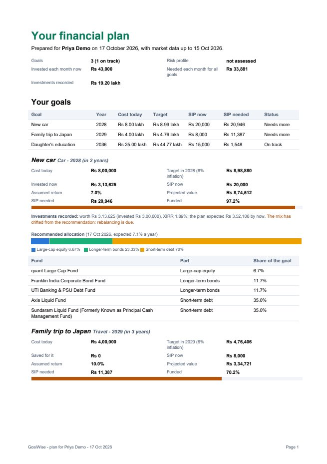
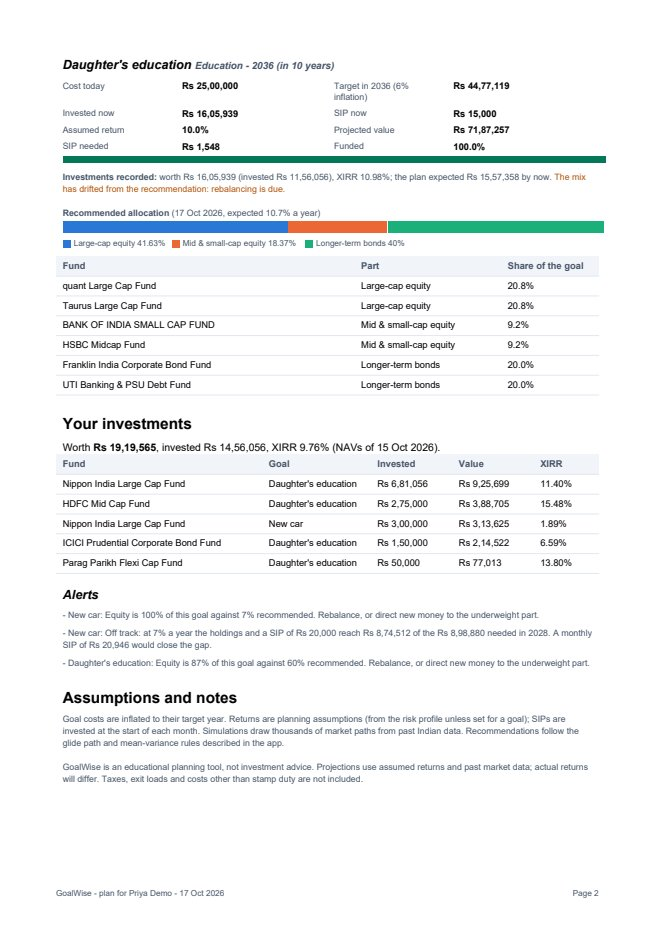
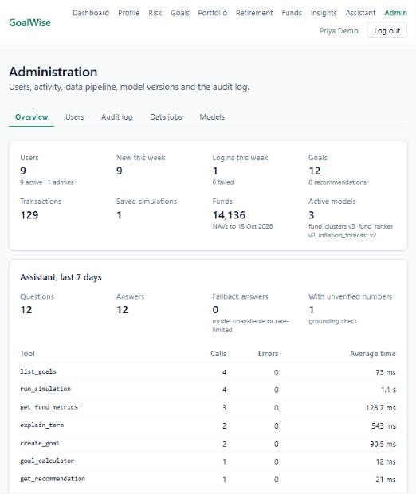
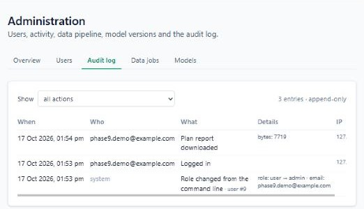
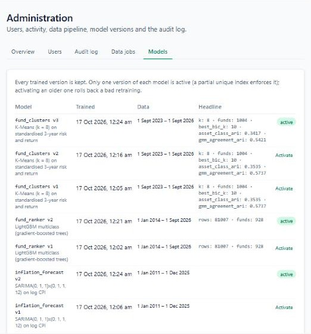

# Phase 11 – Reports and administration

| | |
|---|---|
| Branch | `phase-11-reports-admin` |
| Tag | `v0.11.0` |
| Dates | 2026-10-17 |
| Merge | Merged into `main` with a merge commit after CI passed (GitHub CLI not installed, so no PR) |
| Synopsis objective(s) covered | A downloadable plan report; an administration module (users, data pipeline, model versions, usage) protected by role-based access control; an audit trail of key actions |

## 1. Summary

1. **Download my plan (PDF):** a button on the dashboard and the goals page produces the whole plan as a PDF: profile and risk, every goal with its projection, recommendation, latest saved simulation and recorded investments, the retirement plan, holdings and alerts, assumptions and a disclaimer.
2. **Admin dashboard** (`/admin`, administrators only):
   - **Overview:** users, logins and failed logins, activity, funds and data freshness, the latest run of each data job, active models, and assistant quality (questions, fallback answers, answers with unverified numbers, tool calls with errors and average time).
   - **Users:** search, last login, make or remove admin, deactivate or reactivate.
   - **Audit log:** filter by action or group.
   - **Data jobs:** start a job and watch it run.
   - **Models:** every trained version with its validation headline; activate an older one to roll back.
3. **Audit log:** 22 kinds of key action are recorded with who, what, when and from which address. A database trigger makes the table append-only.
4. **Make an administrator** from the command line: `python -m app.admin make-admin <email>`.

| Before Phase 11 | After Phase 11 |
|---|---|
| 24 tables | 25 tables (+ `audit_log`) |
| 57 endpoints | 65 endpoints (+ 8) |
| 542 tests | 559 tests |
| A `role` column nobody could set or use | Role-based administration and an audit trail |

## 2. Why this phase

- Users want a **document** of their plan to keep, print or discuss with family or an adviser.
- A running system needs an **operator view**. Has the NAV job run? Is the assistant failing? Which model version is live? Who are the users?
- Financial software needs **accountability**. When was this goal deleted? Who made that user an admin? Were there many failed logins from one address? An audit trail answers that, and it must not be editable after the fact.

## 3. What was added

### 3.0 Big picture

```mermaid
flowchart LR
    U[User] -->|Download my plan| RP[GET /api/reports/plan]
    RP --> RS[services/reports.py] --> SV[goals, recommendations, simulations,<br/>retirement, portfolio, profile, risk]
    RS --> PDF[reports/plan_pdf.py<br/>ReportLab] --> U
    A[Admin] -->|role checked every request| AD[/api/admin/*]
    AD --> AS[services/admin.py]
    AS --> DB[(users, job_runs, ml_models,<br/>chat_messages, tool_calls)]
    ALL[Routes: auth, goals, portfolio, ...] -->|after success| AU[Audit dependency] --> AL[(audit_log<br/>append-only trigger)]
    AD --> AL
    CLI[python -m app.admin make-admin] --> AL
```

### 3.1 Database

**Migration `0012_create_audit_log`.**

| Column | Type | Constraint | Meaning |
|---|---|---|---|
| `id` | integer | PK | |
| `created_at` | timestamptz | default now(); index | |
| `actor_id` | integer | **no foreign key**; index with `created_at` | NULL for anonymous (failed login) or command line |
| `actor_email` | varchar(255) | | Snapshot of the e-mail |
| `action` | varchar(60) | index | One of 22 actions, e.g. `goal.delete` |
| `entity_type`, `entity_id` | varchar(40), integer | | What was acted on |
| `details` | jsonb | default '{}' | e.g. `{"role": {"from": "user", "to": "admin"}}` |
| `ip_address` | varchar(45) | | Client address (IPv6 fits in 45 characters) |

```sql
CREATE FUNCTION audit_log_append_only() RETURNS trigger AS $$
BEGIN
    RAISE EXCEPTION 'audit_log is append-only: % is not allowed', TG_OP;
END;
$$ LANGUAGE plpgsql;
CREATE TRIGGER audit_log_append_only BEFORE UPDATE OR DELETE ON audit_log
    FOR EACH ROW EXECUTE FUNCTION audit_log_append_only();
```

Design points:

- **Append-only, enforced by the database.** The application never updates or deletes audit rows, and the trigger makes sure no code path can, including a bug or someone running ordinary SQL with the application's account (test `test_audit_rows_cannot_be_changed_or_deleted`).
- **No foreign key to `users`.** A foreign key would force a choice when a user is deleted: delete their audit history (CASCADE) or rewrite it (SET NULL). Both destroy the record. Instead the id and an e-mail snapshot are kept.
- **Indexes** match the admin queries: newest first (`created_at`), one person's actions (`actor_id, created_at`), one kind of action (`action`).

### 3.2 Backend

| File | Responsibility |
|---|---|
| `app/models/audit.py`, `alembic/versions/0012_create_audit_log.py` | Table, indexes, trigger |
| `app/services/audit.py` | `ACTIONS` (22, with descriptions), `record` (rejects unknown actions), `Auditor`, `entries` (filter by action, action group such as `goal.`, or actor), `last_logins` |
| `app/api/deps.py` | `Audit` dependency (adds the request's IP address), `AdminUser` alias for `Depends(require_admin)` |
| Routes: auth, profile, risk, goals, retirement, simulations, recommendations, portfolio, market | Record each action after it succeeds; failed logins with the e-mail tried |
| `app/chatbot/tools.py` | Goals created by the assistant are recorded as `assistant.goal.create` |
| `app/reports/plan_pdf.py` | Pure renderer: `PlanReport` data classes → PDF bytes (ReportLab platypus: styles, two-column fact tables, tables, progress and allocation bars, page footer) |
| `app/services/reports.py` | Collects the report from the services the pages use (recorded investments replace typed-in savings, as on the portfolio page) |
| `app/finance/formatting.py` | `inr` (Indian grouping) and `lakh_crore`, with a configurable symbol; shared by alerts, the assistant and the PDF |
| `app/services/admin.py`, `app/schemas/admin.py`, `app/api/routes/admin.py` | Overview, users, update (no self-change), audit page, model versions with headline metrics, activation |
| `app/api/routes/reports.py` | `GET /api/reports/plan` |
| `app/admin.py` | `python -m app.admin make-admin | revoke-admin <email>` |

**Endpoints added**

| Method | Path | Who | Response | Errors |
|---|---|---|---|---|
| GET | `/api/reports/plan` | Any user | The plan as `application/pdf`, `attachment`, `Cache-Control: no-store` | `401` |
| GET | `/api/admin/overview` | Admin | Counts, jobs, models, assistant statistics | `401`, `403` |
| GET | `/api/admin/users` | Admin | Search `q`, paged, newest first, with last login and goal count | `401`, `403` |
| PATCH | `/api/admin/users/{id}` | Admin | Change `role` and/or `is_active` (audited) | `404`, `409` own account, `422` |
| GET | `/api/admin/audit` | Admin | Audit entries, newest first; filter `action` (or `goal.`), `actor_id` | `401`, `403` |
| GET | `/api/admin/audit/actions` | Admin | Action → description | `401`, `403` |
| GET | `/api/admin/models` | Admin | Every model version with headline metrics | `401`, `403` |
| POST | `/api/admin/models/{id}/activate` | Admin | Make a version active (audited); returns all versions | `404` |

Existing admin endpoint used by the dashboard: `POST /api/market/jobs/{job}/run` (now audited) and `GET /api/market/jobs`.

### 3.3 Frontend

| File | Responsibility |
|---|---|
| `src/api/reports.ts`, `src/components/DownloadPlanButton.tsx` | Fetches the PDF with the token as a blob and saves it under the server's file name; busy and error states |
| `src/pages/DashboardPage.tsx`, `src/pages/GoalsPage.tsx` | "Download my plan (PDF)" once there is a goal |
| `src/api/admin.ts`, `src/hooks/useAdmin.ts` | Admin types and queries (jobs refresh every 5 s while open) |
| `src/pages/AdminPage.tsx` | Tabs: Overview, Users, Audit log (readable details: "role: user → admin"), Data jobs, Models |
| `src/components/RouteGuards.tsx`, `src/router.tsx`, `src/components/Layout.tsx` | `AdminRoute` (non-admins are sent to the dashboard), `/admin`, "Admin" in the menu for administrators only |

## 4. Key logic explained

### 4.1 Role-based access control

Authentication (Phase 1) proves who the user is; **authorisation** decides what they may do. Every admin route depends on `require_admin`, which runs `get_current_user` (verifies the JWT and **loads the user from the database**) and then checks `role == "admin"`, otherwise **403**. Because the role and `is_active` come from the database on every request, not from the token, demoting or deactivating someone takes effect at once (test: a deactivated user's valid token gets 401). The frontend hides the menu link and guards `/admin`, but that is only convenience: the API is the real barrier.

An administrator cannot change their own role or deactivate themselves (409), so the last admin cannot lock everyone out. New administrators are created from the command line, which needs access to the server, never through the web.

### 4.2 The audit trail

```python
@router.delete("/{goal_id}", status_code=204)
def delete_goal(goal_id: int, user: CurrentUser, db: DbSession, audit: Audit) -> None:
    goal = owned_goal(db, user, goal_id)
    summary = _summary(goal)                      # name, type, year: kept after deletion
    service.delete_goal(db, goal)
    audit("goal.delete", user, entity_type="goal", entity_id=goal_id, details=summary)
```

The `Audit` dependency carries the request's IP address; the route records the action only after the service succeeded. Validation errors and 404s are therefore not logged (tested). Failed logins are, with the e-mail that was tried, because repeated failures signal password guessing. `record` rejects unknown action names, so a typo cannot silently create an unfilterable event.

Trade-off: the action and its audit row are committed one after the other. A crash between the two commits would lose that audit row. Writing both in one transaction would need audit calls inside every service, or database triggers that cannot see the user or IP address. For this project, recording in the route is simpler and clearer.

### 4.3 The PDF

The report data is collected from the same services the pages use. It is put into plain data classes (`PlanReport`, `GoalSection`, …) and rendered by a pure function, so the renderer is tested with synthetic data and the endpoint with real data. ReportLab's *platypus* lays out "flowables" (paragraphs, tables, drawings) across pages and calls a footer function on each page.

- Goal names and other user text are XML-escaped before going into paragraphs. A goal called `New car <fast> & red` renders correctly (tested); without escaping it would break the layout markup.
- Amounts are written "Rs 8,74,512": none of the 14 built-in PDF fonts has the ₹ glyph (it printed as a black box in the first version), and embedding a font for one character was not worth the size.
- `Cache-Control: no-store`: the file holds personal financial data, so browsers and proxies must not cache it.

Measured: the demo account's plan (3 goals, 5 holdings, 2 recommendations) is 2 pages, 7.7 KB, generated in 0.25 s.

| Page 1 | Page 2 |
|---|---|
|  |  |

### 4.4 Model versions and rollback

Each training run (Phase 7) stores a new version; a partial unique index allows one active version per model. The Models tab lists every version with its validation headline: rank correlation and top-pick hit rate for the ranker against momentum, 12-month error of the inflation forecast against the naive forecast and the RBI target. Activating an older version rolls back a bad retraining instantly. The `ml_score` job then refreshes the fund predictions.

| Overview | Audit log |
|---|---|
|  |  |



## 5. Design decisions

| Decision | Alternatives | Why |
|---|---|---|
| ReportLab on the server | WeasyPrint; browser print | No system libraries; consistent; testable. ADR-014 |
| "Rs" instead of ₹ in the PDF | Embed a font | Built-in fonts lack the glyph |
| Admins made from the command line | Web sign-up flag | Needs server access |
| Role read from the database on every request | Trust the token's role | Demotion and deactivation take effect at once |
| No self-demotion | Allow | Avoids lockout |
| Audit table with an append-only trigger | Log files; trust the code | Queryable and tamper-resistant |
| No foreign key from audit to users | FK with CASCADE / SET NULL | History survives user deletion |
| Record after success in the route | Database triggers | Knows the user and IP; simple (two commits, see 4.2) |
| Activate stored model versions | Retrain to roll back | Instant rollback |

## 6. Testing

| Test file | Tests | What is checked |
|---|---|---|
| `test_audit.py` | 6 | Unknown actions rejected; **UPDATE and DELETE refused by the trigger**; sign-up, login and failed login recorded (normalised e-mail, IP); goal create/update/delete with details; failed actions not recorded; filters by action, group and actor; last login |
| `test_reports.py` | 4 | **Full plan renders every section** (text read back with pypdf; Indian grouping; no ₹; escaped goal name); empty plan; login required; **download** (PDF type, attachment, no-store, user's name and goal in the text, audited with its size) |
| `test_admin_api.py` | 7 | **401 without login and 403 for every admin route as a normal user**; overview counts (users, logins, failed logins, goals, assistant fallbacks, unverified numbers, tool errors and average time); user search and last login; promote, demote and **deactivate (the old token stops working)**, audited; **no self-change (409)**, 404, 422; audit endpoint filters; model versions listed and **rolled back**, audited; **command line** grants and revokes admin, audited |
| Earlier phases | 542 | Unchanged (auditing added to their routes) |
| **Total** | **559** | **All passed** (local, ~174 s) |

**Manual test** (2026-10-17, real data):

| Step | Expected | Result |
|---|---|---|
| `python -m app.admin make-admin phase9.demo@example.com` | "… is now admin"; audit row from "system" | Pass |
| Admin link and `/admin` | Overview with 9 users, 12 goals, 129 transactions, 14,136 funds, 3 active models, assistant tool table | Pass (average times rounded after review) |
| Audit log tab | CLI role change, login, report download with details | Pass (details made readable after review) |
| Models tab | 7 versions, 3 active, headline metrics | Pass (ranker and inflation headlines added after review) |
| Download my plan | `200`, `application/pdf`, 7.7 KB, attachment, no-store | Pass (₹ glyph and legend font fixed after the first render) |

## 7. How to run / demo this phase

```bash
cd backend
uv run alembic upgrade head
uv run python -m app.admin make-admin you@example.com
uv run pytest -v tests/test_audit.py tests/test_reports.py tests/test_admin_api.py
```

1. Log in (again, after being made admin) and open **Admin**: overview, users, audit log, data jobs, models.
2. Make another user admin, then deactivate them: the audit log shows both, with before and after.
3. Dashboard → **Download my plan (PDF)**.
4. Try `UPDATE audit_log SET action = 'x';` in `psql`: the trigger refuses it.

## 8. Problems faced and how they were solved

| Problem | Cause | Fix |
|---|---|---|
| No way to create an administrator | Only a `role` column and a guard existed | `python -m app.admin make-admin` (audited) |
| ₹ printed as a black box in alerts in the PDF | Built-in PDF fonts lack the glyph | Text passed to the PDF has ₹ replaced by "Rs" |
| Allocation legends in a serif font | ReportLab drawings default to Times | `fontName="Helvetica"` |
| Deleting a user would destroy or rewrite their audit history | A foreign key forces CASCADE or SET NULL, and the trigger forbids updates | No foreign key; id and e-mail snapshot |
| Writing `router.py` failed once with "Invalid argument" | The dev server's file watcher had the file open | Retried |
| Raw JSON made the audit table unreadable | Details shown verbatim | "role: user → admin · email: …" |
| Model headline empty for the inflation forecast | Its scores are nested | Ranker and forecast key results lifted into the headline |

## 9. Viva questions and answers

1. **Q: What is role-based access control?**
   A: Permissions are attached to roles (user, admin), and users are given roles. Every admin endpoint checks the role on the server and returns 403 if it is not admin; hiding the menu in the browser is only a convenience.

2. **Q: 401 or 403?**
   A: 401: not authenticated (no or invalid token). 403: authenticated but not allowed (a normal user calling an admin route).

3. **Q: Why is the role read from the database rather than the token?**
   A: Tokens live up to 60 minutes. Reading the role and active flag on every request means a demoted or deactivated account loses access immediately (tested).

4. **Q: How is the first administrator created?**
   A: From the command line on the server (`python -m app.admin make-admin`), which needs server access; there is no web route to become admin. The change itself is audited.

5. **Q: Why can an admin not demote themselves?**
   A: The last administrator could otherwise lock everyone out of administration.

6. **Q: What is an audit log and why is it append-only?**
   A: A record of who did what and when, for accountability, security investigations and compliance. If records could be edited, the log could hide the very actions it exists to show; a trigger refuses UPDATE and DELETE.

7. **Q: Can nobody ever change the audit log?**
   A: Not through the application or ordinary SQL. A database superuser could disable the trigger; protecting against that needs separation of duties (a separate audit database, write-once storage).

8. **Q: Why no foreign key from audit_log to users?**
   A: Deleting a user would then cascade-delete or null their history. The id and an e-mail snapshot keep the record intact.

9. **Q: What exactly is recorded?**
   A: 22 key actions: sign-up, logins and failures, profile and risk changes, goal create/update/delete, retirement plan, saved simulations, recommendations, portfolio transactions, goals created by the assistant, report downloads, admin changes, job runs, model activation and command-line role changes. Reads are not logged.

10. **Q: Why log failed logins?**
    A: Many failures for one account or from one address indicate password guessing; the admin overview counts them.

11. **Q: The action and its audit row are separate commits. Is that a problem?**
    A: A crash between them could lose one audit row. One transaction would need audit calls inside every service, or triggers that cannot see the user and IP. Recording in the route was the simpler choice, and the limitation is documented.

12. **Q: Why generate the PDF on the server?**
    A: One consistent document from the same calculations, no browser print quirks, and it can be tested automatically. ReportLab is pure Python, so it needs no system libraries on Windows or Linux.

13. **Q: How do you test a PDF?**
    A: Render it, read the text back with pypdf, and check every section, the Indian number format and escaping; the endpoint test checks headers and the audit row.

14. **Q: Why `Cache-Control: no-store` on the PDF?**
    A: It contains personal financial data; browsers and proxies must not keep copies.

15. **Q: What does the admin overview tell you about the assistant?**
    A: Questions and answers in the last 7 days, fallback answers (model down or rate-limited), answers with numbers the grounding check could not trace, and per tool the calls, errors and average time.

## 10. Report mapping

- **System Analysis – Requirements**: section 2
- **System Design – Database Design**: section 3.1 (append-only audit table, trigger, no foreign key)
- **Security**: 4.1 (RBAC, 401 vs 403, lockout), 4.2 (audit trail), 4.3 (escaping, no-store)
- **Implementation – Reports and administration**: sections 3.2–3.3, 4.3–4.4
- **Testing**: section 6
- **Limitations**: two-commit auditing; no audit export or retention policy; "Rs" instead of ₹ in the PDF; no e-mailing of reports
- **Future Enhancements**: audit export and retention; charts in the PDF; scheduled e-mailed reports; finer-grained roles (support, analyst)
