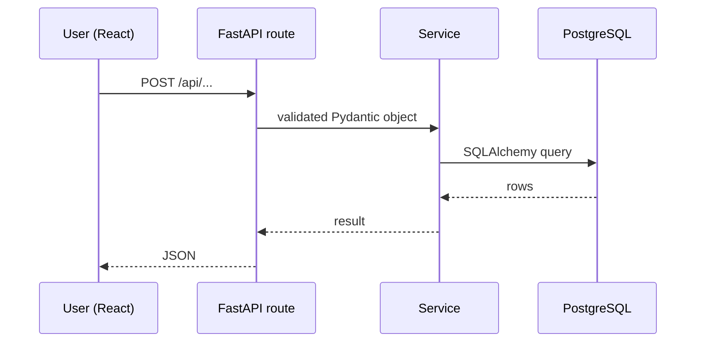

# Phase NN – <Name>

| | |
|---|---|
| Branch | `phase-NN-short-name` |
| Tag | `v0.NN.0` |
| Dates | <start> – <end> |
| Pull Request | <link> |
| Synopsis objective(s) covered | e.g. Objective 3, 4 |

## 1. Summary

<!-- 3–5 sentences: what the user can do now that they could not do before. -->

## 2. Why this phase

<!-- The problem it solves and how it fits the overall system. -->

## 3. What was added

### 3.1 Database
<!-- New/changed tables and columns, relationships, indexes, Alembic migration id. -->

| Table | Column | Type | Constraint | Meaning |
|---|---|---|---|---|
| | | | | |

### 3.2 Backend
<!-- New modules/files and their responsibility. -->

| File | Responsibility |
|---|---|
| | |

**Endpoints added**

| Method | Path | Auth | Request | Response | Purpose |
|---|---|---|---|---|---|
| | | | | | |

### 3.3 Frontend
<!-- New pages, components, hooks, API client functions. -->

| File | Responsibility |
|---|---|
| | |

### 3.4 Integration and orchestration
<!-- How a request travels: UI → API client → route → service → DB/engine → back. -->

## 4. Key logic explained

<!-- Formulas, algorithms, or business rules introduced, with a worked example. -->

## 5. Design decisions

| Decision | Alternatives considered | Why this choice |
|---|---|---|
| | | |

## 6. Testing

| Test | Type (unit / integration / UI) | Result |
|---|---|---|
| | | |

How to run: `...`

## 7. How to run / demo this phase

<!-- Exact steps to see the feature working. Screenshots in docs/screenshots/phase-NN-*.png -->

## 8. Problems faced and how they were solved

-

## 9. Viva questions and answers

1. **Q:** 
   **A:** 

## 10. Report mapping

<!-- Which report chapter(s) this content feeds: Design, Implementation, Testing, Results … -->
