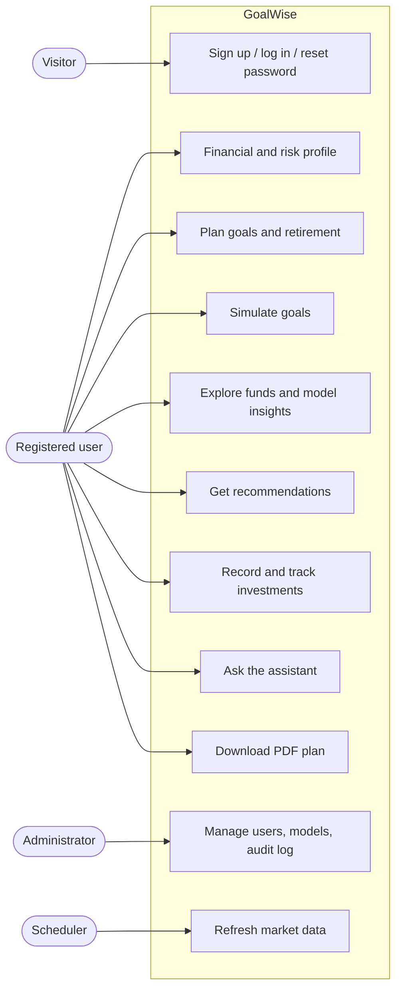

# System Analysis and Requirements

This chapter analyses the problem from the point of view of a system to be built. It describes the existing approach and its drawbacks, the proposed system and its advantages, the feasibility of the project, the users of the system and their requirements, and the hardware and software used — the "computer skills" of the project.

## Existing system

An Indian household that wants to plan its goals today typically combines several unconnected tools:

1. A **SIP calculator** on a fund house's or a bank's website, into which the user types a monthly amount, a period and an expected return, and reads off a future value. Some calculators work in reverse and give the SIP required for a target.
2. A **fund research website**, where the user filters funds by category and sorts them by past returns or star ratings.
3. An **investment platform or broker**, through which units are bought and where holdings and overall returns are shown.
4. **Spreadsheets** or notes in which careful users keep track of which investment belongs to which goal.

### Drawbacks of the existing system

- **One number instead of a range.** Calculators use a single assumed return, so they cannot show the probability of reaching a goal or how much more must be invested for greater certainty.
- **Inflation is often ignored** or left to the user to apply, so targets are understated.
- **No link between funds and goals.** Fund rankings are not related to the horizon or risk of any goal, and are based on past returns alone.
- **No tracking against a plan.** Platforms show what is held, not whether each goal is on course; drift from the intended mix goes unnoticed.
- **Manual and error-prone.** Keeping the pieces consistent in a spreadsheet requires discipline and financial knowledge that most users do not have.
- **Opaque reasoning.** Where advice is given, its assumptions are rarely shown, so users cannot judge it.

## Proposed system

GoalWise brings these activities together around the goal. After a short profile and risk questionnaire, the user adds goals; for each goal the system shows the inflated target, the SIP required, and — through simulation — the chance of success and the SIP needed for greater certainty. A retirement planner covers the special case of a goal that is spent over many years. The system recommends an asset mix and funds for each goal from live market data and machine-learning rankings, and the user records actual investments, which the system values and compares with the plan. A conversational assistant answers questions about all of this in plain language.

### Advantages of the proposed system

- Plans are **per goal**, with inflation, step-up and current savings taken into account.
- Outcomes are **probabilities and ranges** from 10,000 simulated market futures under four models, rather than a single number.
- Fund selection is **data-driven and explained**: rankings come from a validated model, and each shows the factors behind it.
- Recommendations depend on the **goal's horizon and the user's risk profile**.
- Real investments are **tracked against each goal** with XIRR, plan value and alerts.
- Every formula and assumption is **visible**, in the application and in a downloadable PDF plan.
- Questions can be asked in **plain language**, and answers use the system's own calculations.

## Feasibility study

### Technical feasibility

All components of the system can be built with mature, free and open-source technology. Python provides the scientific libraries the analysis needs (NumPy, pandas, SciPy, statsmodels, scikit-learn, LightGBM, arch, hmmlearn) and a modern web framework (FastAPI). PostgreSQL is a reliable relational database, and its pgvector extension stores the embeddings for the assistant's knowledge base in the same database. React and TypeScript are standard for single-page applications. The data required — daily NAVs, index levels and consumer prices — is published free of charge by AMFI, NSE (through public data services) and MOSPI. The language model is available through the Gemini API with a free tier. The most demanding computation, a 10,000-path simulation, takes under two seconds on a single CPU when vectorised with NumPy. The project is therefore technically feasible.

### Economic feasibility

The project uses no paid software or services. Development uses free tools (Visual Studio Code, Git, Docker Desktop, uv, Node.js). The deployed system runs on the free tiers of Vercel, Render and Neon, and the free tier of the Gemini API is sufficient for demonstration. The only costs are the developer's time and an ordinary personal computer and internet connection. The project is economically feasible.

### Operational feasibility

The system is used through a web browser on a computer or phone, with no installation. The interface follows familiar patterns (forms, tables, charts), validates input as it is typed, and explains results in plain language. The assistant lowers the barrier further for users unfamiliar with financial terms. Administrators manage users and models through a dedicated dashboard, and the daily market data refresh runs automatically. The system is operationally feasible.

### Legal and ethical feasibility

The data sources are public. The system does not transact or hold money, and it presents itself as an educational tool rather than personalised investment advice within the meaning of the SEBI (Investment Advisers) Regulations, 2013. Personal data is limited to what planning needs, passwords are stored only as Argon2 hashes, and the assistant is instructed not to send personal identifiers to the language model provider. Key actions are recorded in an append-only audit log.

## Users of the system

Table: User roles and what each can do

| Role | Description | Main activities |
| --- | --- | --- |
| Visitor | Not logged in | Sign up, log in, reset a forgotten password with the security question, view system status |
| Registered user | An individual investor | Maintain the financial profile and risk profile; create, edit and simulate goals; plan retirement; explore funds and model insights; get recommendations; record and edit transactions; track goals; ask the assistant; download the PDF plan; manage the account |
| Administrator | Operates the system | Everything a user can do, plus the admin dashboard: user management (role, active flag), audit log, data-job status, ML model versions (activate or roll back), assistant statistics |
| Scheduler | Automated job (GitHub Actions) | Load daily NAVs, compute fund metrics, refresh index histories and inflation data |

Figure: Use-case overview of GoalWise

## Functional requirements

Table: Functional requirements

| No. | Module | Requirement |
| --- | --- | --- |
| FR1 | Accounts | Users can sign up with name, e-mail, password and a security question; passwords need 8+ characters with a letter and a digit |
| FR2 | Accounts | Users log in with e-mail and password and receive a token valid for 60 minutes |
| FR3 | Accounts | Users can change their name and password, and set their security question, after confirming the current password |
| FR4 | Accounts | A forgotten password can be reset by answering the security question; five wrong answers in an hour lock resets for that address |
| FR5 | Profile | Users record date of birth, employment, income, expenses, loan payments, savings, investments and dependants |
| FR6 | Risk | A ten-question questionnaire scores willingness; capacity is scored from the profile; the lower decides the risk category |
| FR7 | Goals | Users create, edit and delete goals with type, name, cost in today's money, target year, priority, inflation, expected return, current savings, monthly SIP and yearly step-up |
| FR8 | Goals | For every goal the system shows the inflated target, projected value, shortfall, funded percentage and required SIP |
| FR9 | Market data | The system loads daily NAVs for all schemes, histories for active direct-growth funds, index closes and CPI, and records each job run |
| FR10 | Funds | Users search, filter and sort funds and view each fund's NAV chart and metrics (returns, volatility, Sharpe, Sortino, drawdown) |
| FR11 | Simulation | Users simulate a goal under one of four return models and see the chance of success, a fan chart and outcome percentiles |
| FR12 | Simulation | Users change SIP, step-up, target year and equity share by slider or typed value and see the result re-run |
| FR13 | Simulation | The system computes the SIP for 50%, 75% and 90% chance and compares the four models on identical random numbers |
| FR14 | Retirement | Users plan retirement (age, life expectancy, spending, returns, savings, SIP) and see the corpus needed, the chance the money lasts and a survival curve |
| FR15 | ML | The system ranks funds within peer groups with explanations, clusters funds by behaviour and forecasts inflation, with stored validation results |
| FR16 | Recommendations | For each goal the system recommends an allocation across four sleeves and specific funds, with reasons and an efficient frontier |
| FR17 | Portfolio | Users record purchases, past SIP instalments and redemptions, optionally with their own NAV, including for funds not in the list |
| FR18 | Portfolio | Users edit and delete transactions; holdings, cost and realised gains are kept consistent |
| FR19 | Portfolio | The system values holdings, computes XIRR, compares each goal with its plan and raises rebalancing and off-track alerts |
| FR20 | Assistant | Users ask questions in plain language; the assistant uses tools for every number and the knowledge base for explanations, and saves goals only after confirmation |
| FR21 | Reports | Users download a PDF of their plan |
| FR22 | Administration | Administrators manage users and model versions and view the audit log, data jobs and assistant statistics |
| FR23 | Audit | Key actions are recorded in an append-only audit log with user, entity, details and IP address |

## Non-functional requirements

Table: Non-functional requirements

| Quality | Requirement | How it is met |
| --- | --- | --- |
| Performance | Pages respond within 1 s for typical reads; a 10,000-path simulation within 3 s | Vectorised NumPy simulation; indexed queries; materialised holdings |
| Security | Passwords never stored in plain text; data visible only to its owner; admin functions restricted | Argon2id hashing; JWT authentication; ownership checks on every query; role checked from the database on every admin request |
| Reliability | Data stays consistent under concurrent writes; jobs are idempotent | Database transactions; per-user advisory locks; upserts keyed on natural keys |
| Correctness | Financial results match hand calculations | Unit tests with worked examples to the paisa; comparison with month-by-month simulation |
| Usability | Clear forms with immediate validation; plain-language results; works on phones | Client-side validation mirroring the API; responsive layout; assistant |
| Maintainability | Clear layering; documented decisions; automated tests | Routes → services → models; pure finance and simulation modules; 18 architecture decision records; CI on every push |
| Portability | Runs on any OS for development and on standard cloud hosting | Docker for the database and the API image; browser-based client |
| Availability | Demonstrable online at no cost | Vercel, Render and Neon free tiers; a wake-up screen for the sleeping free server |

## Hardware and software requirements (computer skills)

### Hardware

Table: Hardware requirements

| Purpose | Minimum | Used in development |
| --- | --- | --- |
| Development machine | 64-bit CPU with 4 cores, 8 GB RAM, 20 GB free disk | Windows 10 laptop, 8+ GB RAM, SSD |
| Server (deployment) | 0.1 vCPU, 512 MB RAM (measured peak 445 MB) | Render free web service |
| Database (deployment) | 1 GB storage (about 190 MB used) | Neon free PostgreSQL |
| Client | Any modern browser on a computer or phone | Chrome, Edge |

### Software

Table: Software and technologies used

| Category | Technology | Purpose |
| --- | --- | --- |
| Languages | Python 3.12, TypeScript 5, SQL | Backend and analysis; frontend; database |
| Backend framework | FastAPI, Pydantic, Uvicorn | REST API, validation, ASGI server |
| Database | PostgreSQL 16, pgvector, SQLAlchemy 2, Alembic | Storage, vector search, ORM, migrations |
| Data and statistics | NumPy, pandas, SciPy, statsmodels, arch, hmmlearn | Arrays, data frames, optimisation, SARIMA, GARCH, HMM |
| Machine learning | LightGBM, scikit-learn, SHAP | Fund ranking, clustering, explanations |
| AI | Google Gemini API (google-genai) | Language model with function calling; embeddings |
| Frontend | React 19, Vite, Tailwind CSS, TanStack Query, React Router, React Hook Form, Zod | User interface, build, styling, data fetching, routing, forms, validation |
| Reports | ReportLab | PDF plan |
| Security | PyJWT, pwdlib (Argon2) | Tokens, password hashing |
| Testing | pytest, pytest-cov, Vitest, React Testing Library, Playwright | Backend, frontend and browser tests |
| Tools | Git, GitHub, GitHub Actions, Docker, uv, npm, Visual Studio Code | Version control, CI and scheduled jobs, containers, packages, editing |
| Hosting | Vercel, Render, Neon | Frontend, API, database |

The project guidelines suggest Java, .NET or JSP front ends with an Oracle back end, or "advanced computer skills". This project takes the second route: Python with FastAPI, React with TypeScript and PostgreSQL are current industry technologies for data-intensive web applications, and Python is the standard language for the statistical and machine-learning work at the centre of the project.

## Project schedule

The work was divided into fourteen phases, each completed, tested and tagged before the next began, followed by three releases that responded to user feedback.

Table: Project phases and releases

| Phase | Deliverable | Release |
| --- | --- | --- |
| 0 | Project setup: repository, backend and frontend skeletons, database, CI | v0.0.1 |
| 1 | Authentication | v0.1.0 |
| 2 | Financial profile and risk profiling | v0.2.0 |
| 3 | Financial mathematics library and goal manager | v0.3.0 |
| 4 | Market data pipeline and fund explorer | v0.4.0 |
| 5 | Monte Carlo simulation engine | v0.5.0 |
| 6 | Retirement planner | v0.6.0 |
| 7 | Machine-learning fund intelligence | v0.7.0 |
| 8 | Recommendations | v0.8.0 |
| 9 | Portfolio tracker | v0.9.0 |
| 10 | Conversational assistant | v0.10.0 |
| 11 | Reports and administration | v0.11.0 |
| 12 | Testing and evaluation | v0.12.0 |
| 13 | Deployment | v1.0.0, v1.0.1 |
| — | User feedback: own NAV, manual funds, editing, readable amounts | v1.1.0 |
| — | Account page, password reset, wake-up countdown | v1.2.0 |
| 14 | Project report and presentation | — |
