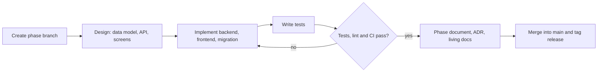

# Methodology and Mathematical Techniques

This chapter first describes how the system was developed — the process, the version-control workflow and the quality gates — and then explains, module by module, the mathematical, statistical and algorithmic techniques it uses. Each technique is presented with its formula, the reason it was chosen, and a worked example that the automated tests reproduce.

## Development methodology

### Incremental, phase-wise development

The system was built incrementally in fourteen phases (Table 3.7). Each phase delivered one complete, usable capability — from the database through the API to the user interface — on top of the previous phases, rather than building all databases first and all screens last. This approach was chosen for three reasons:

1. **Early feedback.** Every phase ended with working software that could be run and examined, so problems in requirements or design surfaced early.
2. **Controlled risk.** The most uncertain parts (market data quality, model accuracy, the behaviour of the language model) were tackled in their own phases, after the foundations were stable, and could be evaluated in isolation.
3. **Documentation as a by-product.** Each phase produced a phase document describing what was added to the frontend, backend and database and how they connect, plus an architecture decision record (ADR) for each significant choice. Eighteen ADRs record the options considered and the reasons for each decision.

### Version control and the definition of done

All work was kept in a Git repository hosted on GitHub. Each phase was developed on its own branch (`phase-NN-name`). A phase was considered **done** only when all of the following held:

1. The feature worked end to end in the browser.
2. New code was covered by automated tests, and the whole test suite passed.
3. The linters (ruff for Python, oxlint for TypeScript) and the formatter reported no problems.
4. The continuous-integration pipeline on GitHub Actions passed on the branch.
5. The phase document, the ADR and the living documents (architecture, database dictionary, API list, changelog) were updated.
6. The branch was merged into `main` with a merge commit and given an annotated version tag.

Figure: Workflow followed in every phase

### Continuous integration

Every push to GitHub runs three jobs:

- **Backend:** install dependencies from the lock file, lint and check formatting, apply all database migrations to a fresh PostgreSQL with pgvector, and run the test suite with branch coverage, failing below 90%.
- **Frontend:** install, lint, run the component tests and build the production bundle.
- **End-to-end:** start PostgreSQL, the API and the web server together and drive a real Chromium browser through the main user flows.

The deployment service deploys only commits whose checks have passed. In total 606 backend tests, 71 frontend tests and 7 end-to-end flows run on every change (Chapter 8).

### Layered design for testability

The backend separates HTTP handling (routes), business logic (services) and data access (models). The mathematical core — the financial formulas, the simulation engine, the retirement model, the machine-learning feature code and the portfolio ledger — is written as pure functions with no database or network access. This is what allows each technique in the rest of this chapter to be tested directly against hand-calculated values, independently of the rest of the system, and to be reused unchanged by the web pages, the PDF report and the assistant's tools.

## Risk profiling

<!-- include: docs/phases/02-risk-profile.md sections="Key logic explained" level=2 heading="none" -->

## Goal planning: time value of money

<!-- include: docs/phases/03-goals.md sections="Key logic explained" level=2 heading="none" -->

## Fund performance metrics

<!-- include: docs/phases/04-market-data.md sections="Key logic explained" level=2 heading="none" drop="Extract and transform: parsing AMFI's file|Load: idempotent upserts in bulk|The job runner and `job_runs`|Data quality: gaps, duplicates, and an inconsistency in official data" -->

## Monte Carlo simulation

<!-- include: docs/phases/05-simulation.md sections="Key logic explained" level=2 heading="none" drop="Vectorisation (timing)" -->

## Retirement planning

<!-- include: docs/phases/06-retirement.md sections="Key logic explained" level=2 heading="none" -->

## Machine learning: fund ranking, clustering and inflation forecasting

<!-- include: docs/phases/07-ml.md sections="Key logic explained" level=2 heading="none" drop="Data and the unit-change fix" -->

## Asset allocation and fund recommendation

<!-- include: docs/phases/08-recommendations.md sections="Key logic explained" level=2 heading="none" -->

## Portfolio accounting: XIRR, FIFO and goal status

<!-- include: docs/phases/09-portfolio.md sections="Key logic explained" level=2 heading="none" drop="Consistency under concurrency" -->

## Conversational assistant: tool calling and retrieval

<!-- include: docs/phases/10-chatbot.md sections="Key logic explained" level=2 heading="none" drop="Streaming|Consistency with the portfolio|Example conversation (real Gemini, demo account)" -->

## Summary of techniques

Table: Mathematical and computational techniques used, by module

| Module | Technique | Purpose |
| --- | --- | --- |
| Risk profile | Weighted scoring, minimum of willingness and capacity | Transparent risk category |
| Goals | Compound interest, effective monthly rate, annuity due, growing annuity, Fisher real return | Inflated target, projection, required SIP |
| Fund metrics | CAGR, rolling returns, annualised volatility, Sharpe and Sortino ratios, maximum drawdown | Risk and return of each fund |
| Simulation | Monte Carlo with normal, circular block bootstrap, GARCH(1,1) and two-state HMM returns; quantiles | Probability of success; SIP for a chosen certainty |
| Retirement | Present value of a growing annuity; lifetime simulation in closed form; withdrawal-rate analysis | Corpus needed; chance the money lasts |
| ML | LightGBM multiclass ranking, tree SHAP, K-Means with silhouette, Gaussian mixture with BIC, SARIMA with AIC; walk-forward validation, paired t test | Fund rankings with reasons; clusters; inflation outlook |
| Recommendations | Glide path rules; mean-variance optimisation by SLSQP with an analytic gradient; efficient frontier | Allocation per goal; fund choice |
| Portfolio | XIRR by Newton–Raphson with bisection fallback; FIFO lot accounting; advisory locks | Returns of irregular cash flows; consistent holdings |
| Assistant | Function calling; vector embeddings; cosine similarity search with an HNSW index; numeric grounding check | Answers grounded in calculations and sources |
