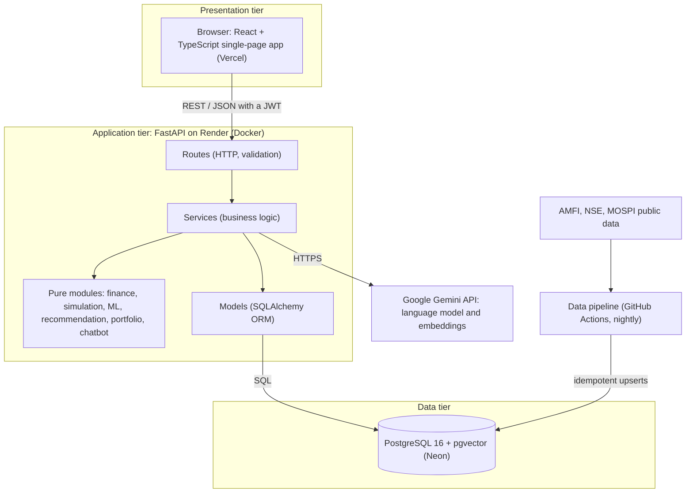
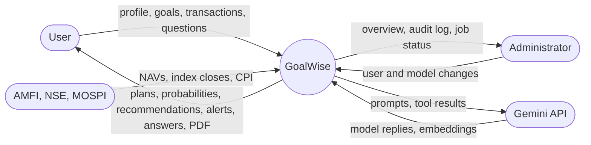
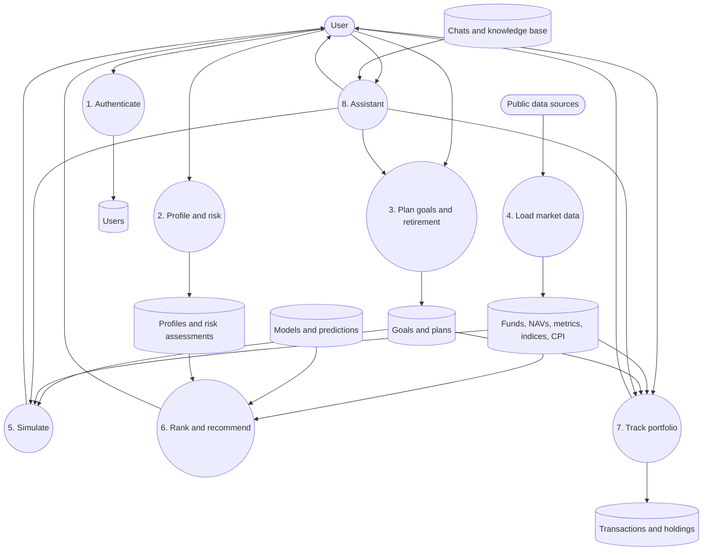
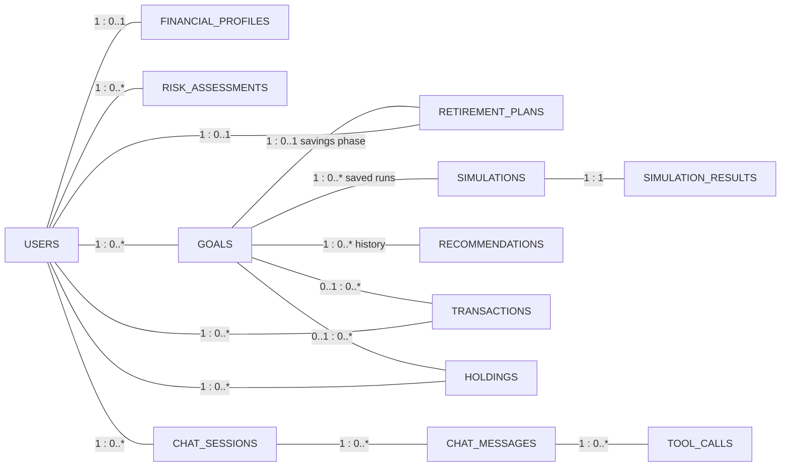
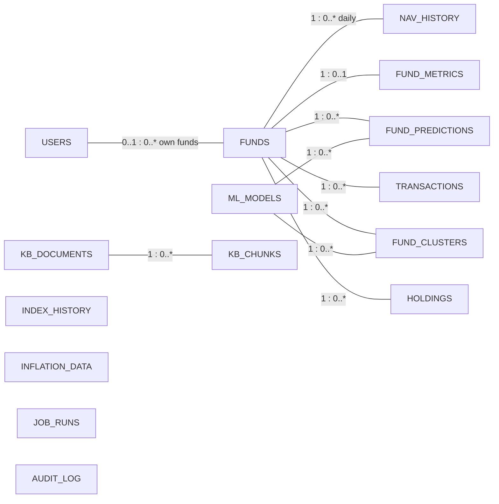

# System Design

This chapter describes the design of GoalWise at several levels: the overall architecture and how its parts communicate, the flow of data through the system, the structure of the database, the interface offered by the API, the security design and the design of the user interface.

## Architectural overview

GoalWise is a three-tier web application. The **presentation tier** is a single-page application written in React and TypeScript that runs in the user's browser. The **application tier** is a REST API written in Python with FastAPI. The **data tier** is a PostgreSQL 16 database with the pgvector extension, which stores both the relational data and the vector embeddings used by the assistant. A data pipeline loads market data into the database on a schedule, and the assistant calls an external language-model service.

Figure: Deployed architecture of GoalWise

The design follows three principles.

1. **One source of every number.** All calculations live in backend modules. The web pages, the PDF report and the assistant's tools call the same functions, so a figure shown on a page, printed in the PDF and quoted by the assistant is always the same.
2. **Pure core, thin edges.** The financial, statistical and machine-learning code is written as pure functions with no database or HTTP access. Services load data, call the pure functions and store results; routes only translate between HTTP and services. This makes the core testable against hand calculations and reusable.
3. **Stateless API.** Each request carries a signed token identifying the user; the server keeps no session. This makes the API simple to scale and to deploy on a free hosting plan that may restart at any time.

### Request flow and module interactions

The following diagrams, maintained throughout the project, show how each major module is organised and how a request travels through it.

<!-- include: docs/architecture.md sections="Overview" level=3 heading="none" drop="Testing and evaluation (Phase 12)|Deployment (Phase 13)" -->

## Software layers

<!-- include: docs/architecture.md sections="Backend layering" level=3 heading="none" -->

<!-- include: docs/architecture.md sections="Frontend structure" level=3 heading="none" -->

## Data flow diagrams

The context diagram (level 0) shows GoalWise as a single process exchanging data with its external entities. The level-1 diagram opens the process into its main sub-processes and data stores.

Figure: Context diagram (DFD level 0)

Figure: Level-1 data flow diagram

The assistant (process 8) does not have its own copy of any calculation: it reaches the goal, simulation and portfolio processes through the same service functions as the pages.

## Database design

The database has 25 tables, created and changed only through versioned Alembic migrations (14 in all). Each migration has an upgrade and a downgrade, and the test suite downgrades the schema to empty and upgrades it again before every run, which proves every migration can be undone and re-applied.

### Entity–relationship diagrams

The schema has two parts. **User data** — profiles, goals, plans, portfolios and conversations — belongs to a user and is deleted with the account. **Reference data** — funds, prices, metrics, models and the knowledge base — is shared by all users and filled by the data pipeline and the training jobs. The diagrams show the entities and their relationships; the attributes of every table are listed in the data dictionary in Appendix D.

Figure: Entity–relationship diagram of the user data (cardinalities on the lines)

Figure: Entity–relationship diagram of the reference data and its links to user data

`INDEX_HISTORY`, `INFLATION_DATA`, `JOB_RUNS` and `AUDIT_LOG` stand alone: they are read by date or by name rather than joined. The audit log deliberately has no foreign key to `USERS`, so its records survive the deletion of the account they describe.

### Design decisions

- **Normalisation.** The schema is in third normal form for user data: each fact is stored once (a user's profile in `financial_profiles`, each goal in `goals`, each transaction in `transactions`) and referenced by foreign keys.
- **Controlled redundancy where it pays.** Two derived values are stored on purpose: the latest NAV on each fund (so the fund list does not scan 2.5 million NAV rows) and the `holdings` table (rebuilt from transactions inside the same database transaction as every change, so reading a portfolio does not replay every lot). Both are kept consistent by the code that writes them, and tests compare them with a full recomputation.
- **History instead of overwrite.** Risk assessments, recommendations, saved simulations, model versions and the audit log keep every row, so earlier results can be explained later.
- **Constraints in the database.** CHECK constraints (positive amounts, valid categories, roles), unique constraints and partial unique indexes (one active model version per model name; one running job per job name) enforce rules that the application relies on, even if the application has a bug.
- **Append-only audit log.** A database trigger rejects updates and deletes on `audit_log`.
- **JSONB for variable structures.** Simulation bands, model parameters, SHAP factors and recommendation inputs vary in shape and are always read as a whole, so they are stored as JSONB; values that are filtered or sorted on are real columns.

Table: Tables of the database by area

| Area | Tables | Purpose |
| --- | --- | --- |
| Accounts and profile | users, financial_profiles, risk_assessments | Identity, finances, risk history |
| Goals and planning | goals, retirement_plans, simulations, simulation_results | Goal inputs, retirement plan, saved simulation runs |
| Market data | funds, nav_history, fund_metrics, index_history, inflation_data, job_runs | Fund master, daily NAVs, metrics, indices, CPI, pipeline log |
| Machine learning | ml_models, fund_predictions, fund_clusters | Model registry, rankings, clusters |
| Recommendations | recommendations | Allocation snapshots per goal |
| Portfolio | transactions, holdings | Source of truth and materialised positions |
| Assistant | chat_sessions, chat_messages, tool_calls, kb_documents, kb_chunks | Conversations, tool audit trail, knowledge base with embeddings |
| Administration | audit_log, alembic_version | Append-only log of key actions; migration version |

The complete data dictionary — every column of every table with its type, constraints and meaning — is given in Appendix D.

### Migration history

<!-- include: docs/database.md sections="Migration history" level=3 heading="none" -->

## API design

The API follows REST conventions: resources are nouns under `/api`, HTTP methods express the action, request and response bodies are JSON validated by Pydantic models, and errors use standard status codes. FastAPI generates an interactive OpenAPI specification from the code, available at `/docs` on the running server.

<!-- include: docs/api.md sections="preamble|Status codes used" level=3 heading="none" -->

## Security design

<!-- include: docs/phases/01-auth.md sections="Key logic explained" level=3 heading="none" -->

### Authorisation and data isolation

Every protected route depends on a function that verifies the token and loads the active user from the database. Every query on user data filters by that user's id, so one user can never read or change another's profile, goals, transactions or conversations; tests check that such requests return "not found". Administrator routes additionally check the role stored in the database on every request, so revoking a role takes effect at once. Changing the password or the security question requires the current password. Funds a user adds by hand are visible only to that user.

### Protection of the assistant

The assistant's system prompt limits it to the user's financial planning, instructs it to use tools for every number and to refuse requests outside its scope, and treats text inside tool results and retrieved articles as data rather than instructions. Questions are limited to 2,000 characters and 30 per hour per user. A goal is saved only after the user confirms a preview, which is enforced in code rather than trusted to the model. No names, e-mail addresses or identifiers are sent to the model provider.

## User interface design

The interface is a responsive single-page application. A top menu gives access to the Dashboard, Profile, Risk, Goals, Portfolio, Retirement, Explore (funds), Insights (models) and Assistant pages, plus Admin for administrators and an Account page under the user's name. The dashboard guides a new user through five steps — financial profile, risk profile, goals, retirement plan and investments — and shows alerts that link to the page that resolves them.

Design choices that recur throughout the interface:

- **Forms validate as the user types**, using the same rules as the API, so most errors are caught before a request; amounts show Indian digit grouping (25,00,000) as they are typed.
- **Results are stated in words as well as numbers**, for example "8 in 10 futures end between ₹51.94 L and ₹1.40 Cr".
- **Charts are drawn as SVG** in the browser: fan charts for simulations, survival curves for retirement, an efficient frontier for recommendations, a value-against-plan chart for portfolio goals.
- **Sliders have typed equivalents**, so an exact value can be entered.
- **A waking-up screen with a countdown** explains the delay when the free server has been idle.

Screenshots of each page are presented with the implementation in Chapter 7.
