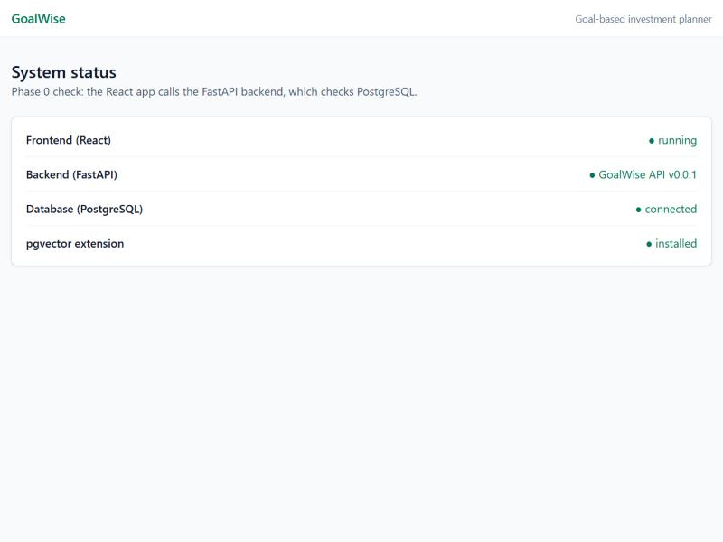
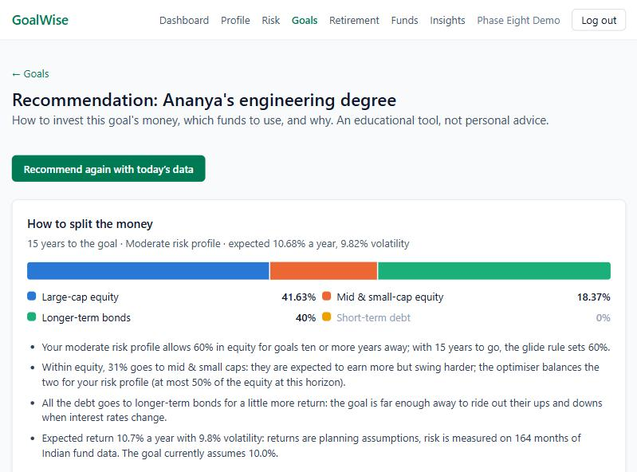
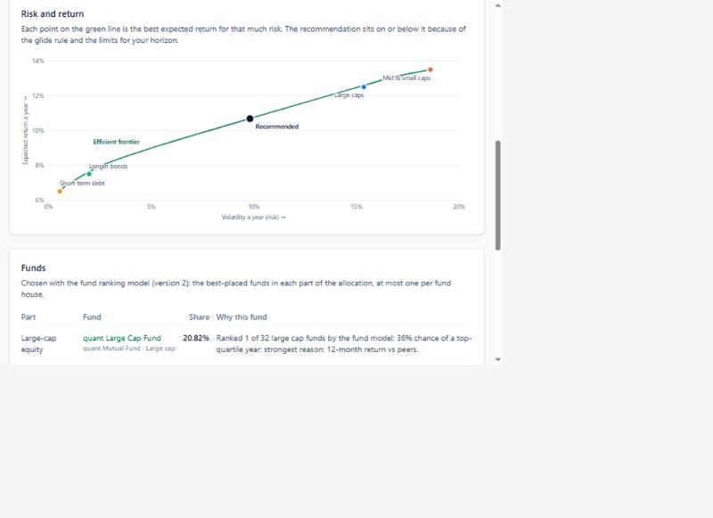
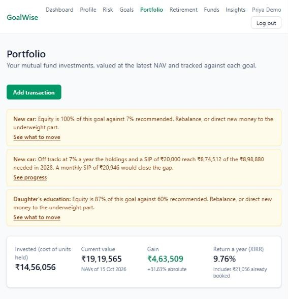
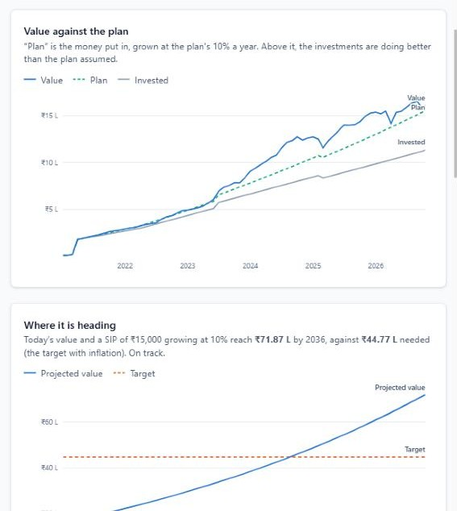

# Implementation

This chapter describes how each module of GoalWise was implemented, in the order in which the modules were built. For every module it summarises what the user can do, lists the backend and frontend components that were added and how a request flows through them, records the problems met during implementation and how they were solved, and shows the resulting screens. The algorithms behind the modules are explained in Chapter 5 and the database tables in Chapter 6 and Appendix D, so they are not repeated here.

The backend is organised as `routes → services → models`, with pure computational packages (`finance`, `simulation`, `ml`, `recommendation`, `portfolio`, `chatbot`) alongside. The frontend is organised into `api` (typed API client functions), `hooks` (data fetching and caching with TanStack Query), `components` (reusable pieces such as forms and charts) and `pages` (one component per route).

## Project setup and foundations

<!-- include: docs/phases/00-setup.md sections="Summary" level=3 heading="none" -->

<!-- include: docs/phases/00-setup.md sections="What was added" level=3 heading="none" drop="Big picture|Database|Backend|Frontend|Repository and tooling files" -->

## Authentication

<!-- include: docs/phases/01-auth.md sections="Summary" level=3 heading="none" -->

<!-- include: docs/phases/01-auth.md sections="What was added" level=3 heading="none" drop="Big picture|Database|Backend|Frontend" -->

<!-- include: docs/phases/01-auth.md sections="Problems faced and how they were solved" level=3 title="Problems faced and solutions" -->

|  |  |
| --- | --- |

Figure: Sign-up form with client-side validation (left) and a failed login (right)

## Financial profile and risk profiling

<!-- include: docs/phases/02-risk-profile.md sections="Summary" level=3 heading="none" -->

<!-- include: docs/phases/02-risk-profile.md sections="What was added" level=3 heading="none" drop="Big picture|Database|Backend|Frontend" -->

<!-- include: docs/phases/02-risk-profile.md sections="Problems faced and how they were solved" level=3 title="Problems faced and solutions" -->

|  |  |
| --- | --- |
|  |  |

Figure: Financial profile, risk questionnaire, risk result and the capacity score breakdown

## Goal planning

<!-- include: docs/phases/03-goals.md sections="Summary" level=3 heading="none" -->

<!-- include: docs/phases/03-goals.md sections="What was added" level=3 heading="none" drop="Big picture|Database|Backend|Frontend" -->

<!-- include: docs/phases/03-goals.md sections="Problems faced and how they were solved" level=3 title="Problems faced and solutions" -->

|  |  |
| --- | --- |

Figure: Goals page with projections (left) and the goal form with a live plan (right)

## Market data pipeline and fund explorer

<!-- include: docs/phases/04-market-data.md sections="Summary" level=3 heading="none" -->

<!-- include: docs/phases/04-market-data.md sections="What was added" level=3 heading="none" drop="Big picture|Database|Backend|Frontend" -->

<!-- include: docs/phases/04-market-data.md sections="Problems faced and how they were solved" level=3 title="Problems faced and solutions" -->

|  |  |
| --- | --- |

Figure: Fund explorer (left) and a fund's page with its NAV against the Nifty 50 (right)

## Monte Carlo simulation

<!-- include: docs/phases/05-simulation.md sections="Summary" level=3 heading="none" -->

<!-- include: docs/phases/05-simulation.md sections="What was added" level=3 heading="none" drop="Big picture|Database|Backend|Frontend" -->

<!-- include: docs/phases/05-simulation.md sections="Problems faced and how they were solved" level=3 title="Problems faced and solutions" -->

|  |  |
| --- | --- |

Figure: Goal simulation with fan chart and what-if controls (left) and the comparison of the four return models (right)

## Retirement planner

<!-- include: docs/phases/06-retirement.md sections="Summary" level=3 heading="none" -->

<!-- include: docs/phases/06-retirement.md sections="What was added" level=3 heading="none" drop="Big picture|Database|Backend|Frontend" -->

<!-- include: docs/phases/06-retirement.md sections="Problems faced and how they were solved" level=3 title="Problems faced and solutions" -->

|  |  |
| --- | --- |

Figure: Retirement plan with the chance the money lasts (left) and the lifetime fan and survival charts (right)

## Machine-learning fund intelligence

<!-- include: docs/phases/07-ml.md sections="Summary" level=3 heading="none" -->

<!-- include: docs/phases/07-ml.md sections="What was added" level=3 heading="none" drop="Big picture|Database|Backend|Frontend" -->

<!-- include: docs/phases/07-ml.md sections="Problems faced and how they were solved" level=3 title="Problems faced and solutions" -->

|  |  |
| --- | --- |
|  |  |

Figure: Fund rankings with SHAP reasons, behaviour clusters, the inflation forecast and a fund's model card

## Recommendations

<!-- include: docs/phases/08-recommendations.md sections="Summary" level=3 heading="none" -->

<!-- include: docs/phases/08-recommendations.md sections="What was added" level=3 heading="none" drop="Big picture|Database|Backend|Frontend" -->

<!-- include: docs/phases/08-recommendations.md sections="Problems faced and how they were solved" level=3 title="Problems faced and solutions" -->

|  |  |
| --- | --- |

Figure: Recommended allocation with reasons (left) and the efficient frontier (right)

## Portfolio tracker

<!-- include: docs/phases/09-portfolio.md sections="Summary" level=3 heading="none" -->

<!-- include: docs/phases/09-portfolio.md sections="What was added" level=3 heading="none" drop="Big picture|Database|Backend|Frontend" -->

<!-- include: docs/phases/09-portfolio.md sections="Problems faced and how they were solved" level=3 title="Problems faced and solutions" -->

### Enhancements after user feedback (version 1.1)

After the first users tried the deployed system, the portfolio gained three features:

- **The user's own NAV.** A purchase or redemption can carry the NAV printed on the user's statement. Without it, the system looks up the NAV of that day as before. This allows any historic transaction to be recorded, including in funds whose full history is not loaded.
- **Funds not in the list.** A user can add a fund by name and type. It is stored as a fund row owned by that user, without a scheme code, so it is invisible to everyone else and to the explorer, metrics, models and recommendations. Its transactions need their NAV, and its holdings are valued at cost because no market price exists.
- **Editing transactions.** A transaction can be corrected in place. The old and new positions are rebuilt in one database transaction under the user's lock, and a correction that would leave a later redemption without units is rejected with nothing changed.

Every rupee input also gained Indian digit grouping as the user types (25,00,000), and the simulation's what-if sliders gained boxes for typing exact values.

|  |  |
| --- | --- |

Figure: Portfolio overview with alerts and goal cards (left) and a goal's progress against its plan (right)

## Conversational assistant

<!-- include: docs/phases/10-chatbot.md sections="Summary" level=3 heading="none" -->

<!-- include: docs/phases/10-chatbot.md sections="What was added" level=3 heading="none" drop="Big picture|Database|Backend|Frontend" -->

<!-- include: docs/phases/10-chatbot.md sections="Problems faced and how they were solved" level=3 title="Problems faced and solutions" -->

|  |  |
| --- | --- |

Figure: The assistant's start page (left) and an answer with tool chips and a chart (right)

## Reports, administration and the audit log

<!-- include: docs/phases/11-reports-admin.md sections="Summary" level=3 heading="none" -->

<!-- include: docs/phases/11-reports-admin.md sections="What was added" level=3 heading="none" drop="Big picture|Database|Backend|Frontend" -->

<!-- include: docs/phases/11-reports-admin.md sections="Problems faced and how they were solved" level=3 title="Problems faced and solutions" -->

|  |  |
| --- | --- |

Figure: First page of the PDF plan (left) and the administrator's overview (right)

## Account management (version 1.2)

The final release added an account page and a way to recover a forgotten password without e-mail.

- **Account page.** Opened by clicking the user's name, it shows the e-mail address (the login, which cannot be changed) and the date the account was created, and lets the user change their name, change their password and set or change a security question. Changing the password or the question requires the current password.
- **Forgotten password.** The login page links to a two-step reset: the user enters their e-mail and is shown their security question, then answers it and chooses a new password. Answers are stored as Argon2 hashes of the normalised text (lower case, spaces collapsed). An address without an account receives a stable stand-in question, so the page cannot be used to discover which addresses are registered. Five wrong answers for an address within an hour lock its resets for the rest of the hour; the attempts are counted from the audit log. New users choose their question at sign-up.
- **Waking-up countdown.** When the free server has been idle, the first visit shows a 60-second countdown and a progress bar while the server starts, instead of an unexplained wait.

These changes added migration 0014 (two columns on `users`), six API endpoints and six backend tests, and are recorded in ADR-018.
